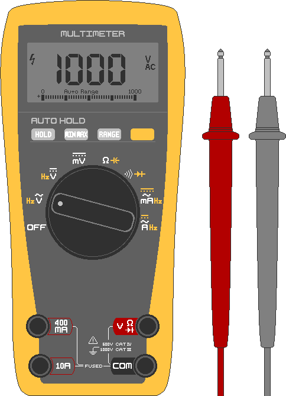

## 2. Измерения и безопасность
&nbsp;&nbsp;&nbsp;Большинство аварий в солнечных системах происходит из-за того, что ① прикасаются, не проверив напряжение, ② замыкают аккумулятор накоротко или ③ используют слишком тонкие провода. Даже если установку нужно сделать срочно, обязательно прочитайте эту главу, прежде чем устанавливать.

---
### 2-1. Мультиметр
#### 2-1-1. Устройство
&nbsp;&nbsp;&nbsp;Прибор, который показывает напряжение, ток и состояние соединения в виде чисел, — обязательная вещь для работы с солнечными системами. Достаточно недорогой цифровой модели.

- Переключатель: поворотный переключатель выбора измеряемой величины. ⎓ (прямая линия) — постоянный ток (DC), ∿ (волна) — переменный ток (AC). Для солнечных панелей и аккумуляторов ставьте DC (⎓).
- Чёрный щуп: щуп «−», всегда подключаемый к гнезду **COM**.
- Красный щуп: щуп «+», обычно вставляемый в гнездо **VΩmA**. В гнездо **10A** его вставляют только при измерении большого тока.

#### 2-1-2. Измерение напряжения
1. Включите питание измеряемого устройства.
2. Поставьте переключатель на V⎓ (напряжение DC). На моделях с ручным выбором диапазона задайте диапазон больше измеряемого значения (для 12 В — диапазон 20 В).
3. Приложите красный щуп к полюсу (+), чёрный — к полюсу (−).
4. Считайте показанное число.

&nbsp;&nbsp;&nbsp;Применение в солнечной энергетике:

- Остаточный заряд аккумулятора: по мере разряда напряжение снижается. Свинцово-кислотный аккумулятор на 12 В при зарядке поднимается примерно до 14,4 В, а если отсоединить зарядное устройство и оставить в покое, при полном заряде показывает около 12,7 В. Аккумулятор на 24 В при полном заряде — около 25,4 В.
- Напряжение панели: если измерить «+/−» панели на солнце, покажется напряжение холостого хода (Voc). Сравните с таблицей характеристик производителя.
- Полярность: если перед числом появился знак «−», красный (+) и чёрный (−) щупы приложены наоборот.

#### 2-1-3. Проверка целостности цепи
1. Выключите питание измеряемого устройства. Измерение при включённом питании может повредить устройство.
2. Поставьте переключатель на •)) (звуковая прозвонка).
3. Приложите красный щуп к точке 1, чёрный — к точке 2.
4. Если цепь соединена, раздастся «пи-и-ип».

&nbsp;&nbsp;&nbsp;Применяется для проверки, в частности, короткого замыкания.

- Предохранитель: приложите к обоим концам; если звук есть — он исправен, если нет — перегорел.
- Провод: приложите к обоим концам; если звук есть — провод цел, если нет — оборван.
- Короткое замыкание: приложите к концам проводов «+» и «−», которые должны быть разделены; если звук есть — они где-то соприкасаются.

#### 2-1-4. Измерение сопротивления (Ом)
1. Выключите питание измеряемого устройства. Измерение при включённом питании может повредить мультиметр.
2. Поставьте переключатель на Ω (сопротивление).
3. Приложите красный щуп к полюсу (+), чёрный — к полюсу (−).
4. Считайте показанное число.

#### 2-1-5. Измерение тока (А)
&nbsp;&nbsp;&nbsp;Ток измеряется иначе, поэтому здесь нужна наибольшая осторожность. Нужно разорвать цепь и включить мультиметр в разрыв последовательно, чтобы электричество проходило через мультиметр. Если приложить щупы к двум концам, как при измерении напряжения, аккумулятор замкнётся накоротко, возникнут сильная искра и ожоги. Обязательно измеряйте, добавив нагрузку (резистор) перед точкой полюса (−).

> **Внимание:** Гнездо 10A мультиметра внутри представляет собой проводник с сопротивлением, близким к 0 Ом. Если подключить его прямо к аккумулятору большой ёмкости класса 100 А·ч, хлынут сотни ампер, и мультиметр может взорваться или вызвать ожоги. Новичкам не следует измерять ток напрямую. Токи заряда и разряда проверяйте по дисплею солнечного контроллера (CC) или инвертора.

&nbsp;&nbsp;&nbsp;Если измерение неизбежно, порядок такой:

1. Выключите питание измеряемого устройства. Подключение при включённом питании приводит к поломке мультиметра, короткому замыканию и искрам.
2. Поставьте переключатель на A⎓ (ток).
3. Переставьте красный щуп в гнездо **10A**, чтобы снизить риск перегорания внутреннего предохранителя.
4. Приложите красный щуп к полюсу (+), чёрный — к полюсу (−), соединённому с нагрузкой (резистором).
5. Считайте показанное число, измеряйте лишь кратко и затем разорвите соединение.

---
### 2-2. Сечения проводов
&nbsp;&nbsp;&nbsp;Ток, который провод может пропустить, определяется площадью сечения меди (толщиной). В Корее обычно указывают SQ (= мм²), в американской системе — AWG (чем меньше число, тем толще).

| Толщина провода | Близкий AWG | Допустимый ток | Участок использования (пример) |
|---|---|---|---|
| 1,5 мм² | 16 AWG | около 15 А | Панель-контроллер |
| 2,5 мм² | 14 AWG | около 20 А | Панель-контроллер |
| 4 мм² | 12 AWG | около 28 А | Панель-контроллер-аккумулятор |
| 6 мм² | 10 AWG | около 36 А | Контроллер-аккумулятор |
| 10 мм² | 8 AWG | около 50 А | Контроллер-большой аккумулятор |
| 16 мм² | 6 AWG | около 65 А | Аккумулятор-инвертор (класс 1000 Вт) |
| 25 мм² | 4 AWG | около 85 А | Аккумулятор-инвертор (1500 Вт и выше) |

- Приведённые значения — ориентировочные. Реальный допустимый ток зависит от типа оболочки, температуры окружающей среды и того, связаны ли несколько жил в пучок.
- Всегда выбирайте с запасом (потолще). Чем длиннее провод и выше температура, тем сильнее падает напряжение, поэтому берите потолще. Если сомневаетесь, выберите на ступень толще.
- Провод, соединяющий аккумулятор и инвертор, должен быть самым толстым.
- Если пропускать большой ток по тонкому проводу, сам провод работает как сопротивление и выделяет тепло (P = I² × R). Это тепло плавит оболочку, и из-за короткого замыкания возникает пожар.

---
### 2-3. Предохранители и автоматы
&nbsp;&nbsp;&nbsp;Это детали, которые сами перегорают при превышении заданного тока и размыкают цепь. Предохранитель защищает, жертвуя собой раньше, чем провода и приборы сгорят от перегрузки по току или короткого замыкания, а автомат — это устройство, которое после срабатывания можно снова включить (сбросить).

- Номинал: выбирают немного больше обычного рабочего тока и меньше допустимого тока провода. Если обычно идёт 20 А, а провод выдерживает до 28 А, подходит предохранитель на 25 А. При включении инвертора мгновенно идёт большой ток, поэтому для инвертора берут предохранитель примерно на 1,5 номинального тока.
- Только для DC: постоянный ток трудно прервать, поэтому нужны специальные изделия. Обязательно проверьте, что изделие предназначено для DC.
- Место: устанавливают на проводе «+» аккумулятора как можно ближе к аккумулятору, чтобы защитить весь провод за ним. Порядок: аккумулятор (+) → предохранитель → контроллер/нагрузка.

---
### 2-4. Поражение током, короткое замыкание, пожар
&nbsp;&nbsp;&nbsp;Пожар возникает из-за слишком тонких проводов, ослабленных клемм, ободранной изоляции проводов и контакта полюсов «+» и «−». Предотвращают это провода подходящей толщины, предохранители/автоматы и надёжные соединения.

#### 2-4-1. Поражение электрическим током
&nbsp;&nbsp;&nbsp;Человеку вредит не само напряжение, а ток (мА), проходящий через тело. Даже при том же напряжении сопротивление мокрого тела сильно падает (закон Ома), и течёт больший ток. Сухая кожа имеет очень высокое сопротивление, поэтому низкие напряжения постоянного тока порядка 12-24 В обычно не пропускают опасный ток. Однако через мокрые руки, раны, язык, глаза он может стать опасным, поэтому во время работы категорически избегайте влаги.

| Ток через тело (для переменного тока) | Ощущение/результат |
|---|---|
| около 1 мА | Покалывание |
| около 5-10 мА | Сильная боль, дрожь мышц |
| около 10-20 мА | Мышцы сводит, отпустить невозможно (очень опасно) |
| около 50 мА и более | Затруднённое дыхание |
| около 100 мА и более | Угроза остановки сердца (смертельно) |

#### 2-4-2. Короткое замыкание и ожоги
&nbsp;&nbsp;&nbsp;В системе на 24 В короткие замыкания, ожоги и пожары случаются гораздо чаще, чем поражение током. Даже при низком напряжении аккумулятор может мгновенно выдать сотни ампер. Если металл — инструмент, кольцо, цепочка — одновременно коснётся полюсов «+» и «−», он раскалится докрасна, что приведёт к тяжёлым ожогам, сварочным искрам, повреждению аккумулятора и взрыву. Перед работой снимите кольца, часы и металлические браслеты, пользуйтесь инструментом с изолированными рукоятками и не роняйте металл возле клемм аккумулятора.

&nbsp;&nbsp;&nbsp;Если через инвертор использовать 220 В AC, на выходной стороне возникает та же опасность поражения током, что и у бытовой розетки. То же относится к случаю, когда несколько панелей соединены последовательно и напряжение выросло (100 В и более).

#### 2-4-3. Дуга
&nbsp;&nbsp;&nbsp;У переменного тока (AC) несколько десятков раз в секунду ток проходит через нуль, поэтому при размыкании выключателя искра (дуга) гаснет сама. Постоянный ток (DC) течёт в одном направлении непрерывно, и однажды возникшая искра гаснет плохо. Выключатели, предохранители и автоматы обязательно берите с номиналом для DC (включая класс напряжения). Если использовать изделие для AC на DC, дуга не гаснет, детали плавятся или возникает пожар.

#### 2-4-4. Правила безопасности при работе
- Работайте, отключив питание (автомат в положении OFF, клеммы отсоединены).
- Прежде чем работать, лично убедитесь по мультиметру, что напряжение равно 0.
- Работайте в сухой обстановке сухими руками. Не работайте в дождь и на мокром полу.
- Снимите металлические украшения, пользуйтесь изолирующими перчатками и инструментом с изолированными рукоятками.
- Работайте одной рукой. Если другую руку держать в кармане, снижается риск того, что ток пройдёт через грудь.
- Дважды проверьте полярность (+/−), прежде чем подключать.
- Затягивайте клеммы крепко, чтобы они не ослабли.

#### 2-4-5. Действия при несчастном случае
1. Отключите питание. Пока оно не отключено, не прикасайтесь к пострадавшему.
2. Если питание отключить нельзя, отделите пострадавшего от электричества изолятором — сухой деревянной палкой или резиновыми перчатками. Не вытаскивайте поражённого током голыми руками.
3. Если нет дыхания или пульса, немедленно начинайте сердечно-лёгочную реанимацию, а когда привезут АНД (AED), используйте его. Вызовите скорую помощь.
4. Не заливайте электрический пожар водой. По возможности отключите питание и затем гасите углекислотным (CO₂) или порошковым (ABC) огнетушителем. Если тушение затруднено или пожар распространяется и опасен, приоритет — эвакуация и сообщение, а не тушение.

---
### 2-5. Безопасность при обращении с аккумуляторами
&nbsp;&nbsp;&nbsp;Аккумулятор — место системы, где сосредоточено больше всего энергии, поэтому он может стать главным источником опасности. Опасности зависят от типа, поэтому заранее выясните тип имеющегося у вас аккумулятора.

#### 2-5-1. Опасности по типам
- Свинцово-кислотные/AGM (аккумуляторы автомобильного типа)
  - При зарядке выделяется взрывоопасный водород, поэтому заряжайте в проветриваемом месте.
  - Внутри находится едкий раствор серной кислоты. Искры и сигареты запрещены. При утечке защитите глаза и кожу, нейтрализуйте пищевой содой и только потом убирайте.
  - Они тяжёлые, поэтому остерегайтесь травм спины и ног.
- Литий-железо-фосфатные (LiFePO₄)
  - Относительно безопаснее других литиевых типов, и в большинстве встроена защитная схема (BMS), предотвращающая перезаряд, переразряд и короткое замыкание, но не теряйте бдительности.
  - Обязательно заряжайте специальным зарядным устройством и BMS (Battery Management System, система управления аккумулятором) именно для этого аккумулятора.
  - При перезаряде, проколе и высокой температуре возможны нагрев и возгорание (тепловой разгон), поэтому берегите от ударов и жары.
  - Если он вздулся, нагрелся или появился странный запах, немедленно прекратите использование и уберите подальше от горючих материалов.

#### 2-5-2. Общие правила
- Не соединяйте клеммы «+» и «−» металлом.
- Перед работой с клеммами снимите кольца, часы и металлические украшения, пользуйтесь изолированным инструментом.
- Установите предохранитель/автомат вблизи провода «+» аккумулятора для защиты от короткого замыкания и перегрузки по току.
- Не храните под прямым солнцем, при высокой температуре (например, в машине) и рядом с горючими материалами.
- Не роняйте и не сминайте (особенно литиевые).
- Не соединяйте аккумуляторы разных типов и напряжений.

#### 2-5-3. Действия при пожаре аккумулятора
&nbsp;&nbsp;&nbsp;Пожар аккумулятора — это и электрический, и опасный пожар, поэтому эвакуация и сообщение могут оказаться важнее настойчивой попытки потушить.

1. По возможности отключите питание и соединения и уберите аккумулятор от горючих материалов.
2. Пожар литиевого аккумулятора не гасится обычным огнетушителем или небольшим количеством воды, а неумелое заливание водой грозит взрывом. Используйте песок или специальный огнетушитель класса D. Если их нет, не пытайтесь тушить через силу: немедленно эвакуируйтесь и сообщите о пожаре.

&nbsp;&nbsp;&nbsp;Большинство аварий с аккумуляторами предотвращается запретом короткого замыкания, запретом перезаряда (используйте подходящий контроллер), избеганием жары и ударов и удалением от горючих материалов.