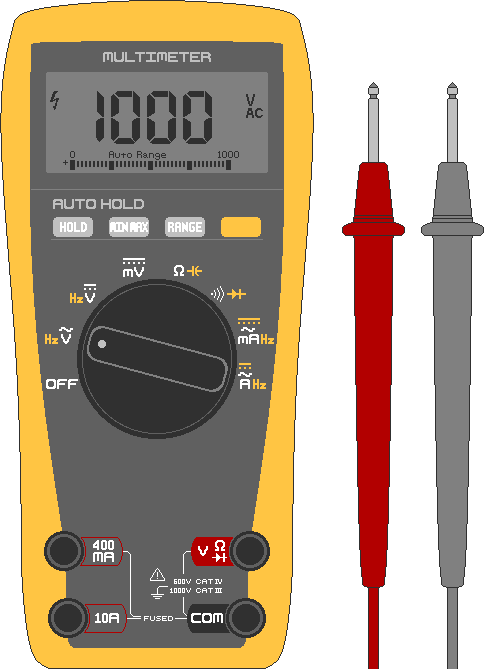

## 2. Measurement and Safety
&nbsp;&nbsp;&nbsp;Most solar system accidents come from ① touching something without checking the voltage, ② short-circuiting a battery, or ③ using wire that is too thin. Even if installation is urgent, read this chapter before you install.

---
### 2-1. Multimeter
#### 2-1-1. Parts
&nbsp;&nbsp;&nbsp;A tool that shows voltage, current, and connection status as numbers, and an essential for solar work. An inexpensive digital one is enough.

- Dial: the rotary switch for choosing what to measure. ⎓ (straight line) is direct current (DC), and ∿ (wave) is alternating current (AC). Set it to DC (⎓) for solar and batteries.
- Black probe: the − probe, always connected to the **COM** terminal.
- Red probe: the + probe, usually plugged into the **VΩmA** terminal. Plug it into the **10A** terminal only when measuring large current.

#### 2-1-2. Measuring Voltage
1. Turn on the power of the device to be measured.
2. Set the dial to V⎓ (DC voltage). For manual-range models, set a range larger than the reading (20V range for 12V).
3. Touch the red probe to the (+) pole and the black probe to the (−) pole.
4. Read the displayed number.

&nbsp;&nbsp;&nbsp;The uses in solar are as follows.

- Battery charge: voltage falls as it discharges. A 12V lead-acid battery rises to about 14.4V while charging, and with the charger disconnected and left to rest it is about 12.7V when fully charged. A 24V battery is about 25.4V when fully charged.
- Panel voltage: measuring the panel +/− in sunlight shows the open-circuit voltage (Voc). Compare it with the manufacturer's spec sheet.
- Polarity: if a − appears before the number, the red (+) and black (−) probes are reversed.

#### 2-1-3. Checking Continuity
1. Turn off the power of the device to be measured. Measuring with it on can damage the device.
2. Set the dial to •)) (continuity beep).
3. Touch the red probe to point 1 and the black probe to point 2.
4. If connected, it makes a "beep" sound.

&nbsp;&nbsp;&nbsp;It is used for checking things like short circuits.

- Fuse: touch both ends; if it beeps it is good, and if not it has blown.
- Wire: touch both ends; if it beeps it is continuous, and if not it is broken.
- Short circuit: touch the ends of a + wire and − wire that should be apart; if it beeps, they are touching somewhere.

#### 2-1-4. Measuring Resistance (Ω)
1. Turn off the power of the device to be measured. Measuring with it on can damage the multimeter.
2. Set the dial to Ω (resistance).
3. Touch the red probe to the (+) pole and the black probe to the (−) pole.
4. Read the displayed number.

#### 2-1-5. Measuring Current (A)
&nbsp;&nbsp;&nbsp;Current is measured differently and requires the most care. You must break the circuit and insert the multimeter in series between so that the electricity passes through the multimeter. If you touch the probes across the ends as when measuring voltage, the battery is short-circuited, causing a large spark and burns. Always measure with a load (resistance) device added before the (−) pole point.

> **Caution:** The multimeter's 10A terminal is, internally, a wire with resistance close to 0Ω. Connecting it directly to a high-capacity battery in the 100Ah class lets hundreds of amps pour out, which can make the multimeter explode or cause burns. Beginners should not measure current directly. Check charge and discharge current on the display of the solar controller (CC) or inverter.

&nbsp;&nbsp;&nbsp;When measurement is unavoidable, the procedure is as follows.

1. Turn off the power of the device to be measured. Connecting with it on causes multimeter failure, short circuits, and sparks.
2. Set the dial to A⎓ (current).
3. Move the red probe to the **10A** terminal to reduce the risk of blowing the internal fuse.
4. Touch the red probe to the (+) pole and the black probe to the (−) pole connected to the load (resistance).
5. Read the displayed number, measure only briefly, and then disconnect.

---
### 2-2. Wire Gauge
&nbsp;&nbsp;&nbsp;The current a wire can carry is set by its copper cross-sectional area (thickness). In Korea it is usually written in SQ (= mm²), and in the US in AWG (the smaller the number, the thicker).

| Wire thickness | Similar AWG | Allowable current | Section of use (example) |
|---|---|---|---|
| 1.5 mm² | 16 AWG | about 15A | Panel-controller |
| 2.5 mm² | 14 AWG | about 20A | Panel-controller |
| 4 mm² | 12 AWG | about 28A | Panel-controller-battery |
| 6 mm² | 10 AWG | about 36A | Controller-battery |
| 10 mm² | 8 AWG | about 50A | Controller-large battery |
| 16 mm² | 6 AWG | about 65A | Battery-inverter (1,000W class) |
| 25 mm² | 4 AWG | about 85A | Battery-inverter (1,500W or more) |

- The values above are rough references. The actual allowable current varies with the type of sheath, ambient temperature, and whether several wires are bundled.
- Always choose generously (thick). The longer the wire and the higher the temperature, the more the voltage drops, so use thicker wire. When in doubt, choose one size thicker.
- The wire connecting the battery and inverter must be the thickest.
- If a large current is passed through thin wire, the wire itself acts as a resistance and produces heat (P = I² × R). This heat melts the sheath and a short circuit causes a fire.

---
### 2-3. Fuses and Breakers
&nbsp;&nbsp;&nbsp;These are components that blow by themselves when a set current is exceeded, breaking the circuit. A fuse sacrifices itself first to protect wires and devices before they burn from overcurrent or a short, and a breaker is one that can be raised again (reset) after tripping.

- Rating: choose slightly above the normal operating current and below the wire's allowable current. If 20A normally flows and the wire withstands up to 28A, a 25A fuse is appropriate. An inverter draws a large instantaneous current at switch-on, so use a fuse of about 1.5 times its rated current.
- DC only: DC is hard to interrupt, so dedicated products are required. Always check that it is for DC.
- Location: fit it on the battery's + wire as close to the battery as possible to protect the entire wire behind it. The order is battery (+) → fuse → controller/load.

---
### 2-4. Electric Shock, Short Circuits, Fire
&nbsp;&nbsp;&nbsp;Fires start from wire that is too thin, loose terminals, stripped wire sheath, and contact between the + and − poles. Wire of proper thickness, fuses/breakers, and firm connections prevent them.

#### 2-4-1. Electric Shock
&nbsp;&nbsp;&nbsp;What injures a person is not the voltage itself but the current (mA) passing through the body. Even at the same voltage, a wet body has far lower resistance (Ohm's law) and a larger current flows. Dry skin has very high resistance, so low DC voltages of 12-24V usually cannot drive a dangerous current. However, it can become dangerous through wet hands, wounds, the tongue, and eyes, so avoid moisture at all costs while working.

| Current through the body (AC basis) | Sensation/result |
|---|---|
| about 1mA | Tingling feeling |
| about 5-10mA | Severe pain, muscles tremble |
| about 10-20mA | Muscles lock and you cannot let go (very dangerous) |
| about 50mA or more | Difficulty breathing |
| about 100mA or more | Risk of cardiac arrest (fatal) |

#### 2-4-2. Short Circuits and Burns
&nbsp;&nbsp;&nbsp;In a 24V system, short circuits, burns, and fires are far more common than electric shock. Even at low voltage, a battery can instantly discharge hundreds of amps. If metal such as a tool, ring, or necklace touches the + and − poles at the same time, the metal glows red-hot, leading to severe burns, welding-like sparks, battery damage, and explosion. Before work, take off rings, watches, and metal bracelets, use insulated-handle tools, and do not drop metal near the battery terminals.

&nbsp;&nbsp;&nbsp;If you use 220V AC through an inverter, the output side carries the same shock risk as a household outlet. The same goes for when many panels are tied in series and the voltage has risen (100V or more).

#### 2-4-3. Arcs
&nbsp;&nbsp;&nbsp;With alternating current (AC), the current drops to zero dozens of times a second, so a spark (arc) goes out by itself when a switch is opened. Direct current (DC) keeps flowing in one direction, so a spark, once made, does not go out easily. Always use switches, fuses, and breakers with a DC rating (including voltage class). If an AC-rated one is used on DC, the arc does not go out and the parts melt or a fire starts.

#### 2-4-4. Work Safety Rules
- Cut the power (breaker OFF, terminals disconnected) before working.
- Confirm directly with the multimeter that the voltage is 0 before working.
- Work in a dry environment with dry hands. Do not work in rain or on a wet floor.
- Remove metal jewelry and use insulated gloves and insulated-handle tools.
- Work with one hand. Keeping the other hand in your pocket lowers the risk of current flowing across your chest.
- Check polarity (+/−) twice before connecting.
- Tighten terminals firmly, not loosely.

#### 2-4-5. Responding to Accidents
1. Cut the power. Do not touch the victim before it is cut.
2. If the power cannot be turned off, separate the victim from the electricity with an insulator such as a dry wooden stick or rubber gloves. Do not pull a shock victim away with bare hands.
3. If there is no breathing or pulse, perform CPR immediately, and use an AED when it arrives. Call emergency services.
4. Do not spray water on an electrical fire. If possible, cut the power and then put it out with a CO₂ or ABC powder extinguisher. If putting it out is difficult or the fire is spreading and dangerous, evacuate and report instead of fighting it.

---
### 2-5. Battery Handling Safety
&nbsp;&nbsp;&nbsp;The battery is where the most energy is concentrated in the system, so it can be the biggest hazard. The hazards differ by type, so check the type of battery you have.

#### 2-5-1. Hazards by Type
- Lead-acid/AGM (car-battery type)
  - Explosive hydrogen gas is released while charging, so charge in a ventilated place.
  - There is corrosive sulfuric acid solution inside. No sparks or cigarettes. If it leaks, protect your eyes and skin, neutralize with baking soda, and then deal with it.
  - It is heavy, so watch for back and foot injuries.
- Lithium iron phosphate (LiFePO₄)
  - Relatively safer than other lithium types, and most have a built-in protection circuit (BMS) against overcharge, overdischarge, and short circuits, but do not let your guard down.
  - Always charge with the charger and BMS (Battery Management System) dedicated to that battery.
  - Overcharge, penetration, and high temperatures can cause heating and fire (thermal runaway), so beware of impact and heat.
  - If it swells, gets hot, or smells strange, stop use at once and move it away from combustibles.

#### 2-5-2. Common Rules
- Do not connect the + and − terminals with metal.
- Before working on terminals, remove rings, watches, and metal jewelry and use insulated tools.
- Fit a fuse/breaker near the battery's + wire to guard against short circuits and overcurrent.
- Do not store in direct sunlight, high heat (such as inside a car), or near combustibles.
- Do not drop or crush (especially lithium).
- Do not connect batteries of different types or voltages together.

#### 2-5-3. Responding to Battery Fires
&nbsp;&nbsp;&nbsp;A battery fire is both an electrical fire and a hazardous fire, so evacuating and reporting may take priority over forcing yourself to put it out.

1. If possible, cut the power and connections and move it away from combustibles.
2. A lithium battery fire is not put out by an ordinary extinguisher or a small amount of water, and spraying water carelessly risks an explosion. Use sand or a dedicated Class D extinguisher. If you have none, do not try to put it out; evacuate at once and report.

&nbsp;&nbsp;&nbsp;Most battery accidents are prevented by no short circuits, no overcharging (use the right controller), avoiding heat and impact, and keeping away from combustibles.