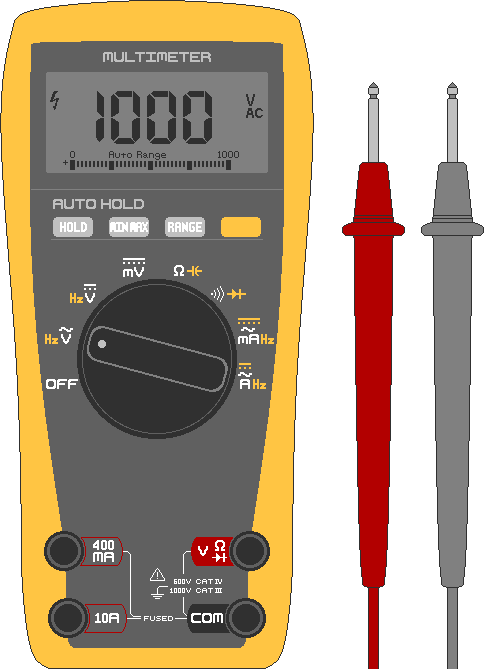

## 2. 測定と安全
&nbsp;&nbsp;&nbsp;太陽光システムの事故の大半は、①電圧を確認せずに触る、②バッテリーを短絡させる、③細すぎる電線を使う、のいずれかから起こります。設置を急ぐ場合でも、この章は必ず読んでから設置します。

---
### 2-1. テスター(マルチメーター)
#### 2-1-1. 構成
&nbsp;&nbsp;&nbsp;電圧・電流・接続状態を数字で見せる道具で、太陽光の作業に欠かせません。手頃な価格のデジタル製品で十分です。

- ダイヤル: 測定対象を選ぶ回転スイッチ。⎓(直線)は直流(DC)、∿(波線)は交流(AC)です。太陽光とバッテリーはDC(⎓)に合わせます。
- 黒いテストリード: 常に**COM**端子につなぐ−極のリード。
- 赤いテストリード: 通常は**VΩmA**端子に差す+極のリード。大きな電流を測るときだけ**10A**端子に差します。

#### 2-1-2. 電圧を測る
1. 測定対象の機器の電源を入れます。
2. ダイヤルをV⎓(DC電圧)に合わせます。手動レンジの製品は、測定値より大きい範囲に設定します(12Vなら20Vレンジ)。
3. 赤いリードを(+)極に、黒いリードを(−)極に当てます。
4. 表示された数字を読み取ります。

&nbsp;&nbsp;&nbsp;太陽光での用途は次のとおりです。

- バッテリー残量: 放電するほど電圧が低くなります。12Vの鉛蓄電池は充電中に約14.4Vまで上がり、充電器を外して置いておくと、満充電の状態で約12.7Vです。24Vのバッテリーは満充電時に約25.4Vです。
- パネル電圧: 日光の下でパネルの+/−を測ると、開放電圧(Voc)が表示されます。メーカーの仕様表と比べます。
- 極性: 数字の前に−が出たら、赤(+)と黒(−)のリードを逆に当てています。

#### 2-1-3. 導通の確認
1. 測定対象の機器の電源を切ります。入れたまま測ると、機器が損傷することがあります。
2. ダイヤルを•))(導通音)に合わせます。
3. 赤いリードを地点1に、黒いリードを地点2に当てます。
4. つながっていれば「ピー」と音が鳴ります。

&nbsp;&nbsp;&nbsp;短絡(ショート)の有無などを確認するときに使います。

- ヒューズ: 両端に当てて音が鳴れば生きており、鳴らなければ切れています。
- 電線: 両端に当てて音が鳴ればつながっており、鳴らなければ断線しています。
- 短絡: 離れているはずの+線と−線の先端に当てて音が鳴れば、どこかでくっついています。

#### 2-1-4. 抵抗(Ω)を測る
1. 測定対象の機器の電源を切ります。入れたまま測ると、テスターが損傷することがあります。
2. ダイヤルをΩ(抵抗)に合わせます。
3. 赤いリードを(+)極に、黒いリードを(−)極に当てます。
4. 表示された数字を読み取ります。

#### 2-1-5. 電流(A)を測る
&nbsp;&nbsp;&nbsp;電流は測定方法が異なるため、最も注意が必要です。回路を切り、その間にテスターを直列に挟んで、電気がテスターを通るようにしなければなりません。電圧を測るように両端にリードを当てると、バッテリーが短絡して大きな火花ややけどが生じます。必ず(−)極の地点の手前に負荷(抵抗)装置を追加して測定します。

> **注意:** テスターの10A端子は、内部抵抗が0Ωに近い導線の状態です。100Ahクラスの大容量バッテリーにそのままつなぐと数百Aが流れ出し、テスターが爆発したりやけどを負ったりすることがあります。初心者は電流を直接測定しません。充電・放電電流は、太陽光コントローラー(CC)やインバーターの表示で確認します。

&nbsp;&nbsp;&nbsp;測定が避けられないときの手順は次のとおりです。

1. 測定対象の機器の電源を切ります。入れたままつなぐと、テスターの故障、短絡、火花の原因になります。
2. ダイヤルをA⎓(電流)に合わせます。
3. 赤いリードを**10A**端子に移し、内部ヒューズが切れる危険を減らします。
4. 赤いリードを(+)極に、黒いリードを負荷(抵抗)とつながった(−)極に当てます。
5. 表示された数字を読み取り、短時間だけ測定して、接続を外します。

---
### 2-2. 電線の規格
&nbsp;&nbsp;&nbsp;電線は、銅の断面積(太さ)によって流せる電流が決まります。韓国では通常SQ(=mm²)、米国式ではAWG(数字が小さいほど太い)で表記します。

| 電線の太さ | 近いAWG | 許容電流 | 使用区間(例) |
|---|---|---|---|
| 1.5 mm² | 16 AWG | 約15A | パネル-コントローラー |
| 2.5 mm² | 14 AWG | 約20A | パネル-コントローラー |
| 4 mm² | 12 AWG | 約28A | パネル-コントローラー-バッテリー |
| 6 mm² | 10 AWG | 約36A | コントローラー-バッテリー |
| 10 mm² | 8 AWG | 約50A | コントローラー-大型バッテリー |
| 16 mm² | 6 AWG | 約65A | バッテリー-インバーター(1,000Wクラス) |
| 25 mm² | 4 AWG | 約85A | バッテリー-インバーター(1,500W以上) |

- 上の値はおおよその参考値です。実際の許容電流は、被覆の種類、周囲の温度、何本かを束ねているかどうかによって変わります。
- 常に余裕を持って(太めに)選びます。電線が長いほど、温度が高いほど電圧がより下がるため、より太く使います。迷ったら1段太いものを選びます。
- バッテリーとインバーターをつなぐ電線が最も太くなければなりません。
- 細い電線に大きな電流を流すと、電線自体が抵抗として働いて熱(P = I² × R)が出ます。この熱が被覆を溶かし、短絡で火災が発生します。

---
### 2-3. ヒューズとブレーカー
&nbsp;&nbsp;&nbsp;定められた電流を超えるとひとりでに切れて回路を遮断する部品です。電線や機器が過電流・短絡で焼ける前に、先に犠牲になって守るのがヒューズで、切れた後に再び上げられる(リセットできる)のがブレーカーです。

- 容量: 通常の使用電流よりやや大きく、電線の許容電流より小さく決めます。普段20Aが流れ、電線が28Aまで耐えるなら、25Aのヒューズが適当です。インバーターは起動時に瞬間的に大きな電流が流れるため、定格電流の約1.5倍のヒューズを使います。
- DC専用: DCは電流を遮断しにくいため、専用の製品が必要です。必ずDC用かどうかを確認します。
- 位置: バッテリーの+線の、バッテリーにできるだけ近い場所に付け、その先の電線全体を保護します。バッテリー(+)→ヒューズ→コントローラー/負荷の順です。

---
### 2-4. 感電・短絡・火災
&nbsp;&nbsp;&nbsp;火災は、細すぎる電線、緩んだ端子、はがれた電線の被覆、+極と−極の接触から発生します。適切な太さの電線、ヒューズ/ブレーカー、しっかりした結線がこれを防ぎます。

#### 2-4-1. 感電
&nbsp;&nbsp;&nbsp;人が傷つくのは電圧そのものではなく、体を通る電流(mA)のためです。同じ電圧でも、濡れた体は抵抗が大きく下がり(オームの法則)、より大きな電流が流れます。乾いた皮膚は抵抗がきわめて高いため、12~24V程度の低いDC電圧では、通常は危険な電流が流れません。しかし、濡れた手、傷、舌、目などでは危険になることがあるため、作業中は水気を徹底して避けます。

| 体に流れる電流(交流基準) | 感じ方/結果 |
|---|---|
| 約1mA | ちくっとする感じ |
| 約5~10mA | 激しい痛み、筋肉が震える |
| 約10~20mA | 筋肉が硬直して手を離せない(非常に危険) |
| 約50mA以上 | 呼吸困難 |
| 約100mA以上 | 心停止の危険(致命的) |

#### 2-4-2. 短絡とやけど
&nbsp;&nbsp;&nbsp;24Vのシステムでは、感電より短絡(ショート)・やけど・火災のほうがはるかに多く起こります。バッテリーは電圧が低くても、瞬間的に数百Aを放出できます。工具・指輪・ネックレスのような金属が+極と−極に同時に触れると、金属が真っ赤に焼け、ひどいやけど、溶接のような火花、バッテリーの損傷、爆発につながります。作業前に指輪・腕時計・金属のブレスレットを外し、絶縁グリップの工具を使い、バッテリー端子の近くに金属を落とさないようにします。

&nbsp;&nbsp;&nbsp;インバーターで220V ACを使うと、出力側は家庭用コンセントと同じ感電の危険が生じます。パネルを何枚も直列にまとめて電圧が高くなった場合(100V以上)も同様です。

#### 2-4-3. アーク
&nbsp;&nbsp;&nbsp;交流(AC)は1秒に数十回電流が0になるので、スイッチを開くと火花(アーク)がひとりでに消えます。直流(DC)は一方向に流れ続けるため、一度できた火花はなかなか消えません。スイッチ・ヒューズ・ブレーカーは、必ずDC定格(電圧等級を含む)の製品を使います。AC用をDCに使うと、アークが消えずに部品が溶けたり火災が起きたりします。

#### 2-4-4. 作業の安全ルール
- 電源を切って(ブレーカーOFF、端子を外して)作業します。
- テスターで電圧が0であることを自分で確認してから作業します。
- 乾いた環境で、乾いた手で作業します。雨の日や濡れた床の上では作業しません。
- 金属の装身具を外し、絶縁手袋と絶縁グリップの工具を使います。
- 片手で作業します。もう一方の手をポケットに入れておくと、電流が胸を横切って流れる危険が下がります。
- 極性(+/−)を2回確認してからつなぎます。
- 端子は緩まないようにしっかり締めます。

#### 2-4-5. 事故への対処
1. 電源を遮断します。遮断する前は、患者に触れません。
2. 電源を切れない場合は、乾いた木の棒やゴム手袋などの絶縁体で、患者を電気から引き離します。感電した人を素手で引っ張り出してはいけません。
3. 呼吸や脈がなければ、ただちに心肺蘇生を行い、AEDが届いたら使用します。救急隊に通報します。
4. 電気火災には水をかけません。可能なら電源を遮断してから、CO₂・ABC粉末消火器で鎮火します。鎮火が難しい、または火災が広がって危険なときは、消火より避難と通報を優先します。

---
### 2-5. バッテリー取り扱いの安全
&nbsp;&nbsp;&nbsp;バッテリーは、システムの中でエネルギーが最も多く集まっている場所であり、最大の危険源になりえます。種類ごとに危険が異なるので、手持ちのバッテリーの種類を確認しておきます。

#### 2-5-1. 種類別の危険
- 鉛蓄電池/AGM(自動車用バッテリーなど)
  - 充電中に爆発しうる水素ガスが出るので、換気のよい場所で充電します。
  - 内部に腐食性の硫酸の溶液があります。火花とたばこは厳禁です。液漏れしたときは目と皮膚を保護し、重曹で中和してから処理します。
  - 重いので、腰や足のけがに注意します。
- リン酸鉄リチウム(LiFePO₄)
  - 他のリチウムの種類より相対的に安全で、大半は保護回路(BMS)が内蔵されていて過充電・過放電・短絡を防ぎますが、油断しません。
  - 必ずそのバッテリー専用の充電器とBMS(Battery Management System、バッテリー管理システム)で充電します。
  - 過充電・貫通・高温環境で発熱・火災(熱暴走)が起こることがあるので、衝撃と高温に注意します。
  - 膨らんだり、熱くなったり、異臭がしたりしたら、ただちに使用を中止し、可燃物から遠ざけます。

#### 2-5-2. 共通のルール
- +端子と−端子を金属でつなぎません。
- 端子の作業の前に、指輪・腕時計・金属の装身具を外し、絶縁工具を使います。
- ヒューズ/ブレーカーをバッテリーの+線の近くに付け、短絡・過電流に備えます。
- 直射日光、高温(車内など)、可燃物の近くに保管しません。
- 落としたり、つぶしたりしません(特にリチウム)。
- 種類や電圧が異なるバッテリーを混ぜてつながないでください。

#### 2-5-3. バッテリー火災への対処
&nbsp;&nbsp;&nbsp;バッテリー火災は電気火災であり危険な火災でもあるため、無理な消火より避難と通報が優先になることがあります。

1. 可能なら電源と接続を遮断し、可燃物から離します。
2. リチウムバッテリーの火災は、一般の消火器や少量の水では消えず、水をいい加減にかけると爆発の危険があります。砂か専用のD型消火器を使います。なければ無理に消そうとせず、ただちに避難してから通報します。

&nbsp;&nbsp;&nbsp;バッテリー事故は、短絡の禁止、過充電の禁止(合ったコントローラーを使う)、高温・衝撃の回避、可燃物との距離の確保で、大部分が予防できます。