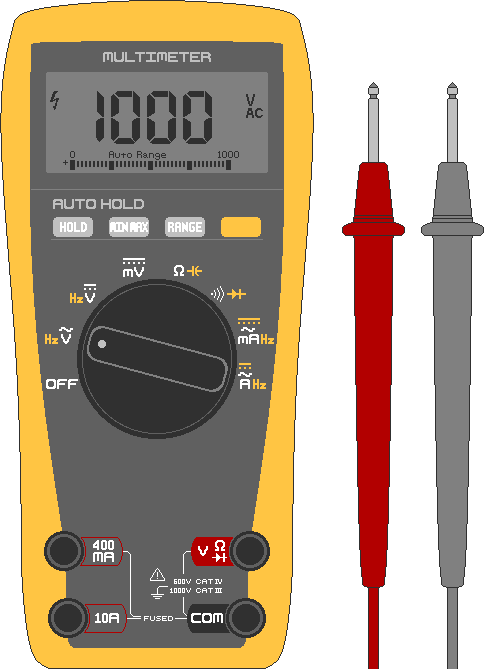

## 2. 측정과 안전
&nbsp;&nbsp;&nbsp;태양광 시스템 사고 대부분은 ① 전압을 확인하지 않고 만지거나 ② 배터리를 합선시키거나 ③ 너무 얇은 전선을 쓰는 데서 옵니다. 설치가 급해도 이 장은 반드시 읽고 설치합니다.

---
### 2-1. 멀티미터
#### 2-1-1. 구성
&nbsp;&nbsp;&nbsp;전압·전류·연결 상태를 숫자로 보여 주는 도구이며 태양광 작업의 필수품입니다. 만 원대 디지털 제품이면 충분합니다.

- 다이얼: 측정 대상을 고르는 회전 스위치. ⎓(직선)은 직류(DC), ∿(물결)은 교류(AC)입니다. 태양광·배터리는 DC(⎓)로 맞춥니다.
- 검정 막대: 항상 **COM** 단자에 연결하는 −극 막대.
- 빨강 막대: 보통 **VΩmA** 단자에 꽂는 +극 막대. 큰 전류를 잴 때만 **10A** 단자에 꽂습니다.

#### 2-1-2. 전압 재기
1. 측정 대상 기기의 전원을 켭니다.
2. 다이얼을 V⎓(DC 전압)에 놓습니다. 수동 제품은 측정값보다 큰 범위로 설정합니다(12V면 20V 범위).
3. 빨강 막대를 (+)극에, 검정 막대를 (−)극에 댑니다.
4. 표시된 숫자를 읽습니다.

&nbsp;&nbsp;&nbsp;태양광에서의 용도는 다음과 같습니다.

- 배터리 잔량: 방전될수록 전압이 낮아집니다. 12V 납산 배터리는 충전 중 약 14.4V까지 오르고, 충전기를 분리하고 두면 완충 상태에서 약 12.7V입니다. 24V 배터리는 완충 시 약 25.4V입니다.
- 패널 전압: 햇빛 아래에서 패널 +/−를 재면 개방전압(Voc)이 표시됩니다. 제조사 사양표와 비교합니다.
- 극성: 숫자 앞에 −가 뜨면 빨강(+)과 검정(−) 막대를 반대로 댄 것입니다.

#### 2-1-3. 연결 확인
1. 측정 대상 기기의 전원을 끕니다. 켜진 상태로 재면 기기가 손상될 수 있습니다.
2. 다이얼을 •))(연결음)에 놓습니다.
3. 빨강 막대를 지점 1에, 검정 막대를 지점 2에 댑니다.
4. 연결되어 있으면 "삐─" 소리가 납니다.

&nbsp;&nbsp;&nbsp;합선(단락) 여부 등을 확인할 때 씁니다.

- 퓨즈: 양 끝에 대어 소리가 나면 살아 있고, 안 나면 끊긴 것입니다.
- 전선: 양 끝에 대어 소리가 나면 이어져 있고, 안 나면 끊어진 것입니다.
- 합선: 떨어져 있어야 할 +선과 −선 끝에 대어 소리가 나면 어딘가 붙어 있는 것입니다.

#### 2-1-4. 저항(Ω) 재기
1. 측정 대상 기기의 전원을 끕니다. 켜진 상태로 재면 멀티미터가 손상될 수 있습니다.
2. 다이얼을 Ω(저항)에 놓습니다.
3. 빨강 막대를 (+)극에, 검정 막대를 (−)극에 댑니다.
4. 표시된 숫자를 읽습니다.

#### 2-1-5. 전류(A) 재기
&nbsp;&nbsp;&nbsp;전류는 측정 방식이 달라 가장 조심해야 합니다. 회로를 끊고 그 사이에 멀티미터를 직렬로 끼워 전기가 멀티미터를 통과하게 해야 합니다. 전압 재듯 양 끝에 막대를 대면 배터리가 합선되어 큰 불꽃과 화상이 납니다. 반드시 (−)극 지점 앞에 부하(저항) 장치를 추가해서 측정합니다.

> **주의:** 멀티미터의 10A 단자는 내부 저항이 0Ω에 가까운 도선 상태입니다. 100Ah급 고용량 배터리에 그대로 연결하면 수백 A가 쏟아져 멀티미터가 폭발하거나 화상을 입을 수 있습니다. 초보자는 전류를 직접 측정하지 않습니다. 충전·방전 전류는 태양광 컨트롤러(CC)나 인버터의 디스플레이로 확인합니다.

&nbsp;&nbsp;&nbsp;측정이 불가피할 때의 순서는 다음과 같습니다.

1. 측정 대상 기기의 전원을 끕니다. 켜진 상태로 연결하면 멀티미터 고장, 합선, 불꽃의 원인이 됩니다.
2. 다이얼을 A⎓(전류)에 놓습니다.
3. 빨강 막대를 **10A** 단자로 옮겨 내부 퓨즈가 끊길 위험을 줄입니다.
4. 빨강 막대를 (+)극에, 검정 막대를 부하(저항)와 연결된 (−)극에 댑니다.
5. 표시된 숫자를 읽고 짧게만 측정한 뒤 연결을 끊습니다.

---
### 2-2. 전선 규격
&nbsp;&nbsp;&nbsp;전선은 구리 단면적(굵기)에 따라 흘릴 수 있는 전류가 정해집니다. 우리나라는 보통 SQ(=mm²), 미국식은 AWG(숫자가 작을수록 굵음)로 표기합니다.

| 전선 굵기 | 비슷한 AWG | 허용 전류 | 사용 구간(예시) |
|---|---|---|---|
| 1.5 mm² | 16 AWG | 약 15A | 패널-컨트롤러 |
| 2.5 mm² | 14 AWG | 약 20A | 패널-컨트롤러 |
| 4 mm² | 12 AWG | 약 28A | 패널-컨트롤러-배터리 |
| 6 mm² | 10 AWG | 약 36A | 컨트롤러-배터리 |
| 10 mm² | 8 AWG | 약 50A | 컨트롤러-대형 배터리 |
| 16 mm² | 6 AWG | 약 65A | 배터리-인버터(1,000W급) |
| 25 mm² | 4 AWG | 약 85A | 배터리-인버터(1,500W 이상) |

- 위 값은 대략적인 참고치입니다. 실제 허용 전류는 피복 종류, 주변 온도, 여러 가닥 묶음 여부에 따라 달라집니다.
- 항상 넉넉하게(굵게) 고릅니다. 전선이 길수록, 온도가 높을수록 전압이 더 떨어지므로 더 굵게 씁니다. 헷갈리면 한 단계 굵은 것을 선택합니다.
- 배터리와 인버터를 잇는 전선이 가장 굵어야 합니다.
- 가는 전선에 큰 전류를 흘리면 전선 자체가 저항으로 작용해 열(P = I² × R)이 납니다. 이 열이 피복을 녹이고 합선으로 화재가 발생합니다.

---
### 2-3. 퓨즈와 차단기
&nbsp;&nbsp;&nbsp;정해진 전류를 넘으면 스스로 끊어져 회로를 차단하는 부품입니다. 전선과 기기가 과전류·합선으로 타기 전에 먼저 희생해 보호하는 것이 퓨즈이고, 끊긴 뒤 다시 올릴 수 있는(리셋) 것이 차단기입니다.

- 용량: 정상 사용 전류보다 약간 크고 전선 허용 전류보다 작게 정합니다. 평소 20A가 흐르고 전선이 28A까지 견디면 25A 퓨즈가 적당합니다. 인버터는 켤 때 순간적으로 큰 전류가 흐르므로 정격 전류의 약 1.5배 퓨즈를 씁니다.
- DC 전용: DC는 전류를 끊기 어려워 전용 제품이 필요합니다. 반드시 DC용인지 확인합니다.
- 위치: 배터리의 +선에서 배터리와 최대한 가까운 곳에 달아 그 뒤 전선 전체를 보호합니다. 배터리(+) → 퓨즈 → 컨트롤러/부하 순서입니다.

---
### 2-4. 감전·합선·화재
&nbsp;&nbsp;&nbsp;화재는 너무 가는 전선, 헐거운 단자, 벗겨진 전선 피복, +극과 −극의 접촉에서 발생합니다. 적정 굵기 전선, 퓨즈/차단기, 단단한 결선이 이를 막습니다.

#### 2-4-1. 감전
&nbsp;&nbsp;&nbsp;사람이 다치는 것은 전압 자체가 아니라 몸을 통과하는 전류(mA) 때문입니다. 같은 전압이라도 젖은 몸은 저항이 크게 낮아져(옴의 법칙) 더 큰 전류가 흐릅니다. 마른 피부는 저항이 매우 높아 12~24V 정도의 낮은 DC 전압은 보통 위험한 전류를 흘리지 못합니다. 그러나 젖은 손, 상처, 혀, 눈 등에서는 위험해질 수 있으므로 작업 중 물기를 무조건 피합니다.

| 몸에 흐르는 전류(교류 기준) | 느낌/결과 |
|---|---|
| 약 1mA | 따끔한 느낌 |
| 약 5~10mA | 심한 통증, 근육이 떨림 |
| 약 10~20mA | 근육이 굳어 손을 뗄 수 없음(매우 위험) |
| 약 50mA 이상 | 호흡 곤란 |
| 약 100mA 이상 | 심장 정지 위험(치명적) |

#### 2-4-2. 합선과 화상
&nbsp;&nbsp;&nbsp;24V 시스템에서는 감전보다 합선(단락)·화상·화재가 훨씬 흔합니다. 배터리는 전압이 낮아도 순간적으로 수백 A를 쏟아낼 수 있습니다. 공구·반지·목걸이 같은 금속이 +극과 −극에 동시에 닿으면 금속이 시뻘겋게 달아올라 심한 화상, 용접 같은 불꽃, 배터리 손상, 폭발로 이어집니다. 작업 전 반지·시계·금속 팔찌를 빼고, 절연 손잡이 공구를 쓰며, 배터리 단자 근처에 금속을 떨어뜨리지 않습니다.

&nbsp;&nbsp;&nbsp;인버터로 220V AC를 쓰면 출력 쪽은 가정용 콘센트와 같은 감전 위험이 생깁니다. 패널을 여러 장 직렬로 묶어 전압이 높아진 경우(100V 이상)도 마찬가지입니다.

#### 2-4-3. 아크
&nbsp;&nbsp;&nbsp;교류(AC)는 1초에 수십 번 전류가 0이 되어 스위치를 열면 불꽃(아크)이 저절로 꺼집니다. 직류(DC)는 계속 한 방향으로 흘러 한 번 생긴 불꽃이 잘 꺼지지 않습니다. 스위치·퓨즈·차단기는 반드시 DC 정격(전압 등급 포함) 제품을 씁니다. AC용을 DC에 쓰면 아크가 꺼지지 않아 부품이 녹거나 화재가 납니다.

#### 2-4-4. 작업 안전 수칙
- 전원을 끊고(차단기 OFF, 단자 분리) 작업합니다.
- 멀티미터로 전압이 0인지 직접 확인한 뒤 작업합니다.
- 마른 환경, 마른 손으로 작업합니다. 비 올 때와 젖은 바닥에서는 작업하지 않습니다.
- 금속 장신구를 제거하고 절연 장갑과 절연 손잡이 공구를 씁니다.
- 한 손으로 작업합니다. 다른 손을 주머니에 두면 전류가 가슴을 가로질러 흐를 위험이 낮아집니다.
- 극성(+/−)을 두 번 확인한 뒤 연결합니다.
- 단자를 헐겁지 않게 단단히 조입니다.

#### 2-4-5. 사고 대처
1. 전원을 차단합니다. 차단 전에는 환자와 접촉하지 않습니다.
2. 전원을 끌 수 없으면 마른 나무 막대기나 고무장갑 등 절연체로 환자를 전기에서 분리합니다. 감전자를 맨손으로 끌어내지 않습니다.
3. 호흡이나 맥박이 없으면 즉시 CPR을 하고, AED가 도착하면 사용합니다. 구급대에 신고합니다.
4. 전기 화재에는 물을 뿌리지 않습니다. 가능하면 전원을 차단한 뒤 CO₂·ABC 분말 소화기로 진압합니다. 진압이 어렵거나 화재가 확산되어 위험하면 진압보다 대피와 신고를 우선합니다.

---
### 2-5. 배터리 취급 안전
&nbsp;&nbsp;&nbsp;배터리는 시스템에서 에너지가 가장 많이 모인 곳이라 가장 큰 위험원이 될 수 있습니다. 종류마다 위험이 다르므로 소지한 배터리의 종류를 확인해 둡니다.

#### 2-5-1. 종류별 위험
- 납산/AGM(자동차 배터리류)
  - 충전 중 폭발 가능한 수소 가스가 나오므로 환기되는 곳에서 충전합니다.
  - 내부에 부식성 황산 용액이 있습니다. 불꽃·담배를 금지합니다. 누액 시 눈과 피부를 보호하고 베이킹소다로 중화한 뒤 처리합니다.
  - 무거우므로 허리·발 부상에 주의합니다.
- 리튬인산철(LiFePO₄)
  - 다른 리튬 종류보다 상대적으로 안전하고 대부분 보호회로(BMS)가 내장돼 과충전·과방전·합선을 막지만 방심하지 않습니다.
  - 반드시 해당 배터리 전용 충전기와 BMS(Battery Management System, 배터리 관리 시스템)로 충전합니다.
  - 과충전·관통·고온 환경에서 발열·화재(열폭주)가 날 수 있으므로 충격과 고온에 주의합니다.
  - 부풀거나 뜨겁거나 이상한 냄새가 나면 즉시 사용을 중단하고 가연물에서 멀리 떨어뜨립니다.

#### 2-5-2. 공통 수칙
- +단자와 −단자를 금속으로 잇지 않습니다.
- 단자 작업 전 반지·시계·금속 장신구를 제거하고 절연 공구를 사용합니다.
- 퓨즈/차단기를 배터리 +선 가까이에 달아 합선·과전류에 대비합니다.
- 직사광선, 고온(차 안 등), 가연물 근처에 보관하지 않습니다.
- 떨어뜨리거나 찌그러뜨리지 않습니다(특히 리튬).
- 종류·전압이 다른 배터리를 섞어 연결하지 않습니다.

#### 2-5-3. 배터리 화재 대처
&nbsp;&nbsp;&nbsp;배터리 화재는 전기 화재이자 위험 화재이므로 무리한 진압보다 대피와 신고가 우선일 수 있습니다.

1. 가능하면 전원·연결을 차단하고 가연물에서 떨어뜨립니다.
2. 리튬 배터리 화재는 일반 소화기나 소량의 물로 꺼지지 않으며, 물을 어설프게 뿌리면 폭발 위험이 있습니다. 모래나 전용 D형 소화기를 사용합니다. 없으면 무리하게 끄지 말고 즉시 대피한 뒤 신고합니다.

&nbsp;&nbsp;&nbsp;배터리 사고는 합선 금지, 과충전 금지(맞는 컨트롤러 사용), 고온·충격 회피, 가연물과 거리두기로 대부분 예방됩니다.