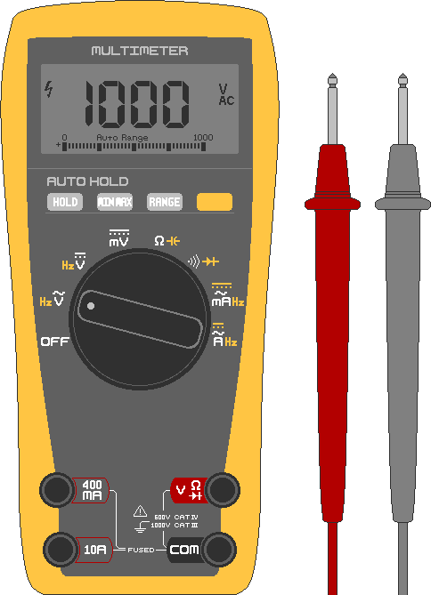

## 2. 测量与安全
&nbsp;&nbsp;&nbsp;太阳能系统的事故大多出在：①不确认电压就触碰，②使电池短路，③使用太细的电线。即使安装很急，也务必先读完这一章再安装。

---
### 2-1. 万用表
#### 2-1-1. 构成
&nbsp;&nbsp;&nbsp;以数字显示电压、电流和连接状态的工具，是太阳能作业的必备品。价格不高的数字式产品就足够了。

- 旋钮：选择测量对象的旋转开关。⎓（直线）是直流（DC），∿（波浪）是交流（AC）。太阳能和电池要拨到DC（⎓）。
- 黑表笔：始终接在**COM**端子上的−极表笔。
- 红表笔：通常插在**VΩmA**端子上的+极表笔。只有测大电流时才插到**10A**端子。

#### 2-1-2. 测电压
1. 打开被测设备的电源。
2. 把旋钮拨到V⎓（DC电压）。手动量程的型号要设为大于测量值的量程（12V就用20V量程）。
3. 红表笔接（+）极，黑表笔接（−）极。
4. 读取显示的数字。

&nbsp;&nbsp;&nbsp;在太阳能中的用途如下。

- 电池余量：放电越多电压越低。12V铅酸电池充电时升到约14.4V，断开充电器静置后，满电状态约为12.7V。24V电池满电时约为25.4V。
- 电池板电压：在阳光下测电池板的+/−，显示的是开路电压（Voc）。与厂家规格表对比。
- 极性：如果数字前面出现−，说明红（+）、黑（−）表笔接反了。

#### 2-1-3. 检查通断
1. 关闭被测设备的电源。开着电源测量可能损坏设备。
2. 把旋钮拨到•))（通断蜂鸣档）。
3. 红表笔接点1，黑表笔接点2。
4. 如果接通，会发出“嘀——”的声音。

&nbsp;&nbsp;&nbsp;用于检查是否短路等情况。

- 保险丝：两端接触，有声音说明是好的，没有声音就是断了。
- 电线：两端接触，有声音说明是通的，没有声音就是断的。
- 短路：接触本应分开的+线和−线的端头，有声音就说明在某处粘连了。

#### 2-1-4. 测电阻（Ω）
1. 关闭被测设备的电源。开着电源测量可能损坏万用表。
2. 把旋钮拨到Ω（电阻）。
3. 红表笔接（+）极，黑表笔接（−）极。
4. 读取显示的数字。

#### 2-1-5. 测电流（A）
&nbsp;&nbsp;&nbsp;电流的测量方式不同，最需要小心。必须断开电路，把万用表串联接在中间，让电通过万用表。如果像测电压那样把表笔搭在两端，电池就会短路，产生大火花并造成烧伤。务必在（−）极点之前增加一个负载（电阻）装置再测。

> **注意：** 万用表的10A端子内部是电阻接近0Ω的导线状态。直接连到100Ah级的大容量电池上，会涌出几百A的电流，万用表可能爆炸或造成烧伤。初学者不要直接测量电流。充放电电流通过太阳能控制器（CC）或逆变器的显示屏查看。

&nbsp;&nbsp;&nbsp;不得不测量时的步骤如下。

1. 关闭被测设备的电源。开着电源连接会导致万用表损坏、短路和火花。
2. 把旋钮拨到A⎓（电流）。
3. 把红表笔换到**10A**端子，降低内部保险丝烧断的风险。
4. 红表笔接（+）极，黑表笔接与负载（电阻）相连的（−）极。
5. 读取显示的数字，只短暂测量，然后断开连接。

---
### 2-2. 电线规格
&nbsp;&nbsp;&nbsp;电线能通过的电流由铜的截面积（粗细）决定。韩国通常用SQ（=mm²）标示，美国用AWG（数字越小越粗）标示。

| 线径 | 相近AWG | 允许电流 | 使用区段（示例） |
|---|---|---|---|
| 1.5 mm² | 16 AWG | 约15A | 电池板-控制器 |
| 2.5 mm² | 14 AWG | 约20A | 电池板-控制器 |
| 4 mm² | 12 AWG | 约28A | 电池板-控制器-电池 |
| 6 mm² | 10 AWG | 约36A | 控制器-电池 |
| 10 mm² | 8 AWG | 约50A | 控制器-大电池 |
| 16 mm² | 6 AWG | 约65A | 电池-逆变器（1,000W级） |
| 25 mm² | 4 AWG | 约85A | 电池-逆变器（1,500W以上） |

- 以上数值为大致参考。实际允许电流因外皮种类、环境温度、是否多根成束而异。
- 始终宽裕（选粗）。电线越长、温度越高，电压降得越多，所以要用更粗的。拿不准就选粗一档的。
- 连接电池和逆变器的电线必须最粗。
- 细电线通过大电流时，电线本身相当于电阻而发热（P = I² × R）。这些热会熔化外皮，因短路引发火灾。

---
### 2-3. 保险丝与断路器
&nbsp;&nbsp;&nbsp;超过规定电流时自行熔断、切断电路的部件。保险丝在电线和设备因过电流、短路烧坏之前先牺牲自己加以保护，断路器则是跳闸后可以重新合上（复位）的。

- 额定值：选比正常使用电流略大、比电线允许电流小的。平时通过20A、电线能承受28A，则25A的保险丝合适。逆变器启动时瞬间电流大，所以用额定电流约1.5倍的保险丝。
- DC专用：DC难以切断电流，需要专用产品。务必确认是DC用的。
- 位置：装在电池的+线上、尽可能靠近电池的地方，保护其后的整条电线。顺序是电池（+）→保险丝→控制器/负载。

---
### 2-4. 触电、短路、火灾
&nbsp;&nbsp;&nbsp;火灾源于过细的电线、松动的接线端、剥落的电线外皮，以及+极与−极接触。线径合适的电线、保险丝/断路器和牢固的接线可以预防这些。

#### 2-4-1. 触电
&nbsp;&nbsp;&nbsp;使人受伤的不是电压本身，而是通过身体的电流（mA）。即使电压相同，潮湿的身体电阻会大幅降低（欧姆定律），流过更大的电流。干燥的皮肤电阻很高，所以12-24V左右的低DC电压通常无法流过危险电流。但湿手、伤口、舌头、眼睛等处可能变得危险，所以作业中务必避开水分。

| 流过身体的电流（以交流计） | 感觉/结果 |
|---|---|
| 约1mA | 有刺痛感 |
| 约5-10mA | 剧痛，肌肉颤抖 |
| 约10-20mA | 肌肉僵硬无法松手（非常危险） |
| 约50mA以上 | 呼吸困难 |
| 约100mA以上 | 有心脏骤停的危险（致命） |

#### 2-4-2. 短路与烧伤
&nbsp;&nbsp;&nbsp;24V系统中，短路、烧伤和火灾远比触电常见。电池即使电压低，也能瞬间释放几百A。工具、戒指、项链之类的金属同时碰到+极和−极，金属会烧得通红，导致严重烧伤、焊接般的火花、电池损坏和爆炸。作业前要摘下戒指、手表和金属手镯，使用绝缘手柄的工具，不要让金属掉到电池端子附近。

&nbsp;&nbsp;&nbsp;通过逆变器使用220V AC时，输出侧会有与家用插座相同的触电危险。把多块电池板串联、电压升高的情况（100V以上）也一样。

#### 2-4-3. 电弧
&nbsp;&nbsp;&nbsp;交流（AC）每秒有几十次电流变为0，所以断开开关时火花（电弧）会自行熄灭。直流（DC）持续朝一个方向流动，一旦产生火花就不容易熄灭。开关、保险丝、断路器务必使用有DC额定值（包括电压等级）的产品。把AC用的用在DC上，电弧不会熄灭，零件会熔化或起火。

#### 2-4-4. 作业安全守则
- 切断电源（断路器OFF、断开端子）后再作业。
- 用万用表亲自确认电压为0后再作业。
- 在干燥的环境中用干燥的手作业。下雨时和湿地面上不作业。
- 摘掉金属饰品，使用绝缘手套和绝缘手柄工具。
- 单手作业。另一只手放在口袋里，可以降低电流横穿胸部的风险。
- 确认两次极性（+/−）后再连接。
- 把接线端拧紧，不要松。

#### 2-4-5. 事故处理
1. 切断电源。切断之前不要接触伤者。
2. 无法关闭电源时，用干木棍或橡胶手套等绝缘体把伤者与电分开。不要徒手把触电者拖出来。
3. 没有呼吸或脉搏时立即进行心肺复苏，AED到达后使用。报告急救部门。
4. 电气火灾不要泼水。可能的话先切断电源，再用CO₂或ABC干粉灭火器扑灭。扑灭困难或火势蔓延而危险时，优先撤离和报警，而不是灭火。

---
### 2-5. 电池操作安全
&nbsp;&nbsp;&nbsp;电池是系统中能量最集中的地方，可能成为最大的危险源。不同种类的危险不同，所以要弄清手头电池的种类。

#### 2-5-1. 各类电池的危险
- 铅酸/AGM（汽车电池类）
  - 充电时会产生可爆炸的氢气，所以要在通风的地方充电。
  - 内部有腐蚀性的硫酸溶液。禁止火花和香烟。漏液时要保护眼睛和皮肤，用小苏打中和后再处理。
  - 很重，注意腰部和脚部受伤。
- 磷酸铁锂（LiFePO₄）
  - 相对其他锂电池更安全，大多内置保护电路（BMS）防止过充、过放和短路，但不要大意。
  - 务必使用该电池专用的充电器和BMS（Battery Management System，电池管理系统）充电。
  - 过充、穿刺、高温环境下可能发热起火（热失控），所以注意冲击和高温。
  - 如果鼓包、发烫或有异味，立即停止使用，远离可燃物。

#### 2-5-2. 通用守则
- 不要用金属连接+端子和−端子。
- 操作端子前摘掉戒指、手表和金属饰品，使用绝缘工具。
- 在电池+线附近装保险丝/断路器，防范短路和过电流。
- 不要存放在阳光直射、高温（如车内）或可燃物附近。
- 不要摔落或压扁（尤其是锂电池）。
- 不要把种类、电压不同的电池混接。

#### 2-5-3. 电池火灾的处理
&nbsp;&nbsp;&nbsp;电池火灾既是电气火灾，也是危险火灾，所以撤离和报警可能比勉强扑灭更优先。

1. 可能的话切断电源和连接，把它移离可燃物。
2. 锂电池火灾用普通灭火器或少量的水扑不灭，随意泼水还有爆炸的危险。要使用沙子或专用的D类灭火器。没有的话不要勉强去灭，立即撤离后报警。

&nbsp;&nbsp;&nbsp;大多数电池事故可以通过禁止短路、禁止过充（使用合适的控制器）、避开高温和冲击、与可燃物保持距离来预防。