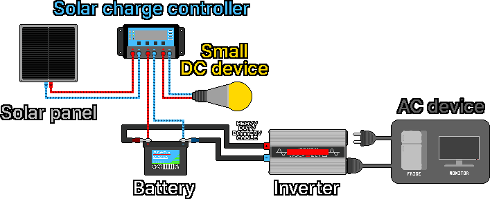
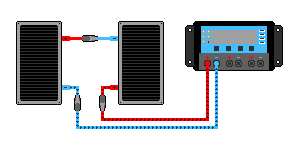
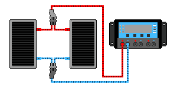
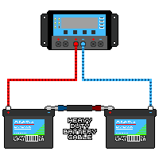
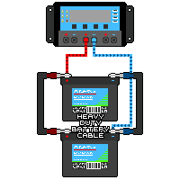

## 3. Солнечная система

1. Солнечная панель получает солнечный свет и вырабатывает электричество постоянного тока (DC).
2. Выработанное электричество поступает в солнечный контроллер заряда.
3. Контроллер регулирует электричество и подаёт его на аккумулятор и маломощные приборы постоянного тока (светодиоды, USB и т. п.).
4. Постоянный ток поступает в аккумулятор, и тот заряжается.
5. Толстыми соединительными кабелями для аккумуляторов (с кольцевыми наконечниками на болтах), специальными соединительными разъёмами и т. п. соединяют полюса (+) и (−) аккумулятора и инвертора друг с другом.
6. Постоянный ток, накопленный в аккумуляторе, по кабелям подаётся на инвертор.
7. Инвертор преобразует постоянный ток в переменный (AC).
8. Переменный ток подаётся на приборы переменного тока, подключённые к инвертору, — холодильник, монитор и т. п.

---
### 3-1. Солнечные панели
#### 3-1-1. Принцип работы
&nbsp;&nbsp;&nbsp;Фотоэффект, возникающий при попадании света на кремниевый полупроводник, преобразует энергию света в электрическую энергию. Панель состоит из множества солнечных элементов (Solar Cell), каждый элемент имеет структуру p-n-перехода, в которой соединены два полупроводниковых слоя с разными свойствами, и на границе образуется электрическое поле.

- Полупроводник n-типа: слой, богатый электронами, с (−) зарядом
- Полупроводник p-типа: слой, где не хватает электронов и много дырок ((+) заряд)

1. Когда приходят фотоны — частицы света, электроны, получившие энергию от атомов кремния, выбиваются и свободно движутся.
2. Электроны (−) собираются на стороне n-типа, дырки (+) — на стороне p-типа.
3. Разделённые заряды создают разность потенциалов (напряжение), и если подключить провод к электродам, электроны потекут по проводу, создавая ток.

| Тип панели | Особенности |
|---|---|
| Монокристаллическая (моно) | Делается нарезкой тонких пластин из одного огромного кристалла кремния. Однородное расположение атомов даёт высокий КПД. Внешний вид однородный, насыщенно-чёрный цвет |
| Поликристаллическая (поли) | Делается из расплава нескольких кремниевых кристаллов, залитого в квадратную форму. Кристаллы перемешаны случайно, поэтому КПД ниже, чем у моно, но она дешевле. Синяя, переливающаяся, как драгоценный камень. Летом при жаре КПД имеет тенденцию падать чуть сильнее, чем у моно |
| Тонкоплёночная | На стеклянную, пластиковую или металлическую подложку наносят фотоэлектрический материал слоем толщиной в микрометры (мкм). Поверхность гладкая, однородная, цвет насыщенно-чёрный или чёрно-коричневый. Срок службы короче и КПД ниже, чем у кристаллических, а КПД может быстро деградировать |

#### 3-1-2. Как читать паспортную табличку панели
&nbsp;&nbsp;&nbsp;Характеристики указаны на этикетке на обратной стороне панели. Если знать пять пунктов ниже, при установке не возникнет серьёзных трудностей.

| Обозначение | Название | Значение |
|---|---|---|
| Pmax (Wp) | Номинальная максимальная мощность | Максимальная мощность (Вт), которую панель может выдать в идеальных условиях |
| Vmp | Напряжение при максимальной мощности | Напряжение при реальной работе |
| Imp | Ток при максимальной мощности | Ток при реальной работе |
| Voc | Напряжение холостого хода | Наибольшее напряжение, когда ничего не подключено |
| Isc | Ток короткого замыкания | Наибольший ток, когда полюса «+» и «−» соединены напрямую |

&nbsp;&nbsp;&nbsp;Пример этикетки: Pmax 200 Вт / Vmp 18,0 В / Imp 11,1 А / Voc 22,0 В / Isc 11,8 А

&nbsp;&nbsp;&nbsp;Выполняется соотношение Pmax ≈ Vmp × Imp (18,0 × 11,1 ≈ 200 Вт). Voc и Isc — предельные значения, поэтому при выборе контроллера проверьте, что эти пределы не превышены.

#### 3-1-3. Панели 12 В и панели 24 В
&nbsp;&nbsp;&nbsp;У «панели 12 В» реальное напряжение (Vmp) тоже около 18 В, а напряжение холостого хода (Voc) — около 22 В. Это означает панель, сделанную для зарядки аккумулятора 12 В; для зарядки аккумулятора 12 В нужно около 14 В, поэтому её рассчитывают с запасом примерно на 18 В. «Панель 24 В» сделана так, чтобы работать в паре с системой 24 В (контроллером и аккумулятором 24 В).

| Название | Примерный Vmp | Примерный Voc | Что заряжает |
|---|---|---|---|
| Панель 12 В | около 18 В | около 22 В | Аккумулятор 12 В |
| Панель 24 В | около 30-36 В | около 37-44 В | Аккумулятор 24 В |

#### 3-1-4. Реальная выработка
&nbsp;&nbsp;&nbsp;Значения на этикетке измерены в идеальных испытательных условиях (STC: сильное солнце 1000 Вт/м², 25 °C), а на практике выработка обычно меньше. Факторы, влияющие на выработку:

- Интенсивность света: в пасмурные дни, утром и вечером выработка сильно падает.
- Угол: чем перпендикулярнее солнечный свет падает на панель, тем выше выработка.
- Тень: элементы соединены последовательно, поэтому даже частичное затенение резко снижает общую выработку (остерегайтесь опавших листьев и тени от электрического столба).
- Температура: когда панель нагревается, напряжение падает и выработка уменьшается. При низкой температуре напряжение растёт, и в холодный ясный зимний день при последовательном соединении напряжение может превысить предел контроллера. Оставляйте запас по максимальному напряжению контроллера.
- Пыль и снег: если поверхность грязная, выработка снижается.

#### 3-1-5. Последовательное и параллельное соединение панелей
&nbsp;&nbsp;&nbsp;Панели устанавливают в соответствии с напряжением контроллера и аккумулятора (12 В/24 В/48 В). При последовательном соединении напряжение (В) складывается, при параллельном — складывается ток (А). Соединяемые панели по возможности нужно унифицировать, так риск аварии меньше. Для безопасности перед работой отсоедините панели от контроллера.

**Последовательное соединение**

- Назначение: когда есть панели 12 В, но нужно использовать контроллер и аккумулятор 24 В, соединяют их последовательно и получают панель 24 В.
- Внимание: если сумма Voc превысит максимальное входное напряжение PV контроллера, случится авария. В холодный ясный день Voc поднимается ещё выше. Оставляйте запас по пределу контроллера, а в системах 24 В обычно держат напряжение в подходящем диапазоне параллельным или смешанным последовательно-параллельным соединением.

1. Отсоедините все подключённые панели от контроллера.
2. Соедините полюс «+» панели A с полюсом «−» панели B.
3. Соедините полюс «−» панели A с клеммой «−» контроллера.
4. Соедините полюс «+» панели B с клеммой «+» контроллера.

**Параллельное соединение**

- Назначение: когда напряжения панели, контроллера и аккумулятора одинаковы, а у контроллера есть запас по токовой ёмкости и пределу входного напряжения, так что установка ещё одной панели не вызовет проблем, увеличивают выработку тока.
- Внимание: в крупных системах по каждому из параллельно соединённых проводов может идти обратный ток, поэтому устанавливайте предохранитель или автомат DC.

1. Отсоедините все подключённые панели от контроллера.
2. Соедините полюса «+» панелей A и B между собой.
3. Соедините полюса «−» панелей A и B между собой.
4. Подключите объединённые полюса «+» и «−» соответственно к клеммам «+» и «−» контроллера.

---
### 3-2. Солнечный контроллер заряда
#### 3-2-1. Роль
&nbsp;&nbsp;&nbsp;Напряжение и ток, поступающие от панели, колеблются в зависимости от солнца, а аккумулятор нужно заряжать только определённым способом. Контроллер между ними предотвращает перезаряд, чтобы аккумулятор не вздулся и не привёл к газовыделению, пожару и взрыву, и управляет стадиями заряда, продлевая срок службы аккумулятора.

> **Внимание:** Не подключайте панель непосредственно к аккумулятору, обязательно пропускайте её через контроллер. При подключении сначала подсоединяйте аккумулятор, потом панель. При отключении сначала отсоединяйте панель, потом аккумулятор.

#### 3-2-2. Типы
&nbsp;&nbsp;&nbsp;Если бюджет ограничен и вы просто используете панель 12 В и аккумулятор 12 В, достаточно PWM. Если хочется получить больше электричества или напряжение панели высокое, выгоднее MPPT.

| Параметр | Тип PWM | Тип MPPT |
|---|---|---|
| Принцип | Подстраивает панель под аккумулятор, то отключая, то подключая | Находит оптимальную точку панели и превращает лишнее напряжение в ток |
| КПД | Средний | Высокий (примерно на 10-30 % больше сбора) |
| Цена | Низкая | Высокая |
| Когда подходит | Напряжение панели ≈ напряжение аккумулятора (панель 12 В + аккумулятор 12 В) | Напряжение панели ≫ напряжения аккумулятора, холодные дни, крупные установки |

- PWM: притягивает напряжение панели к напряжению аккумулятора и подключает. В системе 12 В потенциал лишних 4 В панели на 18 В теряется. Чем ближе напряжение панели к аккумуляторному, тем меньше потери.
- MPPT: с помощью преобразовательной схемы заставляет панель работать в точке наибольшей мощности (Vmp), а лишнее напряжение превращает в дополнительный ток и заряжает больше. Напряжения панели и аккумулятора можно комбинировать более свободно.

#### 3-2-3. Выбор
1. Класс напряжения: выбирайте соответствующий напряжению аккумулятора (12 В/24 В/48 В). Есть изделия с автоопределением, но для системы 24 В используйте контроллер с поддержкой 24 В.
2. Токовая ёмкость (А): должна выдерживать максимальный ток, вырабатываемый панелями (сумма Isc). Оставьте запас примерно в 1,25 раза. Пример) Если сумма Isc панелей около 12 А, то 15 А и более.
3. Предел входного напряжения (MPPT): если сумма Voc при последовательном соединении панелей превысит максимальное входное напряжение PV контроллера, он выйдет из строя. В холодную зимнюю погоду Voc становится выше значения из таблицы, поэтому максимальное входное напряжение PV должно превышать сумму напряжений последовательного соединения как минимум на 15 %.

&nbsp;&nbsp;&nbsp;У некоторых контроллеров есть клемма нагрузки (Load); если напрямую подключить к ней маломощный прибор DC, он получает автоматическое отключение при переразряде. Мощные нагрузки или инвертор подключают не к этой клемме, а непосредственно к аккумулятору.

---
### 3-3. Аккумуляторы
#### 3-3-1. Роль
&nbsp;&nbsp;&nbsp;Хранят электричество, выработанное днём, чтобы его можно было использовать ночью и в пасмурные дни.

#### 3-3-2. Типы
| Тип | Преимущества | Недостатки |
|---|---|---|
| Обслуживаемый свинцово-кислотный (с залитым электролитом) | Самый дешёвый | Тяжёлый, нужна доливка дистиллированной воды, при зарядке выделяет взрывоопасный водород (заряжать в закрытом помещении нельзя), короткий срок службы |
| AGM / гелевый (герметичный свинцово-кислотный) | Мало обслуживания, мало утечек | Свинцово-кислотный, поэтому тяжёлый, срок службы средний |
| Литий-железо-фосфатный (LiFePO₄) | Долгий срок службы, лёгкий, большая используемая ёмкость | Высокая начальная стоимость |

#### 3-3-3. Ёмкость (А·ч) и накопленная энергия (Вт·ч)
&nbsp;&nbsp;&nbsp;Ёмкость аккумулятора выражают в ампер-часах (А·ч), что означает «сколько ампер и сколько часов он может отдавать».

> **Накопленная энергия (Вт·ч) = напряжение (В) × ёмкость (А·ч)**
> Пример) Аккумулятор 12 В 100 А·ч: 12 × 100 = 1200 Вт·ч (1,2 кВт·ч)

#### 3-3-4. Глубина разряда (DoD)
&nbsp;&nbsp;&nbsp;Если расходовать накопленное электричество до конца, срок службы резко сокращается. Реально используемое количество меньше ёмкости на этикетке.

| Тип | Рекомендуемая глубина использования (DoD) | Реально доступное количество при 12 В 100 А·ч |
|---|---|---|
| Свинцово-кислотный / AGM | Только около 50 % | около 600 Вт·ч |
| Литий-железо-фосфатный | около 80-100 % | около 1000-1200 Вт·ч |

&nbsp;&nbsp;&nbsp;При одних и тех же 100 А·ч реально доступного электричества у лития примерно вдвое больше, чем у свинцово-кислотного. Это одна из главных причин, по которой литий предпочитают, несмотря на цену, и это необходимо учитывать при расчёте ёмкости.

#### 3-3-5. Срок службы
&nbsp;&nbsp;&nbsp;Избегайте переразряда (опустошения до конца), предотвращайте перезаряд контроллером, подходящим к аккумулятору, и избегайте слишком холодной или жаркой среды.

- Обслуживаемые/AGM свинцово-кислотные: примерно несколько сотен циклов заряда-разряда при использовании на 50 %
- Литий-железо-фосфатные: примерно несколько тысяч циклов заряда-разряда

#### 3-3-6. Согласование напряжения и последовательное/параллельное соединение
&nbsp;&nbsp;&nbsp;Аккумуляторы тоже подбирают под напряжение системы (12 В/24 В/48 В). При последовательном соединении напряжение (В) складывается, при параллельном — складывается ток (А). Соединяемые аккумуляторы унифицируйте по типу, ёмкости и состоянию (возрасту). Если они не подходят друг к другу, одна сторона перенапрягается, срок службы сокращается или становится опасно.

&nbsp;&nbsp;&nbsp;При изменении конфигурации аккумуляторов сначала отсоедините клеммы панелей, подключённые к контроллеру, затем клеммы аккумуляторов. После того как аккумуляторы соединены последовательно или параллельно, сначала подключите к контроллеру клеммы аккумуляторов, а в последнюю очередь подсоедините панели к контроллеру.

> **Внимание:** В большинстве кабелей с зажимами типа «крокодил» предохранителя нет. Если оставить кабель без предохранителя подключённым к солнечной системе, где постоянно идут сотни ампер, плохой контакт даст нагрев, и возникнет крупный пожар.

**Последовательное соединение**: если нужен аккумулятор 24 В, а есть только аккумуляторы 12 В, соедините последовательно два одинаковых аккумулятора и получите 24 В.

1. Отсоедините все подключённые панели от контроллера.
2. Отсоедините все подключённые аккумуляторы от контроллера.
3. Толстым соединительным кабелем для аккумуляторов (с кольцевыми наконечниками на болтах) соедините полюс «−» аккумулятора A с полюсом «+» аккумулятора B.
4. Подсоедините клемму «+» контроллера к полюсу «+» аккумулятора A.
5. Подсоедините клемму «−» контроллера к полюсу «−» аккумулятора B.
6. Подключите панели к контроллеру.

**Параллельное соединение**: чтобы увеличить ёмкость хранения, соедините параллельно одинаковые аккумуляторы.

1. Отсоедините все подключённые панели от контроллера.
2. Отсоедините все подключённые аккумуляторы от контроллера.
3. Толстым соединительным кабелем для аккумуляторов соедините полюс «+» аккумулятора A с полюсом «+» аккумулятора B.
4. Таким же кабелем соедините полюс «−» аккумулятора A с полюсом «−» аккумулятора B.
5. Соедините полюс «+» аккумулятора A с клеммой «+» контроллера.
6. Соедините полюс «−» аккумулятора B с клеммой «−» контроллера.
7. Подключите панели к контроллеру.

---
### 3-4. Инверторы
#### 3-4-1. Роль
&nbsp;&nbsp;&nbsp;Преобразует постоянный ток (DC) аккумулятора в бытовой переменный (AC, 220 В), позволяя пользоваться обычными бытовыми приборами (телевизорами, холодильниками и т. п.). Если использовать только приборы DC (светодиодные лампы, USB и т. п.), потерь на преобразование нет и это даже эффективнее, поэтому покупать инвертор не нужно.

#### 3-4-2. Виды формы сигнала
&nbsp;&nbsp;&nbsp;Безопасность зависит от формы сигнала, выдаваемого инвертором. Если разница в цене невелика, рекомендуется чистая синусоида. Особенно для приборов с двигателями, таких как холодильники и насосы, для медицинских приборов и точной электроники безопаснее чистая синусоида.

| Вид | Особенности | Пригодность |
|---|---|---|
| Чистая синусоида | Такая же плавная, как электричество в розетке | Безопасна для всех приборов (двигатели, электроника, медицинские приборы) |
| Модифицированная (псевдо) синусоида | Дешёвая, но грубая форма сигнала | Возможны сбои, повреждения, шум у некоторых двигателей, электроники и чувствительных приборов |

#### 3-4-3. Выбор
1. Класс входного напряжения: должен соответствовать напряжению аккумулятора/системы. Для системы 24 В нужен инвертор с входом 24 В.
2. Непрерывная мощность (Вт): должна быть больше суммы потребляемой мощности приборов, которые будут включены одновременно. Пример) Ноутбук 50 Вт + лампа 20 Вт + телевизор 100 Вт = 170 Вт, значит с запасом 300 Вт и более.
3. Пиковая (импульсная) мощность: приборы с двигателями, такие как холодильники и насосы, в момент включения потребляют ток в несколько раз больше обычного. Если вы используете такие приборы, пиковая мощность инвертора должна это выдерживать, поэтому берите изделие с большим запасом по непрерывной мощности.
4. Автономный инвертор: для подготовки к катастрофам используйте автономный (Stand-alone). Сетевой (Grid-tie) работает в связке с коммерческой электросетью, поэтому при отключении электричества им нельзя пользоваться.

#### 3-4-4. Потери на преобразование и мощность в режиме ожидания
&nbsp;&nbsp;&nbsp;При преобразовании DC→AC теряется около 10-15 %, а просто включённый инвертор продолжает потреблять мощность в режиме ожидания (от нескольких до десятков Вт). Привычка выключать инвертор, когда он не нужен, экономит ресурс аккумулятора.

#### 3-4-5. Меры предосторожности
- Прежде чем подключать инвертор к аккумулятору, убедитесь, что выключатель питания инвертора в положении OFF. Если подключить включённый инвертор, на клемме проскочит большая искра, и можно пораниться. Даже при выключенном выключателе может проскочить небольшая искра, но это нормально.
- Выход инвертора — 110-220 В AC, есть опасность поражения током. Обращайтесь с ним так же, как с электричеством из розетки.