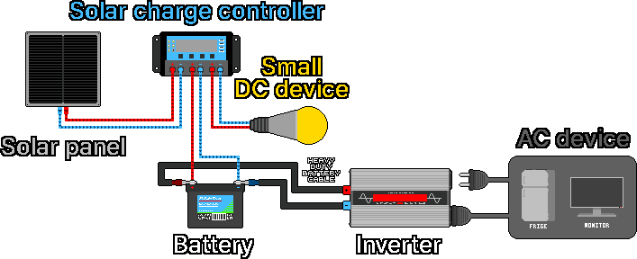
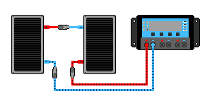
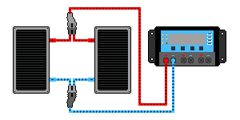
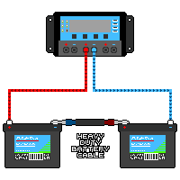
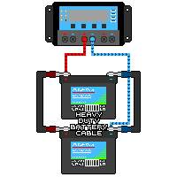

## 3. The Solar System

1. The solar panel receives sunlight and produces direct current (DC) electricity.
2. The produced electricity moves to the solar charge controller.
3. The controller regulates the electricity and supplies it to the battery and small DC devices (LEDs, USB, etc.).
4. DC current flows into the battery and charges it.
5. The (+) and (−) poles of the battery and inverter are connected to each other with thick link cables for connecting batteries (ring-terminal bolt type) or dedicated connectors.
6. The DC current stored in the battery is supplied to the inverter along the cables.
7. The inverter converts DC to alternating current (AC).
8. The AC current is supplied to AC devices connected to the inverter, such as a refrigerator or monitor.

---
### 3-1. Solar Panels
#### 3-1-1. How They Work
&nbsp;&nbsp;&nbsp;The photoelectric effect that occurs when light hits a silicon semiconductor turns light energy into electrical energy. A panel is made up of many solar cells (Solar Cell), and each cell has a PN junction structure in which two semiconductor layers with different properties are joined, with an electric field forming at the boundary.

- N-type semiconductor: a layer rich in electrons, with (−) charge
- P-type semiconductor: a layer short of electrons and rich in holes ((+) charge)

1. When photons, the particles of light, hit, electrons that gain energy from silicon atoms are knocked loose and move freely.
2. Electrons (−) gather on the N-type side and holes (+) on the P-type side.
3. The separated charges create a potential difference (voltage), and when a wire is connected to the electrodes, electrons flow along the wire and current is generated.

| Panel type | Characteristics |
|---|---|
| Monocrystalline (mono) | Made by slicing a single giant silicon crystal thin. The atomic arrangement is uniform, so generation efficiency is high. Uniform appearance and deep black |
| Polycrystalline (poly) | Made by melting several silicon crystals and pouring them into a square mold. The crystals are randomly mixed, so efficiency is lower than monocrystalline but it is cheap. Sparkling blue like a gemstone. Tends to lose slightly more efficiency than mono in summer heat |
| Thin film | A photovoltaic material is coated micrometers (µm) thin on a glass, plastic, or metal substrate. Smooth surface, uniform deep black or blackish brown. Shorter lifespan and lower efficiency than crystalline, and efficiency may degrade quickly |

#### 3-1-2. Reading the Panel Spec Label
&nbsp;&nbsp;&nbsp;The performance is written on the label on the back of the panel. If you know the five items below, installation will not be a big challenge.

| Label | Name | Meaning |
|---|---|---|
| Pmax (Wp) | Rated maximum power | The maximum power (W) it can produce under ideal conditions |
| Vmp | Voltage at maximum power | The voltage during actual operation |
| Imp | Current at maximum power | The current during actual operation |
| Voc | Open-circuit voltage | The highest voltage when nothing is connected |
| Isc | Short-circuit current | The largest current when the + and − poles are connected directly |

&nbsp;&nbsp;&nbsp;Example label: Pmax 200W / Vmp 18.0V / Imp 11.1A / Voc 22.0V / Isc 11.8A

&nbsp;&nbsp;&nbsp;The relation Pmax ≈ Vmp × Imp holds (18.0 × 11.1 ≈ 200W). Voc and Isc are limit values, so when choosing a controller, check that these limits are not exceeded.

#### 3-1-3. 12V Panels and 24V Panels
&nbsp;&nbsp;&nbsp;Even a "12V panel" has an actual voltage (Vmp) of about 18V and an open-circuit voltage (Voc) of about 22V. It means a panel made to charge a 12V battery, and since about 14V is needed to charge a 12V battery, it is designed at around 18V with margin. A "24V panel" is made to pair with a 24V system (24V controller and battery).

| Name | Approx. Vmp | Approx. Voc | Charges |
|---|---|---|---|
| 12V panel | about 18V | about 22V | 12V battery |
| 24V panel | about 30-36V | about 37-44V | 24V battery |

#### 3-1-4. Actual Output
&nbsp;&nbsp;&nbsp;The label figures are values measured under ideal test conditions (STC: strong sunlight 1000W/m², 25 °C), and in practice the output is usually lower. The factors that affect output are as follows.

- Sunlight intensity: output drops greatly on cloudy days, in the morning, and in the evening.
- Angle: the more perpendicular the sunlight to the panel, the higher the output.
- Shade: the cells are connected in series, so shading even part of it sharply cuts the whole output (watch for fallen leaves and the shadow of a utility pole).
- Temperature: when the panel gets hot, the voltage falls and output decreases. When it is cold, the voltage rises, and on a cold clear day in winter, a series connection can push the voltage past the controller's limit. Leave a margin in the controller's maximum voltage spec.
- Dust and snow: output decreases when the surface is dirty.

#### 3-1-5. Connecting Panels in Series and Parallel
&nbsp;&nbsp;&nbsp;Install panels to match the controller/battery voltage (12V/24V/48V). Series adds voltage (V), and parallel adds current (A). Standardize the panels you connect to the same type as far as possible to lower the risk of accidents. For safety before work, disconnect the panels from the controller.

**Series connection**

- Use: when you have 12V panels but must use a 24V controller/battery, connect them in series to make a 24V panel.
- Caution: if the sum of Voc exceeds the controller's maximum PV input voltage, an accident happens. On cold clear days Voc rises further. Leave a margin against the controller limit, and in a 24V system usually keep the voltage in a suitable range with parallel or mixed series-parallel.

1. Disconnect all connected panels from the controller.
2. Connect panel A's + pole to panel B's − pole.
3. Connect panel A's − pole to the controller's − terminal.
4. Connect panel B's + pole to the controller's + terminal.

**Parallel connection**

- Use: increase current production when panel, controller, and battery voltages are the same and the controller has margin in current capacity and input voltage limit so that one more panel causes no problem.
- Caution: in large systems, reverse current can flow in each parallel-connected wire, so install a fuse or DC breaker.

1. Disconnect all connected panels from the controller.
2. Connect the + poles of panels A and B together.
3. Connect the − poles of panels A and B together.
4. Connect the combined + and − poles to the controller's + and − terminals respectively.

---
### 3-2. Solar Charge Controller
#### 3-2-1. Role
&nbsp;&nbsp;&nbsp;The voltage and current coming from the panel fluctuate with sunlight, but a battery must be charged only in a set way. In between, the controller prevents overcharging so that the battery does not swell or lead to gas, fire, or explosion, and manages the charging stages to extend battery life.

> **Caution:** Do not connect the panel directly to the battery; always go through the controller. When connecting, connect the battery first and the panel afterward. When disconnecting, disconnect the panel first and the battery afterward.

#### 3-2-2. Types
&nbsp;&nbsp;&nbsp;If the budget is limited and you use a simple setup with a 12V panel and 12V battery, PWM is enough. If you want to draw more electricity or the panel voltage is high, MPPT is advantageous.

| Item | PWM type | MPPT type |
|---|---|---|
| Principle | Switches the panel on and off to match the battery | Finds the panel's optimal point and converts surplus voltage into current |
| Efficiency | Average | High (harvests roughly 10-30% more) |
| Price | Cheap | Expensive |
| Suits | Panel voltage ≈ battery voltage (12V panel + 12V battery) | Panel voltage ≫ battery voltage, cold days, large installations |

- PWM: pulls the panel down to battery voltage and connects it. In a 12V system, it throws away the potential of the 18V panel's surplus 4V. The closer the panel voltage to the battery, the smaller the loss.
- MPPT: uses a conversion circuit to make the panel work at the point of maximum power (Vmp), and turns the surplus voltage into extra current to charge more. Panel and battery voltages can be combined more freely.

#### 3-2-3. Choosing One
1. Voltage class: choose one that matches the battery voltage (12V/24V/48V). Some products recognize it automatically, but for a 24V system use a controller that supports 24V.
2. Current capacity (A): it must withstand the maximum current the panels produce (sum of Isc). Leave about 1.25 times margin. Example) If the panel Isc sum is about 12A, 15A or more.
3. Input voltage limit (MPPT): if the sum of Voc when panels are tied in series exceeds the controller's maximum PV input voltage, it will fail. In cold winter weather Voc rises above the spec sheet, so the maximum PV input voltage must have at least 15% margin over the sum of the series connection voltage.

&nbsp;&nbsp;&nbsp;Some controllers have a load terminal, so connecting a small DC device directly gets automatic overdischarge cutoff. Large loads or an inverter are connected directly to the battery, not to this terminal.

---
### 3-3. Batteries
#### 3-3-1. Role
&nbsp;&nbsp;&nbsp;Stores the electricity made in the daytime so it can be used at night and on cloudy days.

#### 3-3-2. Types
| Type | Advantages | Disadvantages |
|---|---|---|
| Flooded lead-acid | Cheapest | Heavy, needs distilled water top-ups, releases explosive hydrogen when charging (no charging in enclosed spaces), short life |
| AGM / gel (sealed lead-acid) | Little maintenance, little leakage | Lead-acid so heavy, average life |
| Lithium iron phosphate (LiFePO₄) | Long life, light, large usable capacity | High initial cost |

#### 3-3-3. Capacity (Ah) and Stored Energy (Wh)
&nbsp;&nbsp;&nbsp;Battery capacity is shown in ampere-hours (Ah), meaning "how many amps for how many hours."

> **Stored energy (Wh) = voltage (V) × capacity (Ah)**
> Example) 12V 100Ah battery: 12 × 100 = 1,200Wh (1.2kWh)

#### 3-3-4. Depth of Discharge (DoD)
&nbsp;&nbsp;&nbsp;Using the stored electricity all the way down sharply shortens life. The amount you can actually use is less than the label capacity.

| Type | Recommended depth of use (DoD) | Actually usable amount at 12V 100Ah |
|---|---|---|
| Lead-acid / AGM | only about 50% | about 600Wh |
| Lithium iron phosphate | about 80-100% | about 1,000-1,200Wh |

&nbsp;&nbsp;&nbsp;Even at the same 100Ah, the electricity actually usable from lithium is about twice that of lead-acid. This is a big reason lithium is preferred despite its price, and it must be reflected in capacity calculations.

#### 3-3-5. Lifespan
&nbsp;&nbsp;&nbsp;Avoid overdischarge (emptying completely), prevent overcharging with a controller suited to the battery, and avoid environments that are too cold or too hot.

- Flooded/AGM lead-acid: roughly several hundred charge-discharge cycles at 50% use
- Lithium iron phosphate: roughly several thousand charge-discharge cycles

#### 3-3-6. Matching Voltage and Series/Parallel Connection
&nbsp;&nbsp;&nbsp;Match the batteries to the system voltage (12V/24V/48V) too. Series adds voltage (V), and parallel adds current (A). Standardize the batteries you connect to the same type, capacity, and condition (age). If they are not matched, one side strains and its life is cut short or it becomes dangerous.

&nbsp;&nbsp;&nbsp;When changing the battery configuration, first disconnect the panel terminals connected to the controller, then the battery terminals. After connecting the batteries in series/parallel, connect the battery terminals to the controller first, and lastly connect the panels to the controller.

> **Caution:** Most alligator-clip cables have no fuse. Leaving a fuseless cable clipped onto a solar system where hundreds of amps flow continuously produces heat from poor contact and causes a major fire.

**Series connection**: if you need a 24V battery but only have 12V batteries, connect two identical batteries in series to make 24V.

1. Disconnect all connected panels from the controller.
2. Disconnect all connected batteries from the controller.
3. Connect battery A's − pole to battery B's + pole with a thick link cable for batteries (ring-terminal bolt type).
4. Connect the controller's + terminal to battery A's + pole.
5. Connect the controller's − terminal to battery B's − pole.
6. Connect the panels to the controller.

**Parallel connection**: to increase storage capacity, connect identical batteries in parallel.

1. Disconnect all connected panels from the controller.
2. Disconnect all connected batteries from the controller.
3. Connect battery A's + pole to battery B's + pole with a thick link cable for batteries.
4. Connect battery A's − pole to battery B's − pole with the same kind of cable.
5. Connect battery A's + pole to the controller's + terminal.
6. Connect battery B's − pole to the controller's − terminal.
7. Connect the panels to the controller.

---
### 3-4. Inverters
#### 3-4-1. Role
&nbsp;&nbsp;&nbsp;Converts the battery's direct current (DC) to household alternating current (AC, 220V) so ordinary appliances (TVs, refrigerators, etc.) can be used. If you use only DC devices (LED lights, USB, etc.), there is no conversion loss and it is actually more efficient, so you do not need to buy an inverter.

#### 3-4-2. Waveform Types
&nbsp;&nbsp;&nbsp;Safety varies with the waveform the inverter produces. If the price difference is not large, pure sine wave is recommended. Pure sine wave is safe especially for motor devices such as refrigerators and pumps, medical devices, and precision electronics.

| Type | Characteristics | Suitability |
|---|---|---|
| Pure sine wave | As smooth as outlet electricity | Safe for all devices (motors, electronics, medical devices) |
| Modified sine wave | Cheap but a rough waveform | Possible malfunction, damage, or noise in some motors, electronics, and sensitive devices |

#### 3-4-3. Choosing One
1. Input voltage class: must match the battery/system voltage. A 24V system needs a 24V-input inverter.
2. Continuous output (W): must be larger than the sum of the power consumption of the devices to be run at the same time. Example) Laptop 50W + light 20W + TV 100W = 170W, so 300W or more with margin.
3. Peak (surge) output: motor devices such as refrigerators and pumps draw several times their normal current at the moment of starting. If you use motor devices, the inverter's peak output must withstand this, so buy one with more margin in continuous output.
4. Stand-alone inverter: for disaster preparedness use a stand-alone type. A grid-tie type works linked to the utility grid and cannot be used in a blackout.

#### 3-4-4. Conversion Loss and Standby Power
&nbsp;&nbsp;&nbsp;About 10-15% is lost in DC→AC conversion, and just by being switched on it keeps consuming standby power (a few W to tens of W). The habit of turning the inverter off when not in use saves battery life.

#### 3-4-5. Cautions
- Before connecting the inverter to the battery, check that the inverter's power switch is OFF. If connected while on, a large spark jumps at the terminal and you can be hurt. Even if connected with the switch off, a faint spark may jump, but this is normal.
- The inverter output is 110-220V AC and carries a shock risk. Handle it just like outlet electricity.