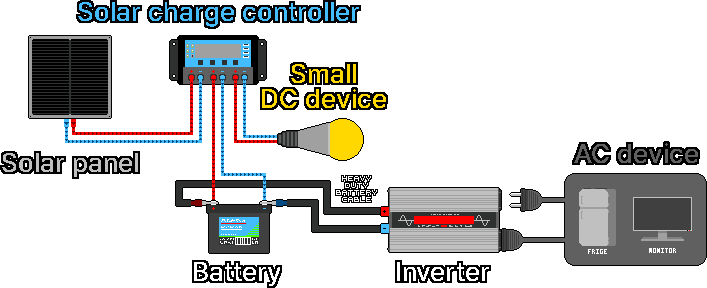
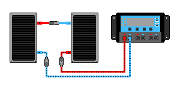
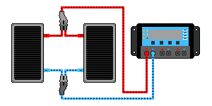
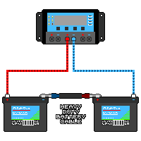
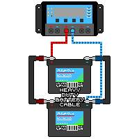

## 3. 太陽光システム

1. 太陽光パネルが日光を受けて、直流(DC)の電気を生産します。
2. 生産された電気が、太陽光充電コントローラーへ移動します。
3. コントローラーが電気をバッテリーと小型のDC機器(LED、USBなど)に合わせて調整し、供給します。
4. バッテリーに直流電流が流れ込み、充電されます。
5. バッテリー接続用の太い連結ケーブル(リング端子のボルト固定式)や専用の接続コネクターなどで、バッテリーとインバーターの(+)、(−)極を互いにつなぎます。
6. バッテリーに蓄えられた直流電流が、ケーブルを通ってインバーターに供給されます。
7. インバーターが直流を交流(AC)に変換します。
8. 交流電流が、インバーターにつながった冷蔵庫、モニターなどのAC機器に供給されます。

---
### 3-1. 太陽光パネル
#### 3-1-1. 動作原理
&nbsp;&nbsp;&nbsp;光がシリコン半導体に当たったときに生じる光電効果により、光エネルギーを電気エネルギーに変えます。パネルは多数の太陽電池(Solar Cell)でできており、各電池は性質の異なる2つの半導体層が接合したPN接合構造で、境界面に電場が形成されます。

- N型半導体: 電子が豊富な(−)電荷の層
- P型半導体: 電子が不足して正孔((+)電荷)が豊富な層

1. 光の粒である光子が当たると、シリコン原子からエネルギーを得た電子が飛び出し、自由に動きます。
2. 電子(−)はN型の側に、正孔(+)はP型の側に集まります。
3. 分離した電荷によって電位差(電圧)が生じ、電極に導線をつなぐと電子が導線を伝って流れ、電流が生まれます。

| パネルの種類 | 特徴 |
|---|---|
| 単結晶(モノ) | 1つの巨大なシリコン結晶を薄く切って作る。原子の配列が均一なため発電効率が高い。外観が均一で濃い黒色 |
| 多結晶(ポリ) | 複数のシリコン結晶を溶かして四角い枠に流し込んで作る。結晶がランダムに混ざるため効率は単結晶より低いが安価。宝石のように輝く青色。夏の高温時には単結晶より効率がやや落ちる傾向がある |
| 薄膜型 | ガラス・プラスチック・金属の基板の上に光電物質をマイクロメートル(µm)単位で薄く塗る。表面が滑らかで均一な濃い黒色か黒褐色。結晶系より寿命が短く効率が低く、効率の低下が速いことがある |

#### 3-1-2. パネルの仕様表(ラベル)の読み方
&nbsp;&nbsp;&nbsp;パネルの裏面のラベルに性能が書かれています。次の5つがわかれば、設置に大きな困難はありません。

| 表記 | 名称 | 意味 |
|---|---|---|
| Pmax (Wp) | 定格最大出力 | 理想的な条件で出せる最大の電力(W) |
| Vmp | 最大出力動作電圧 | 実際に動作するときの電圧 |
| Imp | 最大出力動作電流 | 実際に動作するときの電流 |
| Voc | 開放電圧 | 何もつながないときの最も高い電圧 |
| Isc | 短絡電流 | +極と−極を直接つないだときの最も大きな電流 |

&nbsp;&nbsp;&nbsp;ラベルの例: Pmax 200W / Vmp 18.0V / Imp 11.1A / Voc 22.0V / Isc 11.8A

&nbsp;&nbsp;&nbsp;Pmax ≈ Vmp × Impの関係が成り立ちます(18.0 × 11.1 ≈ 200W)。VocとIscは限界値なので、コントローラーを選ぶときに、この限界を超えないかを確認します。

#### 3-1-3. 12Vパネルと24Vパネル
&nbsp;&nbsp;&nbsp;「12Vパネル」も、実際の電圧(Vmp)は約18V、開放電圧(Voc)は約22Vです。12Vのバッテリーを充電するように作られたパネルという意味で、12Vのバッテリーの充電に約14Vが必要なため、余裕を持たせて18V前後に設計します。「24Vパネル」は、24Vシステム(24Vコントローラー・バッテリー)と組み合わせるように作られたものです。

| 名称 | おおよそのVmp | おおよそのVoc | 充電対象 |
|---|---|---|---|
| 12Vパネル | 約18V | 約22V | 12Vバッテリー |
| 24Vパネル | 約30~36V | 約37~44V | 24Vバッテリー |

#### 3-1-4. 実際の出力
&nbsp;&nbsp;&nbsp;ラベルの数値は、理想的な試験条件(STC: 強い日光1000W/m²、25℃)で測った値で、実際には通常これより少なく出ます。出力を左右する要因は次のとおりです。

- 日光の強さ: 曇りの日、朝、夕方は出力が大きく減少します。
- 角度: 日光がパネルに垂直に当たるほど出力が増加します。
- 日陰: セルが直列につながっているため、一部が隠れるだけで全体の出力が急減します(落ち葉、電柱の影に注意)。
- 温度: パネルが熱くなると電圧が下がって出力が減ります。温度が低いと電圧が上がり、冬の寒い晴れた日には、直列接続の場合に電圧がコントローラーの限界を超えることがあります。コントローラーの最大電圧の仕様に余裕を持たせます。
- ほこり・雪: 表面が汚れていると出力が減少します。

#### 3-1-5. パネルの直列・並列接続
&nbsp;&nbsp;&nbsp;パネルは、コントローラー・バッテリーの電圧(12V/24V/48V)に合わせて設置します。直列は電圧(V)が足し合わされ、並列は電流(A)が足し合わされます。つなぐパネルはなるべく同じ種類に統一したほうが、事故の危険が少なくなります。作業前の安全のため、パネルとコントローラーの接続を外しておきます。

**直列接続**

- 用途: 12Vパネルがあるのに24Vのコントローラー・バッテリーを使わなければならないとき、直列につないで24Vパネルを作ります。
- 注意: Vocの合計がコントローラーの最大PV入力電圧を超えると事故になります。寒い晴れた日にはVocがさらに上がります。コントローラーの限界に余裕を持たせ、24Vシステムでは通常、並列または直並列の混合で電圧を適正な範囲に収めます。

1. つながっているすべてのパネルをコントローラーから外します。
2. パネルAの+極とパネルBの−極をつなぎます。
3. パネルAの−極とコントローラーの−端子をつなぎます。
4. パネルBの+極とコントローラーの+端子をつなぎます。

**並列接続**

- 用途: パネル・コントローラー・バッテリーの電圧が同じで、コントローラーの電流容量と入力電圧の限界に余裕があり、パネルをもう1枚設置しても問題ないときに、電流の生産量を増やします。
- 注意: 大型システムでは、並列につないだ各電線に逆電流が流れることがあるため、ヒューズまたはDCブレーカーを設置します。

1. つながっているすべてのパネルをコントローラーから外します。
2. パネルAとBの+極どうしをつなぎます。
3. パネルAとBの−極どうしをつなぎます。
4. まとめた+極と−極を、それぞれコントローラーの+端子と−端子につなぎます。

---
### 3-2. 太陽光充電コントローラー
#### 3-2-1. 役割
&nbsp;&nbsp;&nbsp;パネルから入ってくる電圧と電流は日光によって揺れ動きますが、バッテリーは決まった方式でしか充電してはいけません。コントローラーはその間で過充電を防ぎ、バッテリーが膨らんだりガス・火災・爆発につながったりしないようにし、充電の段階を管理してバッテリーの寿命を延ばします。

> **注意:** パネルをバッテリーに直接つながず、必ずコントローラーを経由します。接続はバッテリーを先に、パネルを後にします。取り外しはパネルを先に、バッテリーを後にします。

#### 3-2-2. 種類
&nbsp;&nbsp;&nbsp;予算が限られ、12Vパネルと12Vバッテリーで単純に使うなら、PWMで十分です。より多くの電気を取り出したい場合やパネルの電圧が高い場合は、MPPTが有利です。

| 項目 | PWM型 | MPPT型 |
|---|---|---|
| 原理 | バッテリーに合わせてパネルを切ったりつないだりする | パネルの最適点を見つけ、余った電圧を電流に変換する |
| 効率 | 普通 | 高い(おおよそ10~30%多く収穫) |
| 価格 | 安価 | 高価 |
| 向いている場合 | パネル電圧 ≈ バッテリー電圧(12Vパネル + 12Vバッテリー) | パネル電圧 ≫ バッテリー電圧、寒い日、大型設備 |

- PWM: パネルをバッテリーの電圧まで引き下げてつなぎます。12Vシステムでは、18Vパネルの余った4V分の潜在力を捨てます。パネルの電圧がバッテリーに近いほど損が少なくなります。
- MPPT: 変換回路で、パネルが最も多くの電力を出す点(Vmp)で働くようにし、余った電圧を追加の電流に変えて、より多く充電します。パネルとバッテリーの電圧をより自由に組み合わせられます。

#### 3-2-3. 選び方
1. 電圧等級: バッテリーの電圧(12V/24V/48V)に合ったものを選びます。自動認識の製品もありますが、24Vシステムには24Vに対応したコントローラーを使います。
2. 電流容量(A): パネルが作る最大電流(Iscの合計)に耐えなければなりません。約1.25倍の余裕を持たせます。例) パネルのIscの合計が約12Aなら、15A以上。
3. 入力電圧の限界(MPPT): パネルを直列にまとめたときのVocの合計がコントローラーの最大PV入力電圧を超えると、故障します。冬の寒い気候ではVocが仕様表より高くなるため、最大PV入力電圧が直列接続の電圧の合計より少なくとも15%以上余裕がなければなりません。

&nbsp;&nbsp;&nbsp;一部のコントローラーには負荷(Load)端子があり、小さなDC機器を直接つなぐと、自動の過放電遮断を受けられます。大きな負荷やインバーターは、この端子ではなくバッテリーに直接つなぎます。

---
### 3-3. バッテリー
#### 3-3-1. 役割
&nbsp;&nbsp;&nbsp;昼につくった電気を、夜や曇りの日に使えるよう蓄えます。

#### 3-3-2. 種類
| 種類 | 長所 | 短所 |
|---|---|---|
| 液式鉛蓄電池 | 最も安価 | 重い、蒸留水の補充が必要、充電時に爆発性の水素ガスが発生(密閉空間での充電は禁止)、寿命が短い |
| AGM / ゲル(密閉型鉛蓄電池) | 手入れが少ない、液漏れが少ない | 鉛蓄電池なので重く、寿命は普通 |
| リン酸鉄リチウム(LiFePO₄) | 寿命が長く軽い、使える容量が大きい | 初期費用が高い |

#### 3-3-3. 容量(Ah)と蓄電量(Wh)
&nbsp;&nbsp;&nbsp;バッテリーの容量はアンペアアワー(Ah)で表示し、「何Aを何時間出せるか」を意味します。

> **蓄電量(Wh) = 電圧(V) × 容量(Ah)**
> 例) 12V 100Ahのバッテリー: 12 × 100 = 1,200Wh(1.2kWh)

#### 3-3-4. 放電深度(DoD)
&nbsp;&nbsp;&nbsp;蓄えた電気を使い切ると、寿命が急激に縮みます。実際に使える量は、ラベルの容量より少なくなります。

| 種類 | 推奨される使用の深さ(DoD) | 12V 100Ahで実際に使える量 |
|---|---|---|
| 鉛蓄電池 / AGM | 約50%のみ | 約600Wh |
| リン酸鉄リチウム | 約80~100% | 約1,000~1,200Wh |

&nbsp;&nbsp;&nbsp;同じ100Ahでも、実際に使える電気はリチウムが鉛蓄電池の約2倍です。価格が高くてもリチウムが好まれる大きな理由であり、容量の計算に必ず反映します。

#### 3-3-5. 寿命
&nbsp;&nbsp;&nbsp;過放電(使い切ること)を避け、バッテリーに合ったコントローラーで過充電を防ぎ、寒すぎたり暑すぎたりする環境を避けます。

- 液式/AGM鉛蓄電池: 50%使用を基準におよそ数百回の充放電
- リン酸鉄リチウム: およそ数千回の充放電

#### 3-3-6. 電圧の合わせ方と直列・並列接続
&nbsp;&nbsp;&nbsp;バッテリーもシステムの電圧(12V/24V/48V)に合わせます。直列は電圧(V)が足し合わされ、並列は電流(A)が足し合わされます。つなぐバッテリーは、種類・容量・状態(経過年数)が同じものに統一します。そろっていないと、一方が無理をして寿命が削られたり、危険になったりします。

&nbsp;&nbsp;&nbsp;バッテリーの構成を変えるときは、コントローラーとつながったパネル端子を先に外し、次にバッテリー端子を外します。バッテリーを直列・並列につないだ後、バッテリー端子からコントローラーにつなぎ、最後にパネルをコントローラーにつなぎます。

> **注意:** ほとんどのワニ口クリップ型のケーブルにはヒューズがありません。ヒューズのないケーブルを、数百Aが継続して流れる太陽光システムにつないだままにすると、接触不良で熱が出て大規模な火災が発生します。

**直列接続**: 24Vのバッテリーが必要なのに12Vのバッテリーしかなければ、同じバッテリー2個を直列につないで24Vにします。

1. つながっているすべてのパネルをコントローラーから外します。
2. つながっているすべてのバッテリーをコントローラーから外します。
3. バッテリー接続用の太い連結ケーブル(リング端子のボルト固定式)で、バッテリーAの−極とバッテリーBの+極をつなぎます。
4. バッテリーAの+極にコントローラーの+端子をつなぎます。
5. バッテリーBの−極にコントローラーの−端子をつなぎます。
6. パネルをコントローラーとつなぎます。

**並列接続**: 蓄電容量を増やすには、同じバッテリーを並列につなぎます。

1. つながっているすべてのパネルをコントローラーから外します。
2. つながっているすべてのバッテリーをコントローラーから外します。
3. バッテリー接続用の太い連結ケーブルで、バッテリーAの+極とバッテリーBの+極をつなぎます。
4. 同じケーブルで、バッテリーAの−極とバッテリーBの−極をつなぎます。
5. バッテリーAの+極をコントローラーの+端子とつなぎます。
6. バッテリーBの−極をコントローラーの−端子とつなぎます。
7. パネルをコントローラーとつなぎます。

---
### 3-4. インバーター
#### 3-4-1. 役割
&nbsp;&nbsp;&nbsp;バッテリーの直流(DC)を家庭用の交流(AC、220V)に変えて、一般の家電(テレビ・冷蔵庫など)を使えるようにします。DC機器(LED照明、USBなど)だけを使うなら、変換損失がなくかえって効率的なので、インバーターを買う必要はありません。

#### 3-4-2. 波形の種類
&nbsp;&nbsp;&nbsp;インバーターが出す波形によって、安全性が変わります。価格差が大きくなければ、純正弦波をお勧めします。特に冷蔵庫・ポンプのようなモーター機器、医療機器、精密な電子製品には、純正弦波が安全です。

| 種類 | 特徴 | 適合性 |
|---|---|---|
| 純正弦波 | コンセントの電気とまったく同じように滑らか | すべての機器に安全(モーター、電子製品、医療機器) |
| 擬似(修正)正弦波 | 安価だが粗い波形 | 一部のモーター・電子製品・敏感な機器で誤作動、損傷、騒音の可能性 |

#### 3-4-3. 選び方
1. 入力電圧等級: バッテリー/システムの電圧と合っていなければなりません。24Vシステムには24V入力のインバーターが必要です。
2. 連続出力(W): 同時に使う機器の消費電力の合計より大きくなければなりません。例) ノートパソコン50W + 照明20W + テレビ100W = 170Wなら、余裕を持って300W以上。
3. 瞬間最大(サージ)出力: 冷蔵庫・ポンプのようなモーター機器は、起動の瞬間に普段の数倍の電流を使います。モーター機器を使う場合は、インバーターの瞬間最大出力がこれに耐えなければならないので、連続出力により余裕のある製品を買います。
4. 独立型インバーター: 災害対策用には独立型(スタンドアロン)を使います。系統連系型(グリッドタイ)は商用電力網と連係して動作するため、停電時には使えません。

#### 3-4-4. 変換損失と待機電力
&nbsp;&nbsp;&nbsp;DC→AC変換で約10~15%が失われ、電源を入れておくだけでも待機電力(数W~数十W)を消費し続けます。使わないときはインバーターを切る習慣が、バッテリーの寿命を節約します。

#### 3-4-5. 注意事項
- インバーターをバッテリーにつなぐ前に、インバーターの電源スイッチがOFFであることを確認します。入ったままつなぐと、端子から大きな火花が飛んでけがをすることがあります。スイッチを切ってつないでも微細な火花が飛ぶことがありますが、正常です。
- インバーターの出力は110~220V ACで、感電の危険があります。コンセントの電気とまったく同じように扱います。