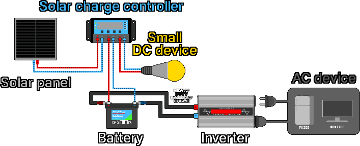
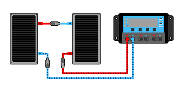
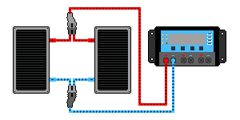
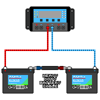
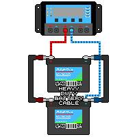

## 3. 태양광 시스템

1. 태양광 패널이 햇빛을 받아 직류(DC) 전기를 생산합니다.
2. 생산된 전기가 태양광 충전 컨트롤러로 이동합니다.
3. 컨트롤러가 전기를 배터리와 소형 DC 기기(LED, USB 등)에 맞게 조절해 공급합니다.
4. 배터리에 직류 전류가 흘러 들어 충전됩니다.
5. 배터리 연결용 굵은 링크 케이블(링 단자 볼트 고정형), 전용 연결 커넥터 등으로 배터리와 인버터의 (+), (−)극을 서로 연결합니다.
6. 배터리에 저장된 직류 전류가 케이블을 따라 인버터로 공급됩니다.
7. 인버터가 직류를 교류(AC)로 변환합니다.
8. 교류 전류가 인버터에 연결된 냉장고, 모니터 등 AC 장치에 공급됩니다.

---
### 3-1. 태양광 패널
#### 3-1-1. 동작 원리
&nbsp;&nbsp;&nbsp;빛이 실리콘 반도체에 닿을 때 생기는 광전효과로 빛 에너지를 전기 에너지로 바꿉니다. 패널은 수많은 태양전지(Solar Cell)로 이루어지고, 각 전지는 성질이 다른 두 반도체 층이 접합한 PN접합 구조이며 경계면에 전기장이 형성됩니다.

- N형 반도체: 전자가 풍부한 (−)전하 층
- P형 반도체: 전자가 부족해 양공(정공, (+)전하)이 풍부한 층

1. 빛 알갱이인 광자가 닿으면 실리콘 원자에서 에너지를 얻은 전자가 튀어나와 자유롭게 움직입니다.
2. 전자(−)는 N형 쪽으로, 양공(+)은 P형 쪽으로 모입니다.
3. 분리된 전하로 전위차(전압)가 생기고, 전극에 도선을 연결하면 전자가 도선을 따라 흘러 전류가 생성됩니다.

| 패널 종류 | 특징 |
|---|---|
| 단결정(모노) | 하나의 거대한 실리콘 결정을 얇게 썰어 만듦. 원자 배열이 균일해 발전 효율이 높음. 외관이 균일하고 짙은 검은색 |
| 다결정(폴리) | 여러 실리콘 결정을 녹여 사각 틀에 부어 만듦. 결정이 무작위로 섞여 효율이 단결정보다 낮지만 저렴. 보석처럼 반짝이는 푸른색. 여름철 고온에서 단결정보다 효율이 조금 더 떨어지는 경향 |
| 박막형 | 유리·플라스틱·금속 기판 위에 광전 물질을 마이크로미터(µm) 단위로 얇게 입힘. 표면이 매끄럽고 균일한 짙은 검은색이나 흑갈색. 결정질보다 수명이 짧고 효율이 낮으며 효율 저하가 빠를 수 있음 |

#### 3-1-2. 패널 사양표(라벨) 읽기
&nbsp;&nbsp;&nbsp;패널 뒷면 라벨에 성능이 적혀 있습니다. 아래 다섯 가지만 알면 설치에 큰 어려움이 없습니다.

| 표기 | 이름 | 뜻 |
|---|---|---|
| Pmax (Wp) | 정격 최대출력 | 이상적 조건에서 낼 수 있는 최대 전력(W) |
| Vmp | 최대출력 동작전압 | 실제 작동할 때의 전압 |
| Imp | 최대출력 동작전류 | 실제 작동할 때의 전류 |
| Voc | 개방전압 | 아무것도 연결하지 않았을 때의 가장 높은 전압 |
| Isc | 단락전류 | +극과 −극을 직접 이었을 때의 가장 큰 전류 |

&nbsp;&nbsp;&nbsp;예시 라벨: Pmax 200W / Vmp 18.0V / Imp 11.1A / Voc 22.0V / Isc 11.8A

&nbsp;&nbsp;&nbsp;Pmax ≈ Vmp × Imp 관계가 성립합니다(18.0 × 11.1 ≈ 200W). Voc와 Isc는 한계값이므로, 컨트롤러를 고를 때 이 한계를 넘지 않는지 확인합니다.

#### 3-1-3. 12V 패널과 24V 패널
&nbsp;&nbsp;&nbsp;'12V 패널'도 실제 전압(Vmp)은 약 18V, 개방전압(Voc)은 약 22V입니다. 12V 배터리를 충전하도록 만든 패널이라는 뜻이며, 12V 배터리 충전에 약 14V가 필요해 여유를 두고 18V 안팎으로 설계합니다. '24V 패널'은 24V 시스템(24V 컨트롤러·배터리)과 짝을 이루도록 만든 것입니다.

| 명칭 | 대략 Vmp | 대략 Voc | 충전 대상 |
|---|---|---|---|
| 12V 패널 | 약 18V | 약 22V | 12V 배터리 |
| 24V 패널 | 약 30~36V | 약 37~44V | 24V 배터리 |

#### 3-1-4. 실제 출력
&nbsp;&nbsp;&nbsp;라벨 수치는 이상적인 시험 조건(STC: 강한 햇빛 1000W/㎡, 25℃)에서 잰 값이며, 실제로는 보통 이보다 적게 나옵니다. 출력을 좌우하는 요인은 다음과 같습니다.

- 햇빛 세기: 흐린 날, 아침, 저녁에 출력이 크게 감소합니다.
- 각도: 햇빛이 패널에 수직으로 들수록 출력이 증가합니다.
- 그늘: 셀이 직렬로 연결되어 있어 일부만 가려도 전체 출력이 급감합니다(낙엽, 전봇대 그림자 주의).
- 온도: 패널이 뜨거워지면 전압이 떨어져 출력이 줄어듭니다. 온도가 낮으면 전압이 올라가는데, 겨울철 추운 맑은 날에는 직렬 연결 시 전압이 컨트롤러 한계를 넘을 수 있습니다. 컨트롤러의 최대 전압 사양에 여유를 둡니다.
- 먼지·눈: 표면이 더러우면 출력이 감소합니다.

#### 3-1-5. 패널 직렬·병렬 연결
&nbsp;&nbsp;&nbsp;패널은 컨트롤러·배터리 전압(12V/24V/48V)에 맞게 설치합니다. 직렬은 전압(V)이 더해지고 병렬은 전류(A)가 더해집니다. 연결할 패널은 되도록 같은 종류로 통일해야 사고 위험이 적습니다. 작업 전 안전을 위해 패널과 컨트롤러의 연결을 끊어 둡니다.

**직렬 연결**

- 용도: 12V 패널이 있는데 24V 컨트롤러·배터리를 써야 할 때 직렬로 이어 24V 패널을 만듭니다.
- 주의: Voc 합이 컨트롤러의 최대 PV 입력 전압을 넘으면 사고가 납니다. 추운 맑은 날에는 Voc가 더 올라갑니다. 컨트롤러 한계에 여유를 두고, 24V 시스템에서는 보통 병렬 또는 직병렬 혼합으로 전압을 적정 범위에 둡니다.

1. 연결된 모든 패널을 컨트롤러와 분리합니다.
2. 패널 A의 +극과 패널 B의 −극을 연결합니다.
3. 패널 A의 −극과 컨트롤러의 −단자를 연결합니다.
4. 패널 B의 +극과 컨트롤러의 +단자를 연결합니다.

**병렬 연결**

- 용도: 패널·컨트롤러·배터리 전압이 같고 컨트롤러의 전류 용량과 입력 전압 한계에 여유가 있어 패널을 하나 더 설치해도 문제없을 때, 전류 생산량을 늘립니다.
- 주의: 대형 시스템에서는 병렬로 연결된 각 전선에 역전류가 흐를 수 있으므로 퓨즈 또는 DC 차단기를 설치합니다.

1. 연결된 모든 패널을 컨트롤러와 분리합니다.
2. 패널 A와 B의 +극끼리 연결합니다.
3. 패널 A와 B의 −극끼리 연결합니다.
4. 합쳐진 +극과 −극을 각각 컨트롤러의 +단자와 −단자에 연결합니다.

---
### 3-2. 태양광 충전 컨트롤러
#### 3-2-1. 역할
&nbsp;&nbsp;&nbsp;패널에서 들어오는 전압과 전류는 햇빛에 따라 출렁이지만 배터리는 정해진 방식으로만 충전해야 합니다. 컨트롤러는 그 사이에서 과충전을 막아 배터리가 부풀거나 가스·화재·폭발로 이어지지 않게 하고, 충전 단계를 관리해 배터리 수명을 늘립니다.

> **주의:** 패널을 배터리에 직접 연결하지 않고 반드시 컨트롤러를 거칩니다. 연결은 배터리를 먼저, 패널을 나중에 합니다. 해체는 패널을 먼저, 배터리를 나중에 합니다.

#### 3-2-2. 종류
&nbsp;&nbsp;&nbsp;예산이 한정되고 12V 패널과 12V 배터리로 단순하게 쓰면 PWM으로 충분합니다. 더 많은 전기를 뽑고 싶거나 패널 전압이 높으면 MPPT가 유리합니다.

| 항목 | PWM형 | MPPT형 |
|---|---|---|
| 원리 | 패널을 배터리에 맞춰 끊었다 이었다 함 | 패널의 최적점을 찾아 남는 전압을 전류로 변환 |
| 효율 | 보통 | 높음(대략 10~30% 더 수확) |
| 가격 | 저렴 | 비쌈 |
| 잘 맞는 경우 | 패널 전압 ≈ 배터리 전압(12V 패널 + 12V 배터리) | 패널 전압 ≫ 배터리 전압, 추운 날, 대형 설비 |

- PWM: 패널을 배터리 전압으로 끌어내려 연결합니다. 12V 시스템에서는 18V 패널의 남는 4V만큼의 잠재력을 버립니다. 패널 전압이 배터리와 비슷할수록 손해가 적습니다.
- MPPT: 변환 회로로 패널이 가장 많은 전력을 내는 점(Vmp)에서 일하게 하고, 남는 전압을 추가 전류로 바꿔 더 많이 충전합니다. 패널·배터리 전압을 더 자유롭게 조합할 수 있습니다.

#### 3-2-3. 고르기
1. 전압 등급: 배터리 전압(12V/24V/48V)에 맞는 것을 고릅니다. 자동 인식 제품도 있지만 24V 시스템에는 24V를 지원하는 컨트롤러를 씁니다.
2. 전류 용량(A): 패널이 만드는 최대 전류(Isc 합)를 견뎌야 합니다. 약 1.25배 여유를 둡니다. 예) 패널 Isc 합이 약 12A면 15A 이상.
3. 입력 전압 한계(MPPT): 패널을 직렬로 묶을 때의 Voc 합이 컨트롤러의 최대 PV 입력 전압을 넘으면 고장납니다. 겨울철 추운 날씨에는 Voc가 사양표보다 높아지므로, 최대 PV 입력 전압이 직렬 연결 전압 합산보다 최소 15% 이상 여유로워야 합니다.

&nbsp;&nbsp;&nbsp;일부 컨트롤러에는 부하(Load) 단자가 있어, 작은 DC 기기를 직접 연결하면 자동 과방전 차단을 받을 수 있습니다. 큰 부하나 인버터는 이 단자가 아니라 배터리에 직접 연결합니다.

---
### 3-3. 배터리
#### 3-3-1. 역할
&nbsp;&nbsp;&nbsp;낮에 만든 전기를 밤과 흐린 날에 쓸 수 있도록 저장합니다.

#### 3-3-2. 종류
| 종류 | 장점 | 단점 |
|---|---|---|
| 침수형 납산 | 가장 저렴 | 무거움, 증류수 보충 필요, 충전 시 폭발성 수소 가스 발생(밀폐 공간에서 충전 금지), 수명 짧음 |
| AGM / 젤(밀폐 납산) | 관리 적음, 누액 적음 | 납산이라 무겁고 수명 보통 |
| 리튬인산철(LiFePO₄) | 수명 길고 가벼움, 쓸 수 있는 용량이 큼 | 초기 비용 높음 |

#### 3-3-3. 용량(Ah)과 저장 전력량(Wh)
&nbsp;&nbsp;&nbsp;배터리 용량은 암페어아워(Ah)로 표시하며 "몇 A를 몇 시간 낼 수 있나"를 뜻합니다.

> **저장 전력량(Wh) = 전압(V) × 용량(Ah)**
> 예) 12V 100Ah 배터리: 12 × 100 = 1,200Wh(1.2kWh)

#### 3-3-4. 방전심도(DoD)
&nbsp;&nbsp;&nbsp;저장된 전기를 끝까지 쓰면 수명이 급격히 줄어듭니다. 실제로 쓸 수 있는 양은 라벨 용량보다 적습니다.

| 종류 | 권장 사용 깊이(DoD) | 12V 100Ah에서 실제 사용 가능한 양 |
|---|---|---|
| 납산 / AGM | 약 50%만 | 약 600Wh |
| 리튬인산철 | 약 80~100% | 약 1,000~1,200Wh |

&nbsp;&nbsp;&nbsp;같은 100Ah라도 실제 사용 가능한 전기는 리튬이 납산의 약 2배입니다. 가격이 비싸도 리튬이 선호되는 큰 이유이며, 용량 계산에 반드시 반영합니다.

#### 3-3-5. 수명
&nbsp;&nbsp;&nbsp;과방전(끝까지 비우기)을 피하고, 배터리에 맞는 컨트롤러로 과충전을 막고, 너무 춥거나 더운 환경을 피합니다.

- 침수형/AGM 납산: 50% 사용 기준 대략 수백 회 충·방전
- 리튬인산철: 대략 수천 회 충·방전

#### 3-3-6. 전압 맞추기와 직렬·병렬 연결
&nbsp;&nbsp;&nbsp;배터리도 시스템 전압(12V/24V/48V)에 맞춥니다. 직렬은 전압(V)이 더해지고 병렬은 전류(A)가 더해집니다. 연결할 배터리는 종류·용량·상태(나이)가 같은 것으로 통일합니다. 짝이 맞지 않으면 한쪽이 무리해 수명이 깎이거나 위험해집니다.

&nbsp;&nbsp;&nbsp;배터리 구성을 바꿀 때는 컨트롤러와 연결된 패널 단자를 먼저 분리하고 배터리 단자를 분리합니다. 배터리를 직렬·병렬로 연결한 뒤, 배터리 단자부터 컨트롤러에 연결하고 마지막으로 패널을 컨트롤러에 연결합니다.

> **주의:** 대부분의 악어집게형 케이블에는 퓨즈가 없습니다. 퓨즈 없는 케이블을 수백 A가 지속해서 흐르는 태양광 시스템에 물려 두면 접속 불량으로 열이 나 대형 화재가 발생합니다.

**직렬 연결**: 24V 배터리가 필요한데 12V 배터리만 있으면, 같은 배터리 2개를 직렬로 이어 24V를 만듭니다.

1. 연결된 모든 패널을 컨트롤러와 분리합니다.
2. 연결된 모든 배터리를 컨트롤러와 분리합니다.
3. 배터리 연결용 굵은 링크 케이블(링 단자 볼트 고정형)로 배터리 A의 −극과 배터리 B의 +극을 연결합니다.
4. 배터리 A의 +극에 컨트롤러의 + 단자를 연결합니다.
5. 배터리 B의 −극에 컨트롤러의 − 단자를 연결합니다.
6. 패널을 컨트롤러와 연결합니다.

**병렬 연결**: 저장 용량을 늘리려면 같은 배터리를 병렬로 연결합니다.

1. 연결된 모든 패널을 컨트롤러와 분리합니다.
2. 연결된 모든 배터리를 컨트롤러와 분리합니다.
3. 배터리 연결용 굵은 링크 케이블로 배터리 A의 +극과 배터리 B의 +극을 연결합니다.
4. 같은 케이블로 배터리 A의 −극과 배터리 B의 −극을 연결합니다.
5. 배터리 A의 +극을 컨트롤러의 + 단자와 연결합니다.
6. 배터리 B의 −극을 컨트롤러의 − 단자와 연결합니다.
7. 패널을 컨트롤러와 연결합니다.

---
### 3-4. 인버터
#### 3-4-1. 역할
&nbsp;&nbsp;&nbsp;배터리의 직류(DC)를 가정용 교류(AC, 220V)로 바꿔 일반 가전(TV·냉장고 등)을 쓸 수 있게 합니다. DC 기기(LED 전등, USB 등)만 쓴다면 변환 손실이 없어 오히려 효율적이므로 인버터를 살 필요가 없습니다.

#### 3-4-2. 파형 종류
&nbsp;&nbsp;&nbsp;인버터가 내는 파형에 따라 안전성이 달라집니다. 가격 차이가 크지 않다면 순수정현파를 권합니다. 특히 냉장고·펌프 같은 모터 기기, 의료기기, 정밀 전자제품에는 순수정현파가 안전합니다.

| 종류 | 특징 | 적합성 |
|---|---|---|
| 순수정현파 | 콘센트 전기와 똑같이 매끈함 | 모든 기기에 안전(모터, 전자제품, 의료기기) |
| 유사(수정)정현파 | 저렴하지만 거친 파형 | 일부 모터·전자제품·민감 기기에서 오작동, 손상, 소음 가능 |

#### 3-4-3. 고르기
1. 입력 전압 등급: 배터리/시스템 전압과 맞아야 합니다. 24V 시스템에는 24V 입력 인버터가 필요합니다.
2. 연속 출력(W): 동시에 켤 기기들의 소비 전력 합보다 커야 합니다. 예) 노트북 50W + 전등 20W + TV 100W = 170W이면 여유 있게 300W 이상.
3. 순간 최대(서지) 출력: 냉장고·펌프 같은 모터 기기는 켜지는 순간 평소의 몇 배 전류를 씁니다. 모터 기기를 쓰면 인버터의 순간 최대 출력이 이를 견뎌야 하므로, 연속 출력에 더 여유 있는 제품을 삽니다.
4. 독립형 인버터: 재난 대비용은 독립형(스탠드얼론)을 씁니다. 계통연계형(그리드타이)은 상용 전력망과 연계해 작동하므로 정전 시 쓸 수 없습니다.

#### 3-4-4. 변환 손실과 대기 전력
&nbsp;&nbsp;&nbsp;DC→AC 변환에서 약 10~15%가 손실되고, 켜 두기만 해도 대기 전력(몇 W~수십 W)을 계속 소모합니다. 사용하지 않을 때는 인버터를 끄는 습관이 배터리 수명을 아낍니다.

#### 3-4-5. 주의사항
- 인버터를 배터리에 연결하기 전에 인버터의 전원 스위치가 OFF인지 확인합니다. 켜진 채 연결하면 단자에서 큰 불꽃이 튀어 다칠 수 있습니다. 스위치를 끄고 연결해도 미세한 불꽃은 튈 수 있으나 정상입니다.
- 인버터 출력은 110~220V AC로 감전 위험이 있습니다. 콘센트 전기와 똑같이 다룹니다.