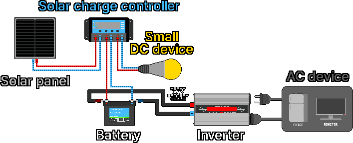
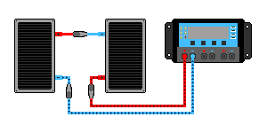
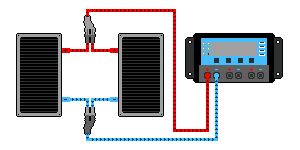
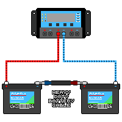
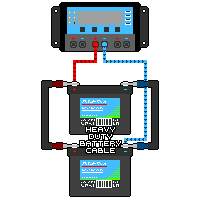

## 3. 太阳能系统

1. 太阳能电池板接收阳光，产生直流（DC）电。
2. 产生的电流向太阳能充电控制器。
3. 控制器对电进行调节，供给电池和小型DC设备（LED、USB等）。
4. 直流电流流入电池，给电池充电。
5. 用电池连接用的粗连接线（环形端子螺栓固定型）、专用连接器等，把电池和逆变器的（+）、（−）极相互连接。
6. 电池中储存的直流电流沿电缆供给逆变器。
7. 逆变器把直流转换为交流（AC）。
8. 交流电流供给连接在逆变器上的冰箱、显示器等AC设备。

---
### 3-1. 太阳能电池板
#### 3-1-1. 工作原理
&nbsp;&nbsp;&nbsp;光照射到硅半导体时产生的光电效应，把光能转换成电能。电池板由众多太阳能电池（Solar Cell）组成，每个电池是性质不同的两层半导体结合成的PN结结构，交界面上形成电场。

- N型半导体：电子丰富的（−）电荷层
- P型半导体：缺少电子、空穴（（+）电荷）丰富的层

1. 光的颗粒——光子照射上来时，从硅原子获得能量的电子被击出，自由移动。
2. 电子（−）聚集到N型一侧，空穴（+）聚集到P型一侧。
3. 分离的电荷产生电势差（电压），在电极上接导线，电子就沿导线流动，产生电流。

| 电池板类型 | 特点 |
|---|---|
| 单晶（Mono） | 把一整块巨大的硅晶体切成薄片制成。原子排列均匀，发电效率高。外观均匀，呈深黑色 |
| 多晶（Poly） | 把多块硅晶体熔化后倒入方形模具制成。晶体随机混杂，效率低于单晶但便宜。像宝石一样闪烁的蓝色。夏季高温时效率比单晶下降得稍多 |
| 薄膜型 | 在玻璃、塑料、金属基板上以微米（µm）级的厚度涂上光电材料。表面光滑均匀，呈深黑色或黑褐色。寿命比晶体硅短、效率低，效率衰减可能较快 |

#### 3-1-2. 阅读电池板规格标签
&nbsp;&nbsp;&nbsp;电池板背面的标签上写有性能。只要知道下面五项，安装就没有太大困难。

| 标示 | 名称 | 含义 |
|---|---|---|
| Pmax (Wp) | 额定最大功率 | 理想条件下能输出的最大功率（W） |
| Vmp | 最大功率工作电压 | 实际工作时的电压 |
| Imp | 最大功率工作电流 | 实际工作时的电流 |
| Voc | 开路电压 | 什么都不接时的最高电压 |
| Isc | 短路电流 | 直接连接+极和−极时的最大电流 |

&nbsp;&nbsp;&nbsp;示例标签：Pmax 200W / Vmp 18.0V / Imp 11.1A / Voc 22.0V / Isc 11.8A

&nbsp;&nbsp;&nbsp;Pmax ≈ Vmp × Imp的关系成立（18.0 × 11.1 ≈ 200W）。Voc和Isc是极限值，所以选控制器时要确认没有超过这些极限。

#### 3-1-3. 12V电池板与24V电池板
&nbsp;&nbsp;&nbsp;“12V电池板”的实际电压（Vmp）也约为18V，开路电压（Voc）约为22V。它的意思是为给12V电池充电而制造的电池板，给12V电池充电需要约14V，所以留出余量设计在18V上下。“24V电池板”则是为与24V系统（24V控制器和电池）配对而制造的。

| 名称 | 大致Vmp | 大致Voc | 充电对象 |
|---|---|---|---|
| 12V电池板 | 约18V | 约22V | 12V电池 |
| 24V电池板 | 约30-36V | 约37-44V | 24V电池 |

#### 3-1-4. 实际输出
&nbsp;&nbsp;&nbsp;标签数值是在理想的测试条件（STC：强阳光1000W/m²、25℃）下测得的值，实际上通常比这个低。影响输出的因素如下。

- 阳光强度：阴天、早晨、傍晚输出大幅下降。
- 角度：阳光越垂直照射电池板，输出越高。
- 遮挡：电池片是串联的，所以只遮住一部分，整体输出也会骤降（注意落叶、电线杆的影子）。
- 温度：电池板变热，电压下降，输出减少。温度低时电压升高，冬季寒冷的晴天，串联时电压可能超过控制器的极限。控制器的最大电压规格要留出余量。
- 灰尘、积雪：表面脏了，输出会减少。

#### 3-1-5. 电池板的串联、并联
&nbsp;&nbsp;&nbsp;电池板要与控制器、电池的电压（12V/24V/48V）匹配来安装。串联电压（V）相加，并联电流（A）相加。要连接的电池板尽量统一为同一种类，事故风险才低。作业前为安全起见，先断开电池板与控制器的连接。

**串联**

- 用途：有12V电池板但必须使用24V控制器、电池时，串联起来做成24V电池板。
- 注意：Voc之和超过控制器的最大PV输入电压就会出事故。寒冷的晴天Voc会升得更高。对控制器的极限要留出余量，24V系统中通常采用并联或串并联混合，把电压控制在合适范围。

1. 把所有已连接的电池板与控制器分开。
2. 连接电池板A的+极和电池板B的−极。
3. 连接电池板A的−极和控制器的−端子。
4. 连接电池板B的+极和控制器的+端子。

**并联**

- 用途：电池板、控制器、电池的电压相同，且控制器的电流容量和输入电压极限有余量、再装一块电池板也没有问题时，增加电流产量。
- 注意：大型系统中，并联的各条电线上可能出现反向电流，所以要装保险丝或DC断路器。

1. 把所有已连接的电池板与控制器分开。
2. 把电池板A和B的+极相连。
3. 把电池板A和B的−极相连。
4. 把合并后的+极和−极分别连接到控制器的+端子和−端子。

---
### 3-2. 太阳能充电控制器
#### 3-2-1. 作用
&nbsp;&nbsp;&nbsp;电池板送来的电压和电流会随阳光起伏，但电池必须按固定的方式充电。控制器在两者之间防止过充，避免电池鼓包或引发气体、火灾、爆炸，并管理充电阶段以延长电池寿命。

> **注意：** 不要把电池板直接连到电池上，务必经过控制器。连接时先接电池，后接电池板。拆除时先拆电池板，后拆电池。

#### 3-2-2. 类型
&nbsp;&nbsp;&nbsp;预算有限、用12V电池板和12V电池简单使用的话，PWM就足够了。想多提取电或电池板电压高时，MPPT更有利。

| 项目 | PWM型 | MPPT型 |
|---|---|---|
| 原理 | 为配合电池，对电池板时通时断 | 找到电池板的最佳点，把多余的电压转换成电流 |
| 效率 | 一般 | 高（大约多收获10-30%） |
| 价格 | 便宜 | 贵 |
| 适合的情况 | 电池板电压 ≈ 电池电压（12V电池板 + 12V电池） | 电池板电压 ≫ 电池电压、寒冷天气、大型设备 |

- PWM：把电池板电压拉低到电池电压再连接。12V系统中，18V电池板多出的4V潜力就被浪费了。电池板电压越接近电池，损失越小。
- MPPT：通过转换电路让电池板在输出功率最大的点（Vmp）工作，把多余的电压转换成额外的电流，充入更多电量。电池板和电池的电压可以更自由地搭配。

#### 3-2-3. 挑选
1. 电压等级：选与电池电压（12V/24V/48V）匹配的。也有自动识别的产品，但24V系统要用支持24V的控制器。
2. 电流容量（A）：必须能承受电池板产生的最大电流（Isc之和）。留出约1.25倍的余量。例）电池板Isc之和约为12A，则选15A以上。
3. 输入电压极限（MPPT）：电池板串联时Voc之和超过控制器的最大PV输入电压就会损坏。冬季寒冷天气Voc会高于规格表，所以最大PV输入电压至少要比串联电压之和宽裕15%以上。

&nbsp;&nbsp;&nbsp;部分控制器有负载（Load）端子，直接连接小型DC设备可获得自动过放保护。大负载或逆变器不要接这个端子，而是直接接到电池。

---
### 3-3. 电池
#### 3-3-1. 作用
&nbsp;&nbsp;&nbsp;把白天产生的电储存起来，供夜晚和阴天使用。

#### 3-3-2. 种类
| 种类 | 优点 | 缺点 |
|---|---|---|
| 富液式铅酸 | 最便宜 | 重，需补充蒸馏水，充电时产生爆炸性氢气（禁止在密闭空间充电），寿命短 |
| AGM / 凝胶（密封铅酸） | 维护少，漏液少 | 是铅酸所以重，寿命一般 |
| 磷酸铁锂（LiFePO₄） | 寿命长、轻，可用容量大 | 初始成本高 |

#### 3-3-3. 容量（Ah）与储存电量（Wh）
&nbsp;&nbsp;&nbsp;电池容量用安时（Ah）表示，意思是“能输出多少A、持续多少小时”。

> **储存电量（Wh）= 电压（V）× 容量（Ah）**
> 例）12V 100Ah电池：12 × 100 = 1,200Wh（1.2kWh）

#### 3-3-4. 放电深度（DoD）
&nbsp;&nbsp;&nbsp;把储存的电用到底，寿命会急剧缩短。实际能用的量比标签容量少。

| 种类 | 建议使用深度（DoD） | 12V 100Ah实际可用量 |
|---|---|---|
| 铅酸 / AGM | 只用约50% | 约600Wh |
| 磷酸铁锂 | 约80-100% | 约1,000-1,200Wh |

&nbsp;&nbsp;&nbsp;同样是100Ah，锂电池实际可用的电约为铅酸的2倍。这是尽管价格贵锂电池仍受青睐的一大原因，容量计算时必须计入。

#### 3-3-5. 寿命
&nbsp;&nbsp;&nbsp;避免过放（放到底），用与电池匹配的控制器防止过充，避免太冷或太热的环境。

- 富液式/AGM铅酸：按使用50%计，大约充放电数百次
- 磷酸铁锂：大约充放电数千次

#### 3-3-6. 匹配电压与串联、并联
&nbsp;&nbsp;&nbsp;电池也要与系统电压（12V/24V/48V）匹配。串联电压（V）相加，并联电流（A）相加。要连接的电池要统一为种类、容量、状态（使用年限）相同的。配不齐的话，一方过度吃力，寿命缩短或变得危险。

&nbsp;&nbsp;&nbsp;更改电池配置时，先拆下与控制器相连的电池板端子，再拆电池端子。把电池串联、并联连接之后，先把电池端子接到控制器，最后再把电池板接到控制器。

> **注意：** 大多数鳄鱼夹式电缆没有保险丝。把没有保险丝的电缆夹在持续流过几百A的太阳能系统上，会因接触不良发热而引发大火。

**串联**：需要24V电池但只有12V电池时，把2个相同的电池串联成24V。

1. 把所有已连接的电池板与控制器分开。
2. 把所有已连接的电池与控制器分开。
3. 用电池连接用的粗连接线（环形端子螺栓固定型）连接电池A的−极和电池B的+极。
4. 把控制器的+端子连接到电池A的+极。
5. 把控制器的−端子连接到电池B的−极。
6. 把电池板与控制器连接。

**并联**：要增加储存容量，就把相同的电池并联。

1. 把所有已连接的电池板与控制器分开。
2. 把所有已连接的电池与控制器分开。
3. 用电池连接用的粗连接线连接电池A的+极和电池B的+极。
4. 用同样的电缆连接电池A的−极和电池B的−极。
5. 把电池A的+极连接到控制器的+端子。
6. 把电池B的−极连接到控制器的−端子。
7. 把电池板与控制器连接。

---
### 3-4. 逆变器
#### 3-4-1. 作用
&nbsp;&nbsp;&nbsp;把电池的直流（DC）转换成家用交流（AC，220V），让普通电器（电视、冰箱等）可以使用。如果只用DC设备（LED灯、USB等），没有转换损耗，反而更高效，所以不需要买逆变器。

#### 3-4-2. 波形种类
&nbsp;&nbsp;&nbsp;逆变器输出的波形不同，安全性也不同。价格差距不大的话，建议选纯正弦波。尤其是冰箱、水泵这类电机设备、医疗设备和精密电子产品，纯正弦波更安全。

| 种类 | 特点 | 适用性 |
|---|---|---|
| 纯正弦波 | 与插座电一样平滑 | 对所有设备都安全（电机、电子产品、医疗设备） |
| 修正（准）正弦波 | 便宜但波形粗糙 | 部分电机、电子产品、敏感设备可能出现故障、损坏、噪音 |

#### 3-4-3. 挑选
1. 输入电压等级：必须与电池/系统电压一致。24V系统需要24V输入的逆变器。
2. 持续输出（W）：必须大于同时开启的设备耗电功率之和。例）笔记本电脑50W + 灯20W + 电视100W = 170W，则留出余量选300W以上。
3. 瞬时最大（浪涌）输出：冰箱、水泵之类的电机设备，在启动的瞬间会用平时几倍的电流。使用电机设备时，逆变器的瞬时最大输出必须能承受，所以要买持续输出余量更大的产品。
4. 离网型逆变器：灾难准备用离网型（Stand-alone）。并网型（Grid-tie）与市电电网联动工作，停电时无法使用。

#### 3-4-4. 转换损耗与待机功率
&nbsp;&nbsp;&nbsp;DC→AC转换中约损失10-15%，而且光是开着也会持续消耗待机功率（几W到几十W）。不用时关掉逆变器的习惯，能节省电池寿命。

#### 3-4-5. 注意事项
- 把逆变器连接到电池之前，确认逆变器的电源开关是OFF。开着连接，端子处会迸出大火花而受伤。关掉开关连接时也可能迸出细微火花，但属于正常。
- 逆变器输出是110-220V AC，有触电危险。要与插座电一样对待。