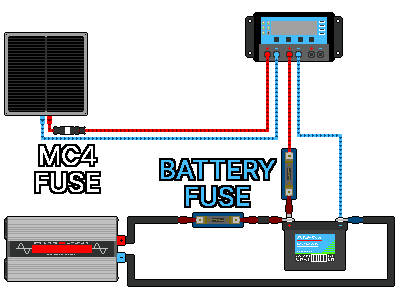

## 4. Проектирование системы
---
### 4-1. Напряжение системы
#### 4-1-1. Что такое напряжение системы
&nbsp;&nbsp;&nbsp;Один класс напряжения, общий для панелей, контроллера, аккумулятора и инвертора. Обычно это один из вариантов 12 В / 24 В / 48 В, и если классы четырёх компонентов совпадают, риск аварии снижается. Контроллер заряжает аккумулятор, а инвертор берёт электричество из аккумулятора, поэтому за основу берут напряжение аккумулятора.

&nbsp;&nbsp;&nbsp;Чтобы использовать панели 24 В, нужны контроллер заряда 24 В и аккумулятор 24 В (а при использовании AC ещё и инвертор с входом 24 В). Если аккумулятора 24 В нет, соедините последовательно два аккумулятора 12 В и получите 24 В.

| Неправильное сочетание | Возможная проблема |
|---|---|
| Панель 12 В + аккумулятор 24 В (PWM) | Напряжение панели низкое, и аккумулятор 24 В зарядить невозможно |
| Контроллер 24 В + аккумулятор 12 В | Несоответствие напряжений: не работает или повреждается |
| Инвертор 12 В + аккумулятор 24 В | Перенапряжение на входе повреждает инвертор |
| Инвертор 24 В + аккумулятор 12 В | Нехватка напряжения: инвертор не работает |

#### 4-1-2. Сравнение 12 В, 24 В и 48 В
&nbsp;&nbsp;&nbsp;Если напряжения компонентов совпадают, работает любой класс. При той же мощности чем выше напряжение, тем меньше ток (P = V × I), поэтому хватает более тонких проводов, а потери на нагрев уменьшаются. Чем крупнее система (чем больше расходуется электричества), тем эффективнее более высокое напряжение.

| Напряжение системы | Ток при передаче 600 Вт | Значение |
|:---:|---:|---|
| 12 В | 50 А | Ток большой, поэтому нужны толстые провода, а потери мощности на нагрев велики |
| 24 В | 25 А | Потери мощности вдвое меньше, чем при 12 В |
| 48 В | 12,5 А | Потери мощности наименьшие, можно использовать провода тоньше, чем при 12 В |

- 12 В: самая простая, много компонентов и приборов на 12 В, но ток большой, поэтому в крупных системах это невыгодно.
- 24 В: ток вдвое меньше, чем при 12 В, поэтому провода и потери меньше — разумный выбор.
- 48 В: потери наименьшие, но большинство компонентов дороже, чем на 12 В и 24 В.

| Примерный масштаб (справка) | Рекомендуемое напряжение системы |
|---|:---:|
| Малый (панели вырабатывают несколько сотен Вт, в основном освещение и зарядка) | 12 В |
| Средний (панели вырабатывают около 1,5 кВт) | 24 В |
| Большой (панели вырабатывают более 1,5 кВт) | 48 В |

#### 4-1-3. Порядок определения
1. Сложите потребление мощности приборов, использующих электричество, и рассчитайте, сколько Вт в час должны вырабатывать панели.
2. Сравните результат с масштабом в таблице выше и определите рекомендуемое напряжение системы.
3. Достаньте аккумулятор того же класса, что и напряжение системы. Если не получается, соберите из нескольких аккумуляторов 12 В последовательно.
4. Достаньте контроллер и инвертор, соответствующие напряжению аккумулятора.
5. Панели берите такие, которые могут заряжать построенную систему. Для контроллера PWM — панель с напряжением, равным напряжению аккумулятора; контроллер MPPT гибче, но проверьте предел Voc.

---
### 4-2. Расчёт необходимой мощности, панелей и ёмкости аккумуляторов
&nbsp;&nbsp;&nbsp;Оставляйте запас по всем значениям. Нехватка опасна, избыток безопасен. Ниже приведён пример для системы 24 В.

#### 4-2-1. Суточное потребление энергии (Вт·ч)
&nbsp;&nbsp;&nbsp;Сначала расставьте приоритеты, начиная с самых необходимых приборов (освещение, связь, охлаждение), затем для каждого прибора, который будет питаться от солнечной энергии, найдите мощность (Вт) × время использования в сутки (ч) и сложите всё.

| Прибор | Мощность | Время использования | Потребление энергии |
|---|---|---|---|
| Светодиодная лампа | 10 Вт | 5 ч | 50 Вт·ч |
| Зарядка телефона | 10 Вт | 2 ч | 20 Вт·ч |
| Ноутбук | 50 Вт | 3 ч | 150 Вт·ч |
| Вентилятор | 40 Вт | 6 ч | 240 Вт·ч |
| Малый холодильник | Периодическая работа | 24 ч | около 500 Вт·ч |
| Итого | | | около 1000 Вт·ч/сутки |

#### 4-2-2. Запас на потери
&nbsp;&nbsp;&nbsp;В контроллере, инверторе, проводах и при заряде-разряде аккумулятора электричество понемногу утекает. Разделите на 0,75, чтобы оставить запас.

- 1000 Вт·ч ÷ 0,75 ≈ 1333 Вт·ч (количество, которое реально нужно выработать и сохранить)

#### 4-2-3. Ёмкость аккумулятора
&nbsp;&nbsp;&nbsp;Определите, на сколько суток запасать энергию (автономность: сколько пасмурных дней нужно пережить). Для подготовки к катастрофам подходит 2-3 дня, в примере берётся 2 дня.

- Энергия для хранения = суточное потребление × автономность = 1000 Вт·ч × 2 дня = 2000 Вт·ч
- Ёмкость аккумулятора (Вт·ч) = энергия для хранения ÷ используемая доля (DoD)
- Ёмкость аккумулятора (А·ч) = Вт·ч ÷ напряжение системы

| Тип аккумулятора | Расчёт | Необходимая ёмкость (Вт·ч) | Пересчёт на 24 В |
|---|---|---|---|
| Литий (80 %) | 2000 ÷ 0,8 | 2500 Вт·ч | 2500 ÷ 24 ≈ 104 А·ч → 120 А·ч |
| Свинцово-кислотный (50 %) | 2000 ÷ 0,5 | 4000 Вт·ч | 4000 ÷ 24 ≈ 167 А·ч → 200 А·ч |

&nbsp;&nbsp;&nbsp;При тех же условиях свинцово-кислотному аккумулятору нужна ёмкость почти вдвое больше, чем литиевому. При подготовке аккумуляторов учитывайте вес и цену вместе.

#### 4-2-4. Мощность панелей
&nbsp;&nbsp;&nbsp;Панели не выдают максимальную мощность весь день. Эффективное время выработки за сутки, пока сохраняется сильное солнце, называют пиковыми солнечными часами (PSH). Это не продолжительность дня. В Республике Корея это примерно 4-5 часов летом и 2-3 часа зимой и в пасмурные дни. Для целей подготовки к катастрофам консервативно принимайте около 3 часов.

- Мощность панелей (Вт) = энергия, которую нужно выработать за сутки ÷ пиковые солнечные часы
- 1333 Вт·ч ÷ 3 часа ≈ около 444 Вт

&nbsp;&nbsp;&nbsp;Для восстановления после пасмурных дней и запаса округляйте вверх с запасом. Пример) Если нужно 444 Вт, то 3 панели по 200 Вт. Если у панелей есть запас, в несколько ясных часов заряд идёт быстрее, и пасмурные дни переживаются лучше, поэтому в условиях катастрофы выгоднее брать панели с запасом.

#### 4-2-5. Ток контроллера
&nbsp;&nbsp;&nbsp;Ток контроллера (А) ≈ (Вт панелей ÷ напряжение системы) × 1,25

- 600 Вт ÷ 24 В = 25 А
- 25 А × 1,25 ≈ 31 А
- Выбирайте контроллер MPPT класса 40 А.

#### 4-2-6. Сводный пример
| Параметр | Решение |
|---|---|
| Напряжение системы | 24 В |
| Суточное потребление | около 1000 Вт·ч (с учётом потерь 1333 Вт·ч) |
| Аккумулятор | Литиевый 24 В·120 А·ч (или свинцово-кислотный 24 В·200 А·ч) |
| Панели | 600 Вт (200 Вт × 3 шт.) |
| Контроллер | MPPT 40 А (24 В) |
| Инвертор (по желанию) | Выбирают с учётом суммы нагрузок и пусковых токов двигателей. Вход 24 В |

---
### 4-3. Выбор проводов и защитных устройств
#### 4-3-1. Толщина проводов
&nbsp;&nbsp;&nbsp;Найдите ток на каждом участке и выберите толщину, которая с запасом выдерживает этот ток. В сводном примере выше, когда инвертор выдаёт 1000 Вт, ток от аккумулятора к инвертору составляет постоянно около 50 А.

| Участок | Примерный ток | Рекомендуемый провод (справка) | Предохранитель/автомат (для DC) |
|---|---|---|---|
| Панель → контроллер | около 25 А | 6 мм² (10 AWG) и более | 30 А |
| Контроллер → аккумулятор | около 25-30 А | 6-10 мм² | 30-40 А |
| Аккумулятор → инвертор | около 50 А и более (пусковой всплеск 100 А и более) | 16 мм² (6 AWG) и более | 80 А и более |

- Приведённые значения — справочные. Чем жарче погода и чем длиннее провод (падение напряжения), тем толще нужно брать провод. Если сомневаетесь, берите на ступень толще. На участке аккумулятор↔инвертор ток наибольший, поэтому берите самый толстый провод.
- Падение напряжения: если провод длинный и тонкий, сопротивление (R) растёт, и напряжение, согласно закону Ома (V = I × R), срезается, а эта часть напрасно уходит в тепло. Принцип: провода должны быть короткими и толстыми. Выгодно также повысить напряжение системы, чтобы уменьшить ток.

#### 4-3-2. Расположение и номиналы предохранителей и автоматов
&nbsp;&nbsp;&nbsp;Предохранители и автоматы при перегрузке по току прерывают ток и защищают провода и оборудование. Ток выходит из источника (+), проходит через прибор и течёт к земле (−), поэтому для защиты проводов со стороны источника (+) их устанавливают на проводе «+». Если поставить на полюс «−», то даже когда предохранитель перегорит или автомат отключится, внутри прибора всё равно остаётся напряжение «+», сохраняется риск утечки или пожара.

- Номинал: изделие больше нормального тока и меньше допустимого тока провода. Пример) Если обычно идёт 25 А, а провод выдерживает до 36 А, то класс 30 А.
- В солнечных системах обязательно используйте изделия с номиналом для DC.

&nbsp;&nbsp;&nbsp;Установите предохранитель или автомат DC на провод «+» в следующих трёх местах.

1. Между панелью и контроллером: как можно ближе к панели
2. Между контроллером и аккумулятором: как можно ближе к аккумулятору
3. Между аккумулятором и инвертором: как можно ближе к аккумулятору

| Место | Рекомендуемое защитное устройство |
| --- | --- |
| Панель ↔ панель (при параллельном соединении) | Предохранитель PV |
| Панель ↔ контроллер заряда | Предохранитель PV или автомат DC для PV |
| Контроллер заряда ↔ аккумулятор | MEGA или Class-T |
| Аккумулятор ↔ инвертор | MEGA или Class-T |
| Отключение для обслуживания | Автомат DC |

&nbsp;&nbsp;&nbsp;Предохранитель MC4 — одна из форм исполнения предохранителя PV.

| Параметр | Предохранитель PV | Предохранитель ANL | Предохранитель MEGA | Предохранитель Class-T | Автомат DC |
| --- | --- | --- | --- | --- | --- |
| Цена | Низкая | Низкая | Средняя | Высокая | Средняя-высокая |
| Скорость отключения | Быстрая | Медленная-средняя | Средняя-быстрая | Очень быстрая | Медленная |
| Отключающая способность (AIC) | Низкая-средняя | Низкая | Средняя | Очень высокая | Зависит от изделия |
| Защита от перегрузки по току | Отличная | Возможна | Отличная | Очень отличная | Возможна |
| Защита от короткого замыкания | Отличная | Средняя | Отличная | Очень отличная | Зависит от изделия |
| Повторное использование | Нельзя | Нельзя | Нельзя | Нельзя | Можно |
| Защита LiFePO4 | Не подходит | Возможна | Рекомендуется | Оптимально | Одиночное использование не рекомендуется |
| Защита свинцово-кислотного аккумулятора | Не подходит | Возможна | Рекомендуется | Рекомендуется | Возможна |
| Защита солнечных панелей | Оптимально | Не подходит | Не подходит | Не подходит | Возможна |
| Малая солнечная установка | Рекомендуется | Подходит | Подходит | Возможна избыточная характеристика | Подходит |
| Средняя солнечная установка | Рекомендуется | Возможна | Рекомендуется | Рекомендуется | Возможна |
| Крупная ESS | Не подходит | Не рекомендуется | Возможна | Оптимально | Вспомогательное |
| Основное назначение | Защита проводов панелей | Автодома, кемперы, малые автономные системы | Автономные системы, инверторы средней мощности | ESS, крупные инверторы, LiFePO4 | Включение/отключение и обслуживание |

> **Внимание:** Литий-железо-фосфатный (LiFePO4) аккумулятор при коротком замыкании мгновенно выдаёт взрывной ток в тысячи ампер. Обычный недорогой бытовой автомат DC или автомат неизвестного типа не может прервать такой ток, внутри он плавится и сваривается, что приводит к пожару. Для литиевого аккумулятора обязательно сначала последовательно установите предохранитель Class-T или высокопроизводительный предохранитель MEGA вплотную к аккумулятору.