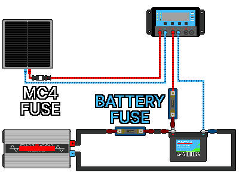

## 4. System Design
---
### 4-1. System Voltage
#### 4-1-1. What System Voltage Is
&nbsp;&nbsp;&nbsp;The single voltage class shared by the panels, controller, battery, and inverter. It is usually one of 12V / 24V / 48V, and the risk of accidents falls when the classes of the four components match. The controller charges the battery and the inverter draws electricity from the battery, so the battery voltage is taken as the reference.

&nbsp;&nbsp;&nbsp;To use 24V panels, you need a 24V charge controller and a 24V battery (and a 24V-input inverter if you use AC). If you have no 24V battery, connect two 12V batteries in series to make 24V.

| Wrong combination | Possible problem |
|---|---|
| 12V panel + 24V battery (PWM) | The panel voltage is too low to charge the 24V battery |
| 24V controller + 12V battery | Voltage mismatch, so it does not work or is damaged |
| 12V inverter + 24V battery | Input overvoltage damages the inverter |
| 24V inverter + 12V battery | Undervoltage keeps the inverter from working |

#### 4-1-2. Comparing 12V, 24V, and 48V
&nbsp;&nbsp;&nbsp;Any class works as long as the component voltages match. For the same power, the higher the voltage, the smaller the current (P = V × I), so thinner wire is enough and heat loss also decreases. The larger the system (the more electricity used), the more efficient the higher voltage is.

| System voltage | Current when sending 600W | Meaning |
|:---:|---:|---|
| 12V | 50A | The current is large, so wire must be thick and power loss from heat is large |
| 24V | 25A | Half the power loss of 12V |
| 48V | 12.5A | Smallest power loss, and thinner wire than 12V can be used |

- 12V: the simplest and with many 12V components and devices, but the current is large, which is a disadvantage in large systems.
- 24V: the current is half that of 12V, so wire and losses are smaller, a sound choice.
- 48V: the least loss, but most components are more expensive than 12V and 24V.

| Approximate scale (reference) | Recommended system voltage |
|---|:---:|
| Small (panels producing several hundred W, mainly lighting and charging) | 12V |
| Medium (panels producing about 1.5kW) | 24V |
| Large (panels producing more than 1.5kW) | 48V |

#### 4-1-3. Order of Deciding
1. Add up the power consumption of the devices that use electricity and calculate how many W per hour the panels must produce.
2. Compare the result with the scale in the table above to find the recommended system voltage.
3. Get a battery of the same class as the system voltage. If you cannot, build one from several 12V batteries in series.
4. Get a controller and inverter that match the battery voltage.
5. Get panels that can charge the system you built. For PWM controllers, panel voltage = battery voltage; MPPT controllers are more flexible, but check the Voc limit.

---
### 4-2. Calculating Required Power, Panel, and Battery Capacity
&nbsp;&nbsp;&nbsp;Leave margin on every value. Too little is dangerous, and plenty is safe. The following is an example for a 24V system.

#### 4-2-1. Daily Energy Consumption (Wh)
&nbsp;&nbsp;&nbsp;Prioritize the essential devices (lighting, communication, refrigeration) first, then for each device to be powered by solar, find power (W) × daily hours of use (h) and add them all up.

| Device | Power | Hours of use | Energy consumption |
|---|---|---|---|
| LED light | 10W | 5h | 50Wh |
| Phone charging | 10W | 2h | 20Wh |
| Laptop | 50W | 3h | 150Wh |
| Fan | 40W | 6h | 240Wh |
| Small refrigerator | Intermittent | 24h | about 500Wh |
| Total | | | about 1,000Wh/day |

#### 4-2-2. Loss Margin
&nbsp;&nbsp;&nbsp;Electricity leaks a little in the controller, inverter, wires, and battery charging and discharging. Divide by about 0.75 to leave margin.

- 1,000Wh ÷ 0.75 ≈ 1,333Wh (the amount actually to be produced and stored)

#### 4-2-3. Battery Capacity
&nbsp;&nbsp;&nbsp;Decide how many days' worth to store (days of autonomy: how many cloudy days to ride out). For disaster preparedness, 2-3 days is appropriate, and the example uses 2 days.

- Energy to store = daily consumption × days of autonomy = 1,000Wh × 2 days = 2,000Wh
- Battery capacity (Wh) = energy to store ÷ usable ratio (DoD)
- Battery capacity (Ah) = Wh ÷ system voltage

| Battery type | Calculation | Required capacity (Wh) | Converted at 24V |
|---|---|---|---|
| Lithium (80%) | 2,000 ÷ 0.8 | 2,500Wh | 2,500 ÷ 24 ≈ 104Ah → 120Ah |
| Lead-acid (50%) | 2,000 ÷ 0.5 | 4,000Wh | 4,000 ÷ 24 ≈ 167Ah → 200Ah |

&nbsp;&nbsp;&nbsp;Under the same conditions, lead-acid needs nearly twice the capacity of lithium. When preparing batteries, weigh weight and price together.

#### 4-2-4. Panel Capacity
&nbsp;&nbsp;&nbsp;Panels do not produce maximum output all day. The effective generating time per day during which strong sunlight holds is called peak sun hours (PSH). It is not the length of the day. In South Korea it is roughly 4-5 hours in summer and 2-3 hours in winter and on cloudy days. For disaster preparedness, conservatively assume about 3 hours.

- Panel capacity (W) = energy to produce per day ÷ peak sun hours
- 1,333Wh ÷ 3 hours ≈ about 444W

&nbsp;&nbsp;&nbsp;Round up generously for recovery after cloudy days and for margin. Example) If 444W is needed, three 200W panels. With spare panel capacity, you charge faster during the few clear hours and get through cloudy days well, so in a disaster it pays to be generous with panels.

#### 4-2-5. Controller Current
&nbsp;&nbsp;&nbsp;Controller current (A) ≈ (panel W ÷ system voltage) × 1.25

- 600W ÷ 24V = 25A
- 25A × 1.25 ≈ 31A
- Choose a 40A-class MPPT controller.

#### 4-2-6. Summary Example
| Item | Decision |
|---|---|
| System voltage | 24V |
| Daily consumption | about 1,000Wh (1,333Wh with losses) |
| Battery | Lithium 24V·120Ah (or lead-acid 24V·200Ah) |
| Panels | 600W (3 × 200W) |
| Controller | 40A MPPT (24V) |
| Inverter (optional) | Choose considering the load total and motor surge. 24V input |

---
### 4-3. Choosing Wires and Protection Devices
#### 4-3-1. Wire Thickness
&nbsp;&nbsp;&nbsp;Find the current for each section and choose a thickness that withstands that current with room to spare. In the summary example above, when the inverter delivers 1,000W, the current flowing from the battery to the inverter is about 50A continuously.

| Section | Approx. current | Recommended wire (reference) | Fuse/breaker (for DC) |
|---|---|---|---|
| Panel → controller | about 25A | 6mm² (10AWG) or more | 30A |
| Controller → battery | about 25-30A | 6-10mm² | 30-40A |
| Battery → inverter | about 50A or more (surge 100A or more) | 16mm² (6AWG) or more | 80A or more |

- The values above are for reference. The hotter the weather and the longer the wire (voltage drop), the thicker the wire. When in doubt, use one size thicker. The battery↔inverter section carries the largest current, so use the thickest wire.
- Voltage drop: if the wire is long and thin, the resistance (R) grows and the voltage is cut by Ohm's law (V = I × R), with that much wasted as heat. The rule is short and thick wire. Raising the system voltage to reduce current also helps.

#### 4-3-2. Fuse/Breaker Location and Rating
&nbsp;&nbsp;&nbsp;Fuses and breakers cut the current when overcurrent flows, protecting wires and equipment. Current flows out of the source (+) through the device to ground (−), so install them on the + wire to protect the source (+) side wire. If fitted on the − pole, even if the fuse blows or the breaker trips, + voltage still flows inside the device, leaving the risk of leakage or fire.

- Rating: a product above the normal current and below the wire's allowable current. Example) If 25A normally flows and the wire holds up to 36A, a 30A class.
- In solar systems, always use products with a DC rating.

&nbsp;&nbsp;&nbsp;Install a fuse or DC breaker on the + wire at the following three places.

1. Between the panel and controller: as close to the panel as possible
2. Between the controller and battery: as close to the battery as possible
3. Between the battery and inverter: as close to the battery as possible

| Location | Recommended protection device |
| --- | --- |
| Panel ↔ panel (in parallel connection) | PV fuse |
| Panel ↔ charge controller | PV fuse or PV DC breaker |
| Charge controller ↔ battery | MEGA or Class-T |
| Battery ↔ inverter | MEGA or Class-T |
| Disconnect for maintenance | DC breaker |

&nbsp;&nbsp;&nbsp;An MC4 fuse is one of the mounting forms of a PV fuse.

| Item | PV fuse | ANL fuse | MEGA fuse | Class-T fuse | DC breaker |
| --- | --- | --- | --- | --- | --- |
| Price | Cheap | Cheap | Average | Expensive | Average to expensive |
| Interrupt speed | Fast | Slow to average | Average to fast | Very fast | Slow |
| Interrupt rating (AIC) | Low to medium | Low | Medium | Very high | Varies by product |
| Overcurrent protection | Excellent | Possible | Excellent | Very excellent | Possible |
| Short-circuit protection | Excellent | Average | Excellent | Very excellent | Varies by product |
| Reusable | No | No | No | No | Yes |
| LiFePO4 protection | Unsuitable | Possible | Recommended | Optimal | Not recommended alone |
| Lead-acid battery protection | Unsuitable | Possible | Recommended | Recommended | Possible |
| Solar panel protection | Optimal | Unsuitable | Unsuitable | Unsuitable | Possible |
| Small solar | Recommended | Suitable | Suitable | Possibly overspecified | Suitable |
| Medium solar | Recommended | Possible | Recommended | Recommended | Possible |
| Large ESS | Unsuitable | Not recommended | Possible | Optimal | Auxiliary |
| Main use | Panel wire protection | RVs, campers, small off-grid | Off-grid, mid-size inverters | ESS, large inverters, LiFePO4 | Switching and maintenance |

> **Caution:** A lithium iron phosphate (LiFePO4) battery releases an explosive current of thousands of amps instantly in a short circuit. An ordinary low-cost household DC breaker or one of unknown type cannot interrupt this current, and its inside melts and fuses together, leading to fire. For a lithium battery, always fit a Class-T fuse or a high-performance MEGA fuse in series first, right next to the battery.