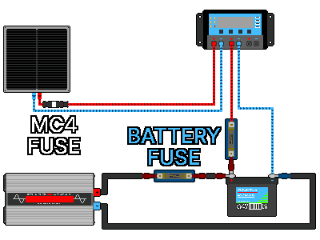

## 4. システム設計
---
### 4-1. システム電圧
#### 4-1-1. システム電圧とは
&nbsp;&nbsp;&nbsp;パネル・コントローラー・バッテリー・インバーターが一緒に使う、1つの電圧等級です。通常は12V / 24V / 48Vのいずれかで、4つの部品の等級が合っていれば事故の危険が減ります。コントローラーはバッテリーを充電し、インバーターはバッテリーから電気を取り出して使うため、バッテリーの電圧を基準にします。

&nbsp;&nbsp;&nbsp;24Vパネルを使うには、24V充電コントローラーと24Vバッテリーが必要です(ACを使うなら24V入力のインバーターも)。24Vバッテリーがなければ、12Vバッテリー2個を直列につないで24Vにします。

| 誤った組み合わせ | 発生しうる問題 |
|---|---|
| 12Vパネル + 24Vバッテリー(PWM) | パネルの電圧が低く、24Vバッテリーを充電できない |
| 24Vコントローラー + 12Vバッテリー | 電圧の不一致で動作しない、または損傷する |
| 12Vインバーター + 24Vバッテリー | 入力の過電圧でインバーターが損傷する |
| 24Vインバーター + 12Vバッテリー | 電圧不足でインバーターが動作しない |

#### 4-1-2. 12V・24V・48Vの比較
&nbsp;&nbsp;&nbsp;部品の電圧さえ合っていれば、どの等級でも動作します。同じ電力なら、電圧が高いほど電流が小さくなる(P = V × I)ので、より細い電線で足り、熱損失も減ります。システムが大きいほど(電気の使用量が多いほど)、高い電圧が効率的です。

| システム電圧 | 600Wを送るときの電流 | 意味 |
|:---:|---:|---|
| 12V | 50A | 電流が大きいので電線を太くする必要があり、熱による電力損失が大きい |
| 24V | 25A | 12Vより電力損失が半分 |
| 48V | 12.5A | 電力損失が最も小さく、12Vより細い電線を使用できる |

- 12V: 最も単純で12V用の部品・機器が多いが、電流が大きいため、大きなシステムでは不利です。
- 24V: 電流が12Vの半分なので、電線や損失が少ない無難な選択です。
- 48V: 損失は最も少ないですが、ほとんどの部品が12V・24Vより高価です。

| おおよその規模(参考) | 推奨されるシステム電圧 |
|---|:---:|
| 小(パネルで数百Wを生産、照明・充電が中心) | 12V |
| 中(パネルで約1.5kWを生産) | 24V |
| 大(パネルで1.5kW以上を生産) | 48V |

#### 4-1-3. 決める順序
1. 電気を使う機器の電力消費量を合計して、パネルで1時間あたり何W生産しなければならないかを計算します。
2. 計算結果を上の表の規模と比べて、推奨されるシステム電圧を確認します。
3. システム電圧と同じ等級のバッテリーを入手します。入手できなければ、12Vをいくつか直列にして構成します。
4. コントローラーとインバーターを、バッテリーの電圧に合った製品で入手します。
5. パネルは、構築したシステムを充電できる製品を入手します。PWMコントローラーはパネル電圧 = バッテリー電圧の製品、MPPTコントローラーはより柔軟ですが、Vocの限界を確認します。

---
### 4-2. 必要電力・パネル・バッテリー容量の計算
&nbsp;&nbsp;&nbsp;すべての値に余裕を持たせます。不足すれば危険で、余裕があれば安全です。以下は24Vシステムの例です。

#### 4-2-1. 1日の消費電力量(Wh)
&nbsp;&nbsp;&nbsp;絶対に必要な機器(照明・通信・冷蔵)から優先順位をつけたうえで、太陽光で電気を供給する機器ごとに、電力(W) × 1日の使用時間(h)を求めて、すべて足します。

| 機器 | 電力 | 使用時間 | 消費電力量 |
|---|---|---|---|
| LED照明 | 10W | 5h | 50Wh |
| 携帯電話の充電 | 10W | 2h | 20Wh |
| ノートパソコン | 50W | 3h | 150Wh |
| 扇風機 | 40W | 6h | 240Wh |
| 小型冷蔵庫 | 断続運転 | 24h | 約500Wh |
| 合計 | | | 約1,000Wh/日 |

#### 4-2-2. 損失の余裕
&nbsp;&nbsp;&nbsp;コントローラー・インバーター・電線・バッテリーの充放電で、電気が少しずつ漏れます。約0.75で割って余裕を持たせます。

- 1,000Wh ÷ 0.75 ≈ 1,333Wh (実際に作って蓄えるべき量)

#### 4-2-3. バッテリー容量
&nbsp;&nbsp;&nbsp;何日分を蓄えるか(自立日数。曇りの日を何日しのぐか)を決めます。災害対策なら2~3日が適当で、例では2日とします。

- 蓄える電力量 = 1日の消費 × 自立日数 = 1,000Wh × 2日 = 2,000Wh
- バッテリー容量(Wh) = 蓄える電力量 ÷ 使用可能な割合(DoD)
- バッテリー容量(Ah) = Wh ÷ システム電圧

| バッテリーの種類 | 計算 | 必要容量(Wh) | 24Vに換算 |
|---|---|---|---|
| リチウム(80%) | 2,000 ÷ 0.8 | 2,500Wh | 2,500 ÷ 24 ≈ 104Ah → 120Ah |
| 鉛蓄電池(50%) | 2,000 ÷ 0.5 | 4,000Wh | 4,000 ÷ 24 ≈ 167Ah → 200Ah |

&nbsp;&nbsp;&nbsp;同じ条件では、鉛蓄電池はリチウムよりほぼ2倍大きな容量が必要です。バッテリーを用意するときは、重さと価格を一緒に考えます。

#### 4-2-4. パネル容量
&nbsp;&nbsp;&nbsp;パネルは一日中最大出力を出すわけではありません。1日のうちに強い日光が保たれる有効な発電時間を、ピーク日照時間(PSH)といいます。昼の長さではありません。大韓民国はおおよそ夏に4~5時間、冬と曇りの日に2~3時間です。災害対策が目的なら、控えめに約3時間とします。

- パネル容量(W) = 1日に作る電力量 ÷ ピーク日照時間
- 1,333Wh ÷ 3時間 ≈ 約444W

&nbsp;&nbsp;&nbsp;曇りの日の回復と余裕のために、多めに見積もります。例) 444Wが必要なら、200Wパネル3枚。パネルに余裕があると、晴れた数時間でより速く充電でき、曇りの日をうまく乗り切れるので、災害時にはパネルを多めに取るほうが有利です。

#### 4-2-5. コントローラーの電流
&nbsp;&nbsp;&nbsp;コントローラー電流(A) ≈ (パネルW ÷ システム電圧) × 1.25

- 600W ÷ 24V = 25A
- 25A × 1.25 ≈ 31A
- 40AクラスのMPPTコントローラーを選びます。

#### 4-2-6. 総合例
| 項目 | 決定 |
|---|---|
| システム電圧 | 24V |
| 1日の消費 | 約1,000Wh(損失込みで1,333Wh) |
| バッテリー | リチウム24V·120Ah(または鉛蓄電池24V·200Ah) |
| パネル | 600W(200W × 3枚) |
| コントローラー | 40A MPPT(24V) |
| インバーター(任意) | 負荷の合計とモーターのサージを考慮して選ぶ。24V入力 |

---
### 4-3. 電線・保護装置の選定
#### 4-3-1. 電線の太さ
&nbsp;&nbsp;&nbsp;区間ごとの電流を求め、その電流に十分に耐える太さを選びます。上の総合例で、インバーターが1,000Wを出すとき、バッテリーからインバーターに流れる電流は継続して約50Aです。

| 区間 | おおよその電流 | 推奨される電線(参考) | ヒューズ/ブレーカー(DC用) |
|---|---|---|---|
| パネル → コントローラー | 約25A | 6mm²(10AWG)以上 | 30A |
| コントローラー → バッテリー | 約25~30A | 6~10mm² | 30~40A |
| バッテリー → インバーター | 約50A以上(瞬間サージ100A以上) | 16mm²(6AWG)以上 | 80A以上 |

- 上の値は参考値です。気温が高いほど、電線が長いほど(電圧降下)、より太く使います。迷ったら1段太い電線を使います。バッテリー↔インバーター区間は電流が最も大きいので、最も太い電線を使います。
- 電圧降下: 電線が長く細いと抵抗(R)が大きくなり、オームの法則(V = I × R)どおりに電圧が削られ、その分が熱として無駄になります。電線は短く太くするのが原則です。システム電圧を上げて電流を減らすのも有利です。

#### 4-3-2. ヒューズ・ブレーカーの位置と容量
&nbsp;&nbsp;&nbsp;ヒューズとブレーカーは、過電流が流れると電流を遮断して、電線と機器を保護します。電流は電源(+)から出て機器を通って接地(−)に流れるので、電源(+)側の電線を保護するよう、+極の電線に設置します。−極に付けると、ヒューズが切れたりブレーカーが落ちたりしても、機器の内部に+電圧が流れ続けて、漏電や火災の危険が残ります。

- 容量: 通常の電流より大きく、電線の許容電流より小さい製品。例) 普段25Aが流れ、電線が36Aまで耐えるなら、30Aクラス。
- 太陽光システムでは、必ずDC定格の製品を使います。

&nbsp;&nbsp;&nbsp;次の3か所の+極の電線に、ヒューズまたはDCブレーカーを設置します。

1. パネルとコントローラーの間: パネルにできるだけ近い場所
2. コントローラーとバッテリーの間: バッテリーにできるだけ近い場所
3. バッテリーとインバーターの間: バッテリーにできるだけ近い場所

| 位置 | 推奨される保護装置 |
| --- | --- |
| パネル ↔ パネル(並列接続時) | PVヒューズ |
| パネル ↔ 充電コントローラー | PVヒューズまたはPV用DCブレーカー |
| 充電コントローラー ↔ バッテリー | MEGAまたはClass-T |
| バッテリー ↔ インバーター | MEGAまたはClass-T |
| メンテナンス用の遮断 | DCブレーカー |

&nbsp;&nbsp;&nbsp;MC4ヒューズは、PVヒューズの装着形態の1つです。

| 項目 | PVヒューズ | ANLヒューズ | MEGAヒューズ | Class-Tヒューズ | DCブレーカー |
| --- | --- | --- | --- | --- | --- |
| 価格 | 安価 | 安価 | 普通 | 高価 | 普通~高価 |
| 遮断速度 | 速い | 遅い~普通 | 普通~速い | 非常に速い | 遅い |
| 遮断容量(AIC) | 低い~中程度 | 低い | 中程度 | 非常に高い | 製品ごとに差がある |
| 過電流保護 | 優秀 | 可能 | 優秀 | 非常に優秀 | 可能 |
| 短絡保護 | 優秀 | 普通 | 優秀 | 非常に優秀 | 製品ごとに差がある |
| 再利用 | 不可 | 不可 | 不可 | 不可 | 可能 |
| LiFePO4の保護 | 不適 | 可能 | 推奨 | 最適 | 単独使用は非推奨 |
| 鉛蓄電池の保護 | 不適 | 可能 | 推奨 | 推奨 | 可能 |
| 太陽光パネルの保護 | 最適 | 不適 | 不適 | 不適 | 可能 |
| 小型太陽光 | 推奨 | 適合 | 適合 | 過剰仕様の可能性 | 適合 |
| 中型太陽光 | 推奨 | 可能 | 推奨 | 推奨 | 可能 |
| 大型ESS | 不適 | 非推奨 | 可能 | 最適 | 補助用 |
| 主な用途 | パネル電線の保護 | RV、キャンピングカー、小型オフグリッド | オフグリッド、中型インバーター | ESS、大型インバーター、LiFePO4 | 開閉およびメンテナンス |

> **注意:** リン酸鉄リチウム(LiFePO4)のバッテリーは、短絡時に瞬間的に数千Aの爆発的な電流を放出します。一般の低価格な家庭用や、種類の不明なDCブレーカーは、この電流を遮断できず、内部が溶けて固着して火災につながります。リチウムバッテリーには、必ずClass-Tヒューズか高性能のMEGAヒューズを、バッテリーのすぐ隣に直列に先に付けます。