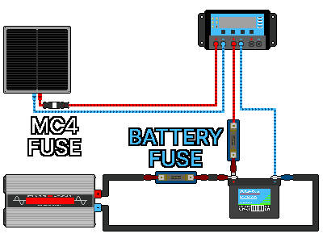

## 4. 시스템 설계
---
### 4-1. 시스템 전압
#### 4-1-1. 시스템 전압이란
&nbsp;&nbsp;&nbsp;패널·컨트롤러·배터리·인버터가 함께 쓰는 하나의 전압 등급입니다. 보통 12V / 24V / 48V 중 하나이며, 네 부품의 등급이 맞아야 사고 위험이 줄어듭니다. 컨트롤러는 배터리를 충전하고 인버터는 배터리에서 전기를 꺼내 쓰므로 배터리 전압을 기준으로 잡습니다.

&nbsp;&nbsp;&nbsp;24V 패널을 쓰려면 24V 충전 컨트롤러와 24V 배터리가 필요합니다(AC를 쓰면 24V 입력 인버터도). 24V 배터리가 없으면 12V 배터리 2개를 직렬로 이어 24V로 만듭니다.

| 잘못된 조합 | 발생 가능한 문제 |
|---|---|
| 12V 패널 + 24V 배터리(PWM) | 패널 전압이 낮아 24V 배터리를 충전하지 못함 |
| 24V 컨트롤러 + 12V 배터리 | 전압 불일치로 작동하지 않거나 손상 |
| 12V 인버터 + 24V 배터리 | 입력 과전압으로 인버터 손상 |
| 24V 인버터 + 12V 배터리 | 전압 부족으로 인버터가 작동하지 않음 |

#### 4-1-2. 12V·24V·48V 비교
&nbsp;&nbsp;&nbsp;부품 전압만 맞으면 어느 등급이든 작동합니다. 같은 전력이면 전압이 높을수록 전류가 작아지므로(P = V × I) 더 얇은 전선으로 충분하고 열 손실도 줄어듭니다. 시스템이 클수록(전기 사용량이 많을수록) 높은 전압이 효율적입니다.

| 시스템 전압 | 600W를 보낼 때 전류 | 의미 |
|:---:|---:|---|
| 12V | 50A | 전류가 커서 전선을 굵게 해야 하고 열 손실로 인한 전력 손실이 큼 |
| 24V | 25A | 12V보다 전력 손실이 절반 |
| 48V | 12.5A | 전력 손실이 가장 작고 12V보다 얇은 전선 사용 가능 |

- 12V: 가장 단순하고 12V용 부품·기기가 많지만 전류가 커서 큰 시스템에서는 불리합니다.
- 24V: 전류가 12V의 절반이라 전선·손실이 적은 무난한 선택입니다.
- 48V: 손실이 가장 적지만 대부분의 부품이 12V·24V보다 비쌉니다.

| 대략적인 규모(참고) | 권장 시스템 전압 |
|---|:---:|
| 작음(패널에서 수백 W 생산, 조명·충전 위주) | 12V |
| 중간(패널에서 약 1.5kW 생산) | 24V |
| 큼(패널에서 1.5kW 이상 생산) | 48V |

#### 4-1-3. 정하는 순서
1. 전기를 쓰는 기기들의 전력 소모량을 합해 패널에서 시간당 몇 W를 생산해야 하는지 계산합니다.
2. 계산 결과를 위 표의 규모와 비교해 권장 시스템 전압을 확인합니다.
3. 시스템 전압과 같은 등급의 배터리를 구합니다. 구하지 못하면 12V 여러 개를 직렬로 구성합니다.
4. 컨트롤러와 인버터를 배터리 전압에 맞는 제품으로 구합니다.
5. 패널은 구축한 시스템을 충전할 수 있는 제품으로 구합니다. PWM 컨트롤러는 패널 전압 = 배터리 전압인 제품, MPPT 컨트롤러는 더 유연하되 Voc 한계를 확인합니다.

---
### 4-2. 필요 전력·패널·배터리 용량 계산
&nbsp;&nbsp;&nbsp;모든 값에 여유를 둡니다. 부족하면 위험하고 넉넉하면 안전합니다. 아래는 24V 시스템 예시입니다.

#### 4-2-1. 하루 소비 전력량(Wh)
&nbsp;&nbsp;&nbsp;꼭 필요한 기기(조명·통신·냉장)부터 우선순위를 매긴 뒤, 태양광으로 전기를 공급할 기기마다 전력(W) × 하루 사용시간(h)을 구해 모두 더합니다.

| 기기 | 전력 | 사용시간 | 소비 전력량 |
|---|---|---|---|
| LED 전등 | 10W | 5h | 50Wh |
| 휴대폰 충전 | 10W | 2h | 20Wh |
| 노트북 | 50W | 3h | 150Wh |
| 선풍기 | 40W | 6h | 240Wh |
| 소형 냉장고 | 간헐 작동 | 24h | 약 500Wh |
| 합계 | | | 약 1,000Wh/일 |

#### 4-2-2. 손실 여유
&nbsp;&nbsp;&nbsp;컨트롤러·인버터·전선·배터리 충방전에서 전기가 조금씩 샙니다. 약 0.75로 나누어 여유를 둡니다.

- 1,000Wh ÷ 0.75 ≈ 1,333Wh (실제로 만들고 저장해야 할 양)

#### 4-2-3. 배터리 용량
&nbsp;&nbsp;&nbsp;며칠치를 저장할지(자립일수. 흐린 날을 며칠 버틸지)를 정합니다. 재난 대비라면 2~3일이 적당하며 예시는 2일입니다.

- 저장할 전력량 = 하루 소비 × 자립일수 = 1,000Wh × 2일 = 2,000Wh
- 배터리 용량(Wh) = 저장할 전력량 ÷ 사용 가능 비율(DoD)
- 배터리 용량(Ah) = Wh ÷ 시스템 전압

| 배터리 종류 | 계산 | 필요 용량(Wh) | 24V로 환산 |
|---|---|---|---|
| 리튬(80%) | 2,000 ÷ 0.8 | 2,500Wh | 2,500 ÷ 24 ≈ 104Ah → 120Ah |
| 납산(50%) | 2,000 ÷ 0.5 | 4,000Wh | 4,000 ÷ 24 ≈ 167Ah → 200Ah |

&nbsp;&nbsp;&nbsp;같은 조건에서 납산은 리튬보다 거의 2배 큰 용량이 필요합니다. 배터리를 준비할 때 무게와 가격을 함께 따집니다.

#### 4-2-4. 패널 용량
&nbsp;&nbsp;&nbsp;패널은 하루 종일 최대 출력을 내지 않습니다. 하루에 강한 햇빛이 유지되는 유효 발전 시간을 피크 일조시간(PSH)이라 합니다. 낮의 길이가 아닙니다. 대한민국은 대략 여름 4~5시간, 겨울·흐린 날 2~3시간입니다. 재난 대비 목적이면 보수적으로 약 3시간으로 잡습니다.

- 패널 용량(W) = 하루 만들 전력량 ÷ 피크 일조시간
- 1,333Wh ÷ 3시간 ≈ 약 444W

&nbsp;&nbsp;&nbsp;흐린 날 회복과 여유를 위해 넉넉히 올려 잡습니다. 예) 444W가 필요하면 200W 패널 3장. 패널에 여유가 있으면 맑은 몇 시간 동안 더 빨리 충전해 흐린 날을 잘 넘기므로, 재난 상황에서는 패널을 후하게 잡는 편이 유리합니다.

#### 4-2-5. 컨트롤러 전류
&nbsp;&nbsp;&nbsp;컨트롤러 전류(A) ≈ (패널 W ÷ 시스템 전압) × 1.25

- 600W ÷ 24V = 25A
- 25A × 1.25 ≈ 31A
- 40A급 MPPT 컨트롤러를 선택합니다.

#### 4-2-6. 종합 예시
| 항목 | 결정 |
|---|---|
| 시스템 전압 | 24V |
| 하루 소비 | 약 1,000Wh(손실 포함 1,333Wh) |
| 배터리 | 리튬 24V·120Ah(또는 납산 24V·200Ah) |
| 패널 | 600W(200W × 3장) |
| 컨트롤러 | 40A MPPT(24V) |
| 인버터(선택) | 부하 합과 모터 서지를 고려해 선택. 24V 입력 |

---
### 4-3. 전선·보호장치 선정
#### 4-3-1. 전선 굵기
&nbsp;&nbsp;&nbsp;구간별 전류를 구하고 그 전류를 넉넉히 견디는 굵기를 고릅니다. 위 종합 예시에서 인버터가 1,000W를 낼 때 배터리에서 인버터로 흐르는 전류는 지속적으로 약 50A입니다.

| 구간 | 대략 전류 | 권장 전선(참고) | 퓨즈/차단기(DC용) |
|---|---|---|---|
| 패널 → 컨트롤러 | 약 25A | 6mm²(10AWG) 이상 | 30A |
| 컨트롤러 → 배터리 | 약 25~30A | 6~10mm² | 30~40A |
| 배터리 → 인버터 | 약 50A 이상(순간 서지 100A 이상) | 16mm²(6AWG) 이상 | 80A 이상 |

- 위 값은 참고치입니다. 날씨가 더울수록, 전선이 길수록(전압 강하) 더 굵게 씁니다. 헷갈리면 한 단계 굵은 전선을 씁니다. 배터리↔인버터 구간은 전류가 가장 크므로 가장 굵은 전선을 씁니다.
- 전압 강하: 전선이 길고 가늘면 저항(R)이 커져 옴의 법칙(V = I × R)대로 전압이 깎이고 그만큼 열로 낭비됩니다. 전선은 짧고 굵게 하는 것이 원칙입니다. 시스템 전압을 높여 전류를 줄여도 유리합니다.

#### 4-3-2. 퓨즈·차단기 위치와 용량
&nbsp;&nbsp;&nbsp;퓨즈와 차단기는 과전류가 흐르면 전류를 차단해 전선과 장비를 보호합니다. 전류는 전원(+)에서 나와 기기를 거쳐 접지(−)로 흐르므로, 전원(+) 측 전선을 보호하도록 +극 전선에 설치합니다. −극에 달면 퓨즈가 끊기거나 차단기가 내려가도 기기 내부에 여전히 +전압이 흘러 누전이나 화재 위험이 남습니다.

- 용량: 정상 전류보다 크고 전선 허용 전류보다 작은 제품. 예) 평소 25A가 흐르고 전선이 36A까지 버티면 30A급.
- 태양광 시스템에서는 반드시 DC 정격 제품을 씁니다.

&nbsp;&nbsp;&nbsp;다음 세 곳의 +극 전선에 퓨즈 또는 DC 차단기를 설치합니다.

1. 패널과 컨트롤러 사이: 패널과 최대한 가까운 곳
2. 컨트롤러와 배터리 사이: 배터리와 최대한 가까운 곳
3. 배터리와 인버터 사이: 배터리와 최대한 가까운 곳

| 위치 | 권장 보호장치 |
| --- | --- |
| 패널 ↔ 패널(병렬 연결 시) | PV 퓨즈 |
| 패널 ↔ 충전컨트롤러 | PV 퓨즈 또는 PV용 DC 차단기 |
| 충전컨트롤러 ↔ 배터리 | MEGA 또는 Class-T |
| 배터리 ↔ 인버터 | MEGA 또는 Class-T |
| 유지보수용 차단 | DC 차단기 |

&nbsp;&nbsp;&nbsp;MC4 퓨즈는 PV 퓨즈의 장착 형태 중 하나입니다.

| 항목 | PV 퓨즈 | ANL 퓨즈 | MEGA 퓨즈 | Class-T 퓨즈 | DC 차단기 |
| --- | --- | --- | --- | --- | --- |
| 가격 | 저렴 | 저렴 | 보통 | 비쌈 | 보통~비쌈 |
| 차단 속도 | 빠름 | 느림~보통 | 보통~빠름 | 매우 빠름 | 느림 |
| 차단용량(AIC) | 낮음~중간 | 낮음 | 중간 | 매우 높음 | 제품별 차이 |
| 과전류 보호 | 우수 | 가능 | 우수 | 매우 우수 | 가능 |
| 단락 보호 | 우수 | 보통 | 우수 | 매우 우수 | 제품별 차이 |
| 재사용 | 불가 | 불가 | 불가 | 불가 | 가능 |
| LiFePO4 보호 | 부적합 | 가능 | 권장 | 최적 | 단독 사용 비권장 |
| 납산 배터리 보호 | 부적합 | 가능 | 권장 | 권장 | 가능 |
| 태양광 패널 보호 | 최적 | 부적합 | 부적합 | 부적합 | 가능 |
| 소형 태양광 | 권장 | 적합 | 적합 | 과사양 가능 | 적합 |
| 중형 태양광 | 권장 | 가능 | 권장 | 권장 | 가능 |
| 대형 ESS | 부적합 | 비추천 | 가능 | 최적 | 보조용 |
| 주요 용도 | 패널 전선 보호 | RV, 캠핑카, 소형 오프그리드 | 오프그리드, 중형 인버터 | ESS, 대형 인버터, LiFePO4 | 개폐 및 유지보수 |

> **주의:** 리튬인산철(LiFePO4) 배터리는 합선 시 순간적으로 수천 A의 폭발적인 전류를 뿜어냅니다. 일반 저가형 가정용이나 종류 미상의 DC 차단기는 이 전류를 차단하지 못하고 내부가 녹아붙어 화재로 이어집니다. 리튬 배터리에는 반드시 Class-T 퓨즈나 고성능 MEGA 퓨즈를 배터리 바로 옆에 직렬로 먼저 답니다.