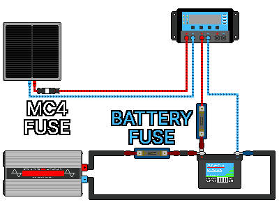

## 4. 系统设计
---
### 4-1. 系统电压
#### 4-1-1. 什么是系统电压
&nbsp;&nbsp;&nbsp;电池板、控制器、电池和逆变器共同使用的一个电压等级。通常是12V / 24V / 48V之一，四种部件的等级一致，事故风险才会降低。控制器给电池充电，逆变器从电池取电使用，所以以电池电压为基准。

&nbsp;&nbsp;&nbsp;要使用24V电池板，需要24V充电控制器和24V电池（用AC的话还要24V输入的逆变器）。没有24V电池的话，把2个12V电池串联成24V。

| 错误的组合 | 可能出现的问题 |
|---|---|
| 12V电池板 + 24V电池（PWM） | 电池板电压低，无法给24V电池充电 |
| 24V控制器 + 12V电池 | 电压不匹配，无法工作或损坏 |
| 12V逆变器 + 24V电池 | 输入过电压，损坏逆变器 |
| 24V逆变器 + 12V电池 | 电压不足，逆变器无法工作 |

#### 4-1-2. 12V、24V、48V的比较
&nbsp;&nbsp;&nbsp;只要部件电压一致，哪个等级都能工作。同样的功率，电压越高电流越小（P = V × I），所以更细的电线就足够，发热损耗也减少。系统越大（用电越多），高电压越高效。

| 系统电压 | 输送600W时的电流 | 含义 |
|:---:|---:|---|
| 12V | 50A | 电流大，所以电线要粗，因发热造成的功率损耗大 |
| 24V | 25A | 功率损耗是12V的一半 |
| 48V | 12.5A | 功率损耗最小，可以使用比12V更细的电线 |

- 12V：最简单，12V用的部件和设备多，但电流大，在大系统中不利。
- 24V：电流是12V的一半，电线和损耗较小，是稳妥的选择。
- 48V：损耗最小，但大部分部件比12V、24V贵。

| 大致规模（参考） | 建议系统电压 |
|---|:---:|
| 小（电池板产生几百W，以照明、充电为主） | 12V |
| 中（电池板产生约1.5kW） | 24V |
| 大（电池板产生1.5kW以上） | 48V |

#### 4-1-3. 确定顺序
1. 把用电设备的耗电量相加，计算电池板每小时必须产生多少W。
2. 把计算结果与上表的规模比较，确定建议的系统电压。
3. 获取与系统电压同一等级的电池。弄不到的话，用多个12V电池串联。
4. 获取与电池电压匹配的控制器和逆变器。
5. 获取能给所搭建系统充电的电池板。PWM控制器用电池板电压 = 电池电压的产品，MPPT控制器更灵活，但要确认Voc极限。

---
### 4-2. 计算所需电力、电池板和电池容量
&nbsp;&nbsp;&nbsp;所有数值都要留出余量。不足就危险，宽裕就安全。以下是24V系统的示例。

#### 4-2-1. 每日耗电量（Wh）
&nbsp;&nbsp;&nbsp;先把必需的设备（照明、通信、冷藏）排出优先顺序，再对每个用太阳能供电的设备，求出功率（W）× 每日使用时间（h），全部相加。

| 设备 | 功率 | 使用时间 | 耗电量 |
|---|---|---|---|
| LED灯 | 10W | 5h | 50Wh |
| 手机充电 | 10W | 2h | 20Wh |
| 笔记本电脑 | 50W | 3h | 150Wh |
| 风扇 | 40W | 6h | 240Wh |
| 小冰箱 | 间歇运行 | 24h | 约500Wh |
| 合计 | | | 约1,000Wh/天 |

#### 4-2-2. 损耗余量
&nbsp;&nbsp;&nbsp;控制器、逆变器、电线、电池充放电中，电会一点一点漏掉。除以约0.75留出余量。

- 1,000Wh ÷ 0.75 ≈ 1,333Wh（实际需要产生并储存的量）

#### 4-2-3. 电池容量
&nbsp;&nbsp;&nbsp;确定储存几天的量（自给天数：能撑过几天阴天）。灾难准备的话2-3天合适，示例取2天。

- 需储存电量 = 每日消耗 × 自给天数 = 1,000Wh × 2天 = 2,000Wh
- 电池容量（Wh）= 需储存电量 ÷ 可用比例（DoD）
- 电池容量（Ah）= Wh ÷ 系统电压

| 电池种类 | 计算 | 所需容量（Wh） | 换算为24V |
|---|---|---|---|
| 锂（80%） | 2,000 ÷ 0.8 | 2,500Wh | 2,500 ÷ 24 ≈ 104Ah → 120Ah |
| 铅酸（50%） | 2,000 ÷ 0.5 | 4,000Wh | 4,000 ÷ 24 ≈ 167Ah → 200Ah |

&nbsp;&nbsp;&nbsp;同样条件下，铅酸需要的容量几乎是锂的2倍。准备电池时要把重量和价格一并考虑。

#### 4-2-4. 电池板容量
&nbsp;&nbsp;&nbsp;电池板不会整天都以最大功率输出。一天中强阳光保持的有效发电时间称为峰值日照时数（PSH）。不是白天的长度。韩国大致是夏季4-5小时，冬季和阴天2-3小时。以灾难准备为目的，保守地取约3小时。

- 电池板容量（W）= 每天需产生的电量 ÷ 峰值日照时数
- 1,333Wh ÷ 3小时 ≈ 约444W

&nbsp;&nbsp;&nbsp;为了阴天后的恢复和余量，要宽松地往上取。例）需要444W的话，用3块200W电池板。电池板有余量，晴朗的几个小时里就能更快充电，更好地度过阴天，所以在灾难情况下，电池板取得宽裕些更有利。

#### 4-2-5. 控制器电流
&nbsp;&nbsp;&nbsp;控制器电流（A）≈（电池板W ÷ 系统电压）× 1.25

- 600W ÷ 24V = 25A
- 25A × 1.25 ≈ 31A
- 选择40A级的MPPT控制器。

#### 4-2-6. 综合示例
| 项目 | 决定 |
|---|---|
| 系统电压 | 24V |
| 每日消耗 | 约1,000Wh（含损耗1,333Wh） |
| 电池 | 锂电池24V·120Ah（或铅酸24V·200Ah） |
| 电池板 | 600W（200W × 3块） |
| 控制器 | 40A MPPT（24V） |
| 逆变器（可选） | 考虑负载合计和电机浪涌来选择。24V输入 |

---
### 4-3. 选择电线与保护装置
#### 4-3-1. 电线粗细
&nbsp;&nbsp;&nbsp;求出各区段的电流，选择能宽裕承受该电流的粗细。在上面的综合示例中，逆变器输出1,000W时，从电池流向逆变器的电流持续约为50A。

| 区段 | 大致电流 | 建议电线（参考） | 保险丝/断路器（DC用） |
|---|---|---|---|
| 电池板 → 控制器 | 约25A | 6mm²（10AWG）以上 | 30A |
| 控制器 → 电池 | 约25-30A | 6-10mm² | 30-40A |
| 电池 → 逆变器 | 约50A以上（瞬时浪涌100A以上） | 16mm²（6AWG）以上 | 80A以上 |

- 以上数值仅供参考。天气越热、电线越长（电压降），就用越粗的。拿不准就用粗一档的电线。电池↔逆变器区段电流最大，所以用最粗的电线。
- 电压降：电线又长又细，电阻（R）变大，按欧姆定律（V = I × R）电压被削减，这部分就以热的形式浪费。原则是电线短而粗。提高系统电压以减小电流也有利。

#### 4-3-2. 保险丝、断路器的位置和额定值
&nbsp;&nbsp;&nbsp;保险丝和断路器在过电流流过时切断电流，保护电线和设备。电流从电源（+）出来，经过设备，流向地（−），所以为了保护电源（+）侧的电线，要装在+极电线上。装在−极的话，即使保险丝熔断或断路器跳闸，设备内部仍有+电压流过，留下漏电或火灾的风险。

- 额定值：比正常电流大、比电线允许电流小的产品。例）平时通过25A，电线能承受到36A，则选30A级。
- 太阳能系统中务必使用有DC额定值的产品。

&nbsp;&nbsp;&nbsp;在以下三处的+极电线上安装保险丝或DC断路器。

1. 电池板与控制器之间：尽可能靠近电池板
2. 控制器与电池之间：尽可能靠近电池
3. 电池与逆变器之间：尽可能靠近电池

| 位置 | 建议保护装置 |
| --- | --- |
| 电池板 ↔ 电池板（并联时） | PV保险丝 |
| 电池板 ↔ 充电控制器 | PV保险丝或PV用DC断路器 |
| 充电控制器 ↔ 电池 | MEGA或Class-T |
| 电池 ↔ 逆变器 | MEGA或Class-T |
| 维护用切断 | DC断路器 |

&nbsp;&nbsp;&nbsp;MC4保险丝是PV保险丝的安装形式之一。

| 项目 | PV保险丝 | ANL保险丝 | MEGA保险丝 | Class-T保险丝 | DC断路器 |
| --- | --- | --- | --- | --- | --- |
| 价格 | 便宜 | 便宜 | 一般 | 贵 | 一般至贵 |
| 分断速度 | 快 | 慢至一般 | 一般至快 | 非常快 | 慢 |
| 分断容量（AIC） | 低至中 | 低 | 中 | 非常高 | 因产品而异 |
| 过电流保护 | 优秀 | 可以 | 优秀 | 非常优秀 | 可以 |
| 短路保护 | 优秀 | 一般 | 优秀 | 非常优秀 | 因产品而异 |
| 可否重复使用 | 不可 | 不可 | 不可 | 不可 | 可以 |
| LiFePO4保护 | 不适合 | 可以 | 推荐 | 最佳 | 不建议单独使用 |
| 铅酸电池保护 | 不适合 | 可以 | 推荐 | 推荐 | 可以 |
| 太阳能电池板保护 | 最佳 | 不适合 | 不适合 | 不适合 | 可以 |
| 小型太阳能 | 推荐 | 适合 | 适合 | 可能规格过高 | 适合 |
| 中型太阳能 | 推荐 | 可以 | 推荐 | 推荐 | 可以 |
| 大型ESS | 不适合 | 不推荐 | 可以 | 最佳 | 辅助用 |
| 主要用途 | 电池板电线保护 | 房车、露营车、小型离网 | 离网、中型逆变器 | ESS、大型逆变器、LiFePO4 | 开闭及维护 |

> **注意：** 磷酸铁锂（LiFePO4）电池短路时会瞬间喷出数千A的爆发性电流。普通低价家用或种类不明的DC断路器无法切断这种电流，内部会熔粘在一起而引发火灾。锂电池务必在紧挨电池的地方先串联Class-T保险丝或高性能MEGA保险丝。