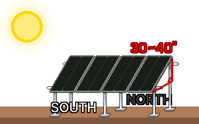

## 5. Установка и эксплуатация
### Проверка безопасности перед работой
- Убедитесь, что питание отключено.
- Уберите поблизости воду и источники возгорания.
- Проверьте, не мокрые ли руки и не идёт ли дождь.
- Проверьте правильность полярности +/−.
- Проверьте, что толщина проводов на каждом участке достаточна, а предохранители DC и автоматы DC установлены.
- Проверьте, что класс напряжения всех компонентов унифицирован (например: панель 24 В ↔ аккумулятор 24 В).
- Реально измерьте напряжение мультиметром.
- Проверьте, что вблизи провода «+» аккумулятора есть предохранитель.
- Проверьте, что контроллер выдерживает пределы тока и напряжения панелей.

---
### 5-1. Размещение панелей
#### 5-1-1. Место размещения
&nbsp;&nbsp;&nbsp;Элементы панели соединены последовательно, поэтому даже частичное затенение резко снижает общую выработку. Проверьте, как перемещаются тени утром, в полдень и после обеда с открытой южной стороны, и устанавливайте там, где не проходят тени от деревьев, электрических столбов, зданий и антенн и где солнце светит весь день.

&nbsp;&nbsp;&nbsp;Панель начинает вырабатывать электричество с момента, когда на неё попадает свет, и, в отличие от аккумулятора, её нельзя выключить выключателем. Во время размещения и прокладки проводки закрывайте панель непрозрачной тканью, чтобы остановить выработку, либо работайте, считая её находящейся под напряжением.

#### 5-1-2. Направление
&nbsp;&nbsp;&nbsp;В Республике Корея, находящейся в Северном полушарии, поворачивайте панели строго на юг. Если во второй половине дня нужно больше электричества, слегка подстройте в сторону юго-запада, а если важно утро — в сторону юго-востока.

#### 5-1-3. Угол
&nbsp;&nbsp;&nbsp;Чем перпендикулярнее свет падает на панель, тем выше КПД выработки, поэтому поставьте панель наклонно к земле. Если угол приходится фиксировать, устанавливайте с наклоном 30-40°, близким к углу широты. Если угол можно регулировать, зимой ставьте круче (широта +около 15°, чтобы ловить низкое зимнее солнце), а летом — положе (широта −около 15°). Для целей подготовки к катастрофам надёжнее слегка приподнять панель под зиму — сезон, когда электричества не хватает больше всего.

#### 5-1-4. Крепление
- Панель — широкий щит, поэтому ветер легко раскачивает её, как парус, или ломает. Даже при временной установке прочно закрепляйте её наземной рамой, привязкой к конструкции, грузами и т. п.
- Когда панель нагревается, выработка падает, поэтому устанавливайте её приподнятой, чтобы воздух проходил позади панели. Не устанавливайте вплотную на горячую поверхность вроде асфальта или металлической крыши.
- В холодную зимнюю погоду напряжение панели (Voc) становится выше значения из таблицы. Предел максимального входного напряжения PV контроллера должен превышать сумму напряжений при последовательном соединении панелей как минимум на 15 %.

---
### 5-2. Проводка, соединения и заземление
#### 5-2-1. Порядок подключения
&nbsp;&nbsp;&nbsp;Большинству контроллеров, чтобы нормально работать, нужно сначала распознать напряжение аккумулятора, поэтому подключение панелей раньше аккумулятора может повредить контроллер. Аккумулятор всегда подключают первым, а отключают последним. При подключении и отключении панелей безопаснее работать, оставив их закрытыми непрозрачной тканью.

**Порядок подключения**

1. Подключите аккумулятор к контроллеру.
2. Подключите панели к контроллеру.
3. Подключите к аккумулятору инвертор с выключенным питанием.
4. Включите питание инвертора.

**Порядок отключения**

1. Выключите питание инвертора.
2. Отсоедините от аккумулятора инвертор с выключенным питанием.
3. Отсоедините панели от контроллера.
4. Отсоедините аккумулятор от контроллера.

#### 5-2-2. Проверка полярности (+/−)
&nbsp;&nbsp;&nbsp;Если подключить с перепутанной полярностью, можно повредить контроллер, аккумулятор и инвертор.

1. Перед подключением проверьте полюса +/− мультиметром.
2. Обычно красный провод — полюс «+», чёрный — полюс «−». Проверяйте цвет клемм и обозначения полярности вместе.
3. Разъёмы панелей (MC4) бывают «папа» и «мама», поэтому соединяйте только разъёмы, которые стыкуются друг с другом.

#### 5-2-3. Состояние соединений
&nbsp;&nbsp;&nbsp;Слабое соединение становится сопротивлением, греется и приводит к пожару.

- Винты и обжимные наконечники (клеммы) затягивайте крепко, чтобы не шатались.
- Толстые провода заканчивайте обжимными наконечниками, чтобы контакт был надёжным.
- Наружные соединения защищайте, чтобы в них не попадали вода и влага.
- При затягивании клемм аккумулятора металлическим инструментом, например гаечным ключом, не допускайте, чтобы инструмент одновременно касался клемм (+) и (−). Если обмотать ручку инструмента изолентой, чтобы свести к минимуму открытые металлические участки, это безопаснее.

#### 5-2-4. Заземление
&nbsp;&nbsp;&nbsp;Заземление (Ground/Earth) — это соединение электрической цепи с землёй или с отдельным металлическим предметом (заземлителем). Когда из-за неисправности прибора электричество попадает на металлический каркас либо возникают статическое электричество или молния, оно безопасно отводит электричество в землю и уменьшает поражение током и повреждения.

1. Соедините между собой металлический каркас, на котором закреплены панели, и монтажную конструкцию.
2. Соедините подключённый металлический каркас заземляющим проводом и подключите к заземляющему стержню, вбитому в землю.

&nbsp;&nbsp;&nbsp;Способ заземления и уравнивания потенциалов частично определяется местными электротехническими правилами. Постоянные и крупные установки должен проверить специалист.

---
### 5-3. Проверка первого запуска и обслуживание
#### 5-3-1. Контрольный список перед запуском
- [  ] Класс напряжения всех компонентов унифицирован (например: все 24 В).
- [  ] Полярность (+/−) проверена мультиметром.
- [  ] Толщина проводов на каждом участке достаточна, предохранители/автоматы DC на месте (вблизи провода «+» аккумулятора).
- [  ] Клеммы затянуты крепко.
- [  ] Панели закреплены так, чтобы выдерживать ветер.

#### 5-3-2. Порядок запуска
1. Подключайте в порядке подключения по п. 5-2-1: аккумулятор → панели → инвертор (с выключенным питанием).
2. По экрану контроллера проверьте, что напряжение аккумулятора в нормальном диапазоне.
3. На солнце проверьте, что отображаются зарядный ток (А) и вход PV.
4. Проверьте, что напряжение аккумулятора постепенно растёт и заряд идёт нормально. Когда заряд не идёт, напряжение полностью заряженного аккумулятора 12 В — около 12,7 В, 24 В — около 25,4 В.
5. Включите питание инвертора и нагрузки и проверьте, что всё работает нормально.

#### 5-3-3. Частые проблемы
| Симптом | Что проверить |
|---|---|
| Не заряжается | Перегоревший предохранитель, ослабленное или перепутанное соединение, тень на панели, настройки контроллера, измерение напряжения панели мультиметром |
| Слабая выработка | Тень, пыль, неправильный угол, перегрев панели, нехватка мощности панелей, тонкие и длинные провода (падение напряжения) |
| Аккумулятор быстро садится | Избыточная нагрузка, нехватка ёмкости аккумулятора, износ аккумулятора, мощность инвертора в режиме ожидания, накопленные переразряды |
| Ошибка на контроллере | Проверьте код по руководству, перепроверьте класс напряжения и соединения |

#### 5-3-4. Обслуживание
- Панели: сотрите пыль, птичий помёт и снег, чтобы восстановить выработку. Если угол можно регулировать, настраивайте его по сезонам.
- Соединения: из-за перепадов температуры клеммы могут ослабнуть, поэтому изредка подтягивайте их заново.
- Аккумуляторы: у обслуживаемых свинцово-кислотных периодически доливайте дистиллированную воду и проветривайте. У всех аккумуляторов поддерживайте клеммы в чистоте, проверяйте напряжение и заменяйте изношенные.
- Контроллер: часто проверяйте зарядный ток и напряжение аккумулятора.

---
### 5-4. Эксплуатация в условиях катастрофы
#### 5-4-1. Приоритеты
&nbsp;&nbsp;&nbsp;Заранее выясните, как каждый прибор влияет на выживание, и когда заряд аккумулятора снижается, отключайте питание по очереди, начиная с приборов с низким приоритетом.

| Приоритет | Категория | Примеры |
| --- | --- | --- |
| 1-й | Выживание, помощь | Телефон, радио, аварийное освещение, необходимые медицинские приборы |
| 2-й | Поддержание, сохранение | Холодильник для продуктов и лекарств, вентиляция, ноутбук |
| 3-й | Удобство и прочее | Обычная бытовая техника, увлажнитель, очиститель воды и т. п. |

#### 5-4-2. Экономия электричества
- Приборы DC подключайте без инвертора прямо к контроллеру (клемма DC Load) или к аккумулятору, чтобы избежать потерь на преобразование.
- Когда приборы AC не используются, выключайте или отсоединяйте инвертор, чтобы исключить потребление в режиме ожидания.
- Вместо ламп накаливания используйте высокоэффективные приборы, например светодиодное освещение.
- Заряд и использование сосредоточьте на время около полудня, когда солнце сильнее всего. Излишки электричества используйте для зарядки приборов.

#### 5-4-3. Проверка остаточного заряда аккумулятора
&nbsp;&nbsp;&nbsp;У свинцово-кислотных аккумуляторов ненадолго отключите нагрузку и заряд и по напряжению в состоянии покоя оцените остаточный заряд.

| Остаточный заряд | Аккумулятор 12 В | Аккумулятор 24 В |
|---|---|---|
| 100 % (полный) | около 12,7 В | около 25,4 В |
| 75 % | около 12,5 В | около 25,0 В |
| 50 % (рекомендуемый предел для свинцово-кислотных) | около 12,2 В | около 24,4 В |
| 25 % | около 12,0 В | около 24,0 В |
| Разряжен (использовать нельзя) | 11,9 В и ниже | 23,8 В и ниже |

&nbsp;&nbsp;&nbsp;У лития (LiFePO₄) напряжение почти ровное, и по нему трудно оценить остаточный заряд. Смотрите показания в %, которые выводят контроллер и BMS. Литий тоже служит дольше, если избегать переразряда — опустошения до конца.

#### 5-4-4. Подготовка к пасмурным дням и зиме
- Если остаточного заряда аккумулятора не хватает, экономьте строже и отключайте приборы 2-го и 3-го приоритета.
- Ради срока службы и безопасности аккумулятора регулируйте расход так, чтобы не допускать переразряда.
- По возможности обеспечьте запасной аккумулятор или другой способ зарядки (генератор и т. п.) на экстренный случай.
- Чем дольше затягивается пасмурная погода, тем больше нужно поддерживать только минимальную мощность для выживания (связь, освещение).

#### 5-4-5. Безопасность при эксплуатации
- Не используйте приборы, превышающие номинал инвертора (с учётом пусковых токов двигателей).
- Проветривайте аккумулятор и при перегреве, странном запахе или вздутии немедленно проверьте его.
- Не допускайте попадания дождевой воды, чтобы оборудование не промокало.
- При длительной эксплуатации периодически чистите панели и проверяйте соединения.