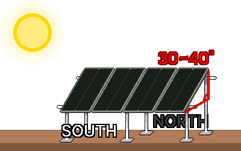

## 5. Installation and Operation
### Pre-Work Safety Check
- Check that the power is cut.
- Remove water and sources of ignition nearby.
- Check whether your hands are wet and whether it is raining.
- Check that the +/− polarity is correct.
- Check that the wire thickness of each section is sufficient and that DC fuses and DC breakers are in place.
- Check that the voltage class of all components is unified (e.g., 24V panel ↔ 24V battery).
- Actually measure the voltage with the multimeter.
- Check that there is a fuse near the battery's + wire.
- Check that the controller can withstand the panel's current and voltage limits.

---
### 5-1. Mounting the Panels
#### 5-1-1. Mounting Location
&nbsp;&nbsp;&nbsp;Panel cells are connected in series, so shading even part of the panel sharply cuts the whole output. Check how shadows move in the morning, noon, and afternoon from an open south-facing direction, and install where the shadows of trees, utility poles, buildings, and antennas do not pass and sunlight reaches all day.

&nbsp;&nbsp;&nbsp;A panel produces electricity from the moment it receives light, and unlike a battery it cannot be switched off. During mounting and wiring, cover the panel with opaque cloth to stop generation, or work on the assumption that it is live.

#### 5-1-2. Direction
&nbsp;&nbsp;&nbsp;In South Korea, in the Northern Hemisphere, face the panels due south. If more electricity is needed in the afternoon, fine-tune slightly toward the southwest, and if the morning matters, slightly toward the southeast.

#### 5-1-3. Angle
&nbsp;&nbsp;&nbsp;The more perpendicular the sunlight to the panel, the higher the generation efficiency, so stand the panel at a slant from the ground. If the angle must be fixed, install at a tilt of 30-40°, close to the latitude angle. If the angle is adjustable, stand it steeper in winter (latitude +about 15°, to catch the low winter sun) and lay it flatter in summer (latitude −about 15°). For disaster preparedness, it is safer to tilt slightly steeper to suit winter, the season when electricity is scarcest.

#### 5-1-4. Securing
- A panel is a broad plate, so wind easily makes it fly like a sail or breaks it. Even for a temporary installation, secure it firmly with a ground frame, lashing to a structure, or weights.
- Output falls when a panel gets hot, so mount it raised so that air passes behind it. Do not install it directly against a hot surface such as asphalt or a metal roof.
- In cold winter weather the panel voltage (Voc) rises above the spec sheet. The controller's maximum PV input voltage limit must have at least 15% margin over the sum of the voltage when the panels are connected in series.

---
### 5-2. Wiring, Connections, and Grounding
#### 5-2-1. Connection Order
&nbsp;&nbsp;&nbsp;Most controllers must sense the battery voltage first to work normally, so connecting the panels before the battery can damage the controller. Always connect the battery first and disconnect it last. When connecting or disconnecting panels, it is safer to work with them covered with opaque cloth.

**Connection order**

1. Connect the battery to the controller.
2. Connect the panels to the controller.
3. Connect the inverter, with its power off, to the battery.
4. Turn on the inverter's power.

**Disconnection order**

1. Turn off the inverter's power.
2. Disconnect the inverter, with its power off, from the battery.
3. Disconnect the panels from the controller.
4. Disconnect the battery from the controller.

#### 5-2-2. Checking Polarity (+/−)
&nbsp;&nbsp;&nbsp;Connecting with reversed polarity can damage the controller, battery, and inverter.

1. Before connecting, check the +/− poles with the multimeter.
2. Usually the red wire is the + pole and the black wire the − pole. Check the terminal colors and the polarity markings together.
3. Panel connectors (MC4) are male and female, so connect only connectors that mate with each other.

#### 5-2-3. Connection Condition
&nbsp;&nbsp;&nbsp;A loose connection becomes a resistance, produces heat, and leads to fire.

- Tighten screws and crimp terminals so that they do not wobble.
- Finish thick wire with crimp terminals so that contact is secure.
- Protect outdoor connections so that water and moisture do not get in.
- When tightening battery terminals with a metal tool such as a wrench, do not let the tool touch the (+) and (−) terminals at the same time. Wrapping the tool handle in insulating tape to minimize exposed metal is safer.

#### 5-2-4. Grounding
&nbsp;&nbsp;&nbsp;Grounding (Ground/Earth) is connecting an electrical circuit to the earth or to a separate piece of metal (a ground electrode). When a device fault sends electricity into a metal frame, or static electricity or lightning occurs, it safely sends the electricity to the earth and reduces shock and damage.

1. Connect the metal frame that holds the panels and the mounting structure to each other.
2. Join the connected metal frame with a ground wire and connect it to a ground rod driven into the earth.

&nbsp;&nbsp;&nbsp;Part of the grounding and bonding method is set by local electrical regulations. For permanent or large installations, have an expert check it.

---
### 5-3. First Start-Up Check and Maintenance
#### 5-3-1. Pre-Start Checklist
- [  ] The voltage class of all components is unified (e.g., all 24V).
- [  ] Polarity (+/−) was checked with the multimeter.
- [  ] The wire thickness of each section is sufficient and DC fuses/breakers are in place (near the battery + wire).
- [  ] Terminals are tightened firmly.
- [  ] The panels are secured to withstand wind.

#### 5-3-2. Start-Up Order
1. Connect in the order of the connection sequence in 5-2-1: battery → panels → inverter (with power off).
2. Check on the controller screen that the battery voltage is in the normal range.
3. In sunlight, check that the charge current (A) and PV input are displayed.
4. Check that the battery voltage rises gradually and charging is normal. When not charging, the fully charged voltage is about 12.7V for 12V and about 25.4V for 24V.
5. Turn on the inverter power and switch on loads to check that they work normally.

#### 5-3-3. Common Problems
| Symptom | Points to check |
|---|---|
| Not charging | Blown fuse, loose or reversed connection, panel shade, controller settings, measuring panel voltage with a multimeter |
| Weak output | Shade, dust, wrong angle, panel overheating, insufficient panel capacity, thin and long wire (voltage drop) |
| Battery drains quickly | Excess load, insufficient battery capacity, aged battery, inverter standby power, accumulated overdischarge |
| Controller error display | Check the code in the manual, recheck voltage class and connections |

#### 5-3-4. Maintenance
- Panels: wipe off dust, bird droppings, and snow to restore output. If the angle is adjustable, adjust it by season.
- Connections: terminals can loosen with temperature changes, so retighten them occasionally.
- Batteries: for flooded lead-acid, top up distilled water and ventilate regularly. For all batteries, keep the terminals clean and check the voltage to replace aged batteries.
- Controller: check the charge current and battery voltage often.

---
### 5-4. Operating in a Disaster
#### 5-4-1. Priorities
&nbsp;&nbsp;&nbsp;Understand in advance how much each device affects survival, and as the battery charge falls, cut power to the lowest-priority devices first.

| Priority | Category | Examples |
| --- | --- | --- |
| 1st | Survival and relief | Phone, radio, emergency lighting, essential medical devices |
| 2nd | Maintenance and preservation | Refrigerator for food and medicine, ventilation, laptop |
| 3rd | Convenience and other | General appliances, humidifier, water purifier, etc. |

#### 5-4-2. Saving Electricity
- Connect DC devices directly to the controller (DC Load terminal) or the battery without an inverter to avoid conversion loss.
- When not using AC devices, turn off or disconnect the inverter to cut standby power.
- Use high-efficiency devices such as LED lighting instead of incandescent bulbs.
- Concentrate charging and use around noon when sunlight is strongest. Use surplus electricity to charge devices.

#### 5-4-3. Checking Remaining Battery Charge
&nbsp;&nbsp;&nbsp;For lead-acid batteries, turn off loads and charging for a while, and measure the voltage at rest to estimate the remaining charge.

| Remaining charge | 12V battery | 24V battery |
|---|---|---|
| 100% (full) | about 12.7V | about 25.4V |
| 75% | about 12.5V | about 25.0V |
| 50% (recommended limit for lead-acid) | about 12.2V | about 24.4V |
| 25% | about 12.0V | about 24.0V |
| Discharged (do not use) | 11.9V or less | 23.8V or less |

&nbsp;&nbsp;&nbsp;Lithium (LiFePO₄) has an almost flat voltage, so it is hard to estimate the remaining charge from voltage. Check the % display shown by the controller and BMS. Lithium also lasts longer if you avoid overdischarge, emptying it completely.

#### 5-4-4. Preparing for Cloudy Days and Winter
- If the remaining battery charge is short, save power more strictly and turn off the 2nd and 3rd priority devices.
- Adjust usage so that overdischarge does not occur, for battery life and safety.
- If possible, secure a spare battery or another charging means (such as a generator) for emergencies.
- The longer the cloudy spell, the more you keep only the minimum survival power (communication and lighting).

#### 5-4-5. Safety During Operation
- Do not use devices exceeding the inverter rating (including motor surge).
- Ventilate the battery, and inspect immediately if there is overheating, a strange smell, or swelling.
- Block rainwater from getting in so that the equipment does not get wet.
- For long-term operation, clean the panels and inspect the connections regularly.