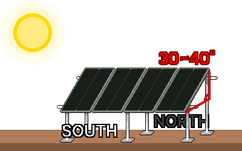

## 5. 設置と運用
### 作業前の安全点検
- 電源が遮断されているか確認します。
- 周囲の水気と火種を取り除きます。
- 手が濡れていないか、雨が降っていないか確認します。
- +/−の極性が合っているか確認します。
- 各区間の電線の太さが十分で、DCヒューズとDCブレーカーが所定の位置にあるか確認します。
- すべての部品の電圧等級が統一されているか確認します(例: 24Vパネル ↔ 24Vバッテリー)。
- テスターで電圧を実際に測ります。
- バッテリーの+線の近くにヒューズがあるか確認します。
- コントローラーがパネルの電流・電圧の限界に耐えるか確認します。

---
### 5-1. パネルの設置
#### 5-1-1. 設置場所
&nbsp;&nbsp;&nbsp;パネルのセルは直列につながっているため、一部が日陰になるだけで全体の出力が急減します。前が開けた南の方向で、朝・正午・午後に影がどう動くかを確認し、木・電柱・建物・アンテナの影が通らず、一日中日光が当たる場所に設置します。

&nbsp;&nbsp;&nbsp;パネルは光を受けた瞬間から電気を作り、バッテリーのようにスイッチで切ることができません。設置と配線の間は、不透明な布でパネルを覆って発電を防ぐか、電気が通っているものとして作業します。

#### 5-1-2. 方向
&nbsp;&nbsp;&nbsp;北半球の大韓民国では、パネルを真南に向けます。午後により多くの電気が必要なら、やや南西に、朝が重要ならやや南東に微調整します。

#### 5-1-3. 角度
&nbsp;&nbsp;&nbsp;日光がパネルに垂直に当たるほど発電効率が上がるため、パネルを地面から斜めに立てます。角度を固定しなければならないときは、緯度の角度に近い30~40°の傾きで設置します。角度の調節が可能なら、冬はより立て(緯度+約15°、低い冬の太陽を受ける)、夏はより寝かせます(緯度−約15°)。災害対策が目的なら、電気が最も不足する季節である冬に合わせて少し立てるほうが安全です。

#### 5-1-4. 固定
- パネルは広い板なので、風で帆のように煽られたり壊れたりしやすいです。仮設置でも、地面のフレーム、構造物への結束、重りなどでしっかり固定します。
- パネルが熱くなると出力が下がるため、パネルの裏に空気が通るよう浮かせて設置します。アスファルトや金属屋根のような熱い表面に、直接貼り付けて設置しません。
- 冬の寒い気候では、パネルの電圧(Voc)が仕様表より高くなります。コントローラーの最大PV入力電圧の限界が、パネルを直列につないだときの電圧の合計より少なくとも15%以上余裕がなければなりません。

---
### 5-2. 配線・結線と接地
#### 5-2-1. 接続の順序
&nbsp;&nbsp;&nbsp;ほとんどのコントローラーは、バッテリーの電圧を先に認識して初めて正常に動作するので、パネルをバッテリーより先につなぐと、コントローラーが損傷することがあります。バッテリーは常に最初につなぎ、最後に外します。パネルをつなぐ・外すときは、不透明な布で覆ったまま作業するとより安全です。

**接続の順序**

1. コントローラーにバッテリーをつなぎます。
2. パネルをコントローラーにつなぎます。
3. 電源の切れたインバーターをバッテリーにつなぎます。
4. インバーターの電源を入れます。

**取り外しの順序**

1. インバーターの電源を切ります。
2. 電源の切れたインバーターをバッテリーから外します。
3. パネルをコントローラーから外します。
4. バッテリーをコントローラーから外します。

#### 5-2-2. 極性(+/−)の確認
&nbsp;&nbsp;&nbsp;極性を逆につなぐと、コントローラー・バッテリー・インバーターが損傷することがあります。

1. つなぐ前に、テスターで+/−の極を確認します。
2. 通常は赤い線が+極、黒い線が−極です。端子の色と極性の表示を一緒に確認します。
3. パネルのコネクター(MC4)は雌雄が決まっているので、互いにかみ合うコネクターどうしをつなぎます。

#### 5-2-3. 結線の状態
&nbsp;&nbsp;&nbsp;緩い接続は抵抗になって熱が出て、火災につながります。

- ネジと圧着端子(ターミナル)は、ぐらつかないようしっかり締めます。
- 太い電線は圧着端子で仕上げて、接触を確実にします。
- 屋外の接続部は、水と湿気が入らないよう保護します。
- バッテリー端子をスパナなどの金属工具で締めるときは、工具が(+)端子と(−)端子に同時に触れないようにします。工具の持ち手に絶縁テープを巻いて、金属が露出する部分を最小限にすると安全です。

#### 5-2-4. 接地
&nbsp;&nbsp;&nbsp;接地(Ground/Earth)は、電気回路を地面や別の金属(接地極)につなぐことです。機器の故障で金属フレームに電気が流れたり、静電気や落雷が起きたりしたときに、電気を地面へ安全に流して、感電と損傷を減らします。

1. パネルを固定する金属フレームと設置構造物を互いにつなぎます。
2. つないだ金属フレームを接地線でつなぎ、地面に打ち込んだ接地棒につなぎます。

&nbsp;&nbsp;&nbsp;接地・ボンディングの方式は、地域の電気規定が定めている部分があります。恒久的・大型の設置は、専門家の確認を受けます。

---
### 5-3. 初回稼働の点検とメンテナンス
#### 5-3-1. 稼働前のチェックリスト
- [  ] すべての部品の電圧等級が統一されています(例: すべて24V)。
- [  ] 極性(+/−)をテスターで確認しました。
- [  ] 各区間の電線の太さが十分で、DCヒューズ/ブレーカーが所定の位置にあります(バッテリーの+線の近く)。
- [  ] 端子がしっかり締まっています。
- [  ] パネルが風に耐えるよう固定されています。

#### 5-3-2. 稼働の順序
1. 5-2-1の接続の順序どおり、バッテリー → パネル → (電源の切れた)インバーターの順につなぎます。
2. コントローラーの画面で、バッテリーの電圧が正常な範囲か確認します。
3. 日光の下で、充電電流(A)とPV入力が表示されるか確認します。
4. バッテリーの電圧が徐々に上がり、正常に充電されているか確認します。充電中でないときの満充電の電圧は、12Vで約12.7V、24Vで約25.4Vです。
5. インバーターの電源を入れ、負荷をつけて正常に動作するか確認します。

#### 5-3-3. よくある問題
| 症状 | 点検事項 |
|---|---|
| 充電されない | ヒューズ切れ、緩んだ、または逆になった接続、パネルの日陰、コントローラーの設定、テスターでパネル電圧を測定 |
| 出力が弱い | 日陰、ほこり、誤った角度、パネルの過熱、パネル容量の不足、細くて長い電線(電圧降下) |
| バッテリーがすぐ減る | 負荷過多、バッテリー容量の不足、バッテリーの劣化、インバーターの待機電力、過放電の蓄積 |
| コントローラーのエラー表示 | 説明書のコードを確認、電圧等級・接続の再点検 |

#### 5-3-4. メンテナンス
- パネル: ほこり・鳥のふん・雪を拭き取って出力を回復します。角度の調整が可能なら、季節ごとに調整します。
- 接続部: 温度変化で端子が緩むことがあるので、ときどき締め直します。
- バッテリー: 液式鉛蓄電池は、蒸留水の補充と換気を定期的に行います。すべてのバッテリーは、端子を清潔に保ち、電圧を確認して、劣化したバッテリーを交換します。
- コントローラー: 充電電流とバッテリー電圧をこまめに確認します。

---
### 5-4. 災害時の運用
#### 5-4-1. 優先順位
&nbsp;&nbsp;&nbsp;各機器が生存に及ぼす影響をあらかじめ把握し、バッテリーの残量が減ったら、優先順位の低い機器から順に電源を切ります。

| 優先順位 | 区分 | 例 |
| --- | --- | --- |
| 1位 | 生存・救護 | 携帯電話、ラジオ、非常灯、必須の医療機器 |
| 2位 | 維持・保存 | 食品・医薬品の冷蔵庫、換気設備、ノートパソコン |
| 3位 | 利便・その他 | 一般の家電製品、加湿器、浄水器など |

#### 5-4-2. 電気の節約
- DC機器は、インバーターなしでコントローラー(DC Load端子)やバッテリーに直接つなぎ、変換損失を避けます。
- AC機器を使わないときは、インバーターを切るか外して、待機電力を遮断します。
- 白熱灯の代わりにLED照明などの高効率機器を使います。
- 日光が最も強い正午前後に、充電と使用をまとめて行います。余った電気は、機器の充電に使います。

#### 5-4-3. バッテリー残量の確認
&nbsp;&nbsp;&nbsp;鉛蓄電池は、負荷と充電をいったん切って休ませた状態で電圧を測り、残量を推し量ります。

| 残量 | 12Vバッテリー | 24Vバッテリー |
|---|---|---|
| 100%(満充電) | 約12.7V | 約25.4V |
| 75% | 約12.5V | 約25.0V |
| 50%(鉛蓄電池の推奨限界) | 約12.2V | 約24.4V |
| 25% | 約12.0V | 約24.0V |
| 放電(使用禁止) | 11.9V以下 | 23.8V以下 |

&nbsp;&nbsp;&nbsp;リチウム(LiFePO₄)は電圧がほぼ平坦で、電圧から残量を推定するのが困難です。コントローラーとBMSが示す%の表示を確認します。リチウムも、使い切る過放電を避けてこそ寿命が長くなります。

#### 5-4-4. 曇りの日・冬への備え
- バッテリー残量が不足したら、より強く節電して、2位・3位の機器を切ります。
- バッテリーの寿命と安全のため、過放電にならないよう使用量を調節します。
- 可能なら、予備のバッテリーやほかの充電手段(発電機など)を、非常用に確保します。
- 曇りの日が長引くほど、最低限の生存電力(通信、照明程度)だけを維持します。

#### 5-4-5. 運用中の安全
- インバーターの定格(モーターのサージを含む)を超える機器を使いません。
- バッテリーを換気し、過熱・異臭・膨らみがあればただちに点検します。
- 雨水が入らないよう防いで、設備が濡れないようにします。
- 長期運用の際は、パネルの清掃と接続部の点検を定期的に行います。