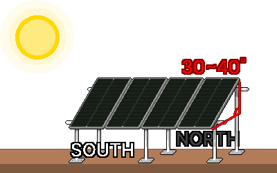

## 5. 설치와 운용
### 작업 전 안전 점검
- 전원이 차단되어 있는지 확인합니다.
- 주변의 물기와 불씨를 제거합니다.
- 손이 젖었는지, 비가 내리는지 확인합니다.
- +/− 극성이 맞는지 확인합니다.
- 각 구간 전선 굵기가 충분하고 DC 퓨즈와 DC 차단기가 자리에 있는지 확인합니다.
- 모든 부품의 전압 등급이 통일되었는지 확인합니다(예: 24V 패널 ↔ 24V 배터리).
- 멀티미터로 전압을 실제로 잽니다.
- 배터리 +선 가까이에 퓨즈가 있는지 확인합니다.
- 컨트롤러가 패널의 전류·전압 한계를 견디는지 확인합니다.

---
### 5-1. 패널 거치
#### 5-1-1. 거치 장소
&nbsp;&nbsp;&nbsp;패널 셀은 직렬로 연결되어 있어 일부만 그늘져도 전체 출력이 급감합니다. 앞이 트인 남쪽 방향에서 아침·정오·오후에 그림자가 어떻게 움직이는지 확인하고, 나무·전봇대·건물·안테나의 그림자가 지나가지 않아 하루 종일 햇빛이 드는 곳에 설치합니다.

&nbsp;&nbsp;&nbsp;패널은 빛을 받는 순간부터 전기를 만들며 배터리처럼 스위치로 끌 수 없습니다. 거치와 배선 중에는 불투명 천으로 패널을 덮어 발전을 막거나, 전기가 살아 있다고 가정하고 작업합니다.

#### 5-1-2. 방향
&nbsp;&nbsp;&nbsp;북반구인 대한민국에서는 패널을 정남향으로 향하게 합니다. 오후에 전기가 더 필요하면 약간 남서쪽으로, 아침이 중요하면 약간 남동쪽으로 미세 조정합니다.

#### 5-1-3. 각도
&nbsp;&nbsp;&nbsp;햇빛이 패널에 수직으로 들수록 발전 효율이 높아지므로 패널을 지면에서 비스듬히 세웁니다. 각도를 고정해야 하면 위도 각도에 가까운 30~40° 기울기로 설치합니다. 각도 조절이 가능하면 겨울에는 더 세우고(위도 +약 15°, 낮은 겨울 해를 받음) 여름에는 더 눕힙니다(위도 −약 15°). 재난 대비 목적이면 전기가 가장 부족한 계절 기준인 겨울에 맞춰 약간 세우는 편이 안전합니다.

#### 5-1-4. 고정
- 패널은 넓은 판이라 바람에 돛처럼 날리거나 부서지기 쉽습니다. 임시 설치라도 지면 프레임, 구조물 결박, 무게추 등으로 단단히 고정합니다.
- 패널이 뜨거워지면 출력이 낮아지므로 패널 뒤로 공기가 통하게 띄워서 설치합니다. 아스팔트·금속 지붕 같은 뜨거운 표면에 바로 붙여 설치하지 않습니다.
- 겨울철 추운 날씨에는 패널 전압(Voc)이 사양표보다 높아집니다. 컨트롤러의 최대 PV 입력 전압 한계가 패널을 직렬 연결할 때의 전압 합산보다 최소 15% 이상 여유로워야 합니다.

---
### 5-2. 배선·결선과 접지
#### 5-2-1. 연결 순서
&nbsp;&nbsp;&nbsp;대부분의 컨트롤러는 배터리 전압을 먼저 인식해야 정상 작동하므로, 패널을 배터리보다 먼저 연결하면 컨트롤러가 손상될 수 있습니다. 배터리는 항상 가장 먼저 연결하고 가장 나중에 분리합니다. 패널을 연결·분리할 때는 불투명 천으로 덮어 둔 채 작업하면 더 안전합니다.

**연결 순서**

1. 컨트롤러에 배터리를 연결합니다.
2. 패널을 컨트롤러에 연결합니다.
3. 전원이 꺼진 인버터를 배터리에 연결합니다.
4. 인버터의 전원을 켭니다.

**분리 순서**

1. 인버터의 전원을 끕니다.
2. 전원이 꺼진 인버터를 배터리에서 분리합니다.
3. 패널을 컨트롤러에서 분리합니다.
4. 배터리를 컨트롤러에서 분리합니다.

#### 5-2-2. 극성(+/−) 확인
&nbsp;&nbsp;&nbsp;극성을 거꾸로 연결하면 컨트롤러·배터리·인버터가 손상될 수 있습니다.

1. 연결 전 멀티미터로 +/− 극을 확인합니다.
2. 보통 빨간 선이 +극, 검은 선이 −극입니다. 단자의 색상과 극성 표시를 함께 확인합니다.
3. 패널 커넥터(MC4)는 암·수가 정해져 있으므로 서로 맞물리는 커넥터끼리 연결합니다.

#### 5-2-3. 결선 상태
&nbsp;&nbsp;&nbsp;느슨한 연결은 저항이 되어 열이 나고 화재로 이어집니다.

- 나사와 압착 단자(터미널)는 흔들리지 않게 단단히 조입니다.
- 굵은 전선은 압착 단자로 마감해 접촉을 확실히 합니다.
- 야외 연결부는 물과 습기가 들지 않도록 보호합니다.
- 배터리 단자를 스패너 등 금속 공구로 조일 때 공구가 (+)단자와 (−)단자에 동시에 닿지 않게 합니다. 공구 손잡이를 절연 테이프로 감아 금속 노출 부위를 최소화하면 안전합니다.

#### 5-2-4. 접지
&nbsp;&nbsp;&nbsp;접지(Ground/Earth)는 전기 회로를 땅이나 별도의 쇠붙이(접지극)에 연결하는 것입니다. 기기 고장으로 금속 프레임에 전기가 흐르거나 정전기·낙뢰가 생겼을 때 전기를 땅으로 안전하게 흘려보내 감전과 손상을 줄입니다.

1. 패널 고정용 금속 프레임과 거치 구조물을 서로 연결합니다.
2. 연결한 금속 프레임을 접지선으로 잇고, 땅에 박은 접지봉에 연결합니다.

&nbsp;&nbsp;&nbsp;접지·본딩 방식은 지역 전기 규정이 정한 부분이 있습니다. 영구·대형 설치는 전문가의 확인을 받습니다.

---
### 5-3. 첫 가동 점검과 유지보수
#### 5-3-1. 가동 전 체크리스트
- [  ] 모든 부품의 전압 등급이 통일되었습니다(예: 전부 24V).
- [  ] 극성(+/−)을 멀티미터로 확인했습니다.
- [  ] 각 구간 전선 굵기가 충분하고 DC 퓨즈/차단기가 제자리에 있습니다(배터리 +선 가까이).
- [  ] 단자가 단단히 조여져 있습니다.
- [  ] 패널이 바람에 견디게 고정되어 있습니다.

#### 5-3-2. 가동 순서
1. 5-2-1의 연결 순서대로 배터리 → 패널 → (전원이 꺼진) 인버터 순으로 연결합니다.
2. 컨트롤러 화면에서 배터리 전압이 정상 범위인지 확인합니다.
3. 햇빛 아래에서 충전 전류(A)와 PV 입력이 표시되는지 확인합니다.
4. 배터리 전압이 서서히 오르며 정상 충전되는지 확인합니다. 충전 중이 아닐 때 완충 전압은 12V 약 12.7V, 24V 약 25.4V입니다.
5. 인버터 전원을 켜고 부하를 켜서 정상 작동하는지 확인합니다.

#### 5-3-3. 흔한 문제
| 증상 | 점검 사항 |
|---|---|
| 충전이 안 됨 | 퓨즈 끊김, 느슨하거나 거꾸로 된 연결, 패널 그늘, 컨트롤러 설정, 멀티미터로 패널 전압 측정 |
| 출력이 약함 | 그늘, 먼지, 잘못된 각도, 패널 과열, 패널 용량 부족, 가늘고 긴 전선(전압 강하) |
| 배터리가 금방 닳음 | 부하 과다, 배터리 용량 부족, 배터리 노후, 인버터 대기 전력, 과방전 누적 |
| 컨트롤러 오류 표시 | 설명서의 코드 확인, 전압 등급·연결 재점검 |

#### 5-3-4. 유지보수
- 패널: 먼지·새똥·눈을 닦아 출력을 회복합니다. 각도 조정이 가능하면 계절별로 조정합니다.
- 연결부: 온도 변화로 단자가 느슨해질 수 있으므로 가끔 다시 조입니다.
- 배터리: 침수형 납산은 증류수 보충과 환기를 주기적으로 합니다. 모든 배터리는 단자를 청결히 유지하고 전압을 확인해 노후 배터리를 교체합니다.
- 컨트롤러: 충전 전류와 배터리 전압을 자주 확인합니다.

---
### 5-4. 재난 상황 운용
#### 5-4-1. 우선순위
&nbsp;&nbsp;&nbsp;각 기기가 생존에 미치는 영향을 미리 파악하고, 배터리 잔량이 줄면 우선순위가 낮은 기기부터 차례로 전원을 끊습니다.

| 우선순위 | 구분 | 예시 |
| --- | --- | --- |
| 1순위 | 생존·구호 | 휴대폰, 라디오, 비상조명, 필수 의료기기 |
| 2순위 | 유지·보존 | 식품·약품 냉장고, 환기 시설, 노트북 |
| 3순위 | 편의·기타 | 일반 가전제품, 가습기, 정수기 등 |

#### 5-4-2. 전기 아껴 쓰기
- DC 기기는 인버터 없이 컨트롤러(DC Load 단자)나 배터리에 직접 연결해 전환 손실을 피합니다.
- AC 기기를 쓰지 않을 때는 인버터를 끄거나 분리해 대기 전력을 차단합니다.
- 백열등 대신 LED 조명 등 고효율 기기를 씁니다.
- 햇빛이 가장 강한 정오 전후에 충전과 사용을 몰아서 합니다. 남는 전기는 기기 충전에 씁니다.

#### 5-4-3. 배터리 잔량 확인
&nbsp;&nbsp;&nbsp;납산 배터리는 부하와 충전을 잠시 끄고 쉰 상태에서 전압을 재어 잔량을 가늠합니다.

| 잔량 | 12V 배터리 | 24V 배터리 |
|---|---|---|
| 100%(완충) | 약 12.7V | 약 25.4V |
| 75% | 약 12.5V | 약 25.0V |
| 50%(납산 권장 한계) | 약 12.2V | 약 24.4V |
| 25% | 약 12.0V | 약 24.0V |
| 방전(사용 금지) | 11.9V 이하 | 23.8V 이하 |

&nbsp;&nbsp;&nbsp;리튬(LiFePO₄)은 전압이 거의 평탄해 전압으로 잔량을 추정하기 어렵습니다. 컨트롤러와 BMS가 보여 주는 % 표시를 확인합니다. 리튬도 끝까지 비우는 과방전을 피해야 수명이 깁니다.

#### 5-4-4. 흐린 날·겨울철 대비
- 배터리 잔량이 부족하면 더 강하게 절전하고 2·3순위 기기를 끕니다.
- 배터리 수명과 안전을 위해 과방전이 되지 않도록 사용량을 조절합니다.
- 가능하면 여분 배터리나 다른 충전 수단(발전기 등)을 비상용으로 확보합니다.
- 흐린 날이 길어질수록 최소 생존 전력(통신, 조명 정도)만 유지합니다.

#### 5-4-5. 운용 중 안전
- 인버터 정격(모터 서지 포함)을 넘는 기기를 쓰지 않습니다.
- 배터리를 환기하고, 과열·이상한 냄새·부풂이 있으면 즉시 점검합니다.
- 빗물이 들어오지 않게 막아 설비가 젖지 않도록 합니다.
- 장기 운용 시 패널 청소와 연결부 점검을 주기적으로 합니다.