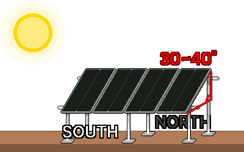

## 5. 安装与运行
### 作业前安全检查
- 确认电源已切断。
- 清除周围的水分和火种。
- 确认手是否潮湿、是否在下雨。
- 确认+/−极性正确。
- 确认各区段电线粗细足够，DC保险丝和DC断路器已就位。
- 确认所有部件的电压等级已统一（例：24V电池板 ↔ 24V电池）。
- 用万用表实际测量电压。
- 确认电池+线附近有保险丝。
- 确认控制器能承受电池板的电流、电压极限。

---
### 5-1. 电池板的安置
#### 5-1-1. 安置地点
&nbsp;&nbsp;&nbsp;电池板的电池片是串联的，所以只有一部分被遮挡，整体输出也会骤降。从前方开阔的南面确认早晨、正午、下午影子怎样移动，安装在树木、电线杆、建筑物、天线的影子都扫不到、全天有阳光的地方。

&nbsp;&nbsp;&nbsp;电池板从受光的那一刻起就会发电，不能像电池那样用开关关掉。安置和布线期间，用不透光的布盖住电池板阻止发电，或者按带电状态来作业。

#### 5-1-2. 方向
&nbsp;&nbsp;&nbsp;在北半球的韩国，让电池板朝向正南。下午需要更多电的话，稍微向西南微调；早晨重要的话，稍微向东南微调。

#### 5-1-3. 角度
&nbsp;&nbsp;&nbsp;阳光越垂直照射电池板，发电效率越高，所以让电池板与地面倾斜竖起。必须固定角度时，按接近纬度角度的30-40°倾角安装。如果可以调节角度，冬季竖得更陡（纬度+约15°，接收低矮的冬季太阳），夏季放得更平（纬度−约15°）。以灾难准备为目的，按电最不足的季节——冬季——来稍微竖起，更为稳妥。

#### 5-1-4. 固定
- 电池板是大面积的板，容易像帆一样被风吹起或损坏。即使是临时安装，也要用地面支架、绑扎在结构物上、配重等牢牢固定。
- 电池板变热，输出会降低，所以要架空安装，让空气能从电池板后面流通。不要直接贴在柏油路面、金属屋顶等发烫的表面上安装。
- 冬季寒冷天气，电池板电压（Voc）会高于规格表。控制器的最大PV输入电压极限，至少要比串联电池板时的电压之和宽裕15%以上。

---
### 5-2. 布线、接线与接地
#### 5-2-1. 连接顺序
&nbsp;&nbsp;&nbsp;大部分控制器必须先识别到电池电压才能正常工作，所以先于电池连接电池板可能损坏控制器。电池始终最先连接、最后拆除。连接、拆除电池板时，盖着不透光的布作业更安全。

**连接顺序**

1. 把电池连接到控制器。
2. 把电池板连接到控制器。
3. 把电源已关闭的逆变器连接到电池。
4. 打开逆变器的电源。

**拆除顺序**

1. 关闭逆变器的电源。
2. 把电源已关闭的逆变器从电池上拆下。
3. 把电池板从控制器上拆下。
4. 把电池从控制器上拆下。

#### 5-2-2. 确认极性（+/−）
&nbsp;&nbsp;&nbsp;极性接反可能损坏控制器、电池和逆变器。

1. 连接前用万用表确认+/−极。
2. 通常红线是+极，黑线是−极。同时确认端子的颜色和极性标示。
3. 电池板连接器（MC4）分公母，所以只连接能相互咬合的连接器。

#### 5-2-3. 接线状态
&nbsp;&nbsp;&nbsp;松动的连接会变成电阻而发热，引发火灾。

- 螺丝和压接端子（接线端）要拧紧，不能晃动。
- 粗电线用压接端子收尾，使接触可靠。
- 室外连接部位要加以保护，不让水和潮气进入。
- 用扳手等金属工具拧紧电池端子时，不要让工具同时碰到（+）端子和（−）端子。用绝缘胶带缠住工具手柄，尽量减少金属外露部分，会更安全。

#### 5-2-4. 接地
&nbsp;&nbsp;&nbsp;接地（Ground/Earth）是把电路连接到大地或另外的金属体（接地极）上。设备故障使电流进入金属框架，或出现静电、雷击时，能把电安全地导入大地，减少触电和损坏。

1. 把固定电池板的金属框架和安置结构物相互连接。
2. 把连接好的金属框架用接地线连起来，接到打入地下的接地棒上。

&nbsp;&nbsp;&nbsp;接地、等电位连接的方式有一部分由当地电气规定决定。永久性、大型安装要请专家确认。

---
### 5-3. 首次运行检查与维护
#### 5-3-1. 运行前检查清单
- [  ] 所有部件的电压等级已统一（例：全部24V）。
- [  ] 已用万用表确认极性（+/−）。
- [  ] 各区段电线粗细足够，DC保险丝/断路器就位（靠近电池+线）。
- [  ] 接线端已拧紧。
- [  ] 电池板已固定，能抗风。

#### 5-3-2. 运行顺序
1. 按5-2-1的连接顺序，依次连接电池 → 电池板 →（电源已关闭的）逆变器。
2. 在控制器屏幕上确认电池电压在正常范围。
3. 在阳光下确认显示出充电电流（A）和PV输入。
4. 确认电池电压缓慢上升，正常充电。不在充电时，满电电压12V约12.7V，24V约25.4V。
5. 打开逆变器电源，开启负载，确认工作正常。

#### 5-3-3. 常见问题
| 症状 | 检查事项 |
|---|---|
| 不充电 | 保险丝熔断、连接松动或接反、电池板遮挡、控制器设置、用万用表测电池板电压 |
| 输出弱 | 遮挡、灰尘、角度不对、电池板过热、电池板容量不足、又细又长的电线（电压降） |
| 电池很快用完 | 负载过大、电池容量不足、电池老化、逆变器待机功率、累积过放 |
| 控制器显示错误 | 查看说明书中的代码，重新检查电压等级和连接 |

#### 5-3-4. 维护
- 电池板：擦去灰尘、鸟粪、积雪，恢复输出。可以调节角度的话，按季节调整。
- 连接部位：温度变化可能使接线端松动，所以偶尔重新拧紧。
- 电池：富液式铅酸要定期补充蒸馏水和通风。所有电池都要保持端子清洁，检查电压，更换老化的电池。
- 控制器：经常查看充电电流和电池电压。

---
### 5-4. 灾难情况下的运行
#### 5-4-1. 优先顺序
&nbsp;&nbsp;&nbsp;事先弄清各设备对生存的影响，电池余量减少时，从优先级低的设备开始依次切断电源。

| 优先级 | 类别 | 例子 |
| --- | --- | --- |
| 第1优先 | 生存、救援 | 手机、收音机、应急照明、必需的医疗设备 |
| 第2优先 | 维持、保存 | 食品、药品冰箱，通风设施，笔记本电脑 |
| 第3优先 | 便利及其他 | 一般家电、加湿器、净水器等 |

#### 5-4-2. 节约用电
- DC设备不经逆变器，直接连接控制器（DC Load端子）或电池，避免转换损耗。
- 不使用AC设备时，关闭或断开逆变器，切断待机功率。
- 用LED照明等高效设备代替白炽灯。
- 把充电和使用集中在阳光最强的正午前后。多余的电用来给设备充电。

#### 5-4-3. 检查电池余量
&nbsp;&nbsp;&nbsp;铅酸电池要暂时关掉负载和充电，在静置状态下测电压来估算余量。

| 余量 | 12V电池 | 24V电池 |
|---|---|---|
| 100%（满电） | 约12.7V | 约25.4V |
| 75% | 约12.5V | 约25.0V |
| 50%（铅酸建议极限） | 约12.2V | 约24.4V |
| 25% | 约12.0V | 约24.0V |
| 放电（禁止使用） | 11.9V以下 | 23.8V以下 |

&nbsp;&nbsp;&nbsp;锂（LiFePO₄）的电压几乎是平的，很难用电压估算余量。要查看控制器和BMS显示的%。锂电池也要避免放到底的过放，寿命才长。

#### 5-4-4. 应对阴天和冬季
- 电池余量不足时，更严格地节电，关掉第2、第3优先级的设备。
- 为了电池寿命和安全，调节使用量，避免过放。
- 可能的话，准备备用电池或其他充电手段（发电机等）作应急。
- 阴天持续越久，越只维持最低限度的生存电力（通信、照明程度）。

#### 5-4-5. 运行中的安全
- 不要使用超过逆变器额定值（含电机浪涌）的设备。
- 保持电池通风，如有过热、异味、鼓包，立即检查。
- 防止雨水进入，使设备不被打湿。
- 长期运行时，定期清洁电池板并检查连接部位。