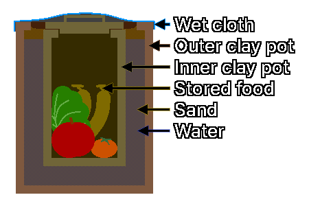

## 2. Способы хранения продуктов
---
### 2-1. Хранение с азотной продувкой (Nitrogen Flushing)
&nbsp;&nbsp;&nbsp;Это способ, при котором вместо поглотителя кислорода закачивают азот, вытесняя кислород внутри упаковки.

| Показатель | Содержание |
| :---: | :--- |
| Принцип | Азот, инертный газ, предотвращает окисление продуктов и подавляет появление вредителей, лишая их кислорода, нужного для дыхания. |
| Преимущества | Удаляет кислород быстрее и полнее, чем поглотитель кислорода. |
| | Выгоден для продуктов, которые приходится многократно вскрывать, в условиях, где возможна повторная продувка (например, сухое молоко, кофе). |
| Подходящие продукты | Эффективен для продуктов, чувствительных к прогорканию: зерно, сухое молоко, кофе, орехи. |
| Предостережения | После упаковки с азотной продувкой для надёжности можно дополнительно использовать поглотитель кислорода, но если азотная продувка выполнена безупречно, дублировать её поглотителем кислорода не нужно. |

---
### 2-2. Влагозащитное хранение с негашёной известью
&nbsp;&nbsp;&nbsp;Это способ, при котором внутрь герметичной ёмкости помещают негашёную известь (оксид кальция, CaO), чтобы поглощать влагу.

| Показатель | Содержание |
| :---: | :--- |
| Принцип | Негашёная известь поглощает окружающую влагу и превращается в гидроксид кальция (Ca(OH)2), предельно снижая влажность внутри ёмкости. |
| Подходящие продукты | Эффективна для предотвращения плесени и размножения микроорганизмов в продуктах, уязвимых к влаге: рисе, бобах, сушёных овощах. |
| Предостережения | Негашёная известь при реакции с водой выделяет тепло, поэтому обращаться с ней нужно осторожно. |
| | Чрезмерная сушка ускоряет растрескивание зерна и окисление жиров, поэтому соблюдайте принцип небольшого количества, а при длительном использовании требуется периодическая замена. |
| | Она не должна непосредственно контактировать с продуктами, её необходимо помещать в отдельный воздухопроницаемый мешочек или ёмкость и размещать в нижней части герметичной ёмкости с продуктами. |

---
### 2-3. Многослойная упаковка (Layered Packaging)
&nbsp;&nbsp;&nbsp;Трёхступенчатая стратегия упаковки для защиты продовольствия от проникновения грызунов и вредителей.

| Упаковка | Роль | Содержание |
| :---: | :---: | :--- |
| Внутренняя упаковка | Защита от кислорода и влаги | С помощью майларового пакета и поглотителя кислорода сохраняется качество самого продукта. |
| Средняя упаковка | Физическая защита | Майларовый пакет помещают в прочную ёмкость, например металлическую банку или толстое пластиковое ведро, чтобы защитить от механических ударов и зубов грызунов. |
| Внешняя упаковка | Скрытие местонахождения и блокировка запаха | Скрывают место хранения продовольствия и принимают меры для блокировки запаха, чтобы не раздражать обоняние грызунов. |

---
### 2-4. Подземное хранение
&nbsp;&nbsp;&nbsp;Глубоко под землёй в течение всего года поддерживаются стабильная температура (около 4-10 °C) и высокая влажность (85-95 %), поэтому корнеплоды и луковичные можно хранить свежими.

| Принцип хранения | Содержание |
| :---: | :--- |
| Раздельное хранение | Картофель, батат, лук и другие выделяют разные газы, поэтому хранить их нужно обязательно раздельно. Особенно лук выделяет этилен, из-за которого картофель прорастает, поэтому их нельзя хранить вместе. |
| Управление вентиляцией | Важно управлять направлением вентиляции, чтобы свежий воздух поступал, а застоявшийся удалялся. |
| Уход за урожаем | Во влажной среде легко размножаются плесень и бактерии, поэтому культуры с повреждённой поверхностью следует немедленно убирать. |
| Контроль температуры | Батат при хранении в прохладном подвале при 10 °C и ниже гниёт от холодового повреждения, поэтому при совместном хранении с картофелем нужно следить за температурой. (Оптимальная температура хранения батата: 12-15 °C) |

---
### 2-5. Горшок в горшке (Pot in Pot)
  
&nbsp;&nbsp;&nbsp;«Горшок в горшке» — традиционный способ хранения продуктов, при котором температура хранения снижается за счёт теплоты испарения.

| Показатель | Содержание |
| :---: | :--- |
| Принцип | Влага из песка между двумя горшками и из ткани, покрывающей их сверху, испаряется, забирая теплоту испарения, и снижает температуру внутри. |
| Материалы | Большой горшок, малый горшок, песок, вода, ткань |
| Хранение | Размещают в хорошо проветриваемом месте, чтобы вода легко испарялась. |
| Применение | Используется для хранения овощей, фруктов, молочных продуктов (краткосрочное временное хранение) и т. п. с целью продления срока хранения. |
| Предостережения | Работает только в регионах с низкой влажностью и сухим воздухом. |
| | В условиях бедствия при влажности выше 80 %, как в корейское лето, вода не испаряется, и вместо этого только разводится плесень. |
| | В жаркой и влажной среде обратитесь к пунктам **5-4. Засолка** и **5-5. Молочнокислое брожение**. |

| Порядок изготовления | Способ изготовления |
| :---: | :--- |
| 1 | Насыпьте на дно большого горшка слой песка 5 см. |
| 2 | Поставьте малый горшок в центр большого горшка. |
| 3 | Полностью заполните песком свободное пространство между малым и большим горшками. |
| 4 | Налейте воду между большим и малым горшками, чтобы смочить песок. |
| 5 | Положите продукты в малый горшок и закройте крышкой. |
| 6 | Возьмите ткань размером с горловину большого горшка, накройте ею большой горшок и побрызгайте на ткань водой. |

---
### 2-6. Кангина (Kangina)
  
&nbsp;&nbsp;&nbsp;Кангина — традиционная технология хранения в глине, которую в северных районах Афганистана используют для сохранения винограда свежим; название означает «сокровище».

| Показатель | Содержание |
| :---: | :--- |
| Принцип | Глиняный барьер защищает виноград от наружного воздуха, влаги и микроорганизмов и сохраняет свежесть. |
| Материалы | Виноград без повреждений (преимущественно сорта с толстой кожурой, собранные вместе с черешками), две круглые глиняные чаши, сделанные из глины с соломой и обожжённые на солнце, бумага, глина |
| Хранение | Хранят в прохладном затенённом месте без прямых солнечных лучей, в подвале или закопав в землю. |
| Предостережения | Это технология, оптимизированная под сухой климат Афганистана и свойства его глины. |
| | При кустарном изготовлении из обычной глины и соломы велика вероятность, что виноград сгниёт из-за неудачного регулирования влажности внутри. |
| | В жаркой и влажной среде обратитесь к пунктам **5-4. Засолка** и **5-5. Молочнокислое брожение**. |

| Порядок изготовления | Способ изготовления |
| :---: | :--- |
| 1 | Положите виноград, завёрнутый в бумагу, в круглую глиняную чашу. |
| 2 | Накройте чашу с виноградом другой глиняной чашей, перевернув её, чтобы закрыть виноград. |
| 3 | Замажьте щель между двумя глиняными чашами глиной, чтобы загерметизировать. |