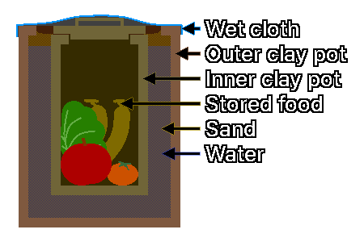
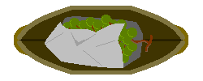

## 2. Food Storage Methods
---
### 2-1. Nitrogen Flushing
&nbsp;&nbsp;&nbsp;This is a method of injecting nitrogen instead of using oxygen absorbers to displace the oxygen inside the package.

| Item | Content |
| :---: | :--- |
| Principle | Nitrogen, an inert gas, prevents oxidation of food and suppresses pests by removing the oxygen they need to breathe. |
| Advantages | It removes oxygen faster and more completely than oxygen absorbers. |
| | It is advantageous for food that needs repeated opening in an environment where refilling is possible (e.g., powdered milk, coffee). |
| Suitable foods | Effective for foods sensitive to rancidity such as grains, powdered milk, coffee, and nuts. |
| Cautions | After nitrogen-flush packaging, an oxygen absorber can be used together for safety, but if the nitrogen flushing is perfect, there is no need to use an oxygen absorber in duplicate. |

---
### 2-2. Moisture-Proof Storage with Quicklime
&nbsp;&nbsp;&nbsp;This is a method of placing quicklime (calcium oxide, CaO) inside a sealed container to absorb moisture.

| Item | Content |
| :---: | :--- |
| Principle | Quicklime absorbs the surrounding moisture and turns into calcium hydroxide (Ca(OH)2), lowering the humidity inside the container to an extreme degree. |
| Suitable foods | Effective in preventing mold and microbial growth in foods vulnerable to moisture such as rice, beans, and dried vegetables. |
| Cautions | Quicklime gives off heat when it reacts with water, so it must be handled with care. |
| | Excessive drying accelerates cracking of grains and fat oxidation, so follow the principle of using a small amount and replace it periodically in long-term use. |
| | It must not touch the food directly, and must always be placed in a separate breathable pouch or container at the bottom of the sealed food container. |

---
### 2-3. Layered Packaging
&nbsp;&nbsp;&nbsp;A three-stage packaging strategy to protect food from the intrusion of rodents and pests.

| Packaging | Role | Content |
| :---: | :---: | :--- |
| Inner packaging | Oxygen/moisture barrier | Preserves the quality of the food itself using a Mylar bag and an oxygen absorber. |
| Middle packaging | Physical defense | Put the Mylar bag in a hard container such as a metal can or thick plastic tub to protect it from physical impact and rodent teeth. |
| Outer packaging | Concealing location and blocking odor | Conceal the place where the food is stored, and take measures to block odor so as not to stimulate the rodents' sense of smell. |

---
### 2-4. Underground Storage
&nbsp;&nbsp;&nbsp;Deep underground keeps a stable temperature (about 4-10 °C) and high humidity (85-95%) throughout the year, so root vegetables and bulbs can be kept fresh.

| Storage principle | Content |
| :---: | :--- |
| Separate storage | Potatoes, sweet potatoes, onions, and so on give off different gases, so they must be stored separately. In particular, onions give off ethylene gas, which makes potatoes sprout, so they must not be stored together. |
| Ventilation control | It is important to manage the ventilation direction so that fresh air flows in and stagnant air flows out. |
| Crop management | Mold and bacteria multiply easily in a high-humidity environment, so crops with damaged surfaces must be removed immediately. |
| Temperature control | Sweet potatoes stored in a cool underground place at 10 °C or below rot from chilling injury, so take care with temperature management when storing them with potatoes. (Optimal sweet potato storage temperature: 12-15 °C) |

---
### 2-5. Pot in Pot
  
&nbsp;&nbsp;&nbsp;Pot in Pot is a traditional food storage method that lowers storage temperature using the heat of vaporization.

| Item | Content |
| :---: | :--- |
| Principle | Moisture in the sand between the two pots, and in the cloth covering it, evaporates and takes away heat of vaporization, lowering the temperature inside. |
| Materials | Large pot, small pot, sand, water, cloth |
| Storage | Keep it in a well-ventilated place so water evaporates easily. |
| Use | Used to extend the shelf life of vegetables, fruit, dairy products (short-term temporary storage), and so on. |
| Cautions | It works only in regions with low humidity and dry air. |
| | In a disaster with humidity above 80% such as the Korean summer, the water does not evaporate and only mold grows. |
| | In a hot, humid environment, refer to the items **5-4. Salting** or **5-5. Lactic Acid Fermentation**. |

| Step | Method |
| :---: | :--- |
| 1 | Fill the bottom of the large pot with 5 cm of sand. |
| 2 | Place the small pot in the center of the large pot. |
| 3 | Fill the empty space between the small pot and the large pot completely with sand. |
| 4 | Pour water between the large pot and the small pot to wet the sand. |
| 5 | Put the food in the small pot and close the lid. |
| 6 | Take a cloth the size of the mouth of the large pot, cover the large pot with it, and sprinkle water over the cloth. |

---
### 2-6. Kangina
  
&nbsp;&nbsp;&nbsp;Kangina is a traditional clay storage technique used in northern Afghanistan to keep grapes fresh, and the name means "treasure."

| Item | Content |
| :---: | :--- |
| Principle | The clay barrier protects the grapes from outside air, moisture, and microorganisms and maintains freshness. |
| Materials | Unblemished grapes (mainly thick-skinned varieties harvested with the stems), two round clay bowls made by mixing mud and straw and baking in the sun, paper, and mud |
| Storage | Keep in a cool, shaded place out of direct sunlight, in a cellar, or buried in the ground. |
| Cautions | It is a technique optimized for Afghanistan's dry climate and the properties of its clay. |
| | If improvised with ordinary mud and straw, there is a high chance the grapes will rot because internal humidity control fails. |
| | In a hot, humid environment, refer to the items **5-4. Salting** or **5-5. Lactic Acid Fermentation**. |

| Step | Method |
| :---: | :--- |
| 1 | Put grapes wrapped in paper into a round clay bowl. |
| 2 | Turn another clay bowl upside down over the bowl holding the grapes to cover them. |
| 3 | Seal the gap between the two clay bowls with mud. |