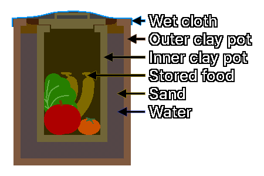

## 2. 食品の保管方法
---
### 2-1. 窒素置換保管 (Nitrogen Flushing)
&nbsp;&nbsp;&nbsp;脱酸素剤の代わりに窒素を注入して、包装内部の酸素を置き換える方法です。

| 項目 | 内容 |
| :---: | :--- |
| 原理 | 不活性ガスである窒素は食品の酸化を防ぎ、害虫が呼吸できる酸素を取り除いて、害虫の発生を抑えます。 |
| 利点 | 脱酸素剤より速く完全に酸素を取り除きます。 |
| | 再充填が可能な環境で、繰り返し開封が必要な食料(例: 粉ミルク、コーヒー)に有利です。 |
| 適した食品 | 穀物、粉ミルク、コーヒー、ナッツ類など、酸敗に敏感な食品に効果的です。 |
| 注意事項 | 窒素置換の包装後、安全のために脱酸素剤を併用することはできますが、窒素置換が完璧なら、脱酸素剤を重ねて使う必要はありません。 |

---
### 2-2. 石灰(生石灰)による防湿保管
&nbsp;&nbsp;&nbsp;密閉容器の内部に生石灰(酸化カルシウム、CaO)を置いて、湿気を吸収する方法です。

| 項目 | 内容 |
| :---: | :--- |
| 原理 | 生石灰が周囲の水分を吸収して水酸化カルシウム(Ca(OH)2)に変わり、容器内部の湿度を極端に下げます。 |
| 適した食品 | 米、豆、乾燥野菜など、湿気に弱い食品のカビや微生物の繁殖を予防するのに効果的です。 |
| 注意事項 | 生石灰は水と反応すると発熱するので、取り扱いに注意が必要です。 |
| | 過度な乾燥は穀物の亀裂と脂肪の酸化を速めるので、少量使用の原則を守り、長期使用の際は定期的な交換が必要です。 |
| | 食品に直接触れさせてはならず、必ず別の通気性のある袋や容器に入れて、密閉された食品容器の下部に置かなければなりません。 |

---
### 2-3. 階層包装 (Layered Packaging)
&nbsp;&nbsp;&nbsp;げっ歯類や害虫の侵入から食料を守るための、3段階の包装戦略です。

| 包装 | 役割 | 内容 |
| :---: | :---: | :--- |
| 内側の包装 | 酸素・湿気の遮断 | マイラーバッグと脱酸素剤を使って、食品そのものの品質を保ちます。 |
| 中間の包装 | 物理的な防御 | 金属缶、厚いプラスチック容器など、頑丈な容器にマイラーバッグを入れて、物理的な衝撃とげっ歯類の歯から守ります。 |
| 外側の包装 | 場所の隠蔽とにおいの遮断 | 食料を保管する場所を隠し、げっ歯類の嗅覚を刺激しないよう、においを遮断する措置を取ります。 |

---
### 2-4. 地下貯蔵
&nbsp;&nbsp;&nbsp;地中深くは年間を通じて安定した温度(約4-10℃)と高い湿度(85-95%)を保つため、根菜類と球根類を新鮮に保管できます。

| 貯蔵の原則 | 内容 |
| :---: | :--- |
| 分離貯蔵 | ジャガイモ、サツマイモ、タマネギなどは、それぞれ異なるガスを放出するので、必ず分けて貯蔵しなければなりません。特に、タマネギはジャガイモの芽を出させるエチレンガスを放出するので、一緒に保管してはいけません。 |
| 通風の管理 | 新鮮な空気が流入し、滞った空気が排出されるよう、通風の向きを管理することが重要です。 |
| 作物の管理 | 高湿の環境ではカビや細菌が増殖しやすいので、表面が傷んだ作物はただちに取り除かなければなりません。 |
| 温度の管理 | サツマイモは10℃以下の涼しい地下に保管すると冷害で腐るので、ジャガイモと一緒に保管するときは温度管理に注意が必要です。(サツマイモの最適保管温度: 12~15℃) |

---
### 2-5. ポット・イン・ポット(Pot in Pot)
  
&nbsp;&nbsp;&nbsp;ポット・イン・ポットは、気化熱を利用して食品の保管温度を下げる、伝統的な食品保管方法です。

| 項目 | 内容 |
| :---: | :--- |
| 原理 | 2つの甕の間の砂と、その上を覆う布の中の水分が蒸発するときに気化熱を奪い、内部の温度を下げます。 |
| 材料 | 大きい甕、小さい甕、砂、水、布 |
| 保管 | 水がよく蒸発するよう、風通しのよい場所に保管します。 |
| 活用 | 野菜、果物、乳製品(短期の一時保管)などを保管して、保存期間を延ばすのに使われます。 |
| 注意事項 | 湿度が低く、大気が乾燥した地域でだけ作動します。 |
| | 韓国の夏のように湿度が80%を超える災害状況では、水が蒸発せず、かえってカビが生えるだけです。 |
| | 高温多湿の環境では、**5-4. 塩漬け**または**5-5. 乳酸発酵**の項目を参照します。 |

| 作製の順序 | 作製の方法 |
| :---: | :--- |
| 1 | 大きい甕の底に砂を5cm入れます。 |
| 2 | 小さい甕を大きい甕の中央に置きます。 |
| 3 | 小さい甕と大きい甕の間の空間を、砂でいっぱいに埋めます。 |
| 4 | 大きい甕と小さい甕の間に水を注いで、砂を湿らせます。 |
| 5 | 小さい甕に食べ物を入れて、ふたを閉めます。 |
| 6 | 大きい甕の口と同じ大きさの布を用意して大きい甕を覆い、布の上から水をかけます。 |

---
### 2-6. カンギナ(Kangina)
  
&nbsp;&nbsp;&nbsp;カンギナは、アフガニスタン北部の地域でブドウを新鮮に保管するために使われてきた伝統的な泥の貯蔵技術で、「宝物」という意味を持っています。

| 項目 | 内容 |
| :---: | :--- |
| 原理 | 泥の壁が、外の空気、湿気、微生物からブドウを守り、鮮度を保ちます。 |
| 材料 | 傷のないブドウ(皮の厚い品種を中心に、軸ごと収穫)、泥とわらを混ぜて日光で焼いた丸い粘土の器2つ、紙、泥 |
| 保管 | 直射日光の当たらない涼しい日陰、地下室、あるいは地中に埋めて保管します。 |
| 注意事項 | アフガニスタンの乾燥した気候と粘土の特性に最適化された技術です。 |
| | 普通の泥とわらで間に合わせに作ると、内部の湿度調節に失敗して、ブドウが腐る確率が高くなります。 |
| | 高温多湿の環境では、**5-4. 塩漬け**または**5-5. 乳酸発酵**の項目を参照します。 |

| 作製の順序 | 作製の方法 |
| :---: | :--- |
| 1 | 丸い粘土の器の上に、紙で包んだブドウを入れます。 |
| 2 | ブドウの入った粘土の器の上に、別の粘土の器を伏せて、ブドウを覆います。 |
| 3 | 2つの粘土の器の間の隙間を泥でふさいで、密封します。 |