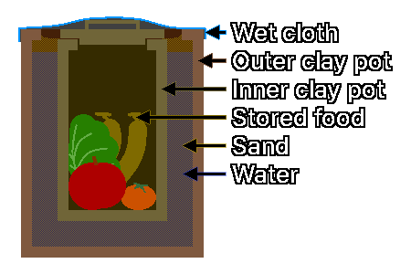

## 2. 食品储存方法
---
### 2-1. 氮气置换储存（Nitrogen Flushing）
&nbsp;&nbsp;&nbsp;是注入氮气以代替脱氧剂、置换包装内氧气的方法。

| 项目 | 内容 |
| :---: | :--- |
| 原理 | 惰性气体氮气可防止食品氧化，并通过去除害虫呼吸所需的氧气来抑制虫害发生。 |
| 优点 | 比脱氧剂更快、更彻底地去除氧气。 |
| | 对可以重新充氮的环境中需要反复开封的食物（如奶粉、咖啡）有利。 |
| 适合的食品 | 对谷物、奶粉、咖啡、坚果等对酸败敏感的食品有效。 |
| 注意事项 | 氮气置换包装后，为安全起见可以同时使用脱氧剂，但如果氮气置换很彻底，就没有必要重复使用脱氧剂。 |

---
### 2-2. 生石灰防潮储存
&nbsp;&nbsp;&nbsp;是在密封容器内放置生石灰（氧化钙，CaO）以吸收湿气的方法。

| 项目 | 内容 |
| :---: | :--- |
| 原理 | 生石灰吸收周围的水分变成氢氧化钙（Ca(OH)2），使容器内部湿度降到极低。 |
| 适合的食品 | 对大米、豆类、干蔬菜等怕潮食品防止霉菌和微生物繁殖有效。 |
| 注意事项 | 生石灰与水反应时会放热，因此处理时要小心。 |
| | 过度干燥会加速谷物开裂和脂肪氧化，所以要遵守少量使用的原则，长期使用时需要定期更换。 |
| | 不得与食品直接接触，必须装在另外的透气小袋或容器里，放在密封食品容器的下方。 |

---
### 2-3. 分层包装（Layered Packaging）
&nbsp;&nbsp;&nbsp;是保护食物免受啮齿类和害虫侵入的三层包装策略。

| 包装 | 作用 | 内容 |
| :---: | :---: | :--- |
| 内层包装 | 隔绝氧气/湿气 | 使用迈拉袋和脱氧剂保存食品本身的品质。 |
| 中层包装 | 物理防御 | 把迈拉袋放进金属罐、厚塑料桶等坚固容器中，保护其免受物理冲击和啮齿类的牙齿。 |
| 外层包装 | 隐藏位置并阻隔气味 | 隐藏存放食物的地点，并采取措施阻隔气味，以免刺激啮齿类的嗅觉。 |

---
### 2-4. 地下储存
&nbsp;&nbsp;&nbsp;地下深处全年保持稳定的温度（约4-10°C）和较高的湿度（85-95%），可使根茎类蔬菜和球茎类保持新鲜。

| 储存原则 | 内容 |
| :---: | :--- |
| 分开储存 | 土豆、红薯、洋葱等会释放不同的气体，因此必须分开储存。尤其是洋葱会释放使土豆发芽的乙烯气体，不得与土豆一起存放。 |
| 通风管理 | 管理通风方向，使新鲜空气流入、滞留空气排出，这一点很重要。 |
| 作物管理 | 高湿环境下霉菌和细菌容易繁殖，因此表面受损的作物要立即清除。 |
| 温度管理 | 红薯存放在10°C以下的凉爽地下会因冷害而腐烂，所以与土豆一起存放时要注意温度管理。（红薯最佳储存温度：12~15°C） |

---
### 2-5. 罐中罐（Pot in Pot）
  
&nbsp;&nbsp;&nbsp;罐中罐是利用汽化热降低食品储存温度的传统食品储存方法。

| 项目 | 内容 |
| :---: | :--- |
| 原理 | 两个罐子之间的沙子，以及盖在上面的布中的水分蒸发时带走汽化热，从而降低内部温度。 |
| 材料 | 大罐、小罐、沙子、水、布 |
| 储存 | 放在通风良好的地方，使水容易蒸发。 |
| 用途 | 用于储存蔬菜、水果、乳制品（短期临时保存）等，以延长保质期。 |
| 注意事项 | 只在湿度低、空气干燥的地区才起作用。 |
| | 在像韩国夏天那样湿度超过80%的灾难情况下，水不会蒸发，反而只会长霉。 |
| | 在高温高湿的环境下，请参考**5-4. 盐渍**或**5-5. 乳酸发酵**项目。 |

| 制作步骤 | 制作方法 |
| :---: | :--- |
| 1 | 在大罐底部铺5cm厚的沙子。 |
| 2 | 把小罐放在大罐中央。 |
| 3 | 用沙子把小罐与大罐之间的空隙填满。 |
| 4 | 向大罐与小罐之间倒水，把沙子浸湿。 |
| 5 | 把食物装进小罐，盖上盖子。 |
| 6 | 取一块与大罐口大小相当的布盖在大罐上，再往布上洒水。 |

---
### 2-6. 坎吉纳（Kangina）
  
&nbsp;&nbsp;&nbsp;坎吉纳是阿富汗北部地区用来保鲜葡萄的传统泥土储存技术，名称的意思是“宝藏”。

| 项目 | 内容 |
| :---: | :--- |
| 原理 | 泥土屏障保护葡萄免受外界空气、湿气和微生物的侵害，保持新鲜。 |
| 材料 | 无瑕疵的葡萄（以果皮厚的品种为主，连梗采收）、混合泥土和稻草后在阳光下烤成的圆形黏土碗2个、纸、泥土 |
| 储存 | 存放在不受阳光直射的凉爽阴凉处、地下室，或埋入地下。 |
| 注意事项 | 这是针对阿富汗的干燥气候和黏土特性优化的技术。 |
| | 用普通泥土和稻草临时仿制，由于内部湿度调节失败，葡萄腐烂的概率很高。 |
| | 在高温高湿的环境下，请参考**5-4. 盐渍**或**5-5. 乳酸发酵**项目。 |

| 制作步骤 | 制作方法 |
| :---: | :--- |
| 1 | 把用纸包好的葡萄放进圆形黏土碗中。 |
| 2 | 在装有葡萄的黏土碗上扣上另一个黏土碗，把葡萄盖住。 |
| 3 | 用泥土封住两个黏土碗之间的缝隙，加以密封。 |