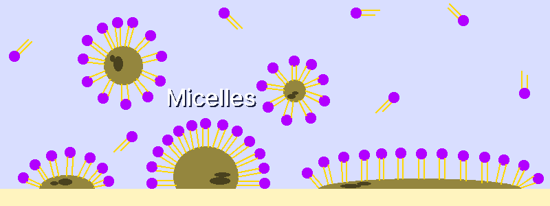

# Мыло
---
## 1. Принцип
### 1-1. Принцип действия
&nbsp;&nbsp;&nbsp;Мыло — это поверхностно-активное вещество: оно эмульгирует жир, чтобы его можно было смыть водой. Тысячи лет его варили из животных жиров или растительных масел в сочетании с золой.

&nbsp;&nbsp;&nbsp;При смешивании с водой молекулы мыла самопроизвольно образуют сферические структуры — мицеллы (Micelles). Гидрофильные «головки» обращены к воде, а липофильные «хвосты» спрятаны внутрь. При наличии жирного загрязнения мицеллы запирают капли жира во внутреннем пространстве, изолируя их от воды; жир стабильно распределяется в воде (коллоидное состояние) и смывается.

---
### 1-2. Химия
&nbsp;&nbsp;&nbsp;Мыло получают в реакции триглицеридов (Triglycerides) — основного компонента животных и растительных жиров — с сильным основанием. Эта реакция называется омылением.

- Триглицерид — это молекула-хранилище жира: три хвоста жирных кислот присоединены к глицериновому остову сложноэфирными связями.
- При добавлении сильного основания, например гидроксида натрия, сложноэфирные связи разрываются и образуются глицерин и соли жирных кислот (Fatty Acid Salts); эти соли жирных кислот и есть мыло.
- Чем длиннее цепь жирной кислоты, тем хуже мыло растворяется в воде, тем оно твёрже и тем хуже пенится.
- Гидроксид натрия (NaOH, едкий натр): образует твёрдые, плохо растворимые в воде натриевые соли, подходящие для твёрдого мыла.
- Гидроксид калия (KOH): образует мягкие, хорошо растворимые в воде калиевые соли, подходящие для жидкого мыла.
- Для полного омыления 1 г свиного жира (смальца) требуется около 0,138 г NaOH. Для 1 кг смальца теоретически это 138 г (при 0 % избытка жира).

---
## 2. Основы мыловарения
### 2-1. Правила безопасности
> **Внимание:** при изготовлении мыла обязательно надевайте защитные очки и перчатки. Сильнощелочные растворы, такие как гидроксид натрия и гидроксид калия, очень едки и при попадании в глаза вызывают серьёзные повреждения.

- При попадании на кожу или в глаза сразу промывайте проточной водой не менее 15 минут и при необходимости обратитесь за медицинской помощью.
- Не используйте уксус при ожоге сильным основанием. При нейтрализации выделяется тепло, и ожог усугубляется.
- Соблюдайте порядок смешивания: гидроксид натрия добавляют в воду. Если лить воду в гидроксид натрия, раствор опасно разбрызгивается или вскипает.
- При растворении гидроксида натрия в воде выделяется много тепла и может появиться дым. Раствор очень горячий и опасный, поэтому держите его подальше от детей и домашних животных.

---
### 2-2. Холодный и горячий способы
| Признак | Холодный способ | Горячий способ |
| :---: | --- | --- |
| Температура | Без внешнего нагрева (используется тепло реакции) | Около 90 °C |
| Время твердения | 4-6 недель (завершение реакции и испарение влаги) | Около 1 дня (быстро) |
| Достоинства | Легко формовать в разные формы, можно использовать разные добавки | Быстро |
| Недостатки | Долгое твердение | Очень высокая вязкость, возможны только простые формы; нельзя использовать термочувствительные добавки |
| Применение | Твёрдое мыло (на свином жире, на оливковом/кокосовом масле) | Жидкое мыло (при использовании гидроксида калия) |

---
### 2-3. Стадия «следа» и добавки
&nbsp;&nbsp;&nbsp;Момент, когда при помешивании смеси на поверхности остаётся след, называется стадией следа (Trace). Густота следа влияет на дизайн мыла и на то, как смешиваются добавки. Мыло на свином жире традиционно нередко варят чистым, без добавок.

| Густота следа | Особенности | Подходящее применение |
| --- | --- | --- |
| Лёгкий след (Light Trace) | Очень жидкий, как жидкость | Узоры-завитки, добавление жидких добавок |
| Средний след (Medium Trace) | Умеренно густой | Распределение твёрдых добавок (семена, кофейный порошок) |
| Густой след (Thick Trace) | Очень вязкий, держит форму | Фактурный дизайн, многослойное мыло |

- Добавки меняют вязкость мыла и время твердения.
- Такие добавки, как коричный альдегид и бензальдегид, чувствительны к сильным основаниям, поэтому их вводят после стадии следа, когда большая часть гидроксида натрия уже израсходована, — иначе они разрушатся.
- Избыток жира (Super-fatting): добавление жира чуть больше необходимого количества. Остаточное масло в мыле меньше сушит кожу и делает мыло мягче.

---
## 3. Изготовление мыла с гидроксидом натрия
&nbsp;&nbsp;&nbsp;Мыло на свином жире — самый традиционный способ: только из воды, свиного жира и гидроксида натрия можно сделать мыло с отличными увлажняющими свойствами.

- Это ярко-белый твёрдый брусок, очень мягкий и отлично увлажняющий. Причина — олеиновая кислота свиного жира, глицерин, образующийся при омылении, и остаточный жир от избытка жира.
- Масла, дающего пену, нет, поэтому пена слабая, а ощущение — выраженно кремовое.
- Готовое мыло можно хранить годами; при контакте с водой оно не расплывается и не становится липким, а остаётся сухим.

| Материал | Количество | Описание |
| :---: | ---: | :--- |
| Свиной жир (смалец) | 500 г | Свиное сало. Топите самостоятельно или покупайте |
| Гидроксид натрия | 67 г | Сильное основание пищевого класса (NaOH). Пищевой класс означает чистоту, а не то, что его можно употреблять в пищу. Значение рассчитано с избытком жира около 3 %, чтобы снизить риск коррозии |
| Дистиллированная вода | 130 мл | Вода, очищенная от примесей и минералов охлаждением пара от нагретой воды. Используйте точное количество |
| Точные весы | 1 шт. | Для точного отмеривания материалов |
| Инструмент для смешивания | 1 шт. | Вручную размешивать очень долго. С ручным блендером след достигается намного быстрее |
| Форма | 1 шт. | Силиконовая форма или пластиковый контейнер |

1. Точно отмерьте дистиллированную воду и гидроксид натрия на весах.
2. Медленно добавьте гидроксид натрия в ёмкость с водой и размешивайте до полного растворения.
3. Отставьте раствор гидроксида натрия остывать. Целевая температура — около 38 °C.
4. Растопите твёрдый свиной жир до жидкого состояния.
5. Вылейте растопленный жир в миску для смешивания и остудите. Целевая температура — около 27 °C. Для хорошего застывания мыла важно выровнять температуры гидроксида натрия и жира.
6. Медленно и осторожно влейте раствор гидроксида натрия в жир с выровненной температурой. Сразу после смешивания начинается реакция омыления, и смесь мутнеет.
7. Перемешивайте инструментом короткими отрезками по 20-30 секунд. Мыло на свином жире доходит до следа дольше, чем мыло на других маслах (вручную — намного дольше). След — это состояние, когда масло и гидроксид натрия стабильно эмульгированы и больше не расслаиваются. Если слишком долго мешать после следа, смесь станет слишком густой и её трудно будет вылить в форму.
8. Вылейте смесь, достигшую следа, в форму. На этом этапе ещё может оставаться гидроксид натрия или калия, и это может быть опасно.
9. Оберните форму одеялом или толстым полотенцем, чтобы сохранить тепло. Это тепло ускоряет реакцию омыления.
10. Через 24 часа выньте мыло из формы и порежьте ножом или резаком на нужные куски. Мыло на свином жире застывает очень твёрдым, поэтому если оставить его в форме больше недели, его трудно резать.
11. Нарезанное мыло ставьте на ребро на пластиковый лист или полку с хорошей вентиляцией и сушите, переворачивая не реже раза в неделю. Мыло холодным способом должно твердеть 4-6 недель. За это время остаточная влага испаряется, и мыло становится твёрже и мягче по действию.

---
## 4. Традиционное мыловарение
&nbsp;&nbsp;&nbsp;Современный способ использует очищенный гидроксид натрия (NaOH), а с древности до Средневековья сильное основание получали сами, комбинируя природные материалы. Таким способом получается мягкое мыло (жидкое или гелеобразное), основной компонент которого — гидроксид калия (KOH).

&nbsp;&nbsp;&nbsp;При традиционном получении щёлока из золы очень трудно обеспечить точную концентрацию щёлочи. Полученный раствор — не чистый гидроксид калия, а смесь карбоната калия и примесей, поэтому измерение концентрации щёлочи неточно. Его лучше использовать для мытья посуды и стирки, чем для умывания или купания.

---
### 4-1. Способ получения
1. Обожгите ракушки или известняк примерно при 1000 °C и получите оксид кальция (CaO, негашёная известь).
2. Залейте водой золу сожжённых лиственных деревьев, настоите и процедите крепкий щёлок (раствор карбоната калия, K₂CO₃).
3. Понемногу добавляя воду к порошку негашёной извести, приготовьте тесто (суспензию) из гашёной извести (гидроксид кальция, Ca(OH)₂).
4. Добавьте тесто из гашёной извести в щёлок и прокипятите вместе.
5. Во время кипения внизу оседает белый осадок карбоната кальция, а вверху образуется раствор сильной щёлочи (гидроксид калия, KOH). Отфильтруйте только прозрачный верхний раствор.
6. Смешайте полученный раствор гидроксида калия с растопленным свиным жиром, затем нагревайте, постоянно помешивая, пока смесь не загустеет.

---
### 4-2. Проверка крепости щёлока
&nbsp;&nbsp;&nbsp;При традиционном способе концентрацию щёлока нельзя точно измерить, поэтому применяли опытные способы проверки.

#### 4-2-1. Проверка яйцом
&nbsp;&nbsp;&nbsp;Опустите в щёлок яйцо и оцените концентрацию щёлочи по тому, насколько оно всплывает над поверхностью.

- Полностью тонет: щёлочь слишком слабая, омыление затруднено.
- Всплывает больше чем наполовину: щёлочь слишком сильная и может повредить жир.
- Слегка выступает верхняя часть (около 2 см в диаметре): подходит.

#### 4-2-2. Проверка пером
&nbsp;&nbsp;&nbsp;Опустите в щёлок перо и оцените концентрацию щёлочи по тому, насколько оно растворяется.

- Без изменений: щёлочи недостаточно
- Растворяется и исчезает сразу: слишком высокая концентрация
- Сразу не растворяется, но за несколько секунд или десятков секунд кончик размягчается и разрушается: подходит