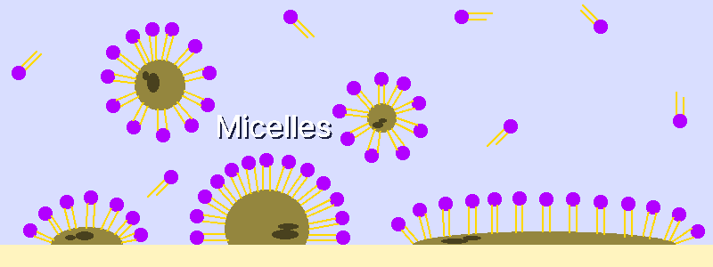

# Soap
---
## 1. Principle
### 1-1. How Soap Works
&nbsp;&nbsp;&nbsp;Soap is a surfactant: it emulsifies oil so that water can wash it away. For thousands of years it has been made by combining animal fat or vegetable oil with ash.

&nbsp;&nbsp;&nbsp;When soap molecules mix with water, they spontaneously form spherical structures called micelles. The hydrophilic heads face the water, and the lipophilic tails tuck inward. When there is grease, the micelles trap the oil droplets in their interior, isolating them from the water, and the oil is dispersed stably in the water (a colloidal state) and rinsed away.

---
### 1-2. Chemistry
&nbsp;&nbsp;&nbsp;Soap is made by reacting triglycerides, the main component of animal and plant fats, with a strong base. This reaction is called saponification.

- A triglyceride is a fat-storage molecule in which three fatty acid tails are attached to a glycerol backbone by ester bonds.
- When a strong base such as sodium hydroxide is added, the ester bonds break and form glycerol and fatty acid salts; these fatty acid salts are soap.
- The longer the fatty acid chain, the less soluble in water, the harder, and the less foamy the soap.
- Sodium hydroxide (NaOH, lye): produces hard sodium salts that dissolve less in water, which suits solid soap.
- Potassium hydroxide (KOH): produces soft potassium salts that dissolve easily in water, which suits liquid soap.
- Fully saponifying 1 g of lard (pig fat) takes about 0.138 g of NaOH. For 1 kg of lard, that is 138 g in theory (at 0% superfat).

---
## 2. Soapmaking Basics
### 2-1. Safety Rules
> **Caution:** Always wear goggles and gloves when making soap. Strong alkaline solutions such as sodium hydroxide and potassium hydroxide are highly corrosive and cause serious injury if they splash into the eyes.

- If it touches skin or eyes, rinse immediately under running water for at least 15 minutes and seek medical care if necessary.
- Do not use vinegar on a strong-base burn. The neutralization produces heat and makes the burn worse.
- Follow the mixing order: add sodium hydroxide to water. Adding water to sodium hydroxide can splash or boil over dangerously.
- Dissolving sodium hydroxide in water gives off a lot of heat and may produce fumes. The solution is extremely hot and dangerous, so keep it away from children and pets.

---
### 2-2. Cold Process and Hot Process
| Item | Cold process | Hot process |
| :---: | --- | --- |
| Temperature | Proceeds without external heating (uses the heat of the reaction) | Proceeds at about 90 °C |
| Curing time | 4-6 weeks (the reaction completes and moisture evaporates) | About 1 day (fast) |
| Advantages | Easy to mold into various shapes; many additives can be used | Fast |
| Disadvantages | Long curing time | Very viscous, so only basic shapes are possible; heat-sensitive additives cannot be used |
| Use | Solid soap (lard soap, olive/coconut oil soap) | Liquid soap (when potassium hydroxide is used) |

---
### 2-3. Trace Stage and Additives
&nbsp;&nbsp;&nbsp;The point at which stirring the mixture leaves a trail on the surface is the trace stage. The thickness of the trace affects the soap design and how additives are mixed in. Lard soap is traditionally often made pure, without additives.

| Trace thickness | Characteristics | Suitable use |
| --- | --- | --- |
| Light trace | Very thin and liquid-like | Swirl designs, mixing in liquid additives |
| Medium trace | Moderately thick | Dispersing solid additives (seeds, coffee grounds) |
| Thick trace | Very viscous and holds its shape | Textured designs, making layered soaps |

- Additives change the viscosity and curing time of the soap.
- Additives such as cinnamaldehyde and benzaldehyde are sensitive to strong bases, so add them after the trace stage, when most of the sodium hydroxide has been used up, so that they are not destroyed.
- Superfatting: adding slightly more fat than is needed. Residual oil remains in the soap, which dries the skin less and makes the soap gentler.

---
## 3. Making Soap with Sodium Hydroxide
&nbsp;&nbsp;&nbsp;Lard (pig fat) soap is the most traditional method, and water, lard, and sodium hydroxide alone are enough to make a soap with excellent moisturizing power.

- It is a pure white, hard bar that is very mild and moisturizing. This comes from the oleic acid in lard, the glycerin produced during saponification, and the residual fat left by superfatting.
- With no oil that builds lather, the lather is weak and the feel is strongly creamy.
- Once it has become soap, it can be stored for years, and even when it touches water it does not melt into a sticky mass but stays dry.

| Ingredient | Amount | Description |
| :---: | ---: | :--- |
| Lard | 500 g | Pig fat. Render it yourself or buy it |
| Sodium hydroxide | 67 g | Food-grade strong base (NaOH). Food grade refers to purity and does not mean it is edible. The value is calculated with about 3% superfat to reduce the corrosion risk |
| Distilled water | 130 ml | Water from which impurities and minerals have been removed by cooling the steam from heated water. Use the exact amount |
| Precision scale | 1 | Weighs the ingredients accurately |
| Mixing tool | 1 | Stirring by hand takes a very long time. A hand blender reaches trace much faster |
| Mold | 1 | A silicone mold or a plastic box |

1. Weigh the distilled water and sodium hydroxide accurately on a scale.
2. Slowly add the sodium hydroxide to the container of water and stir until it dissolves completely.
3. Set the sodium hydroxide solution aside to cool. The target temperature is about 38 °C.
4. Melt the solid lard until it is liquid.
5. Pour the melted lard into the mixing bowl and let it cool. The target temperature is about 27 °C. Matching the temperatures of the sodium hydroxide and the lard is important for the soap to set well.
6. Slowly and carefully pour the sodium hydroxide solution into the temperature-matched lard. Saponification starts right after mixing, and the mixture turns cloudy.
7. Stir with the mixing tool in short bursts of 20-30 seconds. Lard soap takes longer to reach trace than soaps made with other oils (much longer by hand). Trace is the state in which the oil and sodium hydroxide are stably emulsified and no longer separate. If you keep stirring too long after trace, the mixture becomes too thick to pour into the mold.
8. Pour the mixture that has reached trace into the mold. Sodium hydroxide or potassium hydroxide can still remain at this stage and be dangerous.
9. Wrap the mold in a blanket or a thick towel to retain the heat. This heat promotes saponification.
10. After 24 hours, remove the soap from the mold and cut it to the desired size with a knife or cutter. Lard soap sets very hard, so it is difficult to cut if left in the mold for more than a week.
11. Cure the cut soap on a plastic sheet or shelf with good airflow, standing on edge and turning it at least once a week. Cold process soap must cure for 4-6 weeks. During this time the remaining moisture evaporates, making the soap harder and milder.

---
## 4. Traditional Soapmaking
&nbsp;&nbsp;&nbsp;Modern methods use refined sodium hydroxide (NaOH), but from antiquity to the Middle Ages people made the strong base themselves by combining natural materials. This method produces a soft soap (liquid or gel) whose main component is potassium hydroxide (KOH).

&nbsp;&nbsp;&nbsp;With the traditional extraction of lye from ash, it is very hard to secure an exact alkali concentration. The solution obtained is not pure potassium hydroxide but a mixture of potassium carbonate and impurities, so measuring its alkalinity is imprecise. It is better used for washing dishes and laundry than for the face or bath.

---
### 4-1. Procedure
1. Roast seashells or limestone at about 1000 °C to obtain calcium oxide (CaO, quicklime).
2. Pour water over the ash of burned hardwood, steep it, and strain off a strong lye (potassium carbonate, K₂CO₃ solution).
3. Add water little by little to quicklime powder to make a slaked lime (calcium hydroxide, Ca(OH)₂) paste (slurry).
4. Add the slaked lime paste to the lye and boil them together.
5. While boiling, a white calcium carbonate sediment settles in the lower layer, and a strongly alkaline solution (potassium hydroxide, KOH) forms in the upper layer. Strain off only the clear upper solution.
6. Mix the potassium hydroxide solution with melted lard, then heat it and keep stirring until it thickens.

---
### 4-2. Testing the Strength of the Lye
&nbsp;&nbsp;&nbsp;In the traditional method the lye concentration could not be measured precisely, so empirical tests were used.

#### 4-2-1. Egg Test
&nbsp;&nbsp;&nbsp;Float an egg in the lye and judge the alkali concentration by how much of it rises above the surface.

- Sinks completely: the alkali is too weak to saponify.
- More than half floats up: the alkali is too strong and can damage the fat.
- A small part of the top (about 2 cm across) floats: suitable.

#### 4-2-2. Feather Test
&nbsp;&nbsp;&nbsp;Dip a feather in the lye and judge the alkali concentration by how much it dissolves.

- No change: not enough alkali
- Dissolves and disappears immediately: concentration too high
- Does not dissolve immediately, but within a few seconds to several tens of seconds the tip turns soft and breaks down: suitable