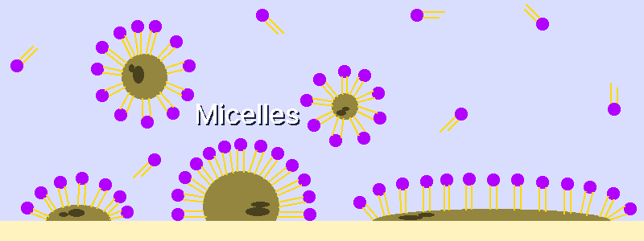

# 石鹸
---
## 1. 原理
### 1-1. 作用の仕組み
&nbsp;&nbsp;&nbsp;石鹸は界面活性剤で、油を乳化させて水で洗い流せるようにします。数千年にわたり、動物性の脂肪や植物性の油と灰を組み合わせて作られてきました。

&nbsp;&nbsp;&nbsp;石鹸の分子は水と混ざると、自然に球状の構造であるミセル(Micelles)を作ります。親水性の頭部は水に触れ、親油性の尾部は内側に隠れます。油汚れがあると、ミセルが油滴を内部の空間に閉じ込めて水から隔離し、油が水中に安定して分散(コロイド状態)して洗い流されます。

---
### 1-2. 化学
&nbsp;&nbsp;&nbsp;動植物性の脂肪の主成分であるトリグリセリド(Triglycerides)と強塩基が反応して、石鹸ができます。この反応がけん化反応です。

- トリグリセリドは、グリセロールの骨格に3本の脂肪酸の尾部がエステル結合でついた、脂肪の貯蔵分子です。
- 水酸化ナトリウムなどの強塩基を加えるとエステル結合が切れ、グリセロールと脂肪酸塩(Fatty Acid Salts)ができます。この脂肪酸塩が石鹸です。
- 脂肪酸の鎖が長いほど、石鹸は水に溶けにくく硬くなり、泡立ちにくくなります。
- 水酸化ナトリウム(NaOH、苛性ソーダ): 硬くて水に溶けにくいナトリウム塩ができるため、固形石鹸に向いています。
- 水酸化カリウム(KOH): 柔らかくて水によく溶けるカリウム塩ができるため、液体石鹸に向いています。
- ラード(豚の脂)1gを完全にけん化するには、NaOHが約0.138g必要です。ラード1kgなら理論上138gです(スーパーファット0%基準)。

---
## 2. 石鹸作りの基礎知識
### 2-1. 安全の決まり
> **注意:** 石鹸を作るときは、ゴーグルと手袋を必ず着用します。水酸化ナトリウムや水酸化カリウムのような強アルカリ溶液は腐食性が強く、目に入ると重い障害を負います。

- 皮膚や目に付いたら、すぐに流水で15分以上洗い、必要なら医療措置を受けます。
- 強塩基による化学やけどに酢を使ってはいけません。中和の過程で熱が出て、やけどが悪化します。
- 混ぜる順序を守ります。水酸化ナトリウムを水に入れます。水を水酸化ナトリウムに入れると、危険なほど飛び散ったり沸き上がったりします。
- 水酸化ナトリウムを水に溶かすと大量の熱が出て、煙が出ることがあります。溶液は非常に熱く危険なので、子どもやペットから遠ざけておきます。

---
### 2-2. コールドプロセスとホットプロセス
| 区分 | コールドプロセス | ホットプロセス |
| :---: | --- | --- |
| 温度 | 外部から加熱せずに進行(反応熱を利用) | 約90℃で進行 |
| 硬化時間 | 4-6週間(反応の完了と水分の蒸発) | 約1日(速い) |
| 長所 | 多様な形に型取りしやすく、多様な添加物を使える | 速い |
| 短所 | 硬化時間が長い | 粘度が非常に高く、基本的な形しか作れない。熱に弱い添加物は使えない |
| 用途 | 固形石鹸(ラード石鹸、オリーブ/ココナッツオイル石鹸) | 液体石鹸(水酸化カリウム使用時) |

---
### 2-3. トレース段階と添加物
&nbsp;&nbsp;&nbsp;混合物をかき混ぜたとき、表面に跡が残る時点がトレース(Trace)段階です。トレースの濃度は、石鹸のデザインや添加物の混ぜ方に影響します。ラード石鹸は、伝統的に添加物を入れず純粋に作ることもあります。

| トレースの濃度 | 特徴 | 適した用途 |
| --- | --- | --- |
| ライトトレース(Light Trace) | とても薄く液体のよう | 渦巻きのデザイン、液体添加物の混合 |
| ミディアムトレース(Medium Trace) | 適度にとろみがある | 固形添加物(種、コーヒー粉)の分散 |
| シックトレース(Thick Trace) | 粘度が非常に高く、形を保つ | 質感のあるデザイン、多層石鹸の製作 |

- 添加物によって、石鹸の粘度と硬化時間が変わります。
- シンナムアルデヒド、ベンズアルデヒドなどの添加物は強塩基に弱いため、水酸化ナトリウムがほとんど消費されたトレース段階の後に入れないと、壊れてしまいます。
- スーパーファット(Super-fatting): 必要量より脂肪を少し多く入れること。石鹸に残った油分が肌の乾燥を和らげ、石鹸を柔らかくします。

---
## 3. 水酸化ナトリウムを使った石鹸作り
&nbsp;&nbsp;&nbsp;ラード(豚の脂)石鹸は最も伝統的な方法で、水・ラード・水酸化ナトリウムだけで、保湿力に優れた石鹸を作れます。

- 純白で硬いバー状で、とても柔らかく保湿力に優れています。これは、ラードのオレイン酸、けん化中にできるグリセリン、スーパーファットで残った脂肪分によるものです。
- 泡立ちを生む油がないため、泡は弱く、クリームのような感触が強くなります。
- 石鹸になれば何年も保管でき、水に触れても溶けてべたつかず、乾いた状態を保ちます。

| 材料 | 分量 | 説明 |
| :---: | ---: | :--- |
| ラード | 500g | 豚の脂。自分で精製するか購入 |
| 水酸化ナトリウム | 67g | 食品グレードの強塩基(NaOH)。食品グレードは純度の基準であり、食べられるという意味ではありません。腐食の危険を減らすため、約3%のスーパーファットで計算した値 |
| 蒸留水 | 130ml | 水を加熱して出た水蒸気を冷却し、不純物とミネラルを除いた水。正確な量を使う |
| 精密はかり | 1個 | 材料を正確に計量 |
| 混ぜる道具 | 1個 | 手で混ぜると非常に時間がかかります。ハンドブレンダーを使うと、はるかに早くトレースに達する |
| 型 | 1個 | シリコン型かプラスチックの箱 |

1. 蒸留水と水酸化ナトリウムを、はかりで正確に計量します。
2. 水の入った容器に水酸化ナトリウムをゆっくり入れ、完全に溶けるまでかき混ぜます。
3. 水酸化ナトリウム溶液を脇に置いて冷まします。目標温度は約38℃です。
4. 固形のラードを、液体になるまで溶かします。
5. 溶かしたラードをミキシングボウルに注いで冷まします。目標温度は約27℃です。水酸化ナトリウムとラードの温度を揃えることが、石鹸がよく固まるうえで重要です。
6. 温度を揃えたラードに、水酸化ナトリウム溶液をゆっくり慎重に注ぎます。混ぜた直後にけん化反応が始まり、混合物が白く濁ります。
7. 混ぜる道具で、20-30秒ずつ短く区切ってかき混ぜます。ラード石鹸は、他の油の石鹸よりトレースまで時間がかかります(手作業ではさらにずっとかかります)。トレースとは、油と水酸化ナトリウムが安定して乳化し、もう分離しない状態です。トレースの後にかき混ぜすぎると、濃くなりすぎて型に注ぎにくくなります。
8. トレースに達した混合物を型に注ぎます。この段階でも水酸化ナトリウムまたは水酸化カリウムが残っていて、危険なことがあります。
9. 型を毛布か厚手のタオルで包んで熱を保ちます。この熱がけん化反応を促します。
10. 24時間後に型から石鹸を取り出し、ナイフかカッターで好みの大きさに切ります。ラード石鹸はとても硬く固まるので、型に1週間以上置くと切りにくくなります。
11. 切った石鹸を、風通しのよいプラスチックシートか棚の上に立てて置き、週に1回以上裏返しながら硬化させます。コールドプロセスの石鹸は4-6週間硬化させる必要があります。この間に残った水分が蒸発して、石鹸がより硬く、より穏やかになります。

---
## 4. 伝統的な石鹸作り
&nbsp;&nbsp;&nbsp;現代の方法では精製された水酸化ナトリウム(NaOH)を使いますが、古代から中世までは、自然から得た材料を組み合わせて強塩基を自分で作っていました。この方法では、水酸化カリウム(KOH)を主成分とする軟石鹸(液体またはジェル)ができます。

&nbsp;&nbsp;&nbsp;灰汁を使った伝統的な抽出では、正確なアルカリ濃度を確保するのが非常に困難です。得られる溶液は純粋な水酸化カリウムではなく、炭酸カリウムと不純物が混ざった形なので、アルカリ濃度の測定が不完全です。洗顔や入浴よりも、食器洗いや洗濯に使うのが向いています。

---
### 4-1. 作り方
1. 貝殻や石灰岩を約1000℃で焼いて、酸化カルシウム(CaO、生石灰)を用意します。
2. 広葉樹を燃やした灰に水を注いで煮出し、濃い灰汁(炭酸カリウム、K₂CO₃水溶液)をこします。
3. 生石灰の粉に水を少しずつ注いで、消石灰(水酸化カルシウム、Ca(OH)₂)のペースト(スラリー)を作ります。
4. 灰汁に消石灰のペーストを入れて、一緒に煮ます。
5. 煮ている間に、下層には白い炭酸カルシウムの沈殿がたまり、上層には強アルカリ溶液(水酸化カリウム、KOH)ができます。上層の澄んだ溶液だけをこし取ります。
6. 作った水酸化カリウム溶液を溶かしたラードと混ぜ、とろみがつくまで加熱しながら絶えずかき混ぜます。

---
### 4-2. 灰汁のアルカリ強度の試験
&nbsp;&nbsp;&nbsp;伝統的な方法では灰汁の濃度を正確に計量できないため、経験的な試験法を使っていました。

#### 4-2-1. 卵の試験法
&nbsp;&nbsp;&nbsp;灰汁に卵を浮かべ、水面から浮き上がる程度でアルカリ濃度を判断します。

- 完全に沈む: アルカリが弱すぎて、けん化が難しくなります。
- 半分以上浮く: アルカリが強すぎて、脂肪を傷める恐れがあります。
- 上部(直径2cm程度)が少し浮く: 適しています。

#### 4-2-2. 羽根の試験法
&nbsp;&nbsp;&nbsp;灰汁に羽根を浸し、溶ける程度でアルカリ濃度を判断します。

- 変化なし: アルカリ不足
- すぐに溶けて消える: 濃度が高すぎる
- すぐには溶けないが、数秒から数十秒のうちに先端がふやけて分解する: 適正