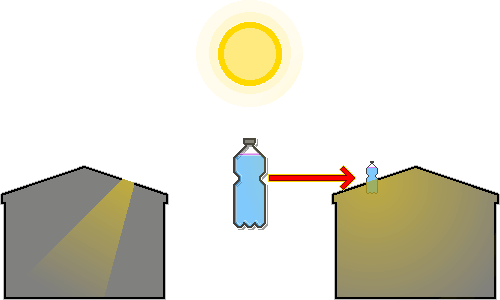

# Лампочка из пластиковой бутылки
---
## 1. Общие сведения
&nbsp;&nbsp;&nbsp;Это приспособленная технология для освещения помещения днём там, где отключено электричество или оплата электроэнергии непосильна. Впервые её изобрёл бразилец Альфредо Мозер (Alfredo Moser) в ответ на энергетический кризис 2002 года, а филиппинец Иллак Диаз (Illac Diaz) распространил по всему миру через кампанию «Литр света» (Liter of Light).

&nbsp;&nbsp;&nbsp;Её делают всего из использованной пластиковой бутылки, воды и небольшого количества отбеливателя. Яркость сопоставима с лампой накаливания мощностью 40-60 Вт, а риск пожара намного ниже, чем у керосиновой лампы.

---
## 2. Материалы
| Материал | Условие | Роль |
| --- | --- | --- |
| Прозрачная пластиковая бутылка | Прозрачная бутылка объёмом 2 л без царапин и изменения цвета | Линза, собирающая и преломляющая свет |
| Вода | Чистая вода | Среда, преломляющая и рассеивающая свет |
| Отбеливатель (хлор) | Хлорсодержащий отбеливатель, 3 мл на 1 л воды | Подавляет рост микроорганизмов |
| Кровельный материал | Оцинкованный стальной лист или похожий жёсткий кровельный материал | Фиксирует бутылку и предотвращает протечки |
| Силиконовый герметик | Силиконовый клей для гидроизоляции и герметизации | Предотвращает протечки |

- Если чистой воды нет, прокипятите или отфильтруйте её, чтобы убрать примеси. Мутная вода резко снижает светопропускание.
- Стеклянная бутылка прочнее пластиковой и прозрачнее, но тяжела, опасна при разбитии, а закрепить её на крыше и гидроизолировать сложнее.

---
## 3. Принцип действия

1. Солнечный свет проходит через воздух и попадает в прозрачную бутылку, полностью наполненную водой.
2. Бутылка с водой действует как выпуклая линза: собирает солнечный свет с большой площади и направляет его в помещение.
3. Когда свет переходит из воздуха в воду, а затем из воды обратно в воздух (в помещение), его путь изгибается из-за разницы плотностей сред (преломление).
4. Благодаря преломлению свет собирается в нижней части бутылки.
5. Собранный внизу свет расходится во все стороны за счёт преломляющей способности воды и тонкого рассеивающего действия частиц отбеливателя.
6. Благодаря рассеиванию свет не концентрируется в одной точке, а равномерно освещает всё помещение.

---
## 4. Установка
1. Подготовка и мытьё материалов: вымойте прозрачную пластиковую бутылку объёмом 2 л и снимите этикетку. Царапины или непрозрачность снижают светопропускание.
2. Заливка воды и отбеливателя: налейте в бутылку чистую воду до самого горлышка, добавьте 3 мл отбеливателя на 1 л воды (около 6 мл на 2 л) и плотно закройте крышку. Если остаётся воздушная прослойка, эффект линзы ослабевает, поэтому наполняйте полностью.
3. Отверстие в крыше: проделайте в кровельном материале (стальном листе) круглое отверстие чуть меньше диаметра бутылки. Слишком большое отверстие трудно загерметизировать, а слишком маленькое не пропустит бутылку.
4. Установка и фиксация бутылки: вставьте бутылку в отверстие так, чтобы 1/3 находилась над крышей, а 2/3 — внутри помещения, и закрепите. Бутылка тяжёлая и может шататься, поэтому подведите снизу, со стороны крыши, опору.
5. Гидроизоляция: толстым слоем нанесите силиконовый герметик на зазор между бутылкой и кровельным материалом — и сверху, и снизу крыши. Дождитесь полного высыхания герметика.

---
## 5. Обслуживание
- Примерно раз в 5 лет заменяйте воду и отбеливатель в бутылке, чтобы сохранить прозрачность.
- После ливня или сильного ветра проверяйте, не появились ли щели в силиконовом герметике на крыше, и при необходимости ремонтируйте.
- Если часть бутылки над крышей покрылась пылью или грязью, светопропускание падает, поэтому регулярно протирайте её.