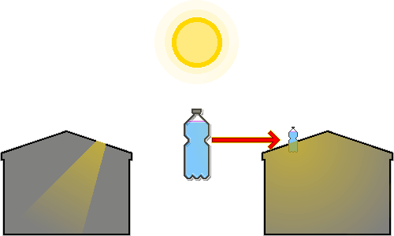

# Plastic Bottle Bulb
---
## 1. Overview
&nbsp;&nbsp;&nbsp;This is an appropriate technology that lights a room during the day where power is cut off or electricity bills are a burden. It was first invented by Alfredo Moser of Brazil in response to the 2002 power crisis, and Illac Diaz of the Philippines spread it worldwide through the "Liter of Light" campaign.

&nbsp;&nbsp;&nbsp;It is made from nothing more than a discarded plastic bottle, water, and a small amount of bleach. It gives about the same brightness as a 40-60 W incandescent bulb and carries far less fire risk than a kerosene lamp.

---
## 2. Materials
| Material | Requirement | Role |
| --- | --- | --- |
| Clear plastic bottle | A clear 2 L bottle with no scratches or discoloration | A lens that gathers and refracts light |
| Water | Clean water | A medium that refracts and scatters light |
| Bleach (chlorine) | Chlorine bleach, 3 ml per 1 L of water | Suppresses microbial growth |
| Roofing material | Galvanized steel sheet or a similar rigid roofing material | Holds the bottle in place and prevents leaks |
| Silicone sealant | Waterproof silicone adhesive for sealing | Prevents leaks |

- If you have no clean water, boil or filter it to remove impurities before use. Cloudy water sharply reduces light transmission.
- A glass bottle is more durable and more transparent than plastic, but it is heavy, dangerous if it breaks, and harder to mount on the roof and waterproof.

---
## 3. Principle

1. Sunlight passes through the air and enters a clear bottle filled with water.
2. The water-filled bottle acts like a convex lens, gathering sunlight from a wide area and focusing it toward the room.
3. When light passes from air into water and then from water back into air (the room), its path bends because of the difference in density between the media (refraction).
4. Refraction brings the light together in the lower part of the bottle.
5. The light gathered in the lower part spreads in all directions through the refractive power of the water and the fine scattering effect of the bleach particles.
6. Thanks to scattering, the light does not concentrate on one spot only but lights the whole room evenly.

---
## 4. Installation
1. Prepare and clean the materials: Wash a clear 2 L plastic bottle and remove the label. Scratches or opacity lower light transmission.
2. Pour in water and bleach: Fill the bottle with clean water to the very top of the neck, add 3 ml of bleach per 1 L of water (about 6 ml for 2 L), and close the cap tightly. Fill it completely, because an air gap weakens the lens effect.
3. Cut the roof opening: Cut a round hole in the roofing material (steel sheet) slightly smaller than the diameter of the bottle. If the hole is too large, waterproofing is difficult; if it is too small, the bottle will not fit.
4. Insert and secure the bottle: Push the bottle into the hole so that one third sits above the roof and two thirds extend into the room. The bottle is heavy and may wobble, so reinforce it from below the roof with a support or similar.
5. Waterproof it: Apply a thick bead of silicone sealant to the gap between the bottle and the roofing material, both above and below the roof, to seal it. Wait until the sealant has dried completely.

---
## 5. Maintenance
- Replace the water and bleach in the bottle about every 5 years to keep it clear.
- After heavy rain or strong wind, check the silicone sealant on the roof for gaps and repair it if necessary.
- If the part of the bottle above the roof is covered with dust or debris, light transmission drops, so wipe it regularly.