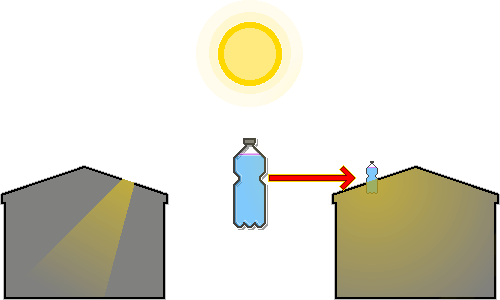

# ペットボトル電球
---
## 1. 概要
&nbsp;&nbsp;&nbsp;停電した環境や電気代が負担になる環境で、日中の室内を明るくする適正技術です。ブラジルのアルフレド・モーゼル(Alfredo Moser)が2002年の停電に対応して初めて考案し、フィリピンのイラック・ディアス(Illac Diaz)が「リッター・オブ・ライト」キャンペーンで世界中に広めました。

&nbsp;&nbsp;&nbsp;廃棄されたペットボトル、水、少量の漂白剤だけで作れ、40-60W級の白熱電球と同程度の明るさが得られます。灯油ランプよりも火災の危険がはるかに低いのが特徴です。

---
## 2. 材料
| 材料 | 条件 | 役割 |
| --- | --- | --- |
| 透明なペットボトル | 傷や変色のない透明な2Lボトル | 光を集めて屈折させるレンズ |
| 水 | きれいな水 | 光を屈折・散乱させる媒質 |
| 漂白剤(塩素) | 塩素系漂白剤を水1Lあたり3ml | 微生物の増殖を抑制 |
| 屋根材 | 亜鉛めっき鋼板または同様の硬い屋根材 | ボトルの固定と水漏れ防止 |
| シリコンシーラント | 防水・密封用のシリコン接着剤 | 水漏れ防止 |

- きれいな水がない場合は、煮沸またはろ過して不純物を取り除いてから使います。水が濁っていると光の透過率が急激に下がります。
- ガラス瓶はプラスチックより耐久性が高く透明度も高いですが、重く、割れると危険で、屋根への固定や防水処理がより難しくなります。

---
## 3. 原理

1. 太陽光が空気を通り、水で満たされた透明なボトルに入ります。
2. 水の入ったボトルが凸レンズのように働き、広い範囲の太陽光を集めて室内の方向へ集中させます。
3. 光が空気から水へ、さらに水から空気(室内)へ進むとき、媒質の密度の違いによって進路が曲がります(屈折)。
4. 屈折によって光がボトルの下部に集まります。
5. 下部に集まった光は、水の屈折力と漂白剤の粒子による微細な散乱効果で四方へ広がります。
6. 散乱のおかげで光が一点だけに集中せず、室内全体をまんべんなく明るくします。

---
## 4. 設置
1. 材料の準備・洗浄: 2Lの透明なペットボトルを洗い、ラベルを剥がします。傷があったり不透明だったりすると、光の透過率が下がります。
2. 水・漂白剤の注入: ボトルにきれいな水を口の先まで満たし、水1Lあたり3ml(2Lなら約6ml)の漂白剤を入れて、キャップをしっかり閉めます。空気の層が残るとレンズ効果が落ちるため、いっぱいに満たします。
3. 屋根の穴あけ: 屋根材(鋼板)に、ボトルの直径よりわずかに小さい円形の穴を開けます。穴が大きすぎると防水が難しく、小さすぎるとボトルが入りません。
4. ボトルの挿入・固定: ボトルの1/3が屋根の上に、2/3が室内に入るように穴へ差し込んで固定します。ボトルは重くて揺れることがあるため、屋根の下側から受け台などで補強します。
5. 防水処理: ボトルと屋根材の隙間に、屋根の上側と下側の両方からシリコンシーラントを厚く塗って密封します。シーラントが完全に乾くまで待ちます。

---
## 5. メンテナンス
- 約5年ごとにボトル内の水と漂白剤を交換し、透明度を保ちます。
- 豪雨や強風の後は、屋根のシリコンシーラントに隙間ができていないかを点検し、必要なら補修します。
- ボトルの屋根より上の部分がほこりや異物で覆われると光の透過率が下がるため、定期的に拭きます。