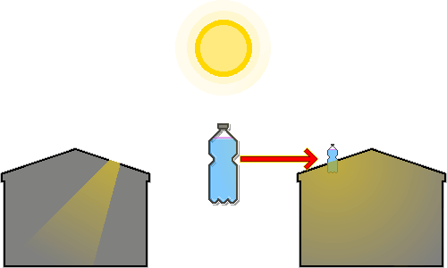

# 페트병 전구
---
## 1. 개요
&nbsp;&nbsp;&nbsp;전력이 끊겼거나 전기료가 부담스러운 환경에서 낮 시간 실내를 밝히는 적정기술입니다. 브라질의 알프레도 모저(Alfredo Moser)가 2002년 정전 사태에 대응해 처음 발명했고, 필리핀의 일락 디아즈(Illac Diaz)가 '리터 오브 라이트' 캠페인으로 전 세계에 확산시켰습니다.

&nbsp;&nbsp;&nbsp;폐플라스틱 병, 물, 소량의 표백제만으로 만들며 40-60W급 백열전구와 비슷한 밝기를 내고, 등유 램프보다 화재 위험이 훨씬 낮습니다.

---
## 2. 재료
| 재료 | 조건 | 역할 |
| --- | --- | --- |
| 투명 페트병 | 흠집이나 변색이 없는 투명한 2L 병 | 빛을 모으고 굴절시키는 렌즈 |
| 물 | 깨끗한 물 | 빛을 굴절·산란시키는 매질 |
| 표백제(염소) | 염소계 표백제(락스)를 물 1L당 3ml | 미생물 성장 억제 |
| 지붕 재료 | 아연 도금 강판 또는 유사한 단단한 지붕 재료 | 병 고정과 누수 방지 |
| 실리콘 실란트 | 방수·밀봉용 실리콘 접착제 | 누수 방지 |

- 깨끗한 물이 없으면 끓이거나 여과해 불순물을 제거한 뒤 씁니다. 물이 탁하면 빛 투과율이 급격히 떨어집니다.
- 유리병은 플라스틱보다 내구성이 좋고 투명도가 높지만, 무겁고 파손 시 위험하며 지붕 고정과 방수 처리가 더 까다롭습니다.

---
## 3. 원리

1. 태양광이 공기를 지나 물이 가득 찬 투명한 병에 들어옵니다.
2. 물이 찬 병이 볼록 렌즈처럼 작용해 넓은 범위의 태양광을 모아 실내 방향으로 집중시킵니다.
3. 빛이 공기에서 물로, 다시 물에서 공기(실내)로 지날 때 매질의 밀도 차이로 경로가 꺾입니다(굴절).
4. 굴절 덕분에 빛이 병의 아랫부분으로 모입니다.
5. 아랫부분에 모인 빛이 물의 굴절력과 표백제 입자의 미세한 산란 효과로 사방으로 퍼집니다.
6. 산란 덕분에 빛이 특정 지점에만 집중되지 않고 실내 전체를 고르게 밝힙니다.

---
## 4. 설치
1. 재료 준비·세척: 2L 투명 페트병을 씻고 라벨을 뗍니다. 흠집이 있거나 불투명하면 빛 투과율이 낮아집니다.
2. 물·표백제 주입: 병에 깨끗한 물을 목 끝까지 가득 채우고 물 1L당 3ml(2L 기준 약 6ml)의 표백제를 넣은 뒤 뚜껑을 꽉 닫습니다. 공기층이 남으면 렌즈 효과가 떨어지므로 가득 채웁니다.
3. 지붕 타공: 지붕 재료(강판)에 병 지름보다 약간 작은 원형 구멍을 뚫습니다. 구멍이 너무 크면 방수가 어렵고 너무 작으면 병이 들어가지 않습니다.
4. 병 삽입·고정: 병의 1/3이 지붕 위로, 2/3가 실내로 들어가게 구멍에 끼워 고정합니다. 병이 무거워 흔들릴 수 있으므로 지붕 아래쪽에서 받침대 등으로 보완합니다.
5. 방수 처리: 병과 지붕 재료 사이의 틈에 지붕 위쪽과 아래쪽 모두 실리콘 실란트를 두껍게 발라 밀봉합니다. 실란트가 완전히 마를 때까지 기다립니다.

---
## 5. 유지보수
- 약 5년마다 병 내부의 물과 표백제를 교체해 투명도를 유지합니다.
- 폭우나 강풍 뒤에는 지붕의 실리콘 실란트에 틈이 생기지 않았는지 점검하고 필요하면 보수합니다.
- 병의 지붕 위쪽 부분이 먼지나 이물질로 덮이면 빛 투과율이 떨어지므로 주기적으로 닦습니다.