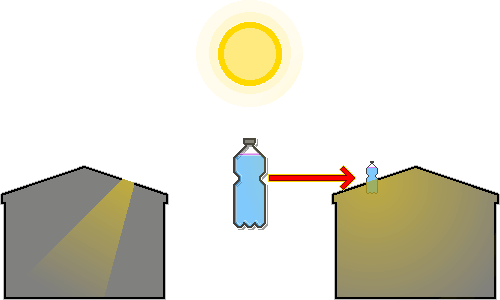

# 塑料瓶灯泡
---
## 1. 概述
&nbsp;&nbsp;&nbsp;这是一种适用于断电或电费负担沉重的环境、用来在白天照亮室内的适用技术。巴西的阿尔弗雷多·莫泽（Alfredo Moser）为应对2002年的停电危机首次发明了它，菲律宾的伊拉克·迪亚兹（Illac Diaz）则通过“一升光”（Liter of Light）运动将其推广到全世界。

&nbsp;&nbsp;&nbsp;只需用废弃塑料瓶、水和少量漂白剂即可制成，亮度与40-60W的白炽灯泡相当，火灾风险比煤油灯低得多。

---
## 2. 材料
| 材料 | 条件 | 作用 |
| --- | --- | --- |
| 透明塑料瓶 | 无划痕、无变色的透明2L瓶 | 聚集并折射光线的透镜 |
| 水 | 清洁的水 | 使光折射、散射的介质 |
| 漂白剂（氯） | 含氯漂白剂，每1L水加3ml | 抑制微生物生长 |
| 屋顶材料 | 镀锌钢板或类似的坚硬屋顶材料 | 固定瓶子、防止漏水 |
| 硅酮密封胶 | 防水密封用的硅酮胶 | 防止漏水 |

- 没有干净的水时，先煮沸或过滤去除杂质再使用。水浑浊会使光的透过率急剧下降。
- 玻璃瓶比塑料更耐用、透明度更高，但较重，破碎时有危险，固定到屋顶和防水处理也更麻烦。

---
## 3. 原理

1. 阳光穿过空气，进入装满水的透明瓶子。
2. 装满水的瓶子像凸透镜一样，把大范围的阳光聚集起来，朝室内方向集中。
3. 光从空气进入水中，再从水中回到空气（室内）时，由于介质密度不同，路径发生弯折（折射）。
4. 折射使光线汇聚到瓶子的下部。
5. 汇聚在下部的光在水的折射力和漂白剂微粒的细微散射作用下向四面扩散。
6. 得益于散射，光不会只集中在某一点，而是均匀照亮整个室内。

---
## 4. 安装
1. 准备并清洗材料：洗净2L透明塑料瓶，撕掉标签。有划痕或不透明会降低光的透过率。
2. 注入水和漂白剂：往瓶中注入干净的水，直到瓶口，按每1L水3ml（2L约6ml）加入漂白剂，然后拧紧瓶盖。留有空气层会削弱透镜效果，所以要装满。
3. 屋顶开孔：在屋顶材料（钢板）上开一个比瓶子直径略小的圆孔。孔太大不易防水，太小则瓶子放不进去。
4. 插入并固定瓶子：把瓶子插入孔中固定，使1/3位于屋顶上方，2/3伸入室内。瓶子较重，可能晃动，所以要从屋顶下方用支撑物等加固。
5. 防水处理：在瓶子与屋顶材料之间的缝隙，从屋顶上方和下方两侧都厚厚地涂上硅酮密封胶进行密封，然后等待密封胶完全干透。

---
## 5. 维护
- 大约每5年更换一次瓶内的水和漂白剂，以保持透明度。
- 暴雨或大风之后，检查屋顶的硅酮密封胶是否出现缝隙，必要时进行修补。
- 瓶子位于屋顶上方的部分如果被灰尘或异物覆盖，光的透过率会下降，要定期擦拭。