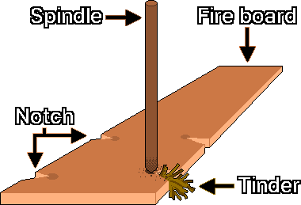
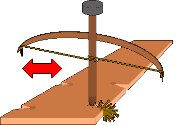
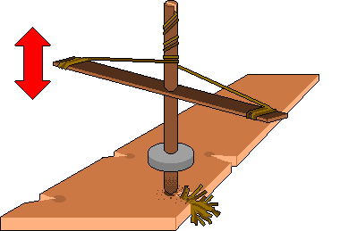
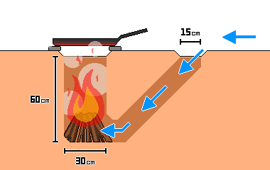

# Зажигание огня
---
## 1. Проверки перед розжигом
- Обеспечьте не менее двух путей эвакуации, чтобы сразу уйти при распространении огня или обнаружении враждебных сил.
- Если земля сырая или холодная, подложите изолирующий материал вроде брёвен: так земля не отнимет тепло, а расход топлива снизится.
- Убедитесь, что для розжига и устойчивого горения достаточно тепла, топлива и кислорода.

| Элемент | Содержание |
| --- | --- |
| Тепло | Температура, достаточная для достижения точки воспламенения (тепло трения, искра, сфокусированный свет) |
| Топливо | Горючее вещество (сухая трава, дрова) |
| Кислород | Воздух, поддерживающий горение (обдув, вентиляция) |

---
## 2. Приоритет способов розжига
&nbsp;&nbsp;&nbsp;Разжигание огня в чрезвычайной ситуации — борьба со временем и силами. Выбирайте самый эффективный способ из доступных инструментов и условий.

| Приоритет | Способ | Успешность | Затраты энергии | Основные инструменты |
| --- | --- | --- | --- | --- |
| 1 | Прямой розжиг | Очень высокая | Очень низкие | Если есть зажигалка, спички, горелка и т. п. |
| 2 | Искра/фокусировка света | Средняя | От низких до средних | Батарея 9 В, линза, ферроцериевый стержень, кремень |
| 3 | Розжиг трением | Низкая | Очень высокие | Ручной, лучковый и насосный бурав (крайняя мера) |

---
## 3. Розжиг
### 3-1. Искровые и физические способы
#### 3-1-1. Розжиг замыканием алкалиновой батареи 9 В
- Принцип: нагрев от электрического сопротивления даёт уголёк.
- Материалы: одна батарея 9 В, тонкая стальная вата, трут
- Способ: одновременно прижмите положительный и отрицательный контакты батареи 9 В к тонкой стальной вате. Стальная вата мгновенно перегревается, раскаляется докрасна и даёт уголёк.

> **Внимание:** при замыкании батарея 9 В быстро перегревается, поэтому прикасайтесь на короткое время и сразу разъединяйте. Литий-ионные батареи (перезаряжаемые блоки) при замыкании очень опасны — возможны взрыв и пожар, поэтому используйте сухой элемент 9 В (алкалиновый или угольно-цинковый).

#### 3-1-2. Розжиг сфокусированным светом через линзу
- Принцип: выпуклая линза собирает солнечный свет в одну точку и доводит его до точки воспламенения.
- Материалы: очки с выпуклыми линзами для дальнозоркости или прозрачная пластиковая бутылка, полностью наполненная водой
- Способ: на солнце держите линзу над трутом и соберите свет в одну точку.

---
### 3-2. Способы трением
&nbsp;&nbsp;&nbsp;Тепло от быстрого трения двух кусков дерева образует угольную пыль, и, подавая в неё кислород, её выращивают до уголька. Способ очень чувствителен к условиям среды: при высокой влажности успех реже. Чтобы угольная пыль образовывалась стабильно, доска-основание и веретено должны быть близки по твёрдости.

#### 3-2-1. Составные части

| Часть | Роль | Основные особенности и материал |
| :---: | :--- | :--- |
| Доска-основание (Fire board) | Основа, на которой происходит трение | У края мягкой доски делают небольшую V-образную выемку (Notch), в которой вращается веретено. Угольная пыль, образующаяся при трении, собирается в этой выемке |
| Веретено (Spindle) | Стержень, который вращается и даёт тепло трения | Обычно из той же породы дерева, что и основание. Должно быть прямым и сухим |
| Трут (Tinder) | Материал, принимающий уголёк и разгорающийся пламенем | Сухой, хорошо горящий материал: сухая трава, кора |

#### 3-2-2. Причины неудачи
| Причина | Проявление | Меры |
| :---: | :--- | :--- |
| Недостаток тепла | Угольная пыль не образуется или не превращается в уголёк | Увеличьте скорость вращения |
| Избыток кислорода | Угольная пыль не накапливается, её сдувает ветром | Защитите от ветра, например обложите стенкой |
| Недостаток кислорода | Уголёк образовался, но растёт медленно или гаснет | Подуйте в меру |
| Избыток топлива | Сухая трава слишком плотная, уголёк задыхается | Разрыхлите сухую траву, оставив воздушные каналы |

#### 3-2-3. Порядок розжига
1. Медленно вращайте веретено, сильно надавливая, чтобы получить тепло трения, и накапливайте угольную пыль под V-образной выемкой.
2. Когда пыли накопилось достаточно и пошёл дым, сохраняя давление, как можно сильнее увеличьте скорость вращения и доведите до точки воспламенения.
3. Если угольная пыль продолжает дымить сама, уголёк образовался успешно.
4. Если после образования уголька слепившаяся пыль не рассыпается от лёгкого встряхивания рукой, он стабилизировался.

#### 3-2-4. Меры предосторожности
- Розжиг трением очень утомителен. Если не получается, не продолжайте через силу: делайте перерыв каждые 10-15 минут и сохраняйте тепло тела.
- Защитите руки перчатками или обмотайте их полотенцем, чтобы на ладонях не появились волдыри.

---
### 3-3. Инструменты для розжига трением
#### 3-3-1. Ручной бурав (Hand drill)
&nbsp;&nbsp;&nbsp;Самый простой инструмент, но требует больше всего усилий и силы.

1. Найдите тонкую гладкую палку длиной от локтя до кончиков пальцев (около 45-50 см) и толщиной с указательный палец (диаметр около 1-1,5 см) и используйте её как веретено.
2. Найдите деревянную доску, чуть мягче веретена, и используйте её как основание.
3. Сделайте в основании лунку примерно вдвое шире диаметра веретена и от края лунки наружу прорежьте V-образную выемку.
4. Заполните место вокруг V-образной выемки трутом.
5. Прочно прижмите основание ногой.
6. Зажмите веретено между ладонями, поставьте вертикально и быстро вращайте его, растирая ладони и сильно нажимая вниз.
7. Вращайте скоростью, а не силой. Когда руки опустятся до конца палки, быстро поднимите их наверх и продолжайте растирать.
8. Когда в V-образной выемке накопится угольная пыль и пойдёт дым, не останавливайтесь, пока не получите уголёк.
9. Когда уголёк образовался, перенесите его в трут и осторожно подуйте сбоку, чтобы получить пламя.

#### 3-3-2. Лучковый бурав (Bow drill)

&nbsp;&nbsp;&nbsp;Веретено вращают с помощью лука. Он даёт более непрерывное вращение, чем ручной бурав, поэтому успешность выше.

1. Выполните шаги ручного бурава до 4-го включительно.
2. В середине камня (упорного блока), который ляжет сверху на веретено, сделайте лунку. Чтобы уменьшить трение о веретено, можно нанести в лунку смазку без влаги: сухие листья, угольный порошок, животный жир, смолу, кусочки мыла.
3. Сделайте лук: крепко обмотайте прочным шнуром или кожаным ремешком оба конца твёрдой, слегка изогнутой палки длиной примерно в руку.
4. Обмотайте тетивой веретено один раз и держите тетиву пальцами руки, в которой лук, регулируя натяжение хваткой. Если тетива натянута туго, она скользит и не наматывается на веретено, а если слишком слаба — прокручивается вхолостую. Завязывайте не туго, а с небольшим запасом.
5. Одной рукой удерживайте и прижимайте упорный блок на верхушке веретена, а другой двигайте лук горизонтально взад-вперёд.
6. Когда веретено в V-образной выемке даёт угольную пыль и дыма достаточно, ускорьтесь, чтобы получить уголёк.
7. Когда уголёк образовался, перенесите его в трут и осторожно подуйте сбоку, чтобы получить пламя.

#### 3-3-3. Насосный бурав (Pump drill)

&nbsp;&nbsp;&nbsp;Преобразует вертикальное движение во вращательное. Изготовить сложнее, но работает очень стабильно.

1. Выполните шаги ручного бурава до 4-го включительно.
2. Подготовьте новую палку для рукоятки.
3. Просверлите отверстие точно посередине рукоятки, наденьте её на веретено крестом и расположите примерно в 10 см от верха.
4. Сделайте лук: крепко обмотайте прочным шнуром или кожаным ремешком оба конца рукоятки.
5. Из камня или глиняного диска с отверстием в центре сделайте груз примерно 1,5 кг.
6. Закрепите груз на веретене примерно в 5 см от нижнего конца.
7. Прорежьте на верхушке веретена прямую (I-образную) канавку.
8. Вставьте середину тетивы в верхнюю I-образную канавку, завяжите узел и прочно привяжите к веретену.
9. Намотайте тетиву на веретено по часовой стрелке сверху вниз и прочно привяжите оба конца к концам рукоятки.
10. Нажмите на рукоятку вниз примерно наполовину, чтобы веретено провернулось.
11. Когда вы отпускаете давление, по инерции груза шнур снова сам наматывается, и веретено вращается в обратную сторону.
12. Повторяйте это возвратно-вращательное движение, чтобы получить угольную пыль, и когда дыма достаточно, ускорьтесь, чтобы получить уголёк.
13. Когда уголёк образовался, перенесите его в трут и осторожно подуйте сбоку, чтобы получить пламя.

---
## 4. Управление огнём
### 4-1. Подача топлива
&nbsp;&nbsp;&nbsp;Разделите топливо по размеру и подкладывайте поэтапно: сначала мелкое, потом среднее, потом крупное. Если рано положить крупное топливо, оно перекроет доступ кислорода, и пламя может задохнуться.

| Топливо | Толщина | Роль |
| :---: | :---: | --- |
| Трут (Tinder) | Не толще грифеля карандаша | Начальное топливо, принимающее уголёк и разгорающееся пламенем (сухая трава, камышовый пух, пух). Настолько сухое, что крошится, если скрутить рукой |
| Растопка (Kindling) | От грифеля до толщины карандаша | Промежуточное топливо, которое стабилизирует пламя и передаёт тепло, чтобы загорелись основные дрова |
| Дрова (Fuelwood) | Толщиной с запястье и более | Основное топливо, поддерживающее долгое горение |

---
### 4-2. Сохранение огня
#### 4-2-1. Отражающая стенка
&nbsp;&nbsp;&nbsp;Если за огнём построить отражающую стенку из брёвен, камней и земли, лучистое тепло сосредоточится в сторону человека или палатки. Это очень эффективно для сохранения тепла тела во сне, к тому же стенка защищает от ветра и уменьшает потери тепла. Чтобы стенка не перегревалась и не трескалась, держите её не ближе 30 см от огня.

#### 4-2-2. Сохранение уголька
- Если глубоко зарыть тлеющий уголь в золу, минимизировав доступ кислорода, он сохранится в состоянии низкотемпературного горения и продержится несколько часов.
- При переходе плотно оберните уголёк сухой корой (особенно берёзовой) или трутом и положите в ёмкость вроде металлической банки. После образования уголька дайте ему стабилизироваться 1 минуту и только потом идите.
- Без небольшой тяги уголёк гаснет из-за нехватки кислорода, поэтому не закрывайте ёмкость полностью герметично.

#### 4-2-3. Дакотская ямка для костра (Dakota Fire Hole)

&nbsp;&nbsp;&nbsp;Способ разжигания огня в выкопанной в земле яме. В зависимости от состояния почвы и влажности дым менее заметен, поэтому есть условный эффект маскировки, а защита от ветра отличная.

> **Внимание:** при застое воздушного потока может накапливаться угарный газ (CO), поэтому обязательно обеспечьте вентиляционный канал между приточным и вытяжным отверстиями. Чтобы избежать подземного пожара, не применяйте способ в местах с обилием корней и на торфяниках (Peatland). В песчаной почве и в районах с риском обрушения стенки могут обвалиться.

1. Начертите на земле большой круг диаметром 30 см, а с наветренной стороны — малый круг диаметром 15 см. Расстояние между кругами должно быть не менее 15 см.
2. Большой круг копайте вертикально на 60 см, а малый — наклонно, до самого низа вертикальной ямы большого круга.
3. Место соединения двух ям сузьте или расширьте так, чтобы в него проходила одна рука.
4. Положите на дно большого круга трут и дрова и разожгите огонь.

---
## 5. Изготовление топлива
### 5-1. Древесный уголь
#### 5-1-1. Крупная куполообразная печь
1. Соберите сухие дрова и сложите их куполом.
2. Обмажьте глиной и загерметизируйте.
3. Сделайте вверху небольшое дымовое отверстие, а внизу — отверстие для притока воздуха.
4. Зажгите через верхнее отверстие.
5. Если в процессе горения на поверхности глины появляются трещины, сразу замажьте их глиной и при необходимости добавьте дрова.
6. Когда цвет дыма меняется с белого на синий, считайте обугливание завершённым и заткните глиной нижнее воздушное отверстие и верхнее дымовое, перекрыв доступ кислорода.
7. Когда жар полностью остынет, соберите уголь.

#### 5-1-2. Малая металлическая банка
1. Положите в небольшую металлическую банку (например, из-под напитка) щепки или трут.
2. Закройте крышку, но полностью герметично закрывать нельзя — давление внутри вырастет, и банка может взорваться, поэтому проделайте в крышке небольшое отверстие.
3. Поместите банку в костёр и нагревайте.
4. Когда из отверстия перестанет выходить дым, считайте обугливание завершённым и достаньте банку.
5. Когда жар полностью остынет, соберите уголь.

---
### 5-2. Вытопленный жир
1. Тщательно промойте жировую ткань коровы или свиньи, чтобы удалить примеси.
2. Нарежьте жир как можно мельче, чтобы увеличить площадь нагрева.
3. Положите в кастрюлю жир с очень небольшим количеством воды и топите на слабом огне на водяной бане.
4. Когда жир растопится, процедите остатки через тонкую ткань или сетку.
5. Остывшая процеженная жидкость превращается в твёрдый вытопленный жир.

### 5-3. Получение пчелиного воска
1. Положите в воду соты (воск), оставшиеся после откачки мёда, и нагрейте до температуры не выше 85 °C.
2. Когда воск полностью растает, процедите примеси через ткань в горячем виде.
3. Дайте процеженному раствору остыть: воск легче воды, поэтому застывает слоем сверху.
4. Снимите затвердевший пласт воска, соскоблите примеси с нижней стороны и очистите ещё раз.

### 5-4. Подручные ресурсы
- Участки с загустевшей сосновой смолой: устойчивы к влаге и из-за масляного состава хорошо загораются.
- Берёзовая кора: содержит маслянистое вещество (бетулин) и является отличным трутом, хорошо загорающимся даже во влажном виде.
- Мокрые брёвна: если их расколоть, внутри можно найти сухую сердцевинную древесину.

---
## 6. Правила безопасности
### 6-1. Не разжигайте огонь в замкнутом пространстве
> **Внимание:** как правило, нельзя разжигать огонь в помещении (в палатке, пещере и других замкнутых пространствах). При разведении огня или использовании угля в замкнутом пространстве очень высок риск отравления угарным газом.

&nbsp;&nbsp;&nbsp;Угарный газ бесцветен и не имеет запаха, поэтому его очень трудно заметить. Вначале появляются головная боль, головокружение, тошнота, сонливость, ухудшение способности соображать и спутанность сознания, которые можно спутать с признаками нехватки кислорода. При появлении таких симптомов немедленно потушите огонь и выйдите на хорошо проветриваемое место снаружи.

### 6-2. Маскировка дыма и защита от обнаружения
- Огонь, разведённый днём, может выдать ваше местоположение дымом на расстоянии нескольких километров. Влажное дерево при испарении влаги резко увеличивает дымность, поэтому используйте малодымный уголь или сухие тонко наколотые дрова.
- Белый дым в основном означает испарение влаги, тёмно-серый — неполное сгорание, поэтому проверьте состояние топлива.
- Ночью разводите огонь в глубокой яме или прикройте его со всех сторон, чтобы свет не просачивался наружу.

### 6-3. Опасность лесных пожаров
&nbsp;&nbsp;&nbsp;В районах с опасностью лесных пожаров и при объявленном предупреждении о сухой погоде, как правило, не разжигайте огонь. Если вы пользовались огнём, полностью потушите остатки водой или землёй и потрогайте золу, чтобы убедиться, что тепла не осталось.

---
## 7. Первая помощь
### 7-1. Ожог первой степени
- Сразу после ожога охлаждайте поражённое место проточной холодной водой (не ледяной) не менее 20 минут. Это не даёт теплу проникнуть глубоко в кожу.
- Охлаждая большую площадь, будьте внимательны: температура тела может резко упасть и привести к переохлаждению.
- Ни в коем случае не прокалывайте волдыри и не применяйте народные средства вроде мазания соевой пастой или водкой (соджу): они повышают риск инфекции.

### 7-2. Промывание при химическом ожоге
&nbsp;&nbsp;&nbsp;Если щелочное вещество (зола, известь и т. п.) попало на обожжённое место, снимите загрязнённую одежду и сразу смойте химическое вещество большим количеством воды. Не пытайтесь нейтрализовать щёлочь кислотой — промывайте только проточной водой.