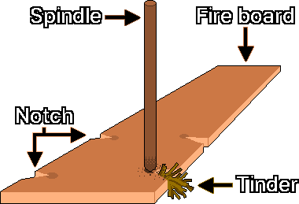
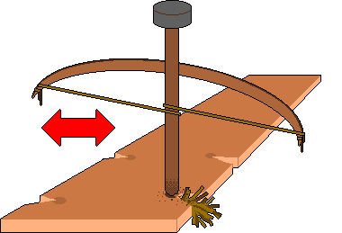
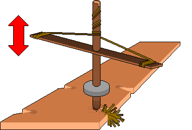
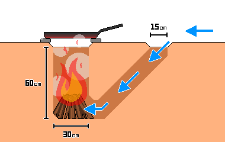

# Fire making
---
## 1. Pre-Ignition Checks
- Secure at least two escape routes so you can leave immediately if the fire spreads or hostile forces are detected.
- If the ground is damp or cold, lay down insulating material such as logs to keep heat from being drawn into the ground and to improve fuel efficiency.
- Check that there is enough heat, fuel, and oxygen for ignition and sustained burning.

| Element | Details |
| --- | --- |
| Heat | A temperature high enough to reach the ignition point (frictional heat, sparks, concentrated sunlight) |
| Fuel | Material that can burn (dry grass, firewood) |
| Oxygen | Air that sustains combustion (blowing, ventilation) |

---
## 2. Ignition Priorities
&nbsp;&nbsp;&nbsp;Making fire in an emergency is a race against time and stamina. Choose the most efficient method for the tools and environment you have.

| Priority | Method | Success rate | Energy cost | Main tools |
| --- | --- | --- | --- | --- |
| 1 | Direct ignition | Very high | Very low | When you have tools such as a lighter, matches, or a torch |
| 2 | Spark / focused light | Medium | Low to medium | 9V battery, lens, ferrocerium rod, flint |
| 3 | Friction ignition | Low | Very high | Hand drill, bow drill, pump drill (last resort) |

---
## 3. Ignition
### 3-1. Spark and Physical Methods
#### 3-1-1. Short-Circuiting a 9V Alkaline Battery
- Principle: Resistive heating produces an ember.
- Materials: one 9V battery, fine steel wool, tinder
- Method: Touch both the positive and negative terminals of the 9V battery to fine steel wool at the same time. The steel wool overheats instantly and glows red, producing an ember.

> **Caution:** A 9V battery overheats rapidly when short-circuited, so touch it for a short time and separate it immediately. Lithium-ion batteries (rechargeable packs) carry a very high risk of explosion and fire when short-circuited, so use a 9V dry cell (alkaline or zinc-carbon).

#### 3-1-2. Focusing Sunlight with a Lens
- Principle: A convex lens concentrates sunlight on one point until it reaches the ignition point.
- Materials: eyeglasses with convex lenses for farsightedness, or a clear plastic bottle filled with water
- Method: In the sun, hold the lens over the tinder and gather the light into a single point.

---
### 3-2. Friction Methods
&nbsp;&nbsp;&nbsp;Friction between two pieces of wood produces heat that creates charred dust, and supplying oxygen to this dust grows it into an ember. The method is very sensitive to environmental conditions, and the success rate falls when humidity is high. For the charred dust to form reliably, the fire board and the spindle must be of similar hardness.

#### 3-2-1. Components

| Component | Role | Main features and materials |
| :---: | :--- | :--- |
| Fire board | The base on which friction occurs | Cut a small V-shaped notch near the edge of a soft board for the spindle to turn in. The charred dust produced by friction collects in this notch |
| Spindle | The rod that rotates and generates frictional heat | Usually the same kind of wood as the fire board. It must be straight and dry |
| Tinder | Material that receives the ember and grows it into a flame | Dry, easily burning material such as dry grass or bark |

#### 3-2-2. Causes of Failure
| Cause | Symptom | Remedy |
| :---: | :--- | :--- |
| Not enough heat | No charred dust forms, or it does not turn into an ember | Increase the rotation speed |
| Too much oxygen | The charred dust does not pile up and is blown away | Take windbreak measures, such as building a wall around it |
| Too little oxygen | An ember forms but grows slowly or dies out | Blow on it appropriately |
| Too much fuel | The dry grass is packed so tightly that the ember suffocates | Loosen the dry grass to leave air passages |

#### 3-2-3. Ignition Steps
1. Turn the spindle slowly while applying strong pressure to generate frictional heat, and pile the charred dust below the V-shaped notch.
2. When enough dust has accumulated and smoke begins to rise, keep the pressure on and raise the rotation speed as high as possible to reach the ignition point.
3. If the dust keeps smoking by itself, the ember has formed successfully.
4. After the ember forms, if the clump of dust does not fall apart when you shake it lightly by hand, it has stabilized.

#### 3-2-4. Precautions
- Friction ignition is very tiring. If you fail, do not keep forcing it; stop every 10-15 minutes to rest and keep your body warm.
- Protect your hands with gloves or a wrapped towel so you do not get blisters on your palms.

---
### 3-3. Friction Ignition Tools
#### 3-3-1. Hand Drill
&nbsp;&nbsp;&nbsp;This is the simplest tool but needs the most effort and strength.

1. Find a thin, smooth stick about the length from elbow to fingertip (about 45-50 cm) and the thickness of an index finger (about 1-1.5 cm in diameter) and use it as the spindle.
2. Find a wooden board slightly softer than the spindle and use it as the fire board.
3. Cut a socket about twice the spindle's diameter in the fire board, and cut a V-shaped notch outward from the edge of the socket.
4. Put tinder around the V-shaped notch.
5. Hold the fire board firmly in place with your foot.
6. Stand the spindle upright between your palms and rub it quickly back and forth while pressing down hard.
7. Spin it with speed rather than force. When your hands reach the bottom of the stick, quickly bring them back up and start rubbing again.
8. Once charred dust piles up in the V-shaped notch and smoke begins to rise, do not stop until an ember forms.
9. When an ember forms, move it to the tinder and blow carefully from the side to make a flame.

#### 3-3-2. Bow Drill

&nbsp;&nbsp;&nbsp;A bow turns the spindle. It provides more continuous rotation than a hand drill, so the success rate is higher.

1. Carry out the hand drill steps up to step 4.
2. Cut a socket in the center of a stone (the bearing block) that will sit on top of the spindle. To reduce friction with the spindle, you can apply a moisture-free lubricant to the socket, such as dry leaves, charcoal powder, animal fat, tree resin, or a piece of soap.
3. Make the bow by tying a strong cord or leather strip firmly to both ends of a hard, slightly curved piece of wood about an arm's length long.
4. Wrap the bowstring once around the spindle, and hold the string together with the fingers of the hand holding the bow so that you can adjust tension with your grip. If the string is taut, it slips and does not wrap around the spindle; if it is too loose, the spindle spins idly. Tie it with a little slack rather than tight.
5. With one hand, hold and press down on the bearing block at the top of the spindle, and with the other hand move the bow back and forth horizontally.
6. When the spindle makes charred dust in the V-shaped notch and enough smoke rises, speed up to create an ember.
7. When an ember forms, move it to the tinder and blow carefully from the side to make a flame.

#### 3-3-3. Pump Drill

&nbsp;&nbsp;&nbsp;It turns vertical motion into rotary motion. It is harder to build but can be operated very reliably.

1. Carry out the hand drill steps up to step 4.
2. Prepare a new stick to use as the handle.
3. Drill a hole in the exact center of the handle stick, fit it onto the spindle in a cross shape, and position it about 10 cm from the top.
4. Make a bow by tying a strong cord or leather strip firmly to both ends of the handle.
5. Make a weight of about 1.5 kg from a stone or clay disk with a hole drilled in the center.
6. Fix the weight to the spindle at about 5 cm above the bottom.
7. Cut a straight-line (I-shaped) groove in the top of the spindle.
8. Fit the middle of the bowstring into the I-shaped groove at the top, tie a knot, and fasten it firmly to the spindle.
9. Wind the bowstring clockwise down the spindle, and tie each end firmly to either end of the handle stick.
10. Push the handle down about halfway to spin the spindle.
11. When you release the pressure, the inertia of the weight automatically rewinds the string, and the spindle rotates in reverse.
12. Repeat this back-and-forth rotation to make charred dust, and when enough smoke rises, speed up to create an ember.
13. When an ember forms, move it to the tinder and blow carefully from the side to make a flame.

---
## 4. Managing the Fire
### 4-1. Adding Fuel
&nbsp;&nbsp;&nbsp;Sort the fuel by size and add it in stages: small first, then medium, then large. If you add large fuel too early, it blocks the oxygen supply and the flame can suffocate.

| Fuel | Thickness | Role |
| :---: | :---: | --- |
| Tinder | Pencil-lead thickness or thinner | The initial fuel that receives the ember and grows it into a flame (dry grass, reed fluff, down). It should be dry enough to crumble when twisted by hand |
| Kindling | Pencil-lead to pencil thickness | The intermediate fuel that steadies the flame and passes heat on so that the main fuel catches fire |
| Fuelwood | Wrist thickness or more | The main fuel that sustains long-term burning |

---
### 4-2. Conserving the Fire
#### 4-2-1. Reflector Wall
&nbsp;&nbsp;&nbsp;Building a reflector wall of logs, stones, or earth behind the fire concentrates radiant heat toward you or your tent. It is very effective for keeping warm when sleeping and also acts as a windbreak, reducing heat loss. Keep at least 30 cm between the wall and the fire so that the wall does not overheat or crack.

#### 4-2-2. Preserving Embers
- If you bury glowing charcoal deep in ash to minimize the oxygen supply, it stays in a low-temperature burning state and can preserve the ember for several hours.
- When moving, wrap the ember tightly in dry bark (especially birch bark) or tinder and put it in a container such as a metal can. After the ember forms, let it stabilize for 1 minute before moving.
- Without a fine airflow the ember goes out from lack of oxygen, so do not seal the container completely.

#### 4-2-3. Dakota Fire Hole

&nbsp;&nbsp;&nbsp;This is a method of making a fire by digging into the ground. Depending on soil conditions and humidity, the smoke is less visible, so it gives conditional concealment, and it is excellent at blocking wind.

> **Caution:** If airflow stagnates, carbon monoxide (CO) can build up, so always provide a ventilation passage between the air intake and the exhaust. To prevent underground fires, do not use it in areas with many roots or in peatland. In sandy soil or collapse-prone areas, the walls may cave in.

1. Draw a large circle 30 cm in diameter on the ground, and a small circle 15 cm in diameter on the upwind side. Keep the distance between the two circles at 15 cm or more.
2. Dig the large circle straight down 60 cm, and dig the small circle at a slant until it reaches the very bottom of the large circle's vertical hole.
3. Adjust the point where the two holes connect, narrowing or widening it until it is about the size one hand fits through.
4. Put tinder and firewood on the bottom of the large circle and light the fire.

---
## 5. Making Fuel
### 5-1. Charcoal
#### 5-1-1. Large Dome Method
1. Gather dry wood and stack it in a dome shape.
2. Seal it by coating it with clay.
3. Make a small smoke vent at the top and an air inlet at the bottom.
4. Light it through the hole at the top.
5. If cracks appear on the surface of the clay during burning, seal them with clay immediately, and add wood if necessary.
6. When the smoke color changes from white to blue, consider the carbonization complete, and block the lower air hole and the upper smoke vent with clay to cut off the oxygen supply.
7. When all the heat has gone, collect the charcoal.

#### 5-1-2. Small Metal Can Method
1. Put wood chips or tinder into a small metal can (such as a drink can).
2. Close the lid to seal it, but poke a small hole in the lid, because a fully airtight can will build up internal pressure and may explode.
3. Put the can into a campfire to heat it.
4. When smoke comes out of the hole and then stops, consider the carbonization complete and take the can out.
5. When all the heat has gone, collect the charcoal.

---
### 5-2. Rendered Fat
1. Wash the fatty tissue of cattle or pigs thoroughly to remove impurities.
2. Cut the fat as finely as possible to widen the surface exposed to heat.
3. Put a very small amount of water and the fat in a pot and heat it gently in a double boiler.
4. When the fat has melted into a liquid, strain out the residue through a fine cloth or mesh.
5. When the strained liquid cools, it becomes solid rendered fat.

### 5-3. Extracting Beeswax
1. Put the honeycomb (beeswax) left after harvesting honey into water and heat it to no more than 85 °C.
2. When the beeswax has melted completely, strain out the impurities through a cloth while it is still hot.
3. Let the strained liquid cool as it is. Because beeswax is lighter than water, it forms a layer on top as it hardens.
4. Lift off the hardened slab of beeswax, scrape the impurities from its underside, and refine it once more.

### 5-4. Resources Nearby
- Pine resin concentrated in lumps: resistant to moisture and, thanks to its oil content, lights easily.
- Birch bark: contains oil (betulin) and is an excellent tinder that lights well even when wet.
- Wet logs: when split, you can get the dry heartwood inside.

---
## 6. Safety Rules
### 6-1. Never Light a Fire in an Enclosed Space
> **Caution:** As a rule, do not light a fire indoors (in an enclosed space such as a tent or cave). Burning fires or charcoal in an enclosed space carries a very high risk of carbon monoxide poisoning.

&nbsp;&nbsp;&nbsp;Carbon monoxide is colorless and odorless, so it is very hard to notice. Early symptoms are headache, dizziness, nausea, drowsiness, impaired judgment, and confusion, which can be mistaken for symptoms of oxygen deprivation. If these symptoms appear, put out the fire immediately and move outside to a well-ventilated place.

### 6-2. Concealing Smoke and Preventing Detection
- A fire lit in the daytime can reveal your position from several kilometers away because of the smoke. Wet wood produces a lot of smoke as the moisture evaporates, so use low-smoke charcoal or dry, thinly split wood.
- White smoke mainly indicates evaporating moisture, and dark gray smoke indicates incomplete combustion, so check the condition of the fuel.
- At night, build the fire in a deep pit or shield the surroundings so that no light leaks out.

### 6-3. Wildfire Risk
&nbsp;&nbsp;&nbsp;As a rule, do not light a fire in wildfire-prone areas or when a dry-weather warning has been issued. If you have used a fire, put out the embers completely with water or soil, and touch the ashes to confirm that no heat remains.

---
## 7. First Aid
### 7-1. First-Degree Burns
- Right after the burn, cool the affected area under cold running water (not ice water) for at least 20 minutes. This stops the heat from penetrating deep into the skin.
- When cooling a large area, be careful: body temperature can drop sharply and cause hypothermia.
- Never pop blisters or use folk remedies such as applying soybean paste or soju, because they raise the risk of infection.

### 7-2. Washing Off Chemical Burns
&nbsp;&nbsp;&nbsp;If an alkaline substance (ash, lime, etc.) gets on the burned area, remove the contaminated clothing and immediately rinse with plenty of water to remove the chemical. Do not try to neutralize the alkaline substance with an acid; wash with running water only.