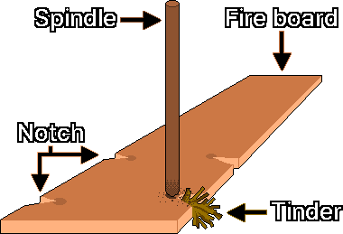
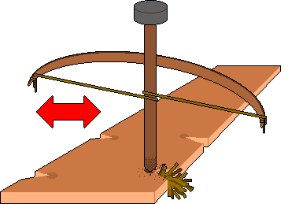
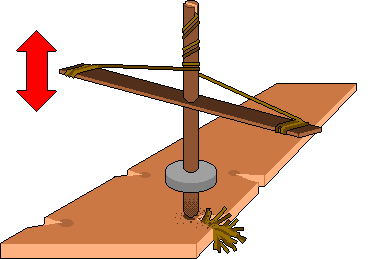
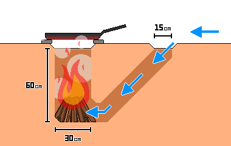

# 発火法
---
## 1. 点火前の確認事項
- 火災が広がったり敵対勢力を察知したりしたときにすぐ避難できるよう、脱出経路を最低2か所確保します。
- 地面が湿っていたり冷たかったりするときは、丸太などの断熱材を敷いて、熱が地面に奪われるのを防ぎ、燃料の効率を高めます。
- 点火と持続的な燃焼のために、熱・燃料・酸素が十分にそろっているかを確認します。

| 要素 | 内容 |
| --- | --- |
| 熱 | 発火点に達するのに十分な温度(摩擦熱、火花、集光熱) |
| 燃料 | 燃える物質(乾いた草、薪) |
| 酸素 | 燃焼を持続させる空気(送風、換気) |

---
## 2. 点火の優先順位
&nbsp;&nbsp;&nbsp;非常時の発火は、時間と体力との戦いです。手持ちの道具と環境に応じて、最も効率的な方法を選びます。

| 順位 | 方式 | 成功率 | エネルギー消費 | 主な道具 |
| --- | --- | --- | --- | --- |
| 1 | 直接点火 | 非常に高い | 非常に低い | ライター、マッチ、トーチなどの道具がある場合 |
| 2 | 火花・集光 | 中程度 | 低い〜中程度 | 9V電池、レンズ、フェロセリウムロッド、火打ち石 |
| 3 | 摩擦点火 | 低い | 非常に高い | ハンドドリル、ボウドリル、ポンプドリル(最後の手段) |

---
## 3. 点火
### 3-1. 火花・物理的な方式
#### 3-1-1. 9Vアルカリ電池のショートによる点火
- 原理: 電気抵抗による発熱で火種を作ります。
- 材料: 9V電池1個、細かいスチールウール、火口(ほくち)
- 方法: 9V電池のプラスとマイナスの端子を、細かいスチールウールに同時に接触させます。スチールウールが一瞬で過熱して赤く熱を帯び、火種ができます。

> **注意:** 9V電池はショートすると急激に過熱するため、短時間接触させたらすぐに離します。リチウムイオン電池(充電式パック)はショートすると爆発・火災の危険が非常に高いため、9V乾電池(アルカリまたはマンガン)を使います。

#### 3-1-2. レンズによる集光点火
- 原理: 凸レンズで太陽光を一点に集め、発火点に到達させます。
- 材料: 遠視矯正用の凸レンズの眼鏡、または水を満たした透明なプラスチックボトル
- 方法: 太陽の下でレンズを火口の上にかざし、光を一点に集めます。

---
### 3-2. 摩擦方式
&nbsp;&nbsp;&nbsp;2本の木片を素早くこすり合わせて生じる熱で炭の粉を作り、この粉に酸素を送って火種に育てます。環境条件に非常に敏感で、湿度が高いと成功率が下がります。炭の粉が安定してできるには、火きり板と回転棒の硬さが互いに近くなければなりません。

#### 3-2-1. 構成要素

| 構成要素 | 役割 | 主な特徴と材料 |
| :---: | :--- | :--- |
| 火きり板(Fire board) | 摩擦が起きる土台 | 柔らかい板の縁の近くに、回転棒を回すための小さなV字の切り込み(Notch)を入れます。摩擦で生じた炭の粉がこの切り込みにたまります |
| 回転棒(Spindle) | 回転して摩擦熱を出す棒 | 普通は火きり板と同じ種類の木。まっすぐで乾いている必要があります |
| 火口(Tinder) | 火種を受けて炎に育てる材料 | 乾いた草、樹皮など、乾燥していてよく燃える材料 |

#### 3-2-2. 失敗の原因
| 失敗の原因 | 現象 | 対処 |
| :---: | :--- | :--- |
| 熱の不足 | 炭の粉ができない、または火種にならない | 回転速度を上げます |
| 酸素過多 | 炭の粉がたまらず、風で飛ぶ | 周りに壁を作るなど、風よけの対策をします |
| 酸素不足 | 火種はできたが成長が遅れる、または消える | 適度に息を吹きかけます |
| 燃料過多 | 乾いた草が密すぎて火種が窒息する | 乾いた草をほぐして空気の通り道を確保します |

#### 3-2-3. 点火の手順
1. 回転棒をゆっくり回しながら強く押しつけて摩擦熱を出し、炭の粉をV字の切り込みの下にためます。
2. 炭の粉が十分にたまって煙が出始めたら、圧力を保ったまま回転速度を最大限に上げて発火点に到達させます。
3. 炭の粉が自分で煙を出し続ければ、火種の形成に成功です。
4. 火種ができた後、手で軽く揺らしても固まった粉が崩れなければ、安定した状態です。

#### 3-2-4. 注意事項
- 摩擦点火は体力の消耗が非常に大きいです。失敗しても無理に続けず、10〜15分ごとに中断して休み、体温を保ちます。
- 手のひらにまめができないよう、手袋をはめるかタオルを巻いて手を保護します。

---
### 3-3. 摩擦点火の道具
#### 3-3-1. ハンドドリル
&nbsp;&nbsp;&nbsp;最も単純ですが、最も多くの労力と力が必要です。

1. ひじから指先まで(約45-50cm)の長さで、人差し指の太さ(直径約1-1.5cm)の、細くて滑らかな棒を探し、回転棒にします。
2. 回転棒よりやや柔らかい木の板を探し、火きり板にします。
3. 火きり板に回転棒の直径の約2倍の大きさのくぼみを掘り、くぼみの縁から外側へV字の切り込みを作ります。
4. V字の切り込みの周りに火口を詰めます。
5. 火きり板を足でしっかり固定します。
6. 回転棒を両手のひらの間に挟んで垂直に立て、手のひらを強く押し下げながら、素早くこすり合わせて回します。
7. 力よりも速さで回します。手が棒の先まで下りたら素早く上に戻し、またこすります。
8. V字の切り込みの間に炭の粉がたまって煙が出始めたら、火種ができるまで止めません。
9. 火種ができたら火口に移し、横から慎重に息を吹きかけて炎にします。

#### 3-3-2. ボウドリル

&nbsp;&nbsp;&nbsp;弓で回転棒を回す方法です。ハンドドリルより持続的な回転力が得られるため、成功率が高くなります。

1. ハンドドリルの手順4まで進めます。
2. 回転棒の上端にのせる石(ベアリングブロック)の中央にくぼみを掘ります。回転棒との摩擦を減らすため、くぼみに乾いた葉、炭の粉、動物性の脂肪、樹脂、石鹸のかけらなど、水分のない潤滑材を塗ることができます。
3. 腕の長さほどの硬くて少し曲がった木の両端に、丈夫な紐か革をしっかり巻きつけて弓を作ります。
4. 弓の弦を回転棒に1周巻き、弓を持つ手の指で弦を一緒に握って、握力で張力を調節します。弦がぴんと張りすぎると回転棒に巻きつかずに滑り、緩すぎると空回りします。張って結ぶより、少し余裕を持たせて結びます。
5. 片手で回転棒上端のベアリングブロックを持って押さえ、もう片方の手で弓を水平に往復させます。
6. 回転棒がV字の切り込みで炭の粉を作り、煙が十分に出たら、速度を上げて火種を作ります。
7. 火種ができたら火口に移し、横から慎重に息を吹きかけて炎にします。

#### 3-3-3. ポンプドリル

&nbsp;&nbsp;&nbsp;上下の動きを回転運動に変えます。製作の難易度は高いですが、非常に安定して運用できます。

1. ハンドドリルの手順4まで進めます。
2. 取っ手にする新しい棒を用意します。
3. 取っ手の棒のちょうど真ん中に穴を開けて、回転棒に十字の形で通し、上端から約10cmの位置に置きます。
4. 取っ手の両端に丈夫な紐か革をしっかり巻きつけて、弓を作ります。
5. 中央に穴を開けた石か粘土の円盤で、1.5kgほどの重りを作ります。
6. 重りを回転棒の下端から約5cmの高さに固定します。
7. 回転棒の上端に、一字型の溝を掘ります。
8. 上端の一字型の溝に弦の中間点をはめ、結び目を作って回転棒にしっかり結びます。
9. 弦を回転棒に時計回りに巻き下ろし、両端を取っ手の棒の両端にそれぞれしっかり結びます。
10. 取っ手を半分ほど下へ押して回転させます。
11. 圧力を緩めると、重りの慣性で紐が自動的に巻き戻り、回転棒が逆回転します。
12. この往復回転を繰り返して炭の粉を作り、煙が十分に出たら、速度を上げて火種を作ります。
13. 火種ができたら火口に移し、横から慎重に息を吹きかけて炎にします。

---
## 4. 火力の管理
### 4-1. 燃料の投入
&nbsp;&nbsp;&nbsp;燃料を大きさ別に分け、小さいもの → 中くらいのもの → 大きいものの順に、段階的に入れます。大きな燃料を早く入れすぎると、酸素の供給が妨げられて炎が窒息することがあります。

| 燃料 | 太さ | 役割 |
| :---: | :---: | --- |
| 火口(Tinder) | 鉛筆の芯の太さ以下 | 火種を受けて炎に育てる最初の燃料(乾いた草、アシの穂綿、綿毛の類)。手でねじると崩れるほど乾いた状態 |
| 焚き付け(Kindling) | 鉛筆の芯〜鉛筆の太さ | 炎を安定させ、主な薪に火がつくように熱を伝える中間の燃料 |
| 薪(Fuelwood) | 手首の太さ以上 | 長時間の燃焼を維持する主な燃料 |

---
### 4-2. 火力の保存
#### 4-2-1. 反射壁
&nbsp;&nbsp;&nbsp;火の後ろに丸太、石、土で反射壁を立てると、放射熱が使う人やテントの方に集中します。就寝時の体温維持に非常に効果的で、風よけにもなり、熱の損失を減らします。反射壁が過熱したり破裂したりしないよう、火との距離を最低30cm以上空けます。

#### 4-2-2. 火種の保存
- 火種のついた炭を灰の中に深く埋めて酸素の供給を最小限にすると、低温燃焼の状態が保たれ、数時間にわたり火種を保存できます。
- 移動するときは、火種を乾いた樹皮(特にシラカバの樹皮)か火口でしっかり包み、金属缶などの容器に入れます。火種ができてから1分間安定させたあとで移動します。
- わずかな通気がないと酸素不足で火種が消えるため、容器を完全には密閉しません。

#### 4-2-3. ダコタ・ファイアホール(Dakota Fire Hole)

&nbsp;&nbsp;&nbsp;地面を掘って火を焚く方式です。土壌の状態や湿度によって煙が見えにくくなるため条件付きの隠蔽効果があり、風を防ぐ点でも優れています。

> **注意:** 空気の流れが滞ると一酸化炭素(CO)がたまることがあるため、吸気口と排気口の間に換気用の通路を必ず確保します。地中火災を防ぐため、根の多い地域や泥炭地(Peatland)では使いません。砂質の土壌や崩落の危険がある地域では、壁が崩れることがあります。

1. 地面に直径30cmの大きな円を描き、風が吹いてくる側に直径15cmの小さな円を描きます。2つの円の間の距離は15cm以上にします。
2. 大きな円は垂直に60cm掘り下げ、小さな円は斜めに、大きな円の垂直な穴の一番下まで掘ります。
3. 2つの穴がつながる部分を、手が1つ入る大きさに狭めたり広げたりして合わせます。
4. 大きな円の底に火口と薪を入れて火を起こします。

---
## 5. 燃料の製造
### 5-1. 木炭
#### 5-1-1. 大規模ドーム方式
1. 乾いた木を集め、ドーム型に積みます。
2. 泥を塗って密封します。
3. 上部に小さな排煙口を、下部に空気の取り入れ口を作ります。
4. 上部の穴から火をつけます。
5. 燃焼中に泥の表面にひび割れができたらすぐに泥でふさぎ、必要なら木を追加します。
6. 煙の色が白から青に変わったら炭化が完了したとみなし、下部の空気穴と上部の排煙口を泥でふさいで酸素の供給を断ちます。
7. 熱がすっかり冷めたら、木炭を回収します。

#### 5-1-2. 小型金属缶方式
1. 小さな金属缶(飲料缶など)に、木片や火口を入れます。
2. ふたを閉めて密封しますが、完全に密閉すると内部の圧力が上がって爆発することがあるため、ふたに小さな穴を開けます。
3. 缶をたき火の中に入れて加熱します。
4. 穴から煙が出てやがて止まったら炭化が完了したとみなし、缶を取り出します。
5. 熱がすっかり冷めたら、木炭を回収します。

---
### 5-2. 精製脂肪
1. 牛や豚の脂肪組織をきれいに洗い、不純物を取り除きます。
2. 脂肪をできるだけ細かく刻み、熱が当たる面積を広げます。
3. 鍋にごく少量の水と脂肪を入れ、弱火で湯せんします。
4. 脂肪が溶けて液体になったら、目の細かい布や網で残りかすをこします。
5. こした液体を冷ますと、固体の精製脂肪になります。

### 5-3. 蜜ろうの抽出
1. 蜂蜜を採った後に残った巣(蜜ろう)を水に入れ、85℃以下で加熱します。
2. 蜜ろうが完全に溶けたら、熱いうちに布で不純物をこします。
3. こした液をそのまま冷ますと、蜜ろうは水より軽いため上部に層をなして固まります。
4. 固まった蜜ろうの板を取り外し、下面の不純物を削り取って、もう一度精製します。

### 5-4. 身近な資源
- 松の樹脂が凝縮した部分: 湿気に強く、油分のおかげで火がつきやすいです。
- シラカバの樹皮: 油分(ベツリン)を含み、濡れた状態でも火がつきやすい優れた火口です。
- 濡れた丸太: 割ると、内部の乾いた心材が得られます。

---
## 6. 安全の決まり
### 6-1. 密閉空間での点火禁止
> **注意:** 屋内(テント、洞窟などの密閉空間)では点火しないのが原則です。密閉空間で火を焚いたり炭を使ったりすると、一酸化炭素中毒の危険が非常に高くなります。

&nbsp;&nbsp;&nbsp;一酸化炭素は無色・無臭のため、気づくことが非常に難しいです。初期には頭痛、めまい、吐き気、眠気、判断力の低下、意識の混濁が現れ、酸素不足の症状と混同されることがあります。こうした症状が出たら、すぐに火を消し、換気のよい屋外へ移動します。

### 6-2. 煙の隠蔽と位置の露出防止
- 昼に焚く火は、煙のせいで数km先からでも位置が分かってしまうことがあります。濡れた木は水分の蒸発で煙が急増するため、煙の少ない木炭か、乾燥して細く割った木材を使います。
- 白い煙は主に水分の蒸発、濃い灰色の煙は不完全燃焼を意味するため、燃料の状態を点検します。
- 夜は、光が見えないように深い穴で火を焚くか、周りを覆って光が漏れないようにします。

### 6-3. 山火事の危険
&nbsp;&nbsp;&nbsp;山火事の危険がある地域や乾燥注意報が出ている状況では、原則として点火しません。火を使った場合は、水や土で残り火を完全に消し、灰に触れて熱が残っていないかを確かめます。

---
## 7. 応急処置
### 7-1. I度のやけど
- やけどの直後、流れる冷水(氷水は除く)で患部を最低20分以上冷やします。熱が皮膚の深くまで浸透するのを防ぎます。
- 広い範囲を冷やすときは、体温が急激に下がって低体温症になることがあるので注意します。
- 水ぶくれをつぶしたり、味噌や焼酎などを塗ったりする民間療法は、感染の危険を高めるため絶対にしません。

### 7-2. 化学やけどの洗浄
&nbsp;&nbsp;&nbsp;アルカリ性の物質(灰、石灰など)がやけどの部位に付いたら、汚れた衣服を脱がせ、すぐに大量の水で洗って化学物質を取り除きます。アルカリ性の物質を酸性の物質で中和しようとせず、流水だけで洗います。