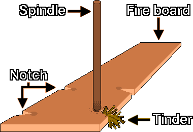
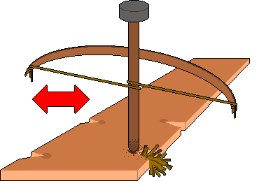
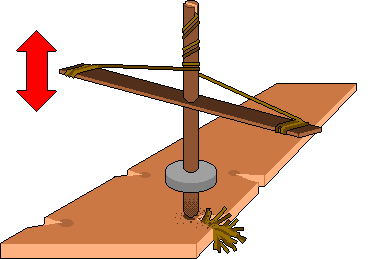
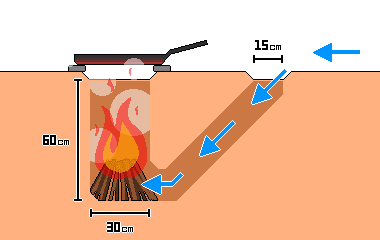

# 불 피우기
---
## 1. 점화 전 확인사항
- 화재 확산이나 적대 세력 탐지 시 즉시 대피할 탈출 경로를 최소 2곳 확보합니다.
- 지면이 습하거나 차가우면 통나무 같은 단열재를 깔아 열이 지면으로 빼앗기는 것을 막고 연료 효율을 높입니다.
- 점화와 지속적인 연소를 위해 열, 연료, 산소가 충분한지 확인합니다.

| 요소 | 내용 |
| --- | --- |
| 열 | 발화점에 도달할 충분한 온도(마찰열, 스파크, 집광열) |
| 연료 | 탈 수 있는 물질(마른 풀, 연료목) |
| 산소 | 연소를 지속시키는 공기(송풍, 환기) |

---
## 2. 점화 우선순위
&nbsp;&nbsp;&nbsp;비상 상황의 불 피우기는 시간과 체력의 싸움입니다. 보유한 도구와 환경에 따라 가장 효율적인 방법을 고릅니다.

| 순위 | 방식 | 성공률 | 에너지 소모 | 주요 도구 |
| --- | --- | --- | --- | --- |
| 1 | 직접 점화 | 매우 높음 | 매우 낮음 | 라이터, 성냥, 토치 등 도구 보유 시 |
| 2 | 스파크/집광 | 중간 | 낮음~중간 | 9V 배터리, 렌즈, 페로세륨 로드, 부싯돌 |
| 3 | 마찰 점화 | 낮음 | 매우 높음 | 핸드 드릴, 보우 드릴, 펌프 드릴(최후의 수단) |

---
## 3. 점화
### 3-1. 스파크·물리 방식
#### 3-1-1. 9V 알칼라인 배터리 단락 점화
- 원리: 전기 저항 발열로 불씨를 만듭니다.
- 재료: 9V 배터리 1개, 미세 철수세미, 불쏘시개
- 방법: 9V 배터리의 양극과 음극 단자를 미세 철수세미에 동시에 접촉시킵니다. 철수세미가 순식간에 과열되어 붉게 달아오르며 불씨가 생깁니다.

> **주의:** 9V 배터리는 단락 시 급격히 과열되므로 단시간 접촉 후 즉시 분리합니다. 리튬이온 배터리(충전식 팩)는 단락 시 폭발·화재 위험이 매우 높으므로 9V 건전지(알칼라인 또는 탄소아연)를 씁니다.

#### 3-1-2. 렌즈를 이용한 집광 점화
- 원리: 볼록 렌즈로 태양광을 한 점에 모아 발화점에 도달시킵니다.
- 재료: 원시 교정용 볼록 렌즈 안경, 또는 물을 가득 채운 투명한 플라스틱 병
- 방법: 태양 아래에서 렌즈를 불쏘시개 위에 올려 빛을 한 점에 모읍니다.

---
### 3-2. 마찰 방식
&nbsp;&nbsp;&nbsp;두 나무 조각을 빠르게 문질러 생긴 열로 숯 가루를 만들고, 이 가루에 산소를 공급해 불씨로 키웁니다. 환경 변수에 매우 민감해 습도가 높으면 성공률이 낮아집니다. 숯 가루가 안정적으로 생기려면 받침대와 회전막대의 경도가 서로 비슷해야 합니다.

#### 3-2-1. 구성 요소

| 구성 요소 | 역할 | 주요 특징 및 재료 |
| :---: | :--- | :--- |
| 받침대(Fire board) | 마찰이 일어나는 받침 | 부드러운 나무판 가장자리 근처에 회전막대를 돌릴 작은 V자 홈(Notch)을 냅니다. 마찰로 생긴 숯 가루가 이 홈에 모입니다 |
| 회전막대(Spindle) | 회전하며 마찰열을 내는 막대 | 보통 받침대와 같은 종류의 나무. 곧고 건조해야 합니다 |
| 불쏘시개(Tinder) | 불씨를 받아 불꽃으로 키우는 재료 | 마른 풀, 나무껍질 등 건조하고 잘 타는 재료 |

#### 3-2-2. 실패 원인
| 실패 원인 | 현상 | 대응 조치 |
| :---: | :--- | :--- |
| 열 부족 | 숯 가루가 생기지 않거나 불씨로 변하지 않음 | 회전 속도를 높입니다 |
| 산소 과다 | 숯 가루가 쌓이지 않고 바람에 날림 | 벽을 두르는 등 방풍 조치를 합니다 |
| 산소 부족 | 불씨가 생겼으나 성장이 지연되거나 소멸 | 적절히 송풍합니다 |
| 연료 과다 | 마른 풀이 너무 빽빽해 불씨가 질식 | 마른 풀을 느슨하게 풀어 공기 통로를 확보합니다 |

#### 3-2-3. 점화 단계
1. 회전막대를 천천히 돌리면서 강한 압력을 가해 마찰열을 내고, 숯 가루를 V자 홈 아래에 쌓습니다.
2. 숯 가루가 충분히 쌓이고 연기가 나기 시작하면 압력을 유지한 채 회전 속도를 최대한 높여 발화점에 도달시킵니다.
3. 숯 가루가 스스로 연기를 지속하면 불씨 형성에 성공한 것입니다.
4. 불씨가 생긴 뒤 손으로 가볍게 흔들어도 뭉친 가루가 붕괴되지 않으면 안정화된 것입니다.

#### 3-2-4. 주의사항
- 마찰 점화는 체력 소모가 매우 큽니다. 실패하면 무리하게 계속하지 말고 10~15분 단위로 중단해 쉬면서 체온을 유지합니다.
- 손바닥에 물집이 생기지 않도록 장갑을 끼거나 수건을 감아 손을 보호합니다.

---
### 3-3. 마찰 점화 도구
#### 3-3-1. 핸드 드릴
&nbsp;&nbsp;&nbsp;가장 단순하지만 가장 많은 노력과 힘이 필요합니다.

1. 팔꿈치에서 손가락 끝까지(약 45-50cm) 길이에 검지 굵기(지름 약 1-1.5cm)의 가늘고 매끄러운 막대를 구해 회전막대로 씁니다.
2. 회전막대보다 약간 무른 나무 판자를 구해 받침대로 씁니다.
3. 받침대에 회전막대 지름의 약 2배 크기로 홈을 파고, 홈 가장자리에서 바깥쪽으로 V자 홈을 만듭니다.
4. V자 홈 사이에 불쏘시개를 채웁니다.
5. 받침대를 발로 단단히 고정합니다.
6. 회전막대를 양손 사이에 끼워 수직으로 세우고, 손바닥을 아래로 강하게 누르면서 빠르게 비벼 돌립니다.
7. 힘보다 속도로 돌립니다. 손이 막대 끝까지 내려오면 재빨리 위로 올려 다시 비빕니다.
8. V자 홈 사이에 숯 가루가 쌓이고 연기가 나기 시작하면 불씨가 생길 때까지 멈추지 않습니다.
9. 불씨가 생기면 불쏘시개로 옮겨 측면에서 조심스럽게 송풍해 불꽃을 만듭니다.

#### 3-3-2. 보우 드릴

&nbsp;&nbsp;&nbsp;활로 회전막대를 돌리는 방법입니다. 핸드 드릴보다 지속적인 회전력을 얻어 성공률이 높습니다.

1. 핸드 드릴 4단계까지 진행합니다.
2. 회전막대 상단에 얹을 돌멩이(베어링 블록)의 가운데에 홈을 팝니다. 회전막대와의 마찰을 줄이려면 홈에 건조한 잎, 숯가루, 동물성 지방, 나무수지, 비누 조각 등 수분 없는 윤활재를 바를 수 있습니다.
3. 팔 길이 정도의 단단하고 약간 굽은 나무의 양 끝에 튼튼한 끈이나 가죽을 단단히 감아 활을 만듭니다.
4. 활줄로 회전막대를 한 바퀴 감고, 활을 잡은 손의 손가락으로 줄을 함께 쥐어 악력으로 장력을 조절합니다. 활줄이 팽팽하면 회전막대에 감기지 않고 미끄러지고, 너무 느슨하면 헛돕니다. 팽팽하게 묶기보다 약간 여유를 두고 묶습니다.
5. 한 손으로 회전막대 상단의 베어링 블록을 잡고 누르며, 다른 손으로 활을 수평으로 왕복시킵니다.
6. 회전막대가 V자 홈에서 숯 가루를 만들고 연기가 충분히 나면 속도를 높여 불씨를 만듭니다.
7. 불씨가 생기면 불쏘시개로 옮겨 측면에서 조심스럽게 송풍해 불꽃을 만듭니다.

#### 3-3-3. 펌프 드릴

&nbsp;&nbsp;&nbsp;수직 운동을 회전 운동으로 바꿉니다. 제작 난이도는 높지만 매우 안정적으로 운용할 수 있습니다.

1. 핸드 드릴 4단계까지 진행합니다.
2. 손잡이로 쓸 새 막대를 준비합니다.
3. 손잡이 막대의 정중앙에 구멍을 뚫어 회전막대에 십자 형태로 끼우고, 상단 약 10cm 지점에 위치시킵니다.
4. 손잡이 양 끝에 튼튼한 끈이나 가죽을 단단히 감아 활을 만듭니다.
5. 중앙에 구멍을 뚫은 돌이나 점토 디스크로 1.5kg 정도의 무게추를 만듭니다.
6. 무게추를 회전막대 하단 약 5cm 높이에 고정합니다.
7. 회전막대 상단에 1자형 홈을 팝니다.
8. 상단 1자형 홈에 활줄의 중간 지점을 끼우고 매듭지어 회전막대에 단단히 묶습니다.
9. 활줄로 회전막대를 시계 방향으로 감아 내리고, 양 끝을 손잡이 막대 양 끝에 각각 단단히 묶습니다.
10. 손잡이를 아래로 절반 정도 밀어 회전시킵니다.
11. 압력을 풀면 무게추의 관성으로 줄이 자동으로 다시 감기며 회전막대가 역회전합니다.
12. 이 왕복 회전을 반복해 숯 가루를 만들고, 연기가 충분히 나면 속도를 높여 불씨를 만듭니다.
13. 불씨가 생기면 불쏘시개로 옮겨 측면에서 조심스럽게 송풍해 불꽃을 만듭니다.

---
## 4. 화력 관리
### 4-1. 연료 투입
&nbsp;&nbsp;&nbsp;연료를 크기별로 분류해 작은 것 → 중간 → 큰 것 순서로 단계적으로 넣습니다. 큰 연료를 일찍 넣으면 산소 공급이 막혀 불꽃이 질식할 수 있습니다.

| 연료 | 굵기 | 역할 |
| :---: | :---: | --- |
| 불쏘시개(Tinder) | 연필심 굵기 이하 | 불씨를 받아 불꽃으로 키우는 초기 연료(마른 풀, 갈대 솜, 솜털류). 손으로 비틀면 바스러질 정도로 마른 상태 |
| 나뭇가지(Kindling) | 연필심 ~ 연필 굵기 | 불꽃을 안정화하고 주 땔감에 불이 붙도록 열을 전달하는 중간 연료 |
| 땔감(Fuelwood) | 손목 굵기 이상 | 장시간 연소를 유지하는 주 연료 |

---
### 4-2. 화력 보존
#### 4-2-1. 반사벽
&nbsp;&nbsp;&nbsp;불 뒤에 통나무, 돌, 흙으로 반사벽을 세우면 복사열이 사용자나 텐트 쪽으로 집중됩니다. 취침 시 체온 유지에 매우 효과적이고 바람막이도 되어 열 손실을 줄입니다. 반사벽이 과열되거나 파열되지 않도록 불과의 거리를 최소 30cm 이상 둡니다.

#### 4-2-2. 불씨 보존
- 불씨가 붙은 숯을 재 속에 깊이 묻어 산소 공급을 최소화하면 저온 연소 상태로 유지되어 수 시간 동안 불씨를 보존할 수 있습니다.
- 이동할 때는 불씨를 건조한 나무껍질(특히 자작나무 껍질)이나 불쏘시개로 단단히 싸서 금속 캔 같은 용기에 넣습니다. 불씨 생성 후 1분간 안정화한 뒤 이동합니다.
- 미세한 통풍이 없으면 산소 부족으로 불씨가 꺼지므로 용기를 완전히 밀봉하지 않습니다.

#### 4-2-3. 다코타 파이어 홀(Dakota Fire Hole)

&nbsp;&nbsp;&nbsp;땅을 파서 불을 피우는 방식입니다. 토양 상태와 습도에 따라 연기 가시성이 줄어 조건부 은폐 효과가 있고 바람 차단에 탁월합니다.

> **주의:** 공기 흐름이 정체되면 일산화탄소(CO)가 쌓일 수 있으므로 급기구와 배기구 사이에 환기 통로를 반드시 확보합니다. 땅 밑 화재를 막기 위해 뿌리가 많은 지역과 이탄지대(Peatland)에서는 쓰지 않습니다. 모래 토양이나 붕괴 위험 지역에서는 벽이 무너질 수 있습니다.

1. 땅에 지름 30cm의 큰 원을 그리고, 바람이 불어오는 쪽에 지름 15cm의 작은 원을 그립니다. 두 원 사이 거리는 15cm 이상으로 합니다.
2. 큰 원은 수직으로 60cm 파 내려가고, 작은 원은 비스듬하게 큰 원의 수직 구멍 가장 아래까지 팝니다.
3. 두 구멍이 연결되는 지점을 손 하나가 들어갈 크기로 줄이거나 늘려 맞춥니다.
4. 큰 원 바닥에 불쏘시개와 장작을 넣고 불을 지핍니다.

---
## 5. 연료 제조
### 5-1. 숯
#### 5-1-1. 대규모 돔 방식
1. 마른 나무를 모아 돔 모양으로 쌓습니다.
2. 진흙을 발라 밀봉합니다.
3. 상단에 작은 연기 배출구를, 하단에 공기 유입 구멍을 만듭니다.
4. 상단 구멍으로 불을 붙입니다.
5. 연소 중 진흙 겉면에 균열이 생기면 즉시 진흙으로 밀봉하고, 필요하면 나무를 추가합니다.
6. 연기 색이 흰색에서 청색으로 변하면 탄화 완료로 보고, 하단 공기구멍과 상단 연기 배출구를 진흙으로 막아 산소 공급을 차단합니다.
7. 열기가 모두 식으면 숯을 수거합니다.

#### 5-1-2. 소형 금속통 방식
1. 작은 금속 캔(음료수 캔 등)에 나무 조각이나 불쏘시개를 넣습니다.
2. 뚜껑을 닫아 밀봉하되, 완전 밀폐하면 내부 압력이 올라 폭발할 수 있으므로 뚜껑에 작은 구멍을 뚫습니다.
3. 캔을 모닥불 속에 넣어 가열합니다.
4. 구멍에서 연기가 나오다 멈추면 탄화 완료로 보고 캔을 꺼냅니다.
5. 열기가 모두 식으면 숯을 수거합니다.

---
### 5-2. 정제 지방
1. 소나 돼지의 지방 조직을 깨끗이 씻어 불순물을 제거합니다.
2. 지방을 최대한 잘게 썰어 열이 닿는 면적을 넓힙니다.
3. 냄비에 아주 적은 양의 물과 지방을 넣고 약한 불로 중탕합니다.
4. 지방이 녹아 액체가 되면 고운 천이나 망으로 찌꺼기를 거릅니다.
5. 거른 액체를 식히면 고체 정제 지방이 됩니다.

### 5-3. 밀랍 추출
1. 꿀을 채취하고 남은 벌집(밀랍)을 물에 넣고 85℃ 이하로 가열합니다.
2. 밀랍이 완전히 녹으면 뜨거운 상태에서 천으로 불순물을 거릅니다.
3. 거른 용액을 그대로 식히면 밀랍이 물보다 가벼워 상단에 층을 이루며 굳습니다.
4. 굳은 밀랍 판을 떼어 하단의 불순물을 긁어내고 한 번 더 정제합니다.

### 5-4. 주변 자원
- 소나무 송진이 응축된 부분: 습기에 강하고 기름 성분 덕분에 불이 잘 붙습니다.
- 자작나무 껍질: 기름 성분(베툴린)이 있어 젖은 상태에서도 불이 잘 붙는 우수한 불쏘시개입니다.
- 젖은 통나무: 쪼개면 내부의 마른 심재를 얻을 수 있습니다.

---
## 6. 안전 수칙
### 6-1. 밀폐 공간에서 점화 금지
> **주의:** 실내(텐트, 동굴 등 밀폐 공간)에서는 점화하지 않는 것이 원칙입니다. 밀폐 공간에서 불을 피우거나 숯을 쓰면 일산화탄소 중독 위험이 매우 높습니다.

&nbsp;&nbsp;&nbsp;일산화탄소는 무색·무취라 알아채기 매우 어렵습니다. 초기에는 두통, 어지럼증, 구역질, 졸림, 판단력 저하, 혼미가 나타나며 산소 부족 증상과 혼동될 수 있습니다. 이런 증상이 생기면 즉시 불을 끄고 환기가 잘 되는 바깥으로 이동합니다.

### 6-2. 연기 은폐와 위치 노출 방지
- 낮에 피우는 불은 연기 때문에 수 km 밖에서도 위치가 노출될 수 있습니다. 젖은 나무는 수분 증발로 연기가 급증하므로 연기가 적은 숯이나 건조하고 가늘게 쪼갠 목재를 씁니다.
- 흰색 연기는 주로 수분 증발, 짙은 회색 연기는 불완전 연소를 뜻하므로 연료 상태를 점검합니다.
- 야간에는 불빛이 노출되지 않도록 깊은 구덩이에서 불을 피우거나 주변을 가려 빛이 새지 않게 합니다.

### 6-3. 산불 위험
&nbsp;&nbsp;&nbsp;산불 위험 지역이나 건조주의보가 발령된 상황에서는 원칙적으로 점화하지 않습니다. 불을 썼다면 물이나 흙으로 잔불을 완전히 끄고, 재를 만져 열기가 남아 있지 않은지 확인합니다.

---
## 7. 응급처치
### 7-1. 1도 화상
- 화상 직후 흐르는 찬물(얼음물 제외)에 최소 20분 이상 환부를 식힙니다. 열기가 피부 깊숙이 침투하는 것을 막습니다.
- 넓은 부위를 냉각할 때는 체온이 급격히 떨어져 저체온증이 올 수 있으므로 주의합니다.
- 물집을 터뜨리거나 된장, 소주 등을 바르는 민간요법은 감염 위험을 높이므로 절대 하지 않습니다.

### 7-2. 화학 화상 세척
&nbsp;&nbsp;&nbsp;알칼리성 물질(재, 석회 등)이 화상 부위에 묻었으면 오염된 의복을 벗기고 즉시 다량의 물로 씻어 화학 물질을 제거합니다. 알칼리성 물질을 산성 물질로 중화하려 하지 말고 흐르는 물로만 씻습니다.