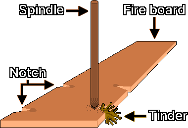
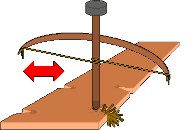
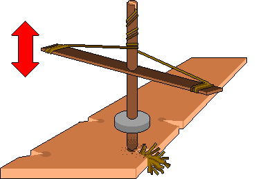
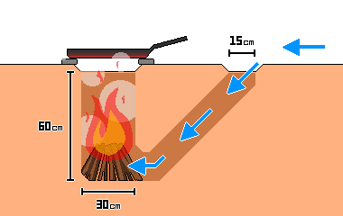

# 生火
---
## 1. 点火前的检查事项
- 至少确保2条逃生路线，以便在火势蔓延或发现敌对势力时立即撤离。
- 地面潮湿或寒冷时，垫上原木等隔热材料，防止热量被地面夺走，提高燃料效率。
- 确认热、燃料和氧气足够，以便点火和持续燃烧。

| 要素 | 内容 |
| --- | --- |
| 热 | 足以达到燃点的温度（摩擦热、火花、聚光热） |
| 燃料 | 可燃物质（干草、燃料木） |
| 氧气 | 维持燃烧的空气（吹风、通风） |

---
## 2. 点火的优先顺序
&nbsp;&nbsp;&nbsp;紧急情况下生火是与时间和体力的较量。根据手头的工具和环境选择最有效的方法。

| 顺序 | 方式 | 成功率 | 能量消耗 | 主要工具 |
| --- | --- | --- | --- | --- |
| 1 | 直接点火 | 很高 | 很低 | 备有打火机、火柴、喷枪等工具时 |
| 2 | 火花/聚光 | 中等 | 低至中等 | 9V电池、透镜、铈铁棒、燧石 |
| 3 | 摩擦点火 | 低 | 很高 | 手钻、弓钻、泵钻（最后手段） |

---
## 3. 点火
### 3-1. 火花与物理方式
#### 3-1-1. 9V碱性电池短路点火
- 原理：利用电阻发热产生火种。
- 材料：9V电池1个、细钢丝绒、引火物
- 方法：让9V电池的正极和负极端子同时接触细钢丝绒。钢丝绒瞬间过热发红，产生火种。

> **注意：**9V电池短路时会迅速过热，所以接触短暂时间后要立即分开。锂离子电池（充电式电池组）短路时爆炸、起火的风险很高，因此要使用9V干电池（碱性或碳锌）。

#### 3-1-2. 用透镜聚光点火
- 原理：用凸透镜把阳光汇聚到一点，使其达到燃点。
- 材料：远视矫正用的凸透镜眼镜，或装满水的透明塑料瓶
- 方法：在阳光下把透镜举在引火物上方，把光汇聚到一点。

---
### 3-2. 摩擦方式
&nbsp;&nbsp;&nbsp;两块木头快速摩擦产生的热量生成炭粉，再给这些炭粉供氧，使其长成火种。这种方法对环境因素非常敏感，湿度高时成功率会降低。要稳定地产生炭粉，火板和钻杆的硬度必须彼此相近。

#### 3-2-1. 构成要素

| 构成要素 | 作用 | 主要特征与材料 |
| :---: | :--- | :--- |
| 火板（Fire board） | 发生摩擦的底座 | 在软木板边缘附近开一个供钻杆转动的小V形凹槽（Notch）。摩擦产生的炭粉会聚集在这个凹槽里 |
| 钻杆（Spindle） | 旋转并产生摩擦热的杆 | 通常与火板是同一种木头。必须笔直而干燥 |
| 引火物（Tinder） | 接住火种并使其长成火焰的材料 | 干草、树皮等干燥且易燃的材料 |

#### 3-2-2. 失败原因
| 失败原因 | 现象 | 应对措施 |
| :---: | :--- | :--- |
| 热量不足 | 不产生炭粉，或炭粉没有变成火种 | 提高转速 |
| 氧气过多 | 炭粉堆不起来，被风吹散 | 围上挡板等，采取防风措施 |
| 氧气不足 | 火种形成了，但成长迟缓或熄灭 | 适度吹风 |
| 燃料过多 | 干草太密，火种被闷死 | 把干草抖松，留出空气通道 |

#### 3-2-3. 点火步骤
1. 缓慢转动钻杆并施加较大压力以产生摩擦热，把炭粉堆积在V形凹槽下方。
2. 炭粉堆够并开始冒烟后，保持压力，把转速尽量提高，使其达到燃点。
3. 炭粉自己持续冒烟，就说明火种形成成功。
4. 火种形成后，用手轻轻晃动，成团的炭粉不散，就说明已经稳定。

#### 3-2-4. 注意事项
- 摩擦点火非常耗体力。失败了不要硬撑着继续，每10-15分钟停下来休息一次，并保持体温。
- 戴上手套或缠上毛巾保护双手，避免手掌起水泡。

---
### 3-3. 摩擦点火工具
#### 3-3-1. 手钻
&nbsp;&nbsp;&nbsp;这是最简单的工具，但需要最多的努力和力气。

1. 找一根从肘部到指尖长度（约45-50cm）、食指粗细（直径约1-1.5cm）的细而光滑的杆子，用作钻杆。
2. 找一块比钻杆略软的木板，用作火板。
3. 在火板上挖一个约为钻杆直径2倍大的凹坑，并从凹坑边缘向外开一个V形凹槽。
4. 在V形凹槽周围填入引火物。
5. 用脚把火板牢牢踩住固定。
6. 把钻杆夹在双手掌心之间竖直立起，手掌用力向下压，同时快速搓动旋转。
7. 靠速度而不是蛮力来转。当双手滑到杆子末端时，迅速移回上方再接着搓。
8. 等V形凹槽里堆起炭粉、开始冒烟后，不到火种形成不要停。
9. 火种形成后，把它移到引火物上，从侧面小心地吹气，使其燃成火焰。

#### 3-3-2. 弓钻

&nbsp;&nbsp;&nbsp;用弓来转动钻杆的方法。比手钻能获得更持续的旋转力，所以成功率更高。

1. 完成手钻的前4个步骤。
2. 在要放在钻杆顶端的石头（轴承块）中央挖一个凹坑。为减少与钻杆的摩擦，可以在凹坑里涂抹干燥的树叶、炭粉、动物脂肪、树脂、肥皂碎块等不含水分的润滑物。
3. 在一根约一臂长、坚硬且略微弯曲的木头两端牢牢绑上结实的绳子或皮条，做成弓。
4. 用弓弦把钻杆缠绕一圈，用握弓那只手的手指把弦一起握住，靠握力调节张力。弓弦绷得太紧会打滑，缠不住钻杆；太松则会空转。绑的时候不要绷紧，要略留余量。
5. 一只手握住并按压钻杆顶端的轴承块，另一只手水平来回拉动弓。
6. 钻杆在V形凹槽里磨出炭粉、冒出足够的烟后，加快速度产生火种。
7. 火种形成后，把它移到引火物上，从侧面小心地吹气，使其燃成火焰。

#### 3-3-3. 泵钻

&nbsp;&nbsp;&nbsp;把垂直运动转换成旋转运动。制作难度较高，但运行非常稳定。

1. 完成手钻的前4个步骤。
2. 准备一根新杆子作手柄。
3. 在手柄杆的正中央钻一个孔，十字形地套在钻杆上，位置在距顶端约10cm处。
4. 在手柄两端牢牢绑上结实的绳子或皮条，做成弓。
5. 用中央钻了孔的石头或黏土圆盘做一个约1.5kg的配重。
6. 把配重固定在钻杆下端约5cm高处。
7. 在钻杆顶端开一道一字形凹槽。
8. 把弓弦的中点嵌入顶端的一字形凹槽，打结后牢牢系在钻杆上。
9. 用弓弦顺时针向下缠绕钻杆，把两端分别牢牢系在手柄杆的两端。
10. 把手柄向下压约一半，使其旋转。
11. 松开压力后，配重的惯性使绳子自动重新缠绕，钻杆反向旋转。
12. 重复这种往复旋转来产生炭粉，冒出足够的烟后，加快速度产生火种。
13. 火种形成后，把它移到引火物上，从侧面小心地吹气，使其燃成火焰。

---
## 4. 火力管理
### 4-1. 添加燃料
&nbsp;&nbsp;&nbsp;把燃料按大小分类，按小的→中等的→大的顺序分阶段添加。过早放入大块燃料会堵住氧气供应，火焰可能被闷死。

| 燃料 | 粗细 | 作用 |
| :---: | :---: | --- |
| 引火物（Tinder） | 铅笔芯粗细以下 | 接住火种并使其长成火焰的初始燃料（干草、芦苇絮、绒毛类）。干燥到用手一拧就碎的程度 |
| 引火柴（Kindling） | 铅笔芯到铅笔粗细 | 使火焰稳定，并传递热量让主要柴火着火的中间燃料 |
| 柴火（Fuelwood） | 手腕粗细以上 | 维持长时间燃烧的主要燃料 |

---
### 4-2. 保存火力
#### 4-2-1. 反射墙
&nbsp;&nbsp;&nbsp;在火的后面用原木、石头、泥土筑一道反射墙，辐射热就会集中到使用者或帐篷一侧。它对睡眠时保暖非常有效，还能挡风，减少热量损失。为避免反射墙过热或破裂，与火的距离至少保持30cm以上。

#### 4-2-2. 保存火种
- 把带火种的木炭深埋进灰里，把氧气供应降到最低，就能维持低温燃烧状态，把火种保存几个小时。
- 移动时，用干树皮（尤其是桦树皮）或引火物把火种紧紧包住，放进金属罐等容器里。火种形成后先稳定1分钟再移动。
- 没有一点通风，火种会因缺氧熄灭，所以不要把容器完全密封。

#### 4-2-3. 达科他火坑（Dakota Fire Hole）

&nbsp;&nbsp;&nbsp;这是挖地生火的方式。根据土壤状况和湿度，烟的可见度会降低，有一定的条件性隐蔽效果，挡风效果也很出色。

> **注意：**气流停滞时，一氧化碳（CO）可能积聚，所以进气口和排气口之间一定要留出通风通道。为防止地下火灾，不要在根系多的地区和泥炭地（Peatland）使用。在沙质土壤或有坍塌风险的地区，坑壁可能塌陷。

1. 在地上画一个直径30cm的大圆，在迎风一侧画一个直径15cm的小圆。两个圆之间的距离保持在15cm以上。
2. 大圆垂直向下挖60cm，小圆斜着挖，直到大圆垂直洞的最底部。
3. 调整两个洞相连的部分，使其缩小或扩大到刚好能伸进一只手的大小。
4. 在大圆底部放入引火物和木柴，点火。

---
## 5. 燃料制作
### 5-1. 木炭
#### 5-1-1. 大型土窑方式
1. 收集干木头，堆成圆顶形。
2. 涂上泥土密封。
3. 在顶部开一个小排烟口，在底部开一个进气孔。
4. 从顶部的孔点火。
5. 燃烧过程中泥土表面出现裂缝时，立即用泥土封住，必要时添加木头。
6. 烟的颜色从白色变成青色时，视为炭化完成，用泥土堵住底部进气孔和顶部排烟口，切断氧气供应。
7. 待热量完全散去后，收取木炭。

#### 5-1-2. 小型金属罐方式
1. 往小金属罐（饮料罐等）里放入木屑或引火物。
2. 盖上盖子密封，但完全密闭会使内部压力升高而爆炸，所以要在盖子上钻一个小孔。
3. 把罐子放进篝火里加热。
4. 孔里冒烟后又停止，视为炭化完成，把罐子取出。
5. 待热量完全散去后，收取木炭。

---
### 5-2. 精炼脂肪
1. 把牛或猪的脂肪组织洗净，去除杂质。
2. 把脂肪尽量切碎，增大受热面积。
3. 在锅中放入极少量的水和脂肪，用小火隔水加热。
4. 脂肪融化成液体后，用细布或滤网滤去残渣。
5. 滤出的液体冷却后就成了固态精炼脂肪。

### 5-3. 提取蜂蜡
1. 把取蜜后剩下的蜂巢（蜂蜡）放入水中，加热到85℃以下。
2. 蜂蜡完全融化后，趁热用布滤去杂质。
3. 滤出的液体直接冷却，蜂蜡比水轻，会在上层形成一层并凝固。
4. 取下凝固的蜂蜡板，刮掉下面的杂质，再精制一次。

### 5-4. 身边的资源
- 松树树脂凝聚的部分：耐潮湿，因含油分而容易着火。
- 桦树皮：含有油分（桦木脑），是潮湿时也容易着火的优质引火物。
- 湿原木：劈开后可以得到里面干燥的心材。

---
## 6. 安全守则
### 6-1. 禁止在密闭空间点火
> **注意：**原则上不要在室内（帐篷、山洞等密闭空间）点火。在密闭空间生火或使用木炭，一氧化碳中毒的风险非常高。

&nbsp;&nbsp;&nbsp;一氧化碳无色无味，很难察觉。初期会出现头痛、头晕、恶心、嗜睡、判断力下降、意识模糊，可能与缺氧症状混淆。一旦出现这些症状，要立即灭火，转移到通风良好的室外。

### 6-2. 隐蔽烟雾与防止暴露位置
- 白天生的火，烟可能让几公里外都能发现你的位置。湿木头因水分蒸发会产生大量烟，所以要使用烟少的木炭，或干燥且劈得较细的木材。
- 白烟主要意味着水分蒸发，深灰色烟意味着燃烧不完全，所以要检查燃料状态。
- 夜间要在深坑里生火，或遮住四周，不让光线漏出去。

### 6-3. 山火风险
&nbsp;&nbsp;&nbsp;在山火高风险地区，或发布了干燥预警的情况下，原则上不要点火。如果用过火，要用水或泥土彻底扑灭余火，并用手摸一摸灰烬，确认没有残留热量。

---
## 7. 急救
### 7-1. 一度烧伤
- 烧伤后立即用流动的冷水（冰水除外）冲洗降温患处，至少20分钟以上。这样可以防止热量深入皮肤。
- 对大面积部位降温时，体温可能急剧下降而引起低体温症，要多加注意。
- 挑破水泡，或涂抹大酱、烧酒等民间偏方，会增加感染风险，绝对不要这样做。

### 7-2. 冲洗化学烧伤
&nbsp;&nbsp;&nbsp;碱性物质（灰、石灰等）沾到烧伤部位时，脱掉被污染的衣物，立即用大量的水冲洗，去除化学物质。不要试图用酸性物质中和碱性物质，只用流动的水冲洗。