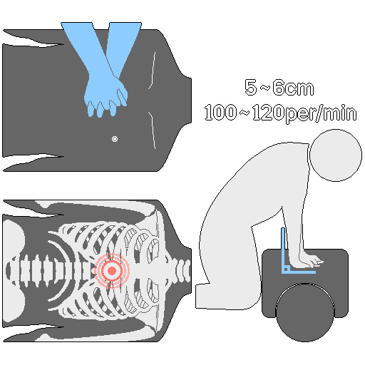
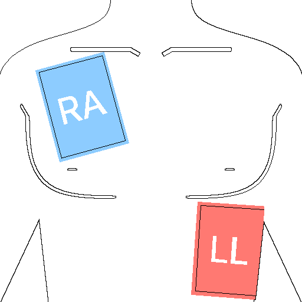
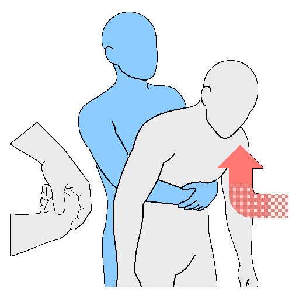

# Первая помощь
> **Внимание:** этот документ предназначен для обучения и справки и не заменяет помощь медицинских специалистов. В экстренной ситуации как можно скорее вызывайте 119 (или местную службу спасения). Некоторые процедуры, например игольную декомпрессию и введение лекарств, выполняют только люди с медицинской подготовкой.

---
## 1. Общие сведения и основные принципы
&nbsp;&nbsp;&nbsp;При тяжёлой экстренной ситуации во время катастрофы, войны или в экстремальных условиях цель — сохранить жизнь и не допустить ухудшения травмы до помощи медицинских специалистов. Первая помощь — это не лечение, а умение продержаться до спасения. Даже если состояние улучшилось, обязательно обратитесь к врачу.

---
### 1-1. Что учитывать перед оказанием помощи
- Если пострадавший в сознании, объясните, что собираетесь делать, и получите согласие. Если он без сознания или жизни угрожает опасность, действуйте сразу, без согласия.
- Если ситуация опасна или вы не можете оценить её, ставьте выше безопасность и быстрый вызов помощи, а не чрезмерные действия.

---
### 1-2. Основные принципы
| Принцип | Содержание |
| --- | --- |
| Обеспечение безопасности | Безопасность самого спасателя — прежде всего. Осмотрите место и убедитесь в отсутствии опасностей — поражения током, пожара, обрушения, ядовитых газов, — и только затем подходите к пострадавшему |
| Вызов и взаимодействие | Сразу вызывайте помощь и конкретно просите о ней окружающих. Чётко сообщите службе 119 (или местной службе спасения) состояние пострадавшего, место и оказанную помощь и поручайте конкретным людям задачи вроде «принести АНД», «сменить» |
| Уход за пострадавшим | Проверьте сознание, дыхательные пути, дыхание и пульс, затем оказывайте неотложную помощь. Не давайте пить человеку без сознания. Снимите мокрую одежду и укройте одеялом |

---
## 2. Приоритеты при травмах: M.A.R.C.H.
&nbsp;&nbsp;&nbsp;Метод оказания помощи при ранениях по порядку приоритетов в военных и чрезвычайных условиях.

| Приоритет | Этап | Содержание |
| :---: | --- | --- |
| 1 | M - Massive Bleeding | Массивное кровотечение |
| 2 | A - Airway | Обеспечение проходимости дыхательных путей |
| 3 | R - Respiration | Дыхание и травмы грудной клетки |
| 4 | C - Circulation | Кровообращение и контроль шока |
| 5 | H - Head injury / Hypothermia | Травма головы и переохлаждение |

---
### 2-1. Massive Bleeding (массивное кровотечение)
&nbsp;&nbsp;&nbsp;Массивное кровотечение быстрее всего угрожает жизни. Главное — быстро остановить его с помощью жгута (Tourniquet) и тампонады раны (Wound Packing).

#### 2-1-1. Жгут
&nbsp;&nbsp;&nbsp;Применяют при сильном кровотечении из конечности (руки, ноги), которое нельзя остановить одним лишь прямым давлением.

1. Накладывайте на 5-7 см выше места кровотечения, в сторону сердца, минуя суставы. В критической ситуации сначала наложите жгут поверх одежды в самой верхней части конечности, а позже скорректируйте.
2. Проденьте ленту с липучкой через пряжку и сильно затяните, закрепив.
3. Вращайте вороток, пока кровотечение полностью не остановится.
4. Зафиксируйте вороток в фиксирующем зажиме и уберите оставшуюся ленту.
5. Обязательно запишите время наложения.
6. Если кровотечение не остановилось, наложите второй жгут сразу выше первого (в сторону сердца).
7. Не снимайте жгут самостоятельно на месте происшествия.

#### 2-1-2. Тампонада раны (Wound Packing)
&nbsp;&nbsp;&nbsp;Применяют при кровотечении из проникающих ран в местах, где нельзя наложить жгут (пах, шея, подмышка и т. п.).

1. Скатайте конец марли в небольшой комок.
2. Глубоко затолкайте марлю в рану, до места самого сильного кровотечения.
3. Плотно заполните рану изнутри, стараясь сохранять давление даже при смене пальцев.
4. После тампонады сильно давите обеими руками не менее 3 минут.
5. Убедившись, что кровотечение остановилось, зафиксируйте тампон давящей повязкой.

---
### 2-2. Airway (проходимость дыхательных путей)
- Если пострадавший в сознании и может говорить, дыхательные пути считаются открытыми. Если он без сознания или у него проблемы с дыханием, сразу обеспечьте проходимость дыхательных путей.
- При подозрении на травму шейного отдела позвоночника приподнимите подбородок. Если риск рвоты или закупорки дыхательных путей оценивается как больший, чем риск травмы шейного отдела, обеспечение проходимости дыхательных путей важнее фиксации шеи.
- Если пострадавший без сознания или ротоглоточный воздуховод (OPA) использовать трудно, введите носоглоточный воздуховод (NPA).
- Если NPA нет, либо есть перелом костей черепа или лица, либо сильное носовое кровотечение, уложите пострадавшего в восстановительное положение (на бок), чтобы обеспечить проходимость дыхательных путей.

---
### 2-3. Respiration (дыхание и травмы грудной клетки)
&nbsp;&nbsp;&nbsp;Напряжённый пневмоторакс (Tension Pneumothorax) из-за травмы груди (огнестрельной, колотой и др.) угрожает жизни, поэтому помощь оказывают немедленно.

#### 2-3-1. Открытый пневмоторакс
1. Найдите отверстие в грудной клетке.
2. Окклюзионной повязкой (Chest Seal) перекройте доступ воздуха.
   - В первую очередь используйте окклюзионную повязку с выпускным клапаном (vented).
   - Если такой повязки нет, закройте рану полностью, а при появлении признаков напряжённого пневмоторакса ненадолго приподнимите один край повязки, чтобы сбросить давление.
   - Трёхстороннюю фиксацию (three-sided seal) применяйте только как временную меру, когда нет ни того, ни другого.

#### 2-3-2. Напряжённый пневмоторакс
- Признаки: непрекращающаяся одышка, неравномерное движение сторон грудной клетки, слабеющий пульс, набухание шейных вен (JVD) при отсутствии гиповолемического шока
- Игольная декомпрессия (NCD) при неправильном выполнении может привести к смертельным повреждениям лёгких, сердца и крупных сосудов, поэтому её выполняют только специалисты с медицинской подготовкой.
- По наставлению точка игольной декомпрессии — второй межреберный промежуток по срединно-ключичной линии или пятый межреберный промежуток по передней подмышечной линии. Введение иглы снимает давление в грудной полости, лёгкое снова расправляется, и кровообращение к сердцу восстанавливается.

---
### 2-4. Circulation (кровообращение и контроль шока)
&nbsp;&nbsp;&nbsp;Ещё раз убедитесь, что все меры остановки кровотечения действенны, и определите признаки шока, чтобы поддерживать кровообращение.

| Признак шока | Содержание |
| :---: | --- |
| Цвет | Бледный или синюшный |
| Состояние | Холодная влажная кожа |
| Температура | Пониженная температура тела |

| Стадия шока | Содержание |
| :---: | --- |
| Компенсированный шок | Стадия, на которой организм повышает частоту сердечных сокращений, чтобы поддержать давление |
| Декомпенсированный шок | Тяжёлое состояние, когда кровопотеря слишком велика и организм больше не справляется |

1. Уложите пострадавшего горизонтально и приподнимите ноги над землёй на 15-30 см. Если есть явная травма таза, живота, груди или позвоночника, ноги не поднимайте: это может усилить внутреннее кровотечение.
2. Сразу снимите мокрую одежду и согрейте одеялом или одеждой.
3. Если пострадавший без сознания, ничего не давайте есть и пить и поверните голову набок, чтобы не перекрыть дыхательные пути.
4. Проверяйте пульс, давление и дыхание каждые 10 минут. При массивном кровотечении проверяйте чаще.

---
### 2-5. Head injury / Hypothermia (травма головы и переохлаждение)
- Расширенные зрачки, «глаза енота» и вытекание прозрачной жидкости (спинномозговой жидкости) из ушей или носа — признаки травмы головы. Возможно сопутствующее повреждение позвоночника, поэтому транспортируйте с зафиксированными головой и шеей.
- У пострадавших с тяжёлой травмой температура тела резко падает из-за кровотечения и шока, это вызывает нарушение свёртывания и усиливает кровотечение.

&nbsp;&nbsp;&nbsp;Помощь при переохлаждении:

1. Перенесите пострадавшего в тёплое место и снимите мокрую одежду.
2. Оберните всё тело одеялом или термопокрывалом и наденьте на голову капюшон или шапку, чтобы избежать потери тепла.
3. Пострадавшим с тяжёлой травмой категорически запрещено есть и пить из-за возможной операции и риска аспирации. Только при лёгком переохлаждении и отсутствии травмы допускается тёплое питьё небольшими порциями.

---
## 3. Сердечно-лёгочная реанимация (СЛР)

- Выживаемость при остановке сердца зависит от правильной СЛР в течение 4 минут. Более чем через 10 минут вероятность повреждения мозга и смерти резко возрастает. Если одновременно применить автоматический наружный дефибриллятор (АНД), выживаемость возрастает более чем вдвое.
- Темп компрессий — 100-120 в минуту, соотношение компрессий и искусственного дыхания — 30:2.
- Сводите перерывы в компрессиях грудной клетки к минимуму — не более 10 секунд, после каждой компрессии давайте грудной клетке полностью расправиться.

---
### 3-1. Порядок действий для разных категорий пострадавших
| Категория | Проверка реакции | Положение рук и глубина компрессий | Если помощь оказывает один человек | Искусственное дыхание |
| --- | --- | --- | --- | --- |
| Взрослый | Потрясите за плечи и спросите: «Вы в порядке?» | Обе руки в замке, центр грудной клетки (нижняя половина грудины). Около 5-6 см | Сразу вызовите 119 (или местную службу спасения), затем делайте СЛР | Рекомендуется, но для неподготовленных людей эффективны и одни компрессии |
| Ребёнок (от 1 года до пубертата) | Похлопайте по плечам | Одна рука, центр грудной клетки. Около 1/3 толщины грудной клетки (около 5 см) | Сначала делайте СЛР 2 минуты, затем вызовите 119 | Остановка сердца часто связана с дыханием, поэтому обязательно 30:2 |
| Младенец (до 1 года) | Похлопайте по стопе | Два пальца, центр грудной клетки. Около 1/3 толщины грудной клетки (около 4 см) | Сначала делайте СЛР 2 минуты, затем вызовите 119 | Остановка сердца часто связана с дыханием, поэтому обязательно 30:2 |

&nbsp;&nbsp;&nbsp;Общий порядок действий:

1. Выявите опасности, обеспечьте безопасность и подойдите.
2. Проверьте реакцию (по таблице выше).
3. Если реакции нет, позовите на помощь, обратившись к конкретным людям. Например: «Вы, в тёмной одежде, вызовите 119!», «Вы, в светлой одежде, принесите АНД!» Если вы один, ведите разговор с 119 по телефону на громкой связи и действуйте параллельно.
4. Наблюдая за грудной клеткой, проверьте дыхание не дольше 10 секунд. Ненормальное дыхание (включая судорожные вздохи) считается отсутствием дыхания.
5. Если дыхание есть, переведите в восстановительное положение, а если нет — начните компрессии грудной клетки.
6. Повторяйте 30:2 до приезда спасателей или пока пострадавший не придёт в себя.

---
### 3-2. Искусственное дыхание
1. Запрокиньте голову и поднимите подбородок, обеспечив проходимость дыхательных путей.
2. Зажмите нос (у младенца накройте рот и нос одновременно, голова в нейтральном положении) и вдувайте воздух 1 секунду — так, чтобы грудная клетка поднялась.
3. Для предотвращения инфекции рекомендуется использовать маску для искусственного дыхания или лицевой щиток.

---
### 3-3. Как пользоваться автоматическим наружным дефибриллятором (АНД)

1. Как только получили АНД, сразу включите его и следуйте голосовым подсказкам. Готовьтесь параллельно, не прекращая СЛР.
2. Наклейте электроды под правой ключицей и на боку под левой подмышкой. Младенцу приклеивают в центр груди (спереди) и на спину (сзади) (передне-заднее расположение). По возможности используйте детские электроды или аттенюатор энергии, а если их нет — взрослые электроды, но электроды не должны касаться друг друга.
3. Когда прозвучит указание «Не прикасайтесь к пострадавшему», отойдите от него.
4. Прямо перед нажатием кнопки разряда крикните «Отойти!», чтобы все отошли. Когда зарядка закончится, нажмите кнопку разряда.
5. Если сердцебиение обнаружено, переведите в восстановительное положение. Если не обнаружено, сразу после разряда возобновите СЛР и повторяйте голосовые указания.

---
### 3-4. Что учитывать
- Спасатели меняются каждые 2 минуты, чтобы из-за усталости не падала глубина компрессий.
- Если пострадавших несколько, в первую очередь помогайте тем, кто не дышит.
- В условиях холода по принципу «холодный, но не мёртвый» рассмотрите продолжение СЛР до восстановления температуры тела.
- В тесном месте или в автомобиле по возможности переместите пострадавшего на ровный пол.
- Пострадавшим с массивным кровотечением или тяжёлой травмой остановка неконтролируемого кровотечения важнее СЛР.

---
## 4. Первая помощь в различных ситуациях
### 4-1. Травмы и кровотечения
| Вид | Особенности | Помощь |
| :---: | --- | --- |
| Ссадина | Содранная кожа. Кровотечение небольшое, но есть риск инфекции | Промыть проточной водой, обеззаразить и наложить повязку |
| Резаная рана | Порез. В зависимости от глубины кровотечение может быть сильным | Прямое давление чистой марлей не менее 5 минут |
| Колотая рана | Проникающее ранение. Риск повреждения нервов и сосудов | Не извлекайте застрявший предмет силой — защитите его как есть и транспортируйте |
| Укус | Рана от укуса. Риск инфекции бактериями из ротовой полости | Лечение в больнице в зависимости от состояния раны |

&nbsp;&nbsp;&nbsp;Быстрые меры при массивном кровотечении:

1. Сильно давите прямо на рану рукой, тканью или марлей.
2. Удерживайте давление не менее 10 минут.
3. Если кровотечение продолжается, применяйте жгут — только на руках и ногах.
4. Накладывайте со стороны сердца от раны (примерно на 5-7 см выше) и записывайте время.

- При обычной остановке кровотечения поднятие места кровотечения выше сердца помогает уменьшить кровопотерю.
- Не удаляйте свернувшиеся сгустки крови.
- Не посыпайте рану кровоостанавливающими порошками и не мажьте мазями: они мешают лечению в больнице.

---
### 4-2. Ожоги и тепловые поражения
> **Внимание:** не прокалывайте волдыри, не отрывайте силой прилипшую одежду или вещества и не прикладывайте лёд прямо к ожогу. Народные средства — масло, соевая паста, соевый соус, зубная паста, лосьон, мазь — повышают риск инфекции.

- При подозрении на шок уложите пострадавшего и слегка приподнимите ноги. Согрейте одеялом и давайте воду небольшими порциями, только если он в сознании и его не тошнит.

| Категория | Особенности | Помощь |
| :---: | --- | --- |
| 1-я степень | Поражение эпидермиса. Покраснение и боль, волдырей нет | Охладить проточной холодной водой, затем наложить повязку, увлажнить |
| 2-я степень | Поражение до дермы. Волдыри, сильная боль | Охладить, не прокалывая волдыри, затем защитить. Быть готовым к болевому шоку |
| 3-я степень | Поражение до подкожной ткани. Боль тупая или отсутствует (нужна пересадка кожи) | Охлаждать недолго, сразу накрыть чистой тканью, согреть и доставить в больницу |

&nbsp;&nbsp;&nbsp;Общая помощь при ожогах:

1. Отойдите от источника тепла и быстро снимите с обожжённого места одежду и украшения (кольца, часы и т. п.). Прилипшую к коже одежду срезайте ножницами, не отрывая силой.
2. Охлаждайте около 15-20 минут проточной прохладной водой (около 18-20 °C) или физраствором. Не прикладывайте лёд напрямую. При обширных и тяжёлых ожогах есть риск переохлаждения, поэтому не переохлаждайте.
3. Накройте специальной повязкой от ожогов и чистой марлей, не сдавливая.

---
### 4-3. Повреждения опорно-двигательного аппарата: R.I.C.E.
| Пункт | Действие |
| :---: | --- |
| Rest (покой) | Не двигайте травмированное место, отдыхайте в удобном положении |
| Ice (холод) | Только для облегчения начального отёка и боли прикладывайте лёд или другой холодный предмет примерно на 15 минут. Длительное охлаждение замедляет восстановление |
| Compression (давление) | Зафиксируйте место шиной или эластичным бинтом. Бинтуйте от части, дальней от сердца, к ближней |
| Elevation (возвышенное положение) | Для улучшения кровообращения и уменьшения отёка и боли поднимите повреждённое место выше сердца, подложив подушку |

- При переломе не вправляйте и не заталкивайте сломанную кость силой.
- Шина должна быть не короче длины, охватывающей суставы по обе стороны перелома.
- После наложения шины каждые 30 минут следите за кровообращением и, если оно нарушено, ослабьте фиксацию.

---
### 4-4. Закупорка дыхательных путей (удушье)

- Спросите: «У вас что-то застряло в горле?» Если человек не может говорить и хватается за горло, закупорка полная. Если он кашляет сам, дыхательные пути перекрыты не полностью, поэтому побуждайте его кашлять.
- Младенцам не делают надавливания на живот (приём Геймлиха) из-за риска повреждения органов брюшной полости.

**Младенец (до 1 года)**

1. Одной рукой обхватите подбородок и скулы младенца и положите его животом вниз на бедро так, чтобы голова была ниже тела.
2. Основанием ладони сильно ударьте 5 раз между лопатками.
3. Поддерживая подбородок и затылок, переверните младенца.
4. Положите два пальца на грудину прямо под серединой линии между сосками и быстро, сильно надавите 5 раз.
5. Повторяйте удары по спине и надавливания на грудь, пока инородное тело не выйдет.

**Взрослые и дети**

1. Встаньте позади пострадавшего, поставив одну ногу между его ног для опоры.
2. Приложите сторону кулака со стороны большого пальца между пупком и подложечной областью.
3. Другой рукой обхватите кулак и сильно толкните назад и вверх (по диагонали вверх).
4. Повторяйте, пока предмет не выйдет или пострадавший не потеряет сознание. При потере сознания переходите к СЛР.

**Если вы один**

1. Попробуйте вытолкнуть предмет кашлем.
2. Если не получилось, поставьте кулак над пупком и под рёбрами, обхватите другой рукой и сильно надавите вверх.
3. Если и это не помогло, упритесь верхней частью живота в край неподвижного предмета — стула, стола — и надавите всем весом тела.

---
### 4-5. Ампутация
&nbsp;&nbsp;&nbsp;Сильно прижмите место ампутации чистой марлей или тканью напрямую и поднимите выше сердца. С ампутированной частью поступайте так.

1. Слегка промойте её физраствором или чистой водой, чтобы удалить инородные частицы.
2. Оберните ампутированную часть чистой тканью, смоченной физраствором.
3. Положите в полиэтиленовый пакет или герметичный контейнер и закройте.
4. Поместите запечатанный пакет в ёмкость со льдом и водой. Следите, чтобы ампутированная часть не касалась льда напрямую.
5. Доставьте пострадавшего в течение 4-6 часов в больницу, где можно сделать операцию по реплантации.

---
### 4-6. Поражение электрическим током
1. Отключите электропитание. До отключения не прикасайтесь к пострадавшему.
2. Если отключить питание нельзя, отделите пострадавшего от электричества изолятором — сухой деревянной палкой, резиновыми перчатками и т. п.
3. Если нет дыхания или пульса, сразу начните СЛР и применяйте АНД, когда его принесут.

---
### 4-7. Несчастные случаи с удушьем (недостаток кислорода, ядовитые газы)
1. Спасатели надевают средства защиты — дыхательный аппарат со сжатым воздухом или маску с подачей воздуха.
2. Войдите в зону удушья и сразу проветрите.
3. Перенесите пострадавшего туда, где воздух безопасен.
4. Пострадавшему без сознания обеспечьте проходимость дыхательных путей, а если дыхание слабое или нет пульса, подавайте кислород высокой концентрации вместе с СЛР.

---
## 5. Поражения от окружающей среды и укусов
### 5-1. Заболевания, связанные с жарой
| Категория | Сознание | Потливость | Температура тела | Степень опасности |
| --- | --- | --- | --- | --- |
| Тепловые судороги | Нормальное | Сильная | Нормальная или слегка повышена | Низкая |
| Тепловое истощение (солнечный удар) | Возможно небольшое снижение | Сильная | От 37 °C | Средняя |
| Тепловой удар | Спутанное или отсутствует | Отсутствует или есть | От 40 °C | Очень опасно |

&nbsp;&nbsp;&nbsp;Общая помощь:

1. Сразу перенесите в прохладное место — в тень, в помещение, под землю.
2. Побрызгайте на тело водой и обмахивайте, охлаждая испарением.
3. Только если пострадавший в сознании, восполняйте жидкость и электролиты водой с солью и сахаром.

- Тепловые судороги: прекратите нагрузку и дайте как следует отдохнуть. Восполняйте жидкость и электролиты и одновременно растягивайте мышцы, в которых судороги. Если к судорогам присоединяются головокружение и рвота, возможен переход в тепловое истощение.
- Тепловое истощение: уложите в тени, слегка приподняв ноги. При рвоте поверните набок, обеспечив проходимость дыхательных путей, и протирайте мокрым полотенцем места крупных сосудов — шею, подмышки, пах, — охлаждая испарением. Только если пострадавший в сознании, повторно поите небольшими порциями воды.
- Тепловой удар: охлаждение — главное. Одновременно с вызовом 119 сразу погрузите пострадавшего в холодную воду или накройте мокрой тканью и обмахивайте. Охлаждайте в первую очередь шею, подмышки и пах, постоянно наблюдайте за дыханием и пульсом и при остановке начните СЛР. Не вливайте воду силой и не давайте жаропонижающие.

---
### 5-2. Укус змеи
&nbsp;&nbsp;&nbsp;Яд ядовитых змей (в основном гадюк) в большинстве случаев распространяется по крови и лимфатической системе. Цель — не удалить яд, а замедлить его распространение. Чем больше движения, тем быстрее распространяется яд, поэтому сведите движение к минимуму и зафиксируйте место укуса.

> **Внимание:** не отсасывайте яд ртом, не разрезайте рану ножом, не затягивайте сильно жгут, не применяйте электрошок, не прикладывайте лёд напрямую, не пейте алкоголь, не бегайте и не двигайтесь, не мажьте соевой пастой и не посыпайте сигаретным пеплом.

&nbsp;&nbsp;&nbsp;Если есть хотя бы один из признаков — сильная боль, быстрый отёк, волдыри, некроз, головокружение, рвота, затуманенное зрение, одышка, — считайте это укусом ядовитой змеи.

1. Сразу отойдите от змеи, увеличив расстояние, и вызовите 119 (или местную службу спасения).
2. Уложите пострадавшего и успокойте, чтобы снизить частоту пульса.
3. Заранее снимите кольца, часы, тесную одежду и т. п. на случай отёка.
4. Слегка промойте место укуса проточной водой, не растирая.
5. На расстоянии примерно 5-10 см от места укуса в сторону сердца приложите сложенную в несколько слоёв марлю и забинтуйте так, чтобы под бинт проходил один палец, лишь замедляя ток лимфы и вен. Ни в коем случае не затягивайте туго, чтобы не пережать и артерию. Зафиксируйте шиной.
6. Держите место укуса чуть ниже уровня сердца или на одном уровне с ним.
7. Если пострадавший в сознании и его не тошнит, поите небольшими порциями воды и держите в тепле, предотвращая шок.
8. По возможности перемещайте на носилках. Если вы изолированы на большом расстоянии, ожидание спасателей может быть безопаснее, чем принудительное перемещение.

---
### 5-3. Укусы пчёл и ос
&nbsp;&nbsp;&nbsp;В большинстве случаев всё ограничивается местной болью, но у части людей возникает тяжёлый системный аллергический шок (анафилаксия). Наблюдение за общей реакцией так же важно, как удаление жала.

- Чтобы снизить вероятность нападения роя, не пользуйтесь духами и не носите яркую (пёструю) одежду.
- Если пчёлы нападают, эффективнее всего быстро убежать подальше. Не нападайте на пчёл, чтобы отогнать их, и не прячьтесь в воде, задерживая дыхание.

1. Пчёлы феромонами вызывают дальнейшие нападения, поэтому быстро уходите оттуда, где их много.
2. Ядовитый мешочек жала продолжает впрыскивать яд, поэтому как можно скорее удалите жало, соскребая его по коже твёрдым плоским предметом — карточкой, ногтем. Если взять жало пинцетом, можно выдавить мешочек, и оставшийся яд сразу попадёт в организм.
3. Промойте место мылом и чистой водой и приложите лёд, завёрнутый в ткань.
4. Даже если чешется, не расчёсывайте, чтобы избежать инфекции.
5. При подозрении на общие симптомы (головокружение, предобморочное состояние и т. п.) уложите пострадавшего и поднимите ноги, подготовившись к шоку. При одышке слегка приподнимите верхнюю часть тела.

&nbsp;&nbsp;&nbsp;Симптомы анафилаксии: отёк губ, языка и горла, крапивница по всему телу, одышка, охриплость голоса, снижение сознания, падение давления, синюшность губ, языка и кончиков пальцев

1. Сразу уложите пострадавшего и поднимите ноги, чтобы предотвратить шок из-за низкого давления. При одышке приподнимите верхнюю часть тела.
2. Немедленно сделайте инъекцию эпинефрина автоинъектором (EpiPen и др.) в бедро.
3. Если пострадавший без сознания, положите на бок, обеспечив проходимость дыхательных путей.
4. Продолжайте проверять дыхание и пульс и при необходимости делайте СЛР.

---
## 6. Сортировка пострадавших (триаж)
&nbsp;&nbsp;&nbsp;Цель сортировки пострадавших в условиях катастрофы — наиболее эффективно распределить ограниченные медицинские ресурсы и спасти как можно больше жизней.

### 6-1. Система сортировки START
&nbsp;&nbsp;&nbsp;START (Simple Triage and Rapid Treatment) оценивает пострадавшего на месте за 60 секунд и относит его к одному из 4 цветов.

#### 6-1-1. Первичная сортировка: может ли идти
&nbsp;&nbsp;&nbsp;Объявите: «Кто может идти, подойдите сюда».

- Может идти: зелёный (несрочный). Переведите в безопасное место.
- Не может идти: оцените на месте по порядку дыхание, кровообращение и сознание (RPM).

#### 6-1-2. Вторичная сортировка: оценка RPM
| Пункт | Критерий | Результат |
| --- | --- | --- |
| Respiration | Нет дыхания даже после обеспечения проходимости дыхательных путей | Чёрный (умер) |
| | Более 30 вдохов в минуту | Красный (срочный) |
| | 30 вдохов в минуту или меньше | Следующий этап (P) |
| Perfusion | Нет пульса на лучевой артерии или CRT (время капиллярного наполнения) более 2 секунд | Красный (срочный) |
| | Пульс на лучевой артерии есть и CRT 2 секунды или меньше | Следующий этап (M) |
| Mental | Не выполняет простые команды | Красный (срочный) |
| | Выполняет простые команды | Жёлтый (неотложный) |

### 6-2. Цвета сортировочной бирки (Triage Tag)
| Цвет | Категория | Значение и приоритет |
| :---: | :---: | --- |
| Красный | Срочная | Жизнь под угрозой, немедленная помощь и эвакуация (закупорка дыхательных путей, шок, сильное кровотечение) |
| Жёлтый | Неотложная | Состояние тяжёлое, но при помощи в течение 1-2 часов жизни ничто не угрожает (открытый перелом, лёгкий ожог) |
| Зелёный | Несрочная | Лёгкое состояние либо пострадавший ходит сам, и помощь через несколько часов допустима (ссадины, лёгкое растяжение) |
| Чёрный | Умер / шансов на выживание нет | Уже умер, либо при крупной катастрофе и острой нехватке ресурсов реанимация ограниченными средствами невозможна (остановка сердца, смертельная травма головы) |