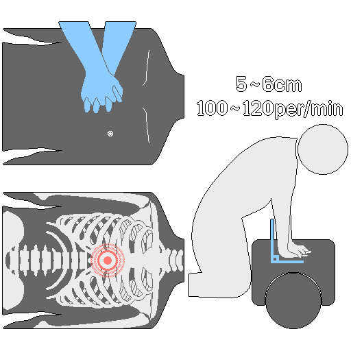
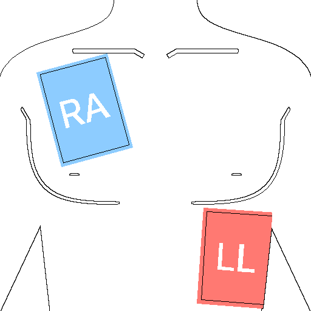
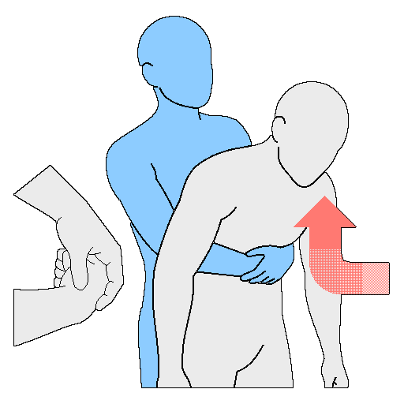

# First aid
> **Caution:** This document is for education and reference only and cannot replace care from medical professionals. In an emergency, call 119 (or the local emergency number) as quickly as possible. Some procedures, such as needle decompression and administering medication, should be performed only by people with medical training.

---
## 1. Overview and Basic Principles
&nbsp;&nbsp;&nbsp;In a serious emergency during a disaster, war, or extreme environment, the goal is to keep the person alive and prevent the injury from getting worse until professional medical help arrives. First aid is not treatment; it is a skill for keeping someone going until they are rescued alive. Even if the situation improves, always get medical care.

---
### 1-1. Before You Treat
- If the injured person is conscious, explain the treatment you are about to give and ask for consent. If the person is unconscious or in life-threatening danger, treat immediately without consent.
- If the situation is dangerous or you cannot judge it, prioritize your own safety and a prompt call for help over forcing a treatment.

---
### 1-2. Basic Principles
| Principle | Details |
| --- | --- |
| Ensure safety | The rescuer's own safety comes first. Survey the scene and check for hazards such as electric shock, fire, collapse, and toxic gas before approaching the patient |
| Call and cooperate | Call for help immediately and ask the people around you for specific help. Tell 119 (or the local emergency number) clearly the patient's condition, location, and the treatment given, and assign tasks to specific bystanders, such as "bring the AED" or "take over" |
| Patient care | Check consciousness, airway, breathing, and pulse before giving emergency care. Do not give drinks to an unconscious patient. Remove wet clothing and keep the patient warm with a blanket |

---
## 2. Trauma Priorities: M.A.R.C.H.
&nbsp;&nbsp;&nbsp;This is a method for treating injuries in order of priority in military and disaster settings.

| Rank | Step | Details |
| :---: | --- | --- |
| 1 | M - Massive Bleeding | Heavy bleeding |
| 2 | A - Airway | Securing the airway |
| 3 | R - Respiration | Breathing and chest injuries |
| 4 | C - Circulation | Circulation and shock management |
| 5 | H - Head injury / Hypothermia | Head injury and hypothermia |

---
### 2-1. Massive Bleeding
&nbsp;&nbsp;&nbsp;Heavy bleeding threatens life fastest. Stopping it quickly with a tourniquet and wound packing is the top priority.

#### 2-1-1. Tourniquet
&nbsp;&nbsp;&nbsp;Use it when severe bleeding from a limb (arm or leg) cannot be stopped by direct pressure alone.

1. Place it about 5-7 cm from the bleeding site toward the heart, avoiding joints. In an emergency, apply it first over clothing at the highest point of the limb and readjust it later.
2. Pass the Velcro strap through the buckle and pull it tight to secure it.
3. Turn the windlass until the bleeding stops completely.
4. Lock the windlass into the retaining clip and tuck away the remaining strap.
5. Always record the time it was applied.
6. If the bleeding does not stop, add a second tourniquet directly above the first one (toward the heart).
7. Do not loosen it on your own at the scene.

#### 2-1-2. Wound Packing
&nbsp;&nbsp;&nbsp;Use it for bleeding from penetrating wounds at sites where a tourniquet cannot be applied (groin, neck, armpit, and so on).

1. Roll the end of the gauze into a small ball.
2. Push the gauze deep into the wound, to the site where the bleeding is heaviest.
3. Fill the inside of the wound tightly, taking care to keep pressure even when you change fingers.
4. After packing, press down hard with both hands for at least 3 minutes.
5. After confirming that the bleeding has stopped, secure the packing with a pressure bandage.

---
### 2-2. Airway
- If the patient is conscious and can speak, the airway is considered open. If the patient is unconscious or has trouble breathing, secure the airway immediately.
- If a cervical spine injury is suspected, lift the jaw. If you judge the risk of vomiting or airway obstruction to be greater than the risk of a cervical spine injury, secure the airway before immobilizing the neck.
- If the patient is unconscious or an oropharyngeal airway (OPA) is hard to use, insert a nasopharyngeal airway (NPA).
- If there is no NPA, or there is a skull or facial fracture or severe nosebleed, place the patient in the recovery position (lying on the side) to secure the airway.

---
### 2-3. Respiration
&nbsp;&nbsp;&nbsp;Tension pneumothorax caused by a chest injury (gunshot, stab wound, and so on) is life-threatening, so treat it immediately.

#### 2-3-1. Open Pneumothorax
1. Find the hole in the chest.
2. Block the entry of air with an occlusive dressing (chest seal).
   - Use a vented chest seal first.
   - If there is no vented seal, seal it completely, and if signs of tension pneumothorax appear, briefly lift one edge of the dressing to release the pressure.
   - Use a three-sided seal only as a makeshift measure when neither is available.

#### 2-3-2. Tension Pneumothorax
- Signs: persistent difficulty breathing, uneven movement of the two sides of the chest, a weakening pulse, and jugular vein distension (JVD) even though it is not hypovolemic shock
- Needle decompression (NCD) can cause fatal injury to the lungs, heart, and major vessels if done incorrectly, so only medically trained personnel should perform it.
- According to the manual, the needle decompression site is the 2nd intercostal space on the midclavicular line or the 5th intercostal space on the anterior axillary line. Inserting the needle relieves the pressure in the chest cavity, so the lung re-expands and blood circulation to the heart is restored.

---
### 2-4. Circulation
&nbsp;&nbsp;&nbsp;Recheck that all hemorrhage control is working, and recognize the signs of shock to maintain circulation.

| Sign of shock | Details |
| :---: | --- |
| Color | Pale or bluish |
| Condition | Cold, clammy skin |
| Temperature | Low body temperature |

| Stage of shock | Details |
| :---: | --- |
| Compensated shock | The stage in which the body raises the heart rate to try to maintain blood pressure |
| Decompensated shock | A serious state in which blood loss is too great and the body can no longer cope |

1. Lay the patient flat and raise the legs 15-30 cm off the ground. If there is an obvious pelvic, abdominal, chest, or spinal injury, do not raise the legs, because it can worsen internal bleeding.
2. Remove wet clothing immediately and keep the patient warm with a blanket or clothing.
3. If the patient is unconscious, give nothing to eat or drink and turn the head to the side so that the airway is not blocked.
4. Check pulse, blood pressure, and breathing every 10 minutes. Check more often for patients with heavy bleeding.

---
### 2-5. Head Injury / Hypothermia
- Dilated pupils, raccoon eyes, and clear fluid (cerebrospinal fluid) leaking from the ears or nose are signs of a head injury. A spinal injury may accompany it, so transport the patient with the head and neck immobilized.
- Patients with serious trauma lose body heat rapidly through bleeding and shock, and this causes clotting problems that worsen the bleeding.

&nbsp;&nbsp;&nbsp;Treating hypothermia:

1. Move the patient to a warm place and remove wet clothing.
2. Wrap the whole body in a blanket or thermal wrap and put a hood or hat on the head to prevent heat loss.
3. Never allow oral intake for patients with severe trauma, because of possible surgery and the risk of aspiration. Only when the hypothermia is mild and there is no trauma, allow warm drinks in small amounts.

---
## 3. Cardiopulmonary Resuscitation (CPR)

- The survival rate of a cardiac arrest patient depends on accurate CPR within 4 minutes. After more than 10 minutes, the chance of brain damage and death rises sharply. Using an automated external defibrillator (AED) as well more than doubles the survival rate.
- The compression rate is 100-120 per minute, and the ratio of compressions to rescue breaths is 30:2.
- Keep interruptions in chest compressions to less than 10 seconds, and let the chest recoil fully after each compression.

---
### 3-1. Procedures by Patient Type
| Category | Check response | Hand position / compression depth | If rescuing alone | Rescue breaths |
| --- | --- | --- | --- | --- |
| Adult | Tap the shoulders and ask "Are you okay?" | Both hands interlaced, center of the chest (lower half of the sternum). About 5-6 cm | Call 119 (or the local emergency number) immediately, then do CPR | Recommended, but for lay rescuers compressions alone are also effective |
| Child (1 year to puberty) | Tap the shoulders | One hand, center of the chest. About 1/3 of the chest depth (about 5 cm) | Do 2 minutes of CPR first, then call 119 | Always 30:2, because cardiac arrest from respiratory causes is common |
| Infant (under 1 year) | Tap the soles of the feet | Two fingers, center of the chest. About 1/3 of the chest depth (about 4 cm) | Do 2 minutes of CPR first, then call 119 | Always 30:2, because cardiac arrest from respiratory causes is common |

&nbsp;&nbsp;&nbsp;Common steps:

1. Check for hazards to ensure safety, then approach.
2. Check for a response (per the table above).
3. If there is no response, ask bystanders for help by pointing to specific people. Example: "You, in the black clothes, call 119!", "You, in the white clothes, bring the AED!" If you are alone, continue while talking to 119 with your phone on speaker.
4. Look at the chest movement and check breathing for no more than 10 seconds. Abnormal breathing (including gasping) counts as no breathing.
5. If the person is breathing, switch to the recovery position; if not, start chest compressions.
6. Repeat 30:2 until rescuers arrive or the patient recovers.

---
### 3-2. Rescue Breaths
1. Tilt the head back and lift the chin to secure the airway.
2. Pinch the nose (for an infant, cover the mouth and nose together and keep the head in a neutral position) and blow in for 1 second, enough to make the chest rise.
3. To prevent infection, use of a rescue-breathing mask or face shield is recommended.

---
### 3-3. How to Use an AED

1. As soon as it arrives, turn it on and follow the voice prompts. Prepare in parallel without stopping CPR.
2. Place the pads below the right collarbone and on the side below the left armpit. For an infant, place them on the center of the chest (front) and on the back (anterior-posterior placement). If possible, use pediatric pads or an energy attenuator; if none, use adult pads, making sure the pads do not touch each other.
3. When the prompt says "Do not touch the patient", step away from the patient.
4. Just before pressing the shock button, shout "Stand clear" so that everyone moves away. When charging is complete, press the shock button.
5. If a heartbeat is detected, switch to the recovery position. If not, resume CPR immediately after the shock and keep following the voice instructions.

---
### 3-4. Notes
- Rescuers should swap every 2 minutes to prevent compression depth from dropping with fatigue.
- With multiple patients, prioritize those who are not breathing.
- In cold environments, follow the principle "cold but not dead" and consider continuing CPR until body temperature is restored.
- In a narrow space or a vehicle, move the patient to a flat floor if possible.
- For patients with massive bleeding or severe trauma, controlling uncontrolled bleeding takes priority over CPR.

---
## 4. First Aid by Situation
### 4-1. Trauma and Bleeding
| Type | Features | Treatment |
| :---: | --- | --- |
| Abrasion | A scraped wound. Little bleeding but a risk of infection | Wash with running water, disinfect, and apply a dressing |
| Laceration | A cut. Depending on depth, bleeding can be heavy | Apply direct pressure with clean gauze for at least 5 minutes |
| Puncture | A stab wound. Risk of nerve and blood-vessel damage | Do not forcibly remove an embedded object; protect it as it is and transport the patient |
| Bite | A bite wound. Risk of infection from bacteria in the mouth | Hospital treatment depending on the condition of the wound |

&nbsp;&nbsp;&nbsp;Quick steps for heavy bleeding:

1. Press hard directly on the wound with a hand, cloth, or gauze.
2. Keep up the pressure for at least 10 minutes.
3. If the bleeding continues, use a tourniquet, limited to arms and legs.
4. Apply it toward the heart from the wound (about 5-7 cm above it) and record the time.

- For ordinary bleeding, raising the bleeding site above the heart helps reduce blood loss.
- Do not remove clots of coagulated blood.
- Avoid sprinkling hemostatic agents or ointments, because they interfere with hospital treatment.

---
### 4-2. Burns and Heat Injuries
> **Caution:** Do not pop blisters, forcibly peel off stuck clothing or material, or put ice directly on the burn. Folk remedies such as applying oil, soybean paste, soy sauce, toothpaste, lotion, or ointment raise the risk of infection.

- If shock is suspected, lay the patient down and raise the legs slightly. Keep the patient warm with a blanket, and give water in small amounts only if the patient is conscious and not vomiting.

| Category | Features | Treatment |
| :---: | --- | --- |
| 1st degree | Epidermal damage. Redness and pain, no blisters | Cool with running cold water, then apply a dressing and moisturize |
| 2nd degree | Damage down to the dermis. Blisters and severe pain | Cool without popping the blisters, then protect. Be prepared for pain-induced shock |
| 3rd degree | Damage down to the subcutaneous tissue. Pain is dull or absent (skin grafting needed) | Cool only briefly, immediately cover with a clean cloth, keep warm, and transport to a hospital |

&nbsp;&nbsp;&nbsp;Common burn care:

1. Move away from the heat source and quickly remove clothing and jewelry (rings, watches, and so on) from the burned area. Cut away clothing stuck to the skin with scissors; do not pull it off by force.
2. Cool for about 15-20 minutes with cool running water (about 18-20 °C) or saline. Do not put ice directly on the burn. Extensive or severe burns carry a risk of hypothermia, so do not over-cool.
3. Cover with a dedicated burn dressing and clean gauze, without applying pressure.

---
### 4-3. Musculoskeletal Injuries: R.I.C.E.
| Item | Action |
| :---: | --- |
| Rest | Keep the injured area still and rest in a comfortable position |
| Ice | Only for relieving early swelling and pain, apply ice or something cold for about 15 minutes. Prolonged icing delays recovery |
| Compression | Immobilize the injured area with a splint or an elastic bandage. Wrap the bandage from the part far from the heart toward the part nearer to it |
| Elevation | To promote circulation and reduce swelling and pain, raise the injured area above the heart on a pillow |

- For a fracture, do not force the broken bone back into place or push it in.
- Use a splint at least as long as to include the joints on both sides of the fracture.
- After splinting, check blood circulation every 30 minutes, and loosen the splint if circulation is not good.

---
### 4-4. Airway Obstruction (Choking)

- Ask, "Is something stuck in your throat?" If the person cannot speak and grabs the throat, the obstruction is complete. If the person coughs on their own, the airway is not completely blocked, so encourage coughing.
- Do not use abdominal thrusts (the Heimlich maneuver) on infants, because of the risk of injury to abdominal organs.

**Infant (under 1 year)**

1. Hold the infant's jaw and cheekbone with one hand and lay the infant face down on your thigh, with the head lower than the body.
2. Strike firmly 5 times between the shoulder blades with the heel of your hand.
3. Cradle the jaw and back of the head and turn the infant over.
4. Place two fingers on the sternum just below the center line between the nipples and give 5 quick, firm compressions.
5. Repeat back blows and chest compressions until the foreign object is cleared.

**Adults and children**

1. Stand behind the person and brace by putting one leg between the person's legs.
2. Place the thumb side of one fist between the navel and the pit of the stomach.
3. Wrap your other hand around the fist and thrust sharply backward and upward (diagonally up).
4. Repeat until the object is expelled or the person loses consciousness. If the person loses consciousness, switch to CPR.

**When you are alone**

1. Try to expel it by coughing.
2. If that fails, place a fist above the navel and below the ribs, wrap your other hand around it, and thrust sharply upward.
3. If that still fails, press your upper abdomen against the edge of a fixed object such as a chair or table, and press with your body weight.

---
### 4-5. Amputation
&nbsp;&nbsp;&nbsp;Press hard directly on the amputation site with clean gauze or cloth and raise it above the heart. Handle the amputated part as follows.

1. Rinse it lightly with saline or clean water to remove foreign matter.
2. Wrap the amputated part in a clean cloth moistened with saline.
3. Put it in a plastic bag or airtight container and seal it.
4. Put the sealed bag into a container of ice and water. Make sure the amputated part does not touch the ice directly.
5. Transport the patient to a hospital that can perform reattachment surgery within 4-6 hours.

---
### 4-6. Electric Shock
1. Cut off the power. Do not touch the patient before the power is cut.
2. If you cannot turn off the power, separate the patient from the electricity with an insulator such as a dry wooden stick or rubber gloves.
3. If there is no breathing or pulse, start CPR immediately and use the AED when it arrives.

---
### 4-7. Asphyxiation Accidents (Oxygen Deficiency and Toxic Gas)
1. Rescuers wear protective equipment such as a self-contained breathing apparatus or a supplied-air mask.
2. Enter the asphyxiation area and ventilate immediately.
3. Move the patient to where there is safe air.
4. Secure the airway of an unconscious patient, and if breathing is weak or there is no pulse, give high-concentration oxygen along with CPR.

---
## 5. Environmental and Bite Injuries
### 5-1. Heat-Related Illness
| Category | Consciousness | Sweating | Body temperature | Danger |
| --- | --- | --- | --- | --- |
| Heat cramps | Normal | Heavy | Normal to slightly high | Low |
| Heat exhaustion (sunstroke) | May be slightly reduced | Heavy | 37 °C or higher | Medium |
| Heat stroke | Confused to unconscious | Absent or present | 40 °C or higher | Very dangerous |

&nbsp;&nbsp;&nbsp;Common care:

1. Move the person immediately to a cool place such as shade, indoors, or underground.
2. Spray water on the body and fan it for evaporative cooling.
3. Only if the person is conscious, replenish fluids and electrolytes with water mixed with salt and sugar.

- Heat cramps: Stop the activity and let the person rest well. Replenish fluids and electrolytes and stretch the cramping muscles at the same time. If dizziness and vomiting accompany the cramps, they may progress to heat exhaustion.
- Heat exhaustion: Lay the person down in the shade with the legs slightly raised. If the person vomits, turn them to the side to secure the airway, and wipe the large-vessel areas such as the neck, armpits, and groin with a wet towel for evaporative cooling. Only if conscious, give small sips of water repeatedly.
- Heat stroke: Cooling is the top priority. Call 119 and at the same time immerse the person in cold water or cover them with wet cloths and fan them. Concentrate cooling on the neck, armpits, and groin, keep monitoring breathing and pulse, and start CPR if they stop. Do not force the person to drink or give fever reducers.

---
### 5-2. Snakebite
&nbsp;&nbsp;&nbsp;The venom of venomous snakes (mainly vipers) mostly spreads through the blood and lymphatic system. The goal of the response is not to remove the venom but to slow its spread. The more the victim moves, the faster the venom spreads, so minimize movement and immobilize the bitten area.

> **Caution:** Do not suck out the venom by mouth, cut the wound with a knife, tie a tourniquet tightly, apply electric shock, put ice directly on it, drink alcohol, run or move around, or apply soybean paste or cigarette ash.

&nbsp;&nbsp;&nbsp;If any one of severe pain, rapid swelling, blisters, necrosis, dizziness, vomiting, blurred vision, or difficulty breathing is present, treat it as a venomous snakebite.

1. Move away from the snake immediately to get distance, and call 119 (or the local emergency number).
2. Lay the patient down and reassure them to lower the heart rate.
3. In anticipation of swelling, remove rings, watches, tight clothing, and so on beforehand.
4. Rinse the bitten area gently under running water without rubbing.
5. About 5-10 cm from the bitten area toward the heart, place a thickly folded piece of gauze and wrap a bandage loosely enough that one finger fits underneath, only to slow lymph and venous flow. Never tie it tightly, so that the artery is not constricted. Immobilize it with a splint.
6. Keep the bitten area slightly below or level with the heart.
7. If the patient is conscious and not vomiting, give water in small amounts and keep them warm to prevent shock.
8. Move the patient by stretcher if possible. When isolated over a long distance, waiting for rescue may be safer than forcing a move.

---
### 5-3. Bee Stings
&nbsp;&nbsp;&nbsp;Most stings end with local pain, but some lead to severe systemic allergic shock (anaphylaxis). Watching for a systemic reaction matters as much as removing the stinger.

- To reduce attacks from a swarm, avoid perfume and bright (colorful) clothing.
- If bees attack, the most effective response is to flee far and fast. Do not strike at the bees to drive them off, and do not hide in water holding your breath.

1. Bees use pheromones to draw further attacks, so leave the area with many bees quickly.
2. The stinger's venom sac keeps injecting venom, so remove the stinger as quickly as possible by scraping it off the skin with a hard, flat object such as a card or a fingernail. If you pinch the stinger with tweezers, you may squeeze the venom sac and push the remaining venom into the body all at once.
3. Wash the area with soap and clean water, and apply a cold compress with ice wrapped in cloth.
4. Even if it itches, do not scratch, to prevent infection.
5. If systemic symptoms (dizziness, a feeling of faintness, and so on) are suspected, lay the patient down and raise the legs to prepare for shock. If there is difficulty breathing, prop the upper body up slightly.

&nbsp;&nbsp;&nbsp;Symptoms of anaphylaxis: swelling of the lips, tongue, and throat, hives all over the body, difficulty breathing, hoarse voice, reduced consciousness, low blood pressure, and cyanosis of the lips, tongue, and fingertips

1. Immediately lay the patient down and raise the legs to prevent hypotensive shock. If there is difficulty breathing, prop the upper body up.
2. Immediately inject an epinephrine auto-injector (such as an EpiPen) into the thigh.
3. If the patient is unconscious, place them on their side to secure the airway.
4. Keep checking breathing and pulse, and do CPR if necessary.

---
## 6. Patient Triage
&nbsp;&nbsp;&nbsp;In a disaster, the purpose of triage is to allocate limited medical resources as efficiently as possible and save as many lives as possible.

### 6-1. The START Triage System
&nbsp;&nbsp;&nbsp;START (Simple Triage and Rapid Treatment) assesses a patient on site within 60 seconds and sorts them into 4 colors.

#### 6-1-1. First Sort: Can the Person Walk?
&nbsp;&nbsp;&nbsp;Announce, "Anyone who can walk, come over here."

- Able to walk: green (minor). Move them to a safe place.
- Unable to walk: assess on site in the order of respiration, perfusion, and mental status (RPM).

#### 6-1-2. Second Sort: RPM Assessment
| Item | Criterion | Result |
| --- | --- | --- |
| Respiration | Not breathing even after opening the airway | Black (deceased) |
| | More than 30 breaths per minute | Red (immediate) |
| | 30 or fewer breaths per minute | Next step (P) |
| Perfusion | No radial pulse, or capillary refill time (CRT) over 2 seconds | Red (immediate) |
| | Radial pulse present and CRT 2 seconds or less | Next step (M) |
| Mental | Cannot follow simple commands | Red (immediate) |
| | Can follow simple commands | Yellow (delayed) |

### 6-2. Triage Tag Colors
| Color | Category | Meaning and priority |
| :---: | :---: | --- |
| Red | Immediate | Life is threatened and immediate treatment and transport are needed (airway obstruction, shock, severe bleeding) |
| Yellow | Delayed | Serious, but life is not at risk if treated within 1-2 hours (open fracture, minor burns) |
| Green | Minor | Minor injury, or the person can walk and can be treated after several hours without harm (abrasions, mild sprains) |
| Black | Deceased / unsalvageable | Already dead, or, in a large-scale disaster or severe resource shortage, cannot be revived with the limited resources (cardiac arrest, fatal head injury) |