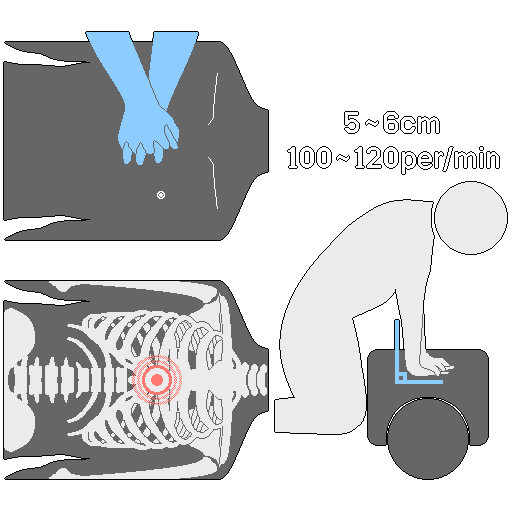
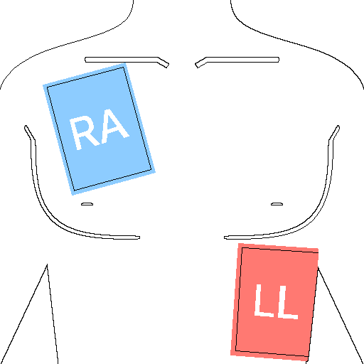
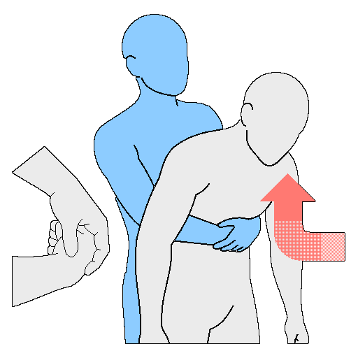

# 応急処置
> **注意:** この文書は教育・参考用であり、専門の医療従事者による診療の代わりにはなりません。緊急事態では、できるだけ早く119(または現地の救助機関)に通報します。針減圧術や薬剤の投与のような一部の処置は、医療教育を受けた人だけが行います。

---
## 1. 概要と基本原則
&nbsp;&nbsp;&nbsp;災害・戦争・極限環境での重大な緊急事態において、専門の医療従事者の助けを受けるまで、命を維持し、負傷の悪化を防ぐことが目的です。応急処置は治療ではなく、生きて救助されるまで持ちこたえさせるための技術です。状況が回復しても、必ず診察を受けます。

---
### 1-1. 処置前の留意事項
- 負傷者に意識があれば、行う処置を説明して同意を求めます。意識がない場合や命が危険な場合は、同意を得ずにただちに処置します。
- 状況が危険な場合や判断がつかない場合は、無理な処置よりも自分の安全の確保と迅速な通報を優先します。

---
### 1-2. 基本原則
| 原則 | 内容 |
| --- | --- |
| 安全確保 | 処置する人自身の安全が最優先です。現場を調べて感電・火災・倒壊・有害ガスなどの危険要素を確認してから、患者に近づきます |
| 通報・協力 | すぐに通報し、周囲に具体的に助けを求めます。119(または現地の救助機関)に患者の状態・位置・行った処置を明確に伝え、周囲の人を指名して「AEDを持ってくる」「交代する」などの役割を指示します |
| 患者管理 | 意識・気道・呼吸・脈拍を確認してから応急措置をします。意識のない患者には飲み物を与えません。濡れた服は脱がせ、毛布で保温します |

---
## 2. 外傷処置の優先順位: M.A.R.C.H.
&nbsp;&nbsp;&nbsp;軍事・災害環境で、優先順位に従って負傷を処置する方法です。

| 順位 | 段階 | 内容 |
| :---: | --- | --- |
| 1 | M - Massive Bleeding | 大量出血 |
| 2 | A - Airway | 気道確保 |
| 3 | R - Respiration | 呼吸・胸部損傷 |
| 4 | C - Circulation | 循環・ショック管理 |
| 5 | H - Head injury / Hypothermia | 頭部外傷・低体温症 |

---
### 2-1. Massive Bleeding(大量出血)
&nbsp;&nbsp;&nbsp;大量出血は最も速く命を脅かします。止血帯(Tourniquet)と創傷パッキング(Wound Packing)で速やかに止血することが最優先です。

#### 2-1-1. 止血帯
&nbsp;&nbsp;&nbsp;四肢(腕・脚)の重い出血で、直接圧迫だけでは止血できないときに使います。

1. 関節を避け、出血部位から心臓側へ約5-7cm離れた位置に当てます。緊急時は、衣服の上から四肢のいちばん高い位置に先に装着し、後から調整し直します。
2. ベルクロのバンドをバックルに通し、強く引っ張って固定します。
3. 締め棒(ウィンドラス)を、出血が完全に止まるまで回します。
4. 締め棒を固定用のクリップにはめ、余ったバンドを整えます。
5. 装着した時刻を必ず記録します。
6. 出血が止まらなければ、最初の止血帯のすぐ上(心臓側)に2本目の止血帯を追加します。
7. 現場で勝手にゆるめません。

#### 2-1-2. 創傷パッキング(Wound Packing)
&nbsp;&nbsp;&nbsp;止血帯を使えない部位(鼠径部・首・脇の下など)の貫通創からの出血に使います。

1. ガーゼの端を小さな玉の形に丸めます。
2. 出血が最もひどい深い部位まで、ガーゼを奥深く押し込みます。
3. 指を入れ替えるときも圧力が保たれるよう注意しながら、傷の内部をぎっしり詰めます。
4. パッキングが終わったら、両手で最低3分間強く圧迫します。
5. 出血が止まったことを確認してから、圧迫包帯で固定します。

---
### 2-2. Airway(気道確保)
- 患者に意識があり話せれば、気道は開いているとみなします。意識がない場合や呼吸に問題がある場合は、ただちに気道を確保します。
- 頸椎の損傷が疑われる場合は、あごを持ち上げます。嘔吐や気道閉塞の危険のほうが頸椎損傷の危険より大きいと判断される場合は、頸椎の固定より気道確保を優先します。
- 意識がない場合や経口エアウェイ(OPA)の使用が難しい場合は、経鼻エアウェイ(NPA)を挿入します。
- NPAがない場合や、頭部・顔面の骨折、ひどい鼻出血がある場合は、回復体位(横向きに寝かせた姿勢)にして気道を確保します。

---
### 2-3. Respiration(呼吸・胸部損傷)
&nbsp;&nbsp;&nbsp;胸部損傷(銃創・刺創など)による緊張性気胸(Tension Pneumothorax)は命を脅かすため、ただちに処置します。

#### 2-3-1. 開放性気胸
1. 胸部の穴を確認します。
2. 密閉ドレッシング(Chest Seal)で空気の流入を防ぎます。
   - 排出弁付き(vented)の密閉ドレッシングを優先して使います。
   - 排出弁付きがなければ完全に密閉し、緊張性気胸の徴候が現れたら、ドレッシングの片側を少しはがして圧を抜きます。
   - 両方ない場合の応急策としてのみ、三辺閉鎖(three-sided seal)を適用します。

#### 2-3-2. 緊張性気胸
- 徴候: 続く呼吸困難、胸部の左右の動きの不均衡、弱くなる脈拍、(循環血液量減少性ショックではないのに)頸静脈の怒張(JVD)
- 針減圧術(NCD)は、誤って行うと肺・心臓・主要血管に致命的な傷を負わせるおそれがあるため、医療教育を受けた専門の人員だけが行います。
- 教範上の針減圧術の位置は、鎖骨中線上の第2肋間、または前腋窩線上の第5肋間です。針を刺して胸腔内の圧力を解消すると、肺が再び膨らみ、心臓への血液循環が回復します。

---
### 2-4. Circulation(循環・ショック管理)
&nbsp;&nbsp;&nbsp;すべての止血処置が有効かを再確認し、ショックの徴候を把握して循環を維持します。

| ショックの徴候 | 内容 |
| :---: | --- |
| 色 | 青白い、または青い |
| 状態 | 冷たくじっとりした皮膚 |
| 温度 | 体温の低下 |

| ショックの段階 | 内容 |
| :---: | --- |
| 代償性ショック | 心拍数を上げて血圧を維持しようとする段階 |
| 非代償性ショック | 血液の損失が大きすぎて、もう持ちこたえられない重い状態 |

1. 患者を水平に寝かせ、脚を地面から15-30cm持ち上げます。明らかな骨盤・腹部・胸部・脊椎の損傷がある場合は、脚の挙上が内出血を悪化させることがあるため行いません。
2. 濡れた服はただちに脱がせ、毛布や衣類で保温します。
3. 患者が意識不明なら何も食べさせず、気道がふさがれないよう顔を横に向けます。
4. 脈拍・血圧・呼吸を10分間隔で確認します。大量出血の患者はもっと短い間隔で確認します。

---
### 2-5. Head injury / Hypothermia(頭部外傷・低体温症)
- 瞳孔の散大、パンダの目(ラクーンアイ)、耳や鼻からの透明な液体(脳脊髄液)の漏れは、頭部外傷の徴候です。脊椎損傷を伴うことがあるため、頭と首を固定したまま搬送します。
- 重い外傷の患者は、出血とショックで体温が急激に下がり、これが凝固障害を起こして出血を悪化させます。

&nbsp;&nbsp;&nbsp;低体温症の処置:

1. 暖かい場所へ移し、濡れた服を脱がせます。
2. 毛布や保温シートで体全体を包み、頭にフードや帽子をかぶせて熱の損失を防ぎます。
3. 重い外傷の患者は、手術への備えと誤嚥の危険があるため、経口摂取を絶対に禁止します。軽い低体温で外傷がない場合に限り、温かい飲み物を少量ずつ許可します。

---
## 3. 心肺蘇生法(CPR)

- 心停止の患者の生存率は、4分以内の正確なCPRにかかっています。10分を超えると、脳の損傷や死亡の可能性が急激に高まります。自動体外式除細動器(AED)を併用すると、生存率が2倍以上に高まります。
- 圧迫の速さは毎分100〜120回、圧迫と人工呼吸の比率は30:2です。
- 胸骨圧迫の中断は10秒以内に最小限にし、圧迫後は胸が完全に元に戻るようにします。

---
### 3-1. 対象別の手順
| 区分 | 反応の確認 | 手の位置・圧迫の深さ | 1人で救助する場合 | 人工呼吸 |
| --- | --- | --- | --- | --- |
| 成人 | 肩をたたきながら「大丈夫ですか?」 | 両手を組み、胸の中央(胸骨の下半分)。約5〜6cm | すぐに119(または現地の救助機関)に通報してからCPR | 推奨されるが、一般の人は胸骨圧迫だけでも有効 |
| 小児(1歳〜思春期) | 肩をたたく | 片手、胸の中央。胸の厚さの約1/3(約5cm) | 先に2分間CPRを行ってから119に通報 | 呼吸が原因の心停止が多いため、必ず30:2 |
| 乳児(1歳未満) | 足の裏をたたく | 指2本、胸の中央。胸の厚さの約1/3(約4cm) | 先に2分間CPRを行ってから119に通報 | 呼吸が原因の心停止が多いため、必ず30:2 |

&nbsp;&nbsp;&nbsp;共通の手順:

1. 危険要素を確認して安全を確保し、近づきます。
2. 反応を確認します(上の表を基準にします)。
3. 反応がなければ、周りの人を指名して助けを求めます。例)「そこの黒い服の方、119に通報してください!」「白い服の方、AEDを持ってきてください!」1人なら、スマートフォンのスピーカーモードで119と通話しながら進めます。
4. 胸の動きを見て、10秒以内に呼吸を確認します。異常な呼吸(あえぎ呼吸を含む)は、呼吸なしとみなします。
5. 呼吸があれば回復体位に移し、なければ胸骨圧迫を始めます。
6. 救急隊が到着するか患者が回復するまで、30:2を繰り返します。

---
### 3-2. 人工呼吸
1. 頭を後ろに傾け、あごを持ち上げて気道を確保します。
2. 鼻をつまみ(乳児は口と鼻を同時に覆い、頭は中間位に保つ)、1秒間、胸がふくらむ程度に息を吹き込みます。
3. 感染防止のため、人工呼吸用マスクや顔面保護具の使用を勧めます。

---
### 3-3. 自動体外式除細動器(AED)の使い方

1. 到着したらすぐに電源を入れ、音声案内に従います。CPRを止めずに準備を並行します。
2. 右の鎖骨の下と、左のわきの下の脇腹にパッドを貼ります。乳児は胸の中央(前)と背中(後ろ)に貼ります(前後方向の貼付)。できれば小児用パッドかエネルギー減衰器を使い、なければ成人用パッドを使いますが、パッド同士が触れないようにします。
3. 「患者から離れてください」という案内が出たら、患者から離れます。
4. 電気ショックのボタンを押す直前に「離れて!」と叫び、全員を離れさせます。充電が終わったら、ショックボタンを押します。
5. 心拍が検出されたら回復体位に移します。検出されなければ、ショックの後すぐにCPRを再開し、音声指示を繰り返します。

---
### 3-4. 留意事項
- 救助者は2分ごとに交代し、疲労による圧迫の深さの低下を防ぎます。
- 患者が複数いる場合は、呼吸のない患者を優先します。
- 低体温の環境では、「冷たいが死んではいない」という原則に従い、体温が回復するまでCPRの継続を検討します。
- 狭い場所や車内では、できるだけ平らな床に移します。
- 大量出血・重症外傷の患者は、制御されていない出血の処置がCPRより優先します。

---
## 4. 状況別の応急処置
### 4-1. 外傷・出血
| 種類 | 特徴 | 処置 |
| :---: | --- | --- |
| 擦過傷 | こすれた傷。出血は少ないが感染の恐れ | 流水で洗い、消毒してドレッシング |
| 切創 | 切れた傷。深さによって出血が多いことがある | きれいなガーゼで5分以上直接圧迫 |
| 刺創 | 刺された傷。神経・血管損傷の危険 | 刺さった物は無理に抜かず、そのまま保護して搬送 |
| 咬傷 | かまれた傷。口の中の細菌による感染の危険 | 傷の状態に応じて病院で治療 |

&nbsp;&nbsp;&nbsp;大量出血時の迅速な措置:

1. 手・布・ガーゼで患部を強く直接圧迫します。
2. 10分以上圧迫を続けます。
3. 出血が続けば、腕・脚に限って止血帯を使います。
4. 傷より心臓側(約5-7cm上)に装着し、時刻を記録します。

- 一般的な止血では、出血部位を心臓より高く上げると出血の減少に役立ちます。
- 固まった血の塊は取り除きません。
- 止血剤や軟膏を振りかけると病院での処置の妨げになるため、控えます。

---
### 4-2. やけど・熱による損傷
> **注意:** 水ぶくれをつぶしたり、くっついた衣服や物質を無理にはがしたり、氷を患部に直接当てたりしません。油・味噌・醤油・歯磨き粉・ローション・軟膏などを塗る民間療法は、感染の危険を高めます。

- ショックが疑われる場合は、寝かせて脚を少し上げます。毛布で保温し、意識があって嘔吐がないときに限り、水を少量ずつ与えます。

| 区分 | 特徴 | 処置 |
| :---: | --- | --- |
| I度 | 表皮の損傷。赤くなり痛みがあるが水ぶくれはない | 流水で冷やしてからドレッシング、保湿 |
| II度 | 真皮までの損傷。水ぶくれ、強い痛み | 水ぶくれをつぶさずに冷やしてから保護。痛みによるショックに備える |
| III度 | 皮下組織までの損傷。痛みが鈍いか、ない(皮膚移植が必要) | 冷却は短く、すぐにきれいな布で覆って保温し、病院へ搬送 |

&nbsp;&nbsp;&nbsp;共通のやけど処置:

1. 熱源から離れ、やけどの部位の衣服・装身具(指輪・腕時計など)を素早く外します。皮膚にくっついた衣服はハサミで切り取り、無理にはがしません。
2. 流水の冷たい水(約18-20℃)か生理食塩水で、約15-20分冷やします。氷を直接当てません。広範囲・重症のやけどは低体温の危険があるため、冷やしすぎません。
3. やけど専用のドレッシングときれいなガーゼで覆いますが、圧迫はしません。

---
### 4-3. 筋骨格系の損傷: R.I.C.E.
| 項目 | 行動 |
| :---: | --- |
| Rest(安静) | けがをした部位を動かさないよう、楽な姿勢で休みます |
| Ice(冷却) | 初期の腫れや痛みの緩和を目的とする場合に限り、氷などの冷たいもので約15分冷やします。長期間の冷却は回復を遅らせます |
| Compression(圧迫) | 添え木や弾性包帯で患部を固定します。包帯は、心臓から遠いほうから近いほうの順に巻きます |
| Elevation(挙上) | 循環の促進と腫れ・痛みの軽減のため、枕で患部を心臓より高く上げます |

- 骨折した場合、折れた骨を無理に整復したり押し込んだりしません。
- 添え木は、骨折部位の両側の関節を含む長さ以上のものを使います。
- 添え木で固定した後は、30分間隔で血液循環を観察し、循環がよくなければゆるめに調整します。

---
### 4-4. 気道閉塞(窒息)

- 「のどに何か詰まりましたか?」と尋ねます。話せずにのどをつかんでいれば、完全閉塞です。自分で咳をしていれば、完全にふさがっているわけではないので、咳を促します。
- 乳児は腹腔内の臓器を傷める危険があるため、腹部突き上げ法(ハイムリック法)を行いません。

**乳児(1歳未満)**

1. 片手で乳児のあごと頬骨を包むように支え、頭が体より低くなるよう、太ももの上にうつぶせに寝かせます。
2. 手のひらの付け根で、左右の肩甲骨の間を強く5回たたきます。
3. あごと後頭部を包むように支えて、反対に向けます。
4. 左右の乳首を結ぶ線の中央のすぐ下の胸骨に指2本を置き、速く強く5回圧迫します。
5. 異物が取れるまで、背中たたきと胸部圧迫を繰り返します。

**成人および小児**

1. 患者の後ろに立ち、片脚を患者の脚の間に入れて体を支えます。
2. 片方のこぶしの親指側を、へそとみぞおちの間に当てます。
3. もう一方の手でこぶしを包み、後ろ上方(斜め上)へ強く押し上げます。
4. 異物が出るか患者が意識を失うまで繰り返します。意識を失ったらCPRに切り替えます。

**1人でいるとき**

1. 咳で出そうと試みます。
2. だめなら、こぶしをへその上・肋骨の下に置き、もう一方の手で包んで上へ強く押し上げます。
3. それでもだめなら、椅子やテーブルなど固定された物の角に上腹部を当て、体重をかけて圧迫します。

---
### 4-5. 切断
&nbsp;&nbsp;&nbsp;切断部位をきれいなガーゼや布で強く直接圧迫し、心臓より高く上げます。切断された部位は、次のように扱います。

1. 生理食塩水かきれいな水で軽く洗い、異物を取り除きます。
2. 生理食塩水で濡らしたきれいな布で、切断された部位を包みます。
3. ビニール袋か密閉容器に入れて密封します。
4. 氷と水を入れた容器に、密封した袋を入れます。切断された部位が氷に直接触れないようにします。
5. 4-6時間以内に接合手術ができる病院へ搬送します。

---
### 4-6. 感電
1. 電源を遮断します。遮断する前は、患者に触れません。
2. 電源を切れない場合は、乾いた木の棒やゴム手袋などの絶縁体で、患者を電気から引き離します。
3. 呼吸や脈拍がなければ、すぐにCPRを行い、AEDが到着したら使います。

---
### 4-7. 窒息事故(酸素欠乏・有害ガス)
1. 救助者は、空気呼吸器や送気マスクなどの保護具を着用します。
2. 窒息事故の区域に進入し、ただちに換気します。
3. 患者を安全な空気のある場所へ移します。
4. 意識のない患者は気道を確保し、呼吸が弱いか脈拍がなければ、CPRとともに高濃度酸素を供給します。

---
## 5. 環境・咬傷による損傷
### 5-1. 熱関連の疾患
| 区分 | 意識 | 汗 | 体温 | 危険度 |
| --- | --- | --- | --- | --- |
| 熱けいれん | 正常 | 多い | 正常〜やや高い | 低い |
| 日射病(熱疲労) | やや低下することがある | 多い | 37℃以上 | 中程度 |
| 熱射病 | 混濁〜なし | ないか、ある | 40℃以上 | 非常に危険 |

&nbsp;&nbsp;&nbsp;共通の処置:

1. ただちに日陰・屋内・地下などの涼しい場所へ移します。
2. 体に水をかけてあおぎ、蒸発で冷やします。
3. 意識があるときに限り、水に塩・砂糖を混ぜて水分・電解質を補給します。

- 熱けいれん: 活動をやめ、十分に休ませます。水分・電解質の補給と、けいれんした部位のストレッチを併せて行います。けいれんにめまいと嘔吐が伴うときは、日射病に進むことがあります。
- 日射病: 日陰に寝かせ、脚を少し上げます。嘔吐したら横を向かせて気道を確保し、濡れタオルで首・脇の下・鼠径部などの太い血管がある部位をふいて、蒸発で冷やします。意識があるときに限り、水を少量ずつ繰り返し飲ませます。
- 熱射病: 冷却が最優先です。119に通報すると同時に、すぐに冷水に浸けるか濡れた布をかけてあおぎます。首・脇の下・鼠径部を集中的に冷やし、呼吸・脈拍を観察し続け、止まったらCPRを始めます。無理に水を飲ませたり、解熱剤を使ったりしません。

---
### 5-2. ヘビにかまれたとき
&nbsp;&nbsp;&nbsp;毒ヘビ(主にマムシ類)の毒は、ほとんどが血液・リンパ系に広がります。対応の目標は毒の除去ではなく、拡散を遅らせることです。動くほど毒が速く広がるため、動きを最小限にして患部を固定します。

> **注意:** 口で毒を吸い出す、刃物で切開する、止血帯で強く縛る、電気ショックを与える、氷を直接当てる、飲酒する、走ったり動いたりする、味噌やタバコの灰を塗ることはしません。

&nbsp;&nbsp;&nbsp;強い痛み、急激な腫れ、水ぶくれ、壊死、めまい、嘔吐、視界のかすみ、呼吸困難のうち1つでもあれば、毒ヘビによる咬傷とみなします。

1. ヘビからすぐに離れて距離を確保し、119(または現地の救助機関)に通報します。
2. 患者を寝かせて安心させ、心拍数を下げます。
3. 腫れに備え、指輪・腕時計・きつい服などをあらかじめ外します。
4. かまれた部位を流水で軽く洗い、こすりません。
5. かまれた部位から心臓側へ約5-10cm離れたところに、厚く折ったガーゼを当て、指が1本入る程度に包帯を巻いて、リンパ・静脈の流れだけを遅らせます。動脈まで締めつけないよう、絶対に強く縛りません。添え木で固定します。
6. かまれた部位を、心臓よりやや低いか同じ高さに置きます。
7. 意識があって嘔吐がなければ、水を少量ずつ飲ませ、体温を保ってショックを予防します。
8. できれば担架で移動します。長距離で孤立している場合は、無理に移動するより救助を待つほうが安全なことがあります。

---
### 5-3. ハチに刺されたとき
&nbsp;&nbsp;&nbsp;ほとんどは局所の痛みで済みますが、一部は重い全身性のアレルギーショック(アナフィラキシー)に至ります。針の除去と同じくらい、全身反応の監視が重要です。

- ハチの群れの攻撃を減らすには、香水と明るい色(派手な)服を避けます。
- ハチが攻撃してきたら、遠くへ素早く逃げるのが最も効果的です。ハチを追い払おうと攻撃したり、水に入って息を止めて隠れたりしません。

1. ハチはフェロモンで追加の攻撃を誘うので、ハチの多い場所を素早く離れます。
2. 針の毒嚢が毒を注入し続けるため、できるだけ早く、カードや爪など硬くて平らな物で、皮膚をこすり取るように押して針を取り除きます。ピンセットで針をつまむと、毒嚢を絞って残った毒液が一度に体内に入ることがあります。
3. 石鹸ときれいな水で患部を洗い、氷を布に包んで冷やします。
4. かゆくても、感染予防のため掻きません。
5. 全身症状(めまい・失神しそうな感じなど)が疑われる場合は、患者を寝かせて脚を上げ、ショックに備えます。呼吸困難があれば、上半身を少し起こします。

&nbsp;&nbsp;&nbsp;アナフィラキシーの症状: 唇・舌・のどの腫れ、全身のじんましん、呼吸困難、かすれ声、意識の低下、血圧の低下、唇・舌・指先のチアノーゼ

1. ただちに患者を寝かせ、脚を上げて低血圧性ショックを予防します。呼吸困難があれば、上半身を起こします。
2. エピネフリン自動注射器(エピペンなど)を、すぐに太ももに注射します。
3. 意識がなければ、横向きに寝かせて気道を確保します。
4. 呼吸・脈拍を確認し続け、必要ならCPRを行います。

---
## 6. 患者の分類(トリアージ)
&nbsp;&nbsp;&nbsp;災害時に患者を分類する目的は、限られた医療資源を最も効率的に配分し、できるだけ多くの命を救うことです。

### 6-1. START分類体系
&nbsp;&nbsp;&nbsp;START(Simple Triage and Rapid Treatment)は、現場で60秒以内に患者を評価し、4つの色に分類します。

#### 6-1-1. 1次分類: 歩行できるか
&nbsp;&nbsp;&nbsp;「歩ける人はこちらに来てください」と案内します。

- 歩行可能: 緑(非応急)。安全な場所へ移動させます。
- 歩行不可: 現場で、呼吸・循環・意識(RPM)の順に評価します。

#### 6-1-2. 2次分類: RPM評価
| 項目 | 基準 | 結果 |
| --- | --- | --- |
| Respiration | 気道確保後も呼吸なし | 黒(死亡) |
| | 毎分30回を超える呼吸 | 赤(緊急) |
| | 毎分30回以下の呼吸 | 次の段階(P) |
| Perfusion | 橈骨動脈の脈拍なし、またはCRT(毛細血管再充満時間)が2秒超 | 赤(緊急) |
| | 橈骨動脈の脈拍があり、CRTが2秒以下 | 次の段階(M) |
| Mental | 簡単な命令に従えない | 赤(緊急) |
| | 簡単な命令に従える | 黄(応急) |

### 6-2. トリアージタグの色
| 色 | 分類 | 意味・優先順位 |
| :---: | :---: | --- |
| 赤 | 緊急 | 命が脅かされており、ただちに処置・搬送が必要(気道閉塞、ショック、重い出血) |
| 黄 | 応急 | 重症だが、1-2時間以内に処置すれば命に別状はない(開放骨折、軽度のやけど) |
| 緑 | 非応急 | 軽症、または自力で歩行でき、数時間後に処置しても差し支えない(擦過傷、軽い捻挫) |
| 黒 | 死亡/救命不能 | すでに死亡している、または大規模災害・資源が極度に不足する状況で、限られた資源では蘇生が不可能(心停止、致命的な頭部外傷) |