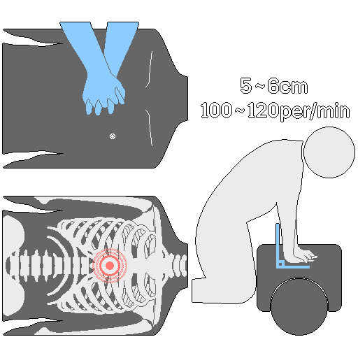
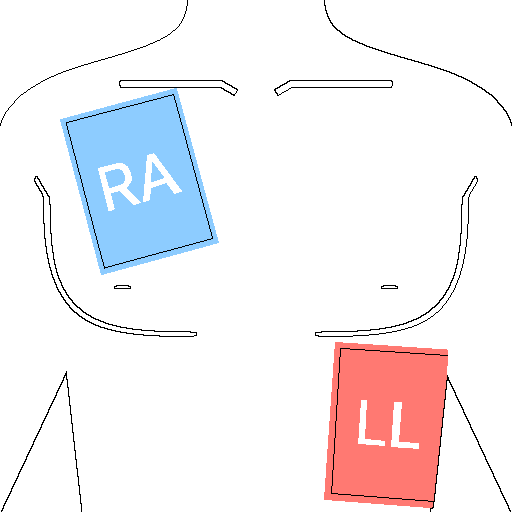
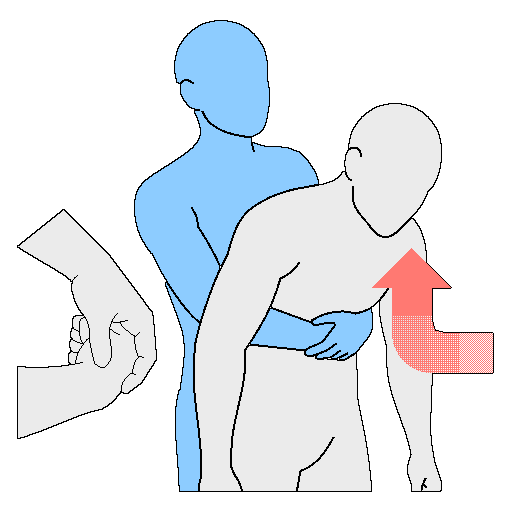

# 急救
> **注意：**本文档仅供教育和参考，不能取代专业医护人员的诊疗。遇到紧急情况，请尽快拨打119（或当地救援电话）。针刺减压、给药等部分处置只能由接受过医疗培训的人员实施。

---
## 1. 概述与基本原则
&nbsp;&nbsp;&nbsp;在灾难、战争、极端环境等严重紧急情况下，目标是在获得专业医护人员帮助之前维持生命，防止伤情恶化。急救不是治疗，而是支撑伤者坚持到获救的技术。即使情况好转，也一定要就医。

---
### 1-1. 处置前的注意事项
- 伤者有意识时，说明将要实施的处置并征得同意。伤者无意识或生命危急时，不必征得同意，立即处置。
- 情况危险或无法判断时，优先确保自身安全并迅速报警，而不是勉强处置。

---
### 1-2. 基本原则
| 原则 | 内容 |
| --- | --- |
| 确保安全 | 施救者自身的安全优先。先勘察现场，确认触电、火灾、坍塌、有害气体等危险因素，再接近伤者 |
| 报警与协作 | 立即报警，并向周围的人提出具体的求助。向119（或当地救援电话）清楚说明伤者的状态、位置和已实施的处置，并指定具体的人承担“去拿AED”“换手”等任务 |
| 伤者管理 | 先确认意识、气道、呼吸和脉搏，再进行急救。不要给无意识的伤者喂饮料。脱掉湿衣服，用毯子保暖 |

---
## 2. 创伤处置的优先顺序：M.A.R.C.H.
&nbsp;&nbsp;&nbsp;这是在军事和灾难环境中按优先顺序处理伤情的方法。

| 顺序 | 步骤 | 内容 |
| :---: | --- | --- |
| 1 | M - Massive Bleeding | 大出血 |
| 2 | A - Airway | 开放气道 |
| 3 | R - Respiration | 呼吸与胸部损伤 |
| 4 | C - Circulation | 循环与休克管理 |
| 5 | H - Head injury / Hypothermia | 头部损伤与低体温症 |

---
### 2-1. Massive Bleeding（大出血）
&nbsp;&nbsp;&nbsp;大出血对生命的威胁最快。用止血带（Tourniquet）和伤口填塞（Wound Packing）迅速止血是重中之重。

#### 2-1-1. 止血带
&nbsp;&nbsp;&nbsp;四肢（手臂、腿）严重出血、仅靠直接压迫无法止血时使用。

1. 避开关节，放在从出血部位向心脏方向约5-7cm处。情况危急时，先隔着衣服在肢体最高处上带，之后再重新调整。
2. 把魔术贴带穿过扣环，用力拉紧固定。
3. 转动绞棒，直到出血完全止住。
4. 把绞棒卡进固定扣，整理好剩余的带子。
5. 一定要记录上带时间。
6. 出血仍未止住时，在第一条止血带的正上方（靠近心脏一侧）再加一条。
7. 不要在现场擅自松开。

#### 2-1-2. 伤口填塞（Wound Packing）
&nbsp;&nbsp;&nbsp;用于无法使用止血带的部位（腹股沟、颈部、腋窝等）的穿透伤出血。

1. 把纱布的一端卷成小球状。
2. 把纱布深深塞进出血最严重的深处。
3. 换手指时也要注意保持压力，把伤口内部填紧。
4. 填塞完成后，用双手用力按压至少3分钟。
5. 确认出血止住后，用加压绷带固定。

---
### 2-2. Airway（开放气道）
- 伤者有意识且能说话，就视为气道通畅。伤者无意识或呼吸有问题时，立即开放气道。
- 怀疑颈椎损伤时，托起下颌。如果判断呕吐、气道梗阻的风险大于颈椎损伤的风险，则优先开放气道，而不是固定颈椎。
- 伤者无意识或难以使用口咽通气管（OPA）时，插入鼻咽通气管（NPA）。
- 没有NPA，或有颅骨、面部骨折，或严重鼻出血时，让伤者侧卧成复苏体位（恢复体位）来保持气道通畅。

---
### 2-3. Respiration（呼吸与胸部损伤）
&nbsp;&nbsp;&nbsp;胸部损伤（枪伤、刺伤等）引起的张力性气胸（Tension Pneumothorax）危及生命，要立即处置。

#### 2-3-1. 开放性气胸
1. 找到胸部的伤口。
2. 用密封敷料（Chest Seal）阻止空气进入。
   - 优先使用带排气阀（vented）的密封敷料。
   - 没有带排气阀的，就完全密封；出现张力性气胸迹象时，暂时掀开敷料的一侧放出压力。
   - 只有在两者都没有时，才作为临时办法使用三边封闭（three-sided seal）。

#### 2-3-2. 张力性气胸
- 迹象：持续的呼吸困难、胸部左右运动不对称、脉搏减弱，以及（并非低血容量性休克却出现的）颈静脉怒张（JVD）
- 针刺减压（NCD）如果操作不当，可能对肺、心脏和主要血管造成致命损伤，因此只能由接受过医疗培训的专业人员实施。
- 按教范，针刺减压的位置是锁骨中线第2肋间或腋前线第5肋间。插入针头释放胸腔内压力后，肺会重新膨胀，心脏的血液循环得以恢复。

---
### 2-4. Circulation（循环与休克管理）
&nbsp;&nbsp;&nbsp;再次确认所有止血处置是否有效，并识别休克迹象，以维持循环。

| 休克迹象 | 内容 |
| :---: | --- |
| 颜色 | 苍白或发青 |
| 状态 | 皮肤冰凉、湿冷 |
| 温度 | 体温下降 |

| 休克阶段 | 内容 |
| :---: | --- |
| 代偿性休克 | 通过加快心率来设法维持血压的阶段 |
| 失代偿性休克 | 失血过多、身体再也无法支撑的严重状态 |

1. 让伤者平躺，把双腿抬高到离地15-30cm。如果有明显的骨盆、腹部、胸部、脊柱损伤，抬腿可能加重内出血，因此不要抬。
2. 立即脱掉湿衣服，用毯子或衣物保暖。
3. 伤者无意识时，不要喂任何东西，并把头转向一侧，避免气道堵塞。
4. 每10分钟检查一次脉搏、血压和呼吸。大出血的伤者要缩短检查间隔。

---
### 2-5. Head injury / Hypothermia（头部损伤与低体温症）
- 瞳孔散大、熊猫眼（浣熊眼）、耳朵或鼻子流出清亮液体（脑脊液），是头部损伤的迹象。可能伴有脊柱损伤，因此要固定头部和颈部后再转运。
- 严重创伤的伤者会因出血和休克使体温急剧下降，这会引起凝血障碍，使出血加重。

&nbsp;&nbsp;&nbsp;低体温症的处置：

1. 转移到温暖的地方，脱掉湿衣服。
2. 用毯子或保温毯包裹全身，给头部戴上兜帽或帽子，防止热量散失。
3. 严重创伤的伤者因要为手术做准备且有误吸风险，绝对禁止经口进食。只有低体温较轻、且没有外伤时，才允许少量饮用温热饮料。

---
## 3. 心肺复苏（CPR）

- 心搏骤停患者的存活率取决于4分钟内是否实施了正确的CPR。超过10分钟，脑损伤和死亡的可能性会急剧上升。同时使用自动体外除颤器（AED），存活率能提高一倍以上。
- 按压速度为每分钟100-120次，按压与人工呼吸的比例为30:2。
- 胸外按压的中断要尽量控制在10秒以内，每次按压后让胸廓完全回弹。

---
### 3-1. 不同对象的操作步骤
| 类别 | 确认反应 | 手的位置与按压深度 | 单人施救时 | 人工呼吸 |
| --- | --- | --- | --- | --- |
| 成人 | 拍打双肩并问“你还好吗？” | 双手十指交叉，放在胸部中央（胸骨下半部）。约5-6cm | 立即拨打119（或当地救援电话），再做CPR | 建议进行，但对普通人来说，只做胸外按压也有效 |
| 儿童（1岁至青春期） | 拍打双肩 | 单手，放在胸部中央。约为胸廓厚度的1/3（约5cm） | 先做2分钟CPR，再拨打119 | 多为呼吸原因导致心搏骤停，所以一定要30:2 |
| 婴儿（不满1岁） | 拍打脚底 | 两根手指，放在胸部中央。约为胸廓厚度的1/3（约4cm） | 先做2分钟CPR，再拨打119 | 多为呼吸原因导致心搏骤停，所以一定要30:2 |

&nbsp;&nbsp;&nbsp;通用步骤：

1. 确认危险因素，确保安全后再接近。
2. 确认反应（按上表）。
3. 没有反应时，指定周围的人求助。例如：“那位穿黑衣服的，请拨打119！”“那位穿白衣服的，请把AED拿来！”如果只有自己一人，就用手机免提与119通话并同时进行。
4. 观察胸部起伏，在10秒内确认呼吸。异常呼吸（包括喘息样呼吸）视为没有呼吸。
5. 有呼吸就改为复苏体位，没有就开始胸外按压。
6. 重复30:2，直到急救人员到达或伤者恢复。

---
### 3-2. 人工呼吸
1. 使头后仰、抬起下颌，开放气道。
2. 捏住鼻子（婴儿则同时罩住口鼻，头保持中立位），吹气1秒，吹到胸部隆起为止。
3. 为防止感染，建议使用人工呼吸面罩或面部防护罩。

---
### 3-3. 自动体外除颤器（AED）的使用方法

1. 一拿到就立刻开机，按语音提示操作。不要中断CPR，同时做好准备。
2. 把电极片贴在右锁骨下方和左腋下的侧胸。婴儿贴在胸部中央（前）和背部（后）（前后位贴法）。条件允许时使用儿童电极片或能量衰减器，没有的话使用成人电极片，但要让电极片互不接触。
3. 听到“请勿接触患者”的提示后，离开患者身边。
4. 按下放电按钮前，大喊“离开！”，让所有人都离开。充电完成后，按下放电按钮。
5. 如果检测到心跳，就改为复苏体位。没有检测到，则在放电后立即恢复CPR，并继续按语音指示操作。

---
### 3-4. 注意事项
- 施救者每2分钟换手一次，防止因疲劳导致按压深度下降。
- 有多名伤者时，优先处理没有呼吸的人。
- 在低温环境中，遵循“冰冷但未死亡”的原则，考虑持续CPR直到体温恢复。
- 在狭窄空间或车内，尽量把伤者移到平坦的地面上。
- 大出血、严重创伤的伤者，控制无法控制的出血优先于CPR。

---
## 4. 不同情形的急救
### 4-1. 外伤与出血
| 类型 | 特点 | 处置 |
| :---: | --- | --- |
| 擦伤 | 刮擦造成的伤口。出血少，但有感染风险 | 用流水冲洗、消毒后包扎 |
| 切割伤 | 割伤。根据深度，出血可能很多 | 用干净纱布直接压迫5分钟以上 |
| 刺伤 | 刺入的伤口。有损伤神经、血管的风险 | 不要强行拔出扎入的物体，原样保护后转运 |
| 咬伤 | 咬出的伤口。有口腔细菌感染的风险 | 根据伤口情况到医院治疗 |

&nbsp;&nbsp;&nbsp;大出血时的快速措施：

1. 用手、布或纱布用力直接压迫患处。
2. 持续压迫10分钟以上。
3. 出血不止时，仅在手臂、腿部使用止血带。
4. 在伤口靠心脏一侧（约上方5-7cm处）上带，并记录时间。

- 一般止血时，把出血部位抬到高于心脏的位置，有助于减少出血。
- 不要取下凝固的血块。
- 撒止血药或涂药膏会妨碍医院的处置，所以不要这样做。

---
### 4-2. 烧伤与热损伤
> **注意：**不要挑破水泡，不要强行撕下粘住的衣物或物质，不要把冰直接放在患处。涂抹油、大酱、酱油、牙膏、乳液、药膏等民间偏方会增加感染风险。

- 怀疑休克时，让伤者躺下并稍微抬高双腿。用毯子保暖，只有在意识清醒且没有呕吐时，才少量喂水。

| 类别 | 特点 | 处置 |
| :---: | --- | --- |
| 一度 | 表皮损伤。发红、疼痛，没有水泡 | 用流动的冷水降温后包扎、保湿 |
| 二度 | 损伤到真皮。有水泡、剧痛 | 不要挑破水泡，降温后保护。防备疼痛引起的休克 |
| 三度 | 损伤到皮下组织。疼痛迟钝或无痛（需要植皮） | 降温时间要短，立即用干净的布盖住并保暖，转送医院 |

&nbsp;&nbsp;&nbsp;通用烧伤处置：

1. 远离热源，迅速取下烧伤部位的衣物和饰品（戒指、手表等）。粘在皮肤上的衣物要用剪刀剪开，不要强行撕下。
2. 用流动的凉水（约18-20℃）或生理盐水降温约15-20分钟。不要直接用冰。大面积、重度烧伤有低体温风险，不要过度降温。
3. 用烧伤专用敷料和干净纱布覆盖，但不要加压。

---
### 4-3. 肌肉骨骼损伤：R.I.C.E.
| 项目 | 行动 |
| :---: | --- |
| Rest（休息） | 让受伤部位不要活动，用舒服的姿势休息 |
| Ice（冰敷） | 仅为缓解早期肿胀和疼痛，用冰等冷物冰敷约15分钟。长时间冰敷会延缓恢复 |
| Compression（加压） | 用夹板或弹性绷带固定患处。绷带按从远离心脏的一端到靠近心脏的一端的顺序缠绕 |
| Elevation（抬高） | 为促进循环、减轻肿胀和疼痛，用枕头把患处垫到高于心脏的位置 |

- 骨折时，不要强行复位或把断骨塞回去。
- 夹板的长度至少要包括骨折部位两侧的关节。
- 上夹板后每30分钟观察一次血液循环，循环不好就放松调整。

---
### 4-4. 气道梗阻（窒息）

- 问：“是不是有东西卡在喉咙里了？”如果说不出话并用手抓住脖子，就是完全梗阻。如果自己在咳嗽，说明没有完全堵住，要鼓励其咳嗽。
- 婴儿有腹腔内脏器损伤的风险，不要做腹部冲击（海姆立克法）。

**婴儿（不满1岁）**

1. 用一只手托住婴儿的下颌和颧骨，让婴儿趴在大腿上，头低于身体。
2. 用掌根在两侧肩胛骨中间用力拍背5次。
3. 托住下颌和后脑勺，把婴儿翻转过来。
4. 把两根手指放在两乳头连线中点正下方的胸骨上，快速有力地按压5次。
5. 重复拍背和胸部按压，直到异物排出。

**成人与儿童**

1. 站在伤者身后，把一条腿插到伤者两腿之间来支撑。
2. 把一只拳头的拇指一侧抵在肚脐与心窝之间。
3. 用另一只手包住拳头，向后上方（斜向上）用力冲击。
4. 重复到异物排出或伤者失去意识为止。失去意识后改做CPR。

**独自一人时**

1. 尝试用咳嗽排出。
2. 不行的话，把拳头放在肚脐上方、肋骨下方，用另一只手包住，用力向上冲击。
3. 仍然不行，就把上腹部抵在椅子、桌子等固定物体的边角上，借助体重按压。

---
### 4-5. 断肢
&nbsp;&nbsp;&nbsp;用干净的纱布或布料对断肢处用力直接压迫，并抬高到高于心脏的位置。断离的肢体按以下方法处理。

1. 用生理盐水或干净的水轻轻冲洗，去除异物。
2. 用生理盐水浸湿的干净布包裹断离的肢体。
3. 装入塑料袋或密封容器中密封。
4. 把密封好的袋子放进装有冰和水的容器里。不要让断离的肢体直接接触冰。
5. 在4-6小时内转送到能做再植手术的医院。

---
### 4-6. 触电
1. 切断电源。切断前不要接触伤者。
2. 无法关闭电源时，用干燥的木棍或橡胶手套等绝缘体把伤者与电源分开。
3. 如果没有呼吸或脉搏，立即做CPR，AED到达后使用。

---
### 4-7. 窒息事故（缺氧、有害气体）
1. 施救者佩戴空气呼吸器或送风面罩等防护装备。
2. 进入窒息事故区域，立即通风。
3. 把伤者转移到空气安全的地方。
4. 无意识的伤者要开放气道，呼吸微弱或没有脉搏时，在做CPR的同时供应高浓度氧气。

---
## 5. 环境与咬蜇伤
### 5-1. 与热相关的疾病
| 类别 | 意识 | 出汗 | 体温 | 危险程度 |
| --- | --- | --- | --- | --- |
| 热痉挛 | 正常 | 多 | 正常至略高 | 低 |
| 热衰竭（日射病） | 可能略有下降 | 多 | 37℃以上 | 中等 |
| 热射病 | 意识模糊至无意识 | 无或有 | 40℃以上 | 非常危险 |

&nbsp;&nbsp;&nbsp;通用处置：

1. 立即转移到阴凉处、室内、地下等凉爽的地方。
2. 往身上洒水并扇风，通过蒸发降温。
3. 只有在意识清醒时，才用加了盐和糖的水补充水分和电解质。

- 热痉挛：停止活动，让其充分休息。补充水分和电解质，并同时拉伸痉挛的部位。如果痉挛伴有头晕和呕吐，可能发展为热衰竭。
- 热衰竭：让其躺在阴凉处，稍微抬高双腿。呕吐时转向侧卧以保持气道通畅，用湿毛巾擦拭颈部、腋下、腹股沟等大血管部位，通过蒸发降温。只有在意识清醒时，才反复少量喂水。
- 热射病：降温是最优先的。在拨打119的同时，立即把伤者浸入冷水，或盖上湿布并扇风。重点冷却颈部、腋下、腹股沟，持续观察呼吸和脉搏，一旦停止就开始做CPR。不要强行灌水，也不要使用退烧药。

---
### 5-2. 被蛇咬伤时
&nbsp;&nbsp;&nbsp;毒蛇（主要是蝮蛇类）的毒液大多通过血液和淋巴系统扩散。应对的目标不是清除毒液，而是减缓扩散。活动越多毒液扩散越快，所以要尽量减少活动，并固定患处。

> **注意：**不要用嘴吸毒、用刀切开伤口、用止血带勒紧、电击、直接敷冰、饮酒、奔跑或活动，也不要涂抹大酱或烟灰。

&nbsp;&nbsp;&nbsp;只要出现剧烈疼痛、急剧肿胀、水泡、坏死、头晕、呕吐、视物模糊、呼吸困难中的任何一项，就视为毒蛇咬伤。

1. 立即远离蛇，拉开距离，并拨打119（或当地救援电话）。
2. 让伤者躺下并安抚，降低心率。
3. 为应对肿胀，事先取下戒指、手表、紧身衣物等。
4. 用流水轻轻冲洗被咬部位，不要揉搓。
5. 在距被咬部位向心脏方向约5-10cm处，垫上折厚的纱布，用绷带缠绕到刚好能插进一根手指的松紧程度，只是减缓淋巴和静脉的流动。千万不要勒紧，以免连动脉也被压住。用夹板固定。
6. 让被咬部位略低于心脏或与心脏同高。
7. 如果意识清醒且没有呕吐，少量喂水并保暖，预防休克。
8. 尽量用担架转移。在长距离孤立无援时，等待救援可能比勉强移动更安全。

---
### 5-3. 被蜂蜇伤时
&nbsp;&nbsp;&nbsp;大多数情况下只是局部疼痛，但有一部分会发展为严重的全身性过敏性休克（过敏反应）。监测全身反应与拔除蜂刺同样重要。

- 为减少蜂群的攻击，要避免使用香水和穿颜色鲜艳（花哨）的衣服。
- 蜂群攻击时，最有效的办法是迅速逃到远处。不要为了赶走蜜蜂而反击，也不要躲进水里屏住呼吸。

1. 蜜蜂会用信息素招引更多同伴进攻，所以要迅速离开有很多蜜蜂的地方。
2. 蜂刺的毒囊会持续注入毒液，所以要尽快用卡片、指甲等坚硬而平整的东西像刮擦一样顺着皮肤推出，拔掉蜂刺。如果用镊子夹蜂刺，可能会挤压毒囊，使剩余的毒液一下子全部进入体内。
3. 用肥皂和干净的水清洗患处，把冰用布包住冷敷。
4. 即使发痒，为预防感染也不要抓挠。
5. 怀疑出现全身症状（头晕、快要晕倒的感觉等）时，让伤者躺下并抬高双腿，防备休克。有呼吸困难时，把上半身稍微垫高。

&nbsp;&nbsp;&nbsp;过敏反应的症状：嘴唇、舌头、喉咙肿胀，全身荨麻疹，呼吸困难，声音嘶哑，意识下降，血压降低，嘴唇、舌头、指尖发绀

1. 立即让伤者躺下并抬高双腿，预防低血压性休克。有呼吸困难时，把上半身垫高。
2. 立即在大腿上注射肾上腺素自动注射器（EpiPen等）。
3. 无意识时，让伤者侧卧以保持气道通畅。
4. 持续检查呼吸和脉搏，必要时做CPR。

---
## 6. 伤员分类（检伤分类）
&nbsp;&nbsp;&nbsp;灾难情况下伤员分类的目的，是最有效地分配有限的医疗资源，尽可能多地挽救生命。

### 6-1. START分类体系
&nbsp;&nbsp;&nbsp;START（Simple Triage and Rapid Treatment）在现场60秒内评估伤员，并分成4种颜色。

#### 6-1-1. 第一次分类：能否行走
&nbsp;&nbsp;&nbsp;喊话：“能走的人请到这边来。”

- 能行走：绿色（非紧急）。把他们转移到安全的地方。
- 不能行走：在现场按呼吸、循环、意识（RPM）的顺序评估。

#### 6-1-2. 第二次分类：RPM评估
| 项目 | 标准 | 结果 |
| --- | --- | --- |
| Respiration | 开放气道后仍无呼吸 | 黑色（死亡） |
| | 每分钟呼吸超过30次 | 红色（危急） |
| | 每分钟呼吸30次以下 | 进入下一步（P） |
| Perfusion | 桡动脉无搏动，或CRT（毛细血管再充盈时间）超过2秒 | 红色（危急） |
| | 桡动脉有搏动且CRT在2秒以内 | 进入下一步（M） |
| Mental | 无法执行简单指令 | 红色（危急） |
| | 能执行简单指令 | 黄色（紧急） |

### 6-2. 分类标签（Triage Tag）颜色
| 颜色 | 分类 | 含义与优先顺序 |
| :---: | :---: | --- |
| 红色 | 危急 | 生命受到威胁，需要立即处置和转运（气道梗阻、休克、严重出血） |
| 黄色 | 紧急 | 伤情严重，但在1-2小时内处置就不会危及生命（开放性骨折、轻度烧伤） |
| 绿色 | 非紧急 | 伤势轻微，或能自行行走，数小时后再处置也无妨（擦伤、轻微扭伤） |
| 黑色 | 死亡/无生存希望 | 已经死亡，或在大规模灾难、资源极度匮乏的情况下，以有限的资源无法复苏（心搏骤停、致命的头部损伤） |