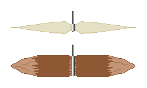

## 2. Нить и крючки
&nbsp;&nbsp;&nbsp;Почти все виды снастей — сети, обвязка верш, ярусы — начинаются с нити. Без нити рыбалка ограничена голыми руками и острогой, поэтому умение делать нить из природных материалов — узкое место всей рыболовной техники.

---
### 2-1. Как волокно становится нитью
&nbsp;&nbsp;&nbsp;Из стеблей растений можно использовать луб — волокна сразу под корой. Это длинные пучки целлюлозы, которые растение создало, чтобы стоять самому, поэтому одна нить тонка, но прочна на разрыв вдоль длины. Однако волокна короткие и концы у них гладкие, поэтому если просто соединить их, они выскальзывают.

- Скручивание решает эту проблему трением. Каждые две пряди скручивают в одну сторону, а затем эти две обвивают друг вокруг друга в противоположную сторону (обратное кручение). Сила, с которой каждая прядь стремится раскрутиться, превращается в силу, стягивающую другую, и нить сама себя удерживает. Если оба направления одинаковы, нить просто раскручивается. Кручение увеличивает силу нормального давления между волокнами, а с ней и трение, поэтому волокна не скользят и делят нагрузку.
- У степени кручения есть оптимум. Если её не хватает, волокна выскальзывают, а если слишком много, волокна располагаются наклонно к оси нити, сила вдоль длины уменьшается, нить становится жёсткой и рвётся на узлах.
- Вплетая новые волокна, делайте это вразбежку, чтобы стыки двух прядей не оказывались в одной точке. Если стыки совпадают, это место становится самым слабым во всей нити, а нить всегда рвётся в самой слабой точке.

| Материал | Заготавливаемая часть | Особенности |
| --- | --- | --- |
| Крапива | Луб стебля | Тонкая и прочная, сравнительно устойчива к воде. Лучше всего после того, как стебли высохнут осенью |
| Конопля | Луб стебля | Традиционно одно из самых прочных растительных волокон. Подходит для толстых верёвок |
| Кудзу | Кора лианы | Можно получить длинную, хороша для толстого шнура на месте, но для тонкой нити груба |
| Бумажная шелковица | Кора ветвей | Волокна длинные и прочные, используется и для бумаги, и для шнура |
| Липа, вяз | Внутренняя кора | Если вымачивать в воде несколько дней, слои расслаиваются и снимаются лентами |
| Кокосовая пальма, пальма | Жилки листьев, оболочка плода | Легко добыть на побережье и на юге, устойчивы к морской воде |
| Рогоз, осока, ситник | Весь лист | Если расщепить на тонкие полосы и скрутить, годится для плетения верш |

&nbsp;&nbsp;&nbsp;Вымачивание внутренней коры в воде несколько дней нужно для того, чтобы микроорганизмы разложили пектин, скрепляющий волокна (мочка). Если вымачивать слишком долго, разлагаются и сами волокна, и при натяжении они рвутся с хлопком. Достаточно, чтобы при соскабливании коры ногтем волокна чисто разделялись на пряди.

---
### 2-2. Нить из животных материалов
&nbsp;&nbsp;&nbsp;Животные нити намного прочнее растительных, но боятся воды.

- Сухожилие: почти чистые пучки коллагеновых волокон, поэтому при той же толщине предел прочности на разрыв в несколько раз выше, чем у растительного волокна. Если намотать мокрым и высушить, оно сжимается и туго стягивает, отлично подходит для крепления наконечников стрел и древков. Впитав воду, оно разбухает и размягчается, поэтому как леска не годится. Его используют для обвязки ловушек, связывания крючков и тетивы лука.
- Кишка (кишечник): если выдавить содержимое, соскоблить внутреннюю слизистую, скрутить и высушить, получается нить, гораздо более стойкая к воде и почти прозрачная, и её можно использовать как леску.
- Ремень из сыромятной кожи: ремень, сделанный нарезкой кожи по спирали, толстый и прочный, но намокнув, вытягивается, а высохнув, снова усаживается, поэтому для рыбалки неудобен.

| Материал нити | Приблизительная относительная прочность | Стойкость к воде | Основное применение |
| --- | :---: | :---: | --- |
| Сухожилие | Очень высокая | Низкая | Обвязка, тетива, связывание крючков |
| Кишка | Высокая | Средняя | Леска, поводки |
| Конопля, крапива | Средняя | Средняя | Леска, сети |
| Внутренняя кора | Средняя | Высокая | Верши, толстые верёвки |
| Кудзу, лианы | Низкая | Высокая | Обвязка сооружений, запоры |
| Ремень из сыромятной кожи | Высокая | Низкая | Обвязка вне воды |

&nbsp;&nbsp;&nbsp;Роли распределяют по толщине. Поводок, который рыба кусает напрямую, должен быть тонким и малозаметным, а нить, фиксирующая всю снасть, — толстой и устойчивой к гниению. Если пытаться решить всё одним видом нити, где-то одно обязательно не получится.

---
### 2-3. Формы крючков
&nbsp;&nbsp;&nbsp;Современные изогнутые рыболовные крючки предполагают обработку металла. Если металл обрабатывать нельзя, используют крючок-распорку (Gorge Hook).

- Устройство: короткий стержень, заострённый с обоих концов, в середину которого привязывают нить.
- Принцип действия: если спрятать его в наживке вдоль нити, то когда рыба проглотит, он пройдёт в горло в положении вдоль нити. Когда нить натягивают, он поворачивается вокруг нити, привязанной посередине, ложится поперёк, и оба конца упираются в горло или стенку желудка, так что не выходит.
- Преимущество: направление нагрузки совпадает с направлением длины материала, поэтому он трудно ломается. У изогнутого крючка в месте изгиба концентрируется напряжение изгиба, и если он сделан из дерева или кости, то ломается именно там, а крючок-распорка получает только осевое сжатие и из того же материала выдерживает гораздо большую силу.
- Изготовление: обработайте твёрдую веточку или кусочек кости до 2-5 см, заострите оба конца и сделайте посередине неглубокую канавку, чтобы привязать нить. Инструментов и времени почти не нужно, поэтому на ярус можно повесить много штук.
- Недостаток: он цепляется, только если потянуть после того, как рыба полностью проглотила. Если подсечь сразу после поклёвки, не получится.

| Форма | Материал | Принцип действия | Сильные и слабые стороны |
| --- | --- | --- | --- |
| Крючок-распорка | Дерево, кость, колючка | После проглатывания ложится поперёк и цепляется | Легко сделать и трудно сломать, но нужно ждать, пока проглотит |
| Колючий крючок | Крупные колючки робинии, боярышника и др. | Впивается в рот в виде крючка | Удобен на месте, но изогнутая часть слабая |
| Костяной крючок | Птичья кость, обломки костей ног | Как у изогнутого крючка | Долго шлифовать и доводить |
| Составной крючок | Деревянное цевьё + кость или колючка на конце | Два материала используются в выгодных для каждого направлениях | Самый прочный, но если обвязка ослабнет, теряется всё |
| Ракушка | Раковина с толстым перламутровым слоем | Отражает свет и приманивает без наживки | Легко ломается, но полезна, когда нет наживки |
| Проволока, гвозди | Металл | Сгибают, формируя даже бородку | Самый надёжный, но при бедствии количество ограничено |

&nbsp;&nbsp;&nbsp;Бородка — небольшой выступ возле острия крючка, сделанный в обратную сторону, и она предотвращает не зацепление, а выскальзывание. Когда крючок прокалывает плоть, она параллельна направлению движения, и сопротивление мало, а когда он пытается выйти, кончик бородки цепляется за плоть, и сопротивление резко растёт. При бедствии упущенную рыбу не вернуть, поэтому ценность бородки велика. Если сделать бородку большой, то и сила, нужная для первого прокола, растёт, и крючок вовсе не цепляется, поэтому делайте её маленькой по сравнению с толщиной крючка.