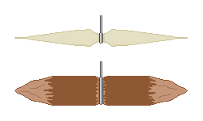

## 2. Line and Hooks
&nbsp;&nbsp;&nbsp;Almost every form of gear, including nets, trap lashings, and longlines, starts from line. Without line, fishing is limited to bare hands and spears, so the ability to make line from nature is the bottleneck of all fishing skill.

---
### 2-1. How Fiber Becomes Thread
&nbsp;&nbsp;&nbsp;What is usable from plant stems is the bast fiber just inside the bark. These are long bundles of cellulose that the plant made to stand upright, so even a single strand is thin but strong against tension along its length. But the fibers are short and the ends are smooth, so if you simply join them, they slip out.

- Twisting solves this problem with friction. Twist each of two strands in the same direction, then wind the two around each other in the opposite direction (reverse twist). The force of each strand trying to untwist turns into a force that squeezes the other, so the line holds itself. If the two directions are the same, the line simply unravels. The twist increases the normal force between fibers and so also the friction, so the fibers do not slip and share the load.
- The amount of twist has an optimum. If too little, the fibers slip out; if too much, the fibers become oblique to the axis of the line, the force along the length decreases, and the line becomes stiff and breaks at knots.
- When splicing in new fibers, stagger them so the splices of the two strands do not come at the same point. If the splices overlap, that spot becomes the weakest in the whole line, and a line always breaks at its weakest point.

| Material | Part harvested | Characteristics |
| --- | --- | --- |
| Nettle | Stem bast | Thin and tough, relatively resistant to water. Best after the stems dry in autumn |
| Hemp | Stem bast | Traditionally one of the strongest plant fibers. Suited to thick line |
| Kudzu | Vine bark | Can be obtained in long lengths and good for thick cord on the spot, but too coarse for fine thread |
| Paper mulberry | Branch bark | Fibers are long and strong, used for both paper and cord |
| Linden, elm | Inner bark | Soaked in water for a few days, the layers separate and peel off in strips |
| Coconut palm, palm | Leaf veins, fruit husk | Easy to get on coasts and in the south, and resistant to seawater |
| Cattail, sedge, rush | Whole leaf | Torn thin and twisted, they are useful for weaving fish traps |

&nbsp;&nbsp;&nbsp;Soaking inner bark in water for a few days lets microorganisms break down the pectin holding the fibers (retting). If soaked too long, even the fibers themselves break down and snap when pulled. It is enough when you scrape the bark with a fingernail and the fibers separate cleanly into strands.

---
### 2-2. Line from Animals
&nbsp;&nbsp;&nbsp;Animal line is far stronger than plant line but weak in water.

- Sinew: Almost pure bundles of collagen fiber, so its tensile strength is several times that of plant fiber of the same thickness. Wound on wet and dried, it shrinks and binds tightly, excellent for fixing arrowheads and shafts. It swells and softens when it takes up water, so it is unsuitable as fishing line. It is used for trap lashings, hook bundles, and bowstrings.
- Gut (intestine): After stripping the contents and scraping off the inner mucosa, twisting and drying it makes a line much more resistant to water and nearly transparent, usable as fishing line.
- Rawhide thong: A thong made by cutting hide in a spiral is thick and strong, but it stretches when wet and shrinks again when dry, which is inconvenient for fishing.

| Line material | Approximate relative strength | Resistance to water | Main use |
| --- | :---: | :---: | --- |
| Sinew | Very high | Low | Lashing, bowstrings, hook bundles |
| Gut | High | Medium | Fishing line, leaders |
| Hemp, nettle | Medium | Medium | Fishing line, nets |
| Inner bark | Medium | High | Fish traps, thick line |
| Kudzu, vines | Low | High | Lashing structures, weirs |
| Rawhide thong | High | Low | Lashing out of water |

&nbsp;&nbsp;&nbsp;Divide roles by thickness. The leader that fish bite directly must be thin and less conspicuous, and the line that anchors the whole gear must be thick and resistant to rot. If you try to solve everything with one kind of line, it fails on one side.

---
### 2-3. Hook Forms
&nbsp;&nbsp;&nbsp;Modern curved fishhooks assume metalworking. If you cannot work metal, use a gorge hook.

- Structure: A short rod pointed at both ends, with the line tied at the very center.
- Operation: Hidden in the bait, aligned with the line, it passes down the throat in an aligned posture when the fish swallows it. When the line is pulled, it rotates about the line tied at the center and lies crosswise, and both ends catch in the throat or stomach wall so it does not come out.
- Advantage: The direction of the force matches the lengthwise direction of the material, so it is hard to break. A curved hook concentrates bending stress at the bend and breaks there when made of wood or bone, but a gorge hook receives only axial compression and withstands much more force from the same material.
- Making: Trim a hard twig or bone piece to 2-5 cm, sharpen both ends, and cut a shallow groove in the middle to tie the line. It takes almost no tools or time, so many can be hung on a longline.
- Disadvantage: It catches only if pulled after the fish has fully swallowed it. Setting the hook right after a bite fails.

| Form | Material | Principle of operation | Strengths and weaknesses |
| --- | --- | --- | --- |
| Gorge hook | Wood, bone, thorn | Lies crosswise after being swallowed and catches | Easy to make and hard to break, but you must wait until it is swallowed |
| Thorn hook | Large thorns of black locust, hawthorn, etc. | Embeds in the mouth in hook form | Good for improvising, but the curved part is weak |
| Bone hook | Bird bone, leg bone pieces | Same as a curved hook | Takes a long time to grind and shape |
| Composite hook | Wooden shank + bone or thorn tip | Uses the two materials each in its favorable direction | The strongest, but if the lashing comes loose, everything is lost |
| Shell | Shell with a thick nacre layer | Reflects light and lures without bait | Breaks easily, but useful when there is no bait |
| Wire, nails | Metal | Bent to form even a barb | The most reliable, but quantities are limited in a disaster |

&nbsp;&nbsp;&nbsp;A barb is a small projection made near the point of the hook in the opposite direction, and it prevents not catching but slipping out. When piercing flesh it is parallel to the direction of travel so resistance is small, and when it tries to come out the barb tip catches in the flesh and resistance rises sharply. In a disaster a lost fish cannot be recovered, so the value of the barb is great. If you make the barb large, the force needed for the first penetration also grows and the hook does not set at all, so make it small relative to the thickness of the hook.