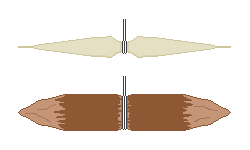

## 2. 糸と針
&nbsp;&nbsp;&nbsp;網、筌の結束、延縄など、漁具のほとんどすべての形が糸から出発します。糸がなければ釣りは素手と銛に限られるので、自然の中で糸をつくる能力が、釣りの技術全体のボトルネックです。

---
### 2-1. 繊維が糸になる原理
&nbsp;&nbsp;&nbsp;植物の茎で使えるのは、樹皮のすぐ内側にある靭皮繊維です。植物が自ら立つためにつくった長いセルロースの束なので、1本は細くても、長さ方向の引っ張りに強いものです。しかし繊維が短く先端が滑らかなため、そのままつないでも滑って抜けます。

- 撚りは、この問題を摩擦で解決します。2本をそれぞれ同じ方向に撚り、その2本を反対方向に互いに巻きつけます(逆撚り)。それぞれの撚り糸がほどけようとする力が、相手を締める力に変わり、糸が自らを捕まえます。2つの方向が同じなら、糸はそのままほどけます。撚りが繊維の間の垂直抗力を大きくして摩擦力も大きくなり、繊維が滑らずに力を分担して受けます。
- 撚りの程度には最適点があります。足りないと繊維が滑って抜け、過ぎると繊維が糸の軸に対して斜めになって長さ方向の力が減り、糸が硬くなって結び目で切れます。
- 新しい繊維を継ぎ足すときは、2本の継ぎ目が同じ位置に来ないようにずらして入れます。継ぎ目が重なると、その場所が糸全体で最も弱くなり、糸はいつも最も弱い点で切れます。

| 材料 | 採取する部位 | 特徴 |
| --- | --- | --- |
| イラクサ | 茎の靭皮 | 細くて強靭で、水に比較的強い。秋に茎が枯れた後が最良 |
| 麻(アサ) | 茎の靭皮 | 伝統的に最も強い植物繊維の1つ。太い糸に適する |
| クズ | つるの皮 | 長く得られ、その場で太い縄として使いやすいが、細い糸としては粗い |
| コウゾ | 枝の皮 | 繊維が長くて強く、紙と縄の両方に使われる |
| シナノキ、ニレ | 内皮 | 水に数日浸けておくと層が分離し、帯状にはがれる |
| ヤシ、シュロ | 葉脈、果実の皮 | 海岸と南部で手に入りやすく、海水に強い |
| ガマ、カヤツリグサ類、イグサ | 葉全体 | 細く裂いて撚ると、筌を編むのに使える |

&nbsp;&nbsp;&nbsp;木の内皮を水に数日浸けておくのは、繊維をつなぎ止めているペクチンを微生物に分解させるためです(浸水発酵)。長く浸けすぎると、繊維そのものまで分解され、引っ張るとぷつんと切れます。皮を爪でこすって、繊維が束できれいに分かれれば十分です。

---
### 2-2. 動物から得る糸
&nbsp;&nbsp;&nbsp;動物性の糸は、植物性よりはるかに強い一方、水に弱いものです。

- 腱: ほぼ純粋なコラーゲン繊維の束なので、同じ太さで植物繊維より引っ張り強度が何倍も高くなります。濡れた状態で巻いて乾かすと、収縮して固く締まり、矢じりと柄の固定に優れています。水を吸うと膨らんで柔らかくなるため、釣り糸には不向きです。罠の結び目、針の束ね、弓の弦に使います。
- 腸(腸管): 内容物をしごき出し、内側の粘膜をこそげ取った後に、撚って乾かすと、水にはるかに強く、透明に近くなって、釣り糸として使えます。
- 生皮のひも: 皮を螺旋状に切ってつくったひもは、太くて丈夫ですが、濡れると伸び、乾くとまた縮むため、釣りには不便です。

| 糸の材料 | おおよその相対強度 | 水への抵抗 | 主な用途 |
| --- | :---: | :---: | --- |
| 腱 | 非常に高い | 低い | 結束、弓の弦、針の束ね |
| 腸 | 高い | 中程度 | 釣り糸、ハリス |
| 麻、イラクサ | 中程度 | 中程度 | 釣り糸、網 |
| 木の内皮 | 中程度 | 高い | 筌、太い糸 |
| クズ、つる | 低い | 高い | 構造物の結束、簗 |
| 生皮のひも | 高い | 低い | 水の外での結束 |

&nbsp;&nbsp;&nbsp;太さによって役割を分けます。魚が直接かみつくハリスは細くて目立たないことが必要で、漁具全体を固定する糸は、太くて腐りにくいことが必要です。1種類の糸ですべて解決しようとすると、どちらか一方で失敗します。

---
### 2-3. 針の形
&nbsp;&nbsp;&nbsp;現代の曲がった釣り針は、金属加工を前提とします。金属を扱えなければ、ゴージフック(Gorge Hook)を使います。

- 構造: 両端が尖った短い棒で、真ん中に糸を結びます。
- 作動: 糸と並行な向きで餌の中に隠しておくと、魚が飲み込むときに、糸と並行な姿勢で喉を通過します。糸を引くと、真ん中に結んだ糸を軸に回転して横に倒れ、両端が喉や胃壁に引っかかって抜けません。
- 利点: 力のかかる方向が材料の長さ方向と一致するので折れにくくなります。曲がった針は、曲がった地点に曲げ応力が集中するため、木や骨でつくるとその場所で折れますが、ゴージフックは軸方向の圧縮だけを受け、同じ材料でもはるかに大きな力に耐えます。
- 製作: 硬い木の枝や骨片を2-5cmに整え、両端を尖らせて、真ん中に浅い溝を入れて糸を結びます。道具も時間もほとんど要らないので、延縄にいくつも吊るせます。
- 欠点: 魚が完全に飲み込んだ後に引かないと掛かりません。当たりがあった直後にすぐ合わせると失敗します。

| 形 | 材料 | 作動の原理 | 強みと弱み |
| --- | --- | --- | --- |
| ゴージフック | 木、骨、とげ | 飲み込んだ後に横に倒れて掛かる | 作りやすく折れにくいが、飲み込むまで待つ必要がある |
| とげ針 | ニセアカシア、サンザシなどの大きなとげ | かぎ形で口に刺さる | その場で使いやすいが、曲がった部分が弱い |
| 骨の針 | 鳥の骨、脚の骨の破片 | 曲がった針と同じ | 磨いて整えるのに時間がかかる |
| 組み合わせ針 | 木の軸 + 骨やとげの先 | 2つの材料をそれぞれ有利な向きで使う | 最も丈夫だが、結束がほどけるとすべて失う |
| 貝殻 | 真珠層が厚い貝殻 | 光を反射し、餌なしで誘う | 折れやすいが、餌がないときに役立つ |
| 針金、釘 | 金属 | 曲げて返しまで形成 | 最も確実だが、災害時には数量に限りがある |

&nbsp;&nbsp;&nbsp;返しは、針先の近くに反対方向につくった小さな突起で、掛かることではなく抜けることを防ぎます。肉を貫いて入るときは進行方向と並行なので抵抗が小さく、抜けようとすると返しの先が肉に引っかかって抵抗が急激に大きくなります。災害時には逃した魚を回収できないので、返しの価値は大きくなります。返しを大きくすると、最初に刺さるのに必要な力も大きくなり、まったく掛からないので、針の太さに比べて小さくつくります。