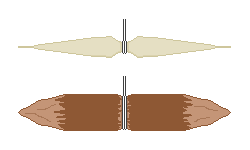

## 2. 줄과 바늘
&nbsp;&nbsp;&nbsp;그물, 통발 결속, 주낙 등 어구의 거의 모든 형태가 줄에서 출발합니다. 줄이 없으면 낚시는 맨손과 작살로 제한되므로, 자연에서 줄을 만드는 능력이 낚시 기술 전체의 병목입니다.

---
### 2-1. 섬유에서 실이 되는 원리
&nbsp;&nbsp;&nbsp;식물 줄기에서 쓸 수 있는 것은 껍질 바로 안쪽의 인피섬유입니다. 식물이 스스로 서기 위해 만든 긴 셀룰로스 다발이라 한 가닥은 가늘어도 길이 방향의 인장력에 강합니다. 그러나 섬유가 짧고 끝이 매끄러워 그냥 이으면 미끄러져 빠집니다.

- 꼬기는 이 문제를 마찰로 해결합니다. 두 가닥을 각각 같은 방향으로 꼬고, 그 둘을 반대 방향으로 서로 감습니다(역꼬임). 각 가닥이 풀리려는 힘이 상대를 조이는 힘으로 바뀌어 줄이 스스로를 붙잡습니다. 두 방향이 같으면 줄이 그냥 풀립니다. 꼬임이 섬유 사이의 수직 항력을 키우고 마찰력도 커져, 섬유가 미끄러지지 않고 힘을 나누어 받습니다.
- 꼬임의 정도에는 최적점이 있습니다. 부족하면 섬유가 미끄러져 빠지고, 지나치면 섬유가 줄의 축에 대해 비스듬해져 길이 방향 힘이 줄고 줄이 뻣뻣해져 매듭에서 끊어집니다.
- 새 섬유를 이어 넣을 때는 두 가닥의 이음매가 같은 지점에 오지 않게 어긋나게 넣습니다. 이음매가 겹치면 그 자리가 줄 전체에서 가장 약해지고, 줄은 언제나 가장 약한 지점에서 끊어집니다.

| 재료 | 채취 부위 | 특징 |
| --- | --- | --- |
| 쐐기풀 | 줄기 인피 | 가늘고 질기며 물에 비교적 강함. 가을에 줄기가 마른 뒤가 가장 좋음 |
| 삼(대마) | 줄기 인피 | 전통적으로 가장 강한 식물 섬유 중 하나. 굵은 줄에 적합 |
| 칡 | 덩굴 껍질 | 길게 얻을 수 있고 즉석에서 굵은 끈으로 쓰기 좋으나 가는 실로는 거침 |
| 닥나무 | 가지 껍질 | 섬유가 길고 강하여 종이와 끈에 함께 쓰임 |
| 피나무, 느릅나무 | 속껍질 | 물에 며칠 담가 두면 층이 분리되어 띠 모양으로 벗겨짐 |
| 야자, 종려 | 잎맥, 열매 껍질 | 해안과 남부에서 구하기 쉽고 바닷물에 강함 |
| 부들, 왕골, 골풀 | 잎 전체 | 가늘게 찢어 꼬면 통발 엮는 데 쓸 만함 |

&nbsp;&nbsp;&nbsp;나무 속껍질을 물에 며칠 담그는 것은 섬유를 붙든 펙틴을 미생물이 분해하게 하기 위해서입니다(침수 발효). 너무 오래 담그면 섬유 자체까지 분해되어 당기면 툭 끊어집니다. 껍질을 손톱으로 긁어 섬유가 가닥으로 깔끔하게 분리되면 충분합니다.

---
### 2-2. 동물에서 얻는 줄
&nbsp;&nbsp;&nbsp;동물성 줄은 식물성보다 훨씬 강하지만 물에 약합니다.

- 힘줄: 거의 순수한 콜라겐 섬유 다발이라 같은 굵기에서 식물 섬유보다 인장강도가 몇 배 높습니다. 젖은 상태로 감아 말리면 수축하며 단단히 조여 화살촉과 자루 고정에 뛰어납니다. 물을 먹으면 부풀어 물러지므로 낚싯줄로는 부적합합니다. 덫의 결착부, 바늘 묶음, 활시위에 씁니다.
- 장(창자): 내용물을 훑고 안쪽 점막을 긁은 뒤 꼬아 말리면 물에 훨씬 강하고 투명에 가까워 낚싯줄로 쓸 수 있습니다.
- 생가죽 끈: 가죽을 나선형으로 오려 만든 끈은 굵고 튼튼하지만 젖으면 늘어지고 마르면 다시 줄어들어 낚시에는 불편합니다.

| 줄 재료 | 대략적인 상대 강도 | 물에 대한 저항 | 주된 용도 |
| --- | :---: | :---: | --- |
| 힘줄 | 매우 높음 | 낮음 | 결착, 활시위, 바늘 묶음 |
| 장 | 높음 | 중간 | 낚싯줄, 목줄 |
| 삼, 쐐기풀 | 중간 | 중간 | 낚싯줄, 그물 |
| 나무 속껍질 | 중간 | 높음 | 통발, 굵은 줄 |
| 칡, 덩굴 | 낮음 | 높음 | 구조물 결속, 어살 |
| 생가죽 끈 | 높음 | 낮음 | 물 밖의 결속 |

&nbsp;&nbsp;&nbsp;굵기에 따라 역할을 나눕니다. 물고기가 직접 무는 목줄은 가늘고 눈에 덜 띄어야 하고, 어구 전체를 고정하는 줄은 굵고 부패에 강해야 합니다. 한 종류의 줄로 전부 해결하려 하면 어느 한쪽에서 실패합니다.

---
### 2-3. 바늘의 형태
&nbsp;&nbsp;&nbsp;현대의 굽은 낚싯바늘은 금속 가공을 전제로 합니다. 금속을 다룰 수 없으면 고지 훅(Gorge Hook)을 씁니다.

- 구조: 양쪽 끝이 뾰족한 짧은 막대이고 한가운데에 줄을 묶습니다.
- 작동: 줄과 나란한 방향으로 미끼 속에 숨겨 두면 물고기가 삼킬 때 줄과 나란한 자세로 목구멍을 통과합니다. 줄을 당기면 가운데 묶인 줄을 축으로 회전해 가로로 눕고, 양쪽 끝이 목구멍이나 위벽에 걸려 빠지지 않습니다.
- 장점: 힘이 걸리는 방향이 재료의 길이 방향과 일치해 부러지기 어렵습니다. 굽은 바늘은 굽은 지점에 굽힘 응력이 집중되어 나무나 뼈로 만들면 그 자리에서 부러지지만, 고지 훅은 축 방향 압축만 받아 같은 재료로도 훨씬 큰 힘을 견딥니다.
- 제작: 단단한 나뭇가지나 뼈 조각을 2-5cm로 다듬고 양끝을 뾰족하게 깎은 뒤 가운데에 얕은 홈을 내어 줄을 묶습니다. 도구와 시간이 거의 들지 않아 여러 개를 주낙에 매달 수 있습니다.
- 단점: 물고기가 완전히 삼킨 뒤에 당겨야 걸립니다. 입질 직후 바로 채면 실패합니다.

| 형태 | 재료 | 작동 원리 | 강점과 약점 |
| --- | --- | --- | --- |
| 고지 훅 | 나무, 뼈, 가시 | 삼킨 뒤 가로로 눕혀 걸림 | 만들기 쉽고 잘 부러지지 않으나 삼킬 때까지 기다려야 함 |
| 가시 바늘 | 아까시, 산사나무 등의 큰 가시 | 갈고리 형태로 입에 박힘 | 즉석에서 쓰기 좋으나 굽은 부위가 약함 |
| 뼈 바늘 | 새 뼈, 다리뼈 조각 | 굽은 바늘과 동일 | 갈아서 다듬는 시간이 오래 걸림 |
| 조합 바늘 | 나무 자루 + 뼈나 가시 끝 | 두 재료를 각각 유리한 방향으로 씀 | 가장 튼튼하나 결착이 풀리면 전부 잃음 |
| 조개껍데기 | 진주층이 두꺼운 껍데기 | 빛을 반사해 미끼 없이 유인 | 부러지기 쉬우나 미끼가 없을 때 유용 |
| 철사, 못 | 금속 | 구부려 미늘까지 형성 | 가장 확실하나 재난 상황에서는 수량 제한 |

&nbsp;&nbsp;&nbsp;미늘은 바늘 끝 가까이에 반대 방향으로 낸 작은 돌기이며, 걸리는 것이 아니라 빠지는 것을 막습니다. 살을 뚫고 들어갈 때는 진행 방향과 나란해 저항이 작고, 빠져나오려 하면 미늘 끝이 살에 걸려 저항이 급격히 커집니다. 재난 상황에서 놓친 물고기는 회수할 수 없으므로 미늘의 가치가 큽니다. 미늘을 크게 만들면 처음 박히는 데 필요한 힘도 커져 아예 걸리지 않으므로 바늘 굵기에 비해 작게 냅니다.