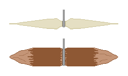

## 2. 줄과 바늘
&nbsp;&nbsp;&nbsp;어구의 거의 모든 형태는 줄에서 출발합니다. 그물도 통발을 묶는 것도 주낙도 줄이 있어야 성립하며, 줄이 없으면 낚시는 맨손과 작살로 제한됩니다. 그래서 자연에서 줄을 만드는 능력은 낚시 기술 전체의 병목입니다.

---
### 2-1. 섬유에서 실이 되는 원리
&nbsp;&nbsp;&nbsp;식물 줄기에서 쓸 수 있는 것은 껍질 바로 안쪽의 인피섬유입니다. 인피섬유는 식물이 스스로 서 있기 위해 만든 긴 셀룰로스 다발이라서, 한 가닥 한 가닥은 가늘어도 길이 방향의 인장력에 강합니다. 문제는 이 섬유가 짧고 끝이 매끄러워 그냥 이으면 미끄러져 빠진다는 점입니다.

&nbsp;&nbsp;&nbsp;꼬기는 이 문제를 마찰로 해결하는 방법입니다. 두 가닥을 각각 같은 방향으로 꼬아 놓고, 그 둘을 반대 방향으로 서로 감으면, 각 가닥이 풀리려는 힘이 상대를 조이는 힘으로 바뀝니다. 이것이 역꼬임이며, 줄이 스스로를 붙잡아 두는 구조입니다. 이때 두 방향이 같으면 줄은 그냥 풀려 버립니다. 꼬임이 만드는 조임은 섬유 사이의 수직 항력을 키우고, 수직 항력이 커지면 마찰력도 커지므로, 섬유가 서로 미끄러지지 않고 힘을 나누어 받게 됩니다.

&nbsp;&nbsp;&nbsp;꼬임의 정도에는 최적점이 있습니다. 꼬임이 부족하면 섬유가 미끄러져 빠지고, 지나치면 각 섬유가 줄의 축에 대해 비스듬해져 길이 방향으로 낼 수 있는 힘이 줄어들고 줄 자체가 뻣뻣해져 매듭에서 끊어집니다. 또한 새 섬유를 이어 넣을 때는 두 가닥의 이음매가 같은 지점에 오지 않도록 어긋나게 넣어야 합니다. 이음매가 겹치면 그 자리가 줄 전체에서 가장 약한 지점이 되고, 줄은 언제나 가장 약한 지점에서 끊어집니다.

| 재료 | 채취 부위 | 특징 |
| --- | --- | --- |
| 쐐기풀 | 줄기 인피 | 가늘고 질기며 물에 비교적 강합니다. 가을에 줄기가 마른 뒤가 가장 좋습니다 |
| 삼(대마) | 줄기 인피 | 전통적으로 가장 강한 식물 섬유 중 하나이며 굵은 줄에 적합합니다 |
| 칡 | 덩굴 껍질 | 길게 얻을 수 있고 즉석에서 굵은 끈으로 쓰기 좋으나 가는 실로는 거칩니다 |
| 닥나무 | 가지 껍질 | 섬유가 길고 강하여 종이와 끈에 함께 쓰입니다 |
| 피나무, 느릅나무 | 속껍질 | 물에 며칠 담가 두면 층이 분리되어 띠 모양으로 벗겨집니다 |
| 야자, 종려 | 잎맥, 열매 껍질 | 해안과 남부에서 구하기 쉽고 바닷물에 강합니다 |
| 부들, 왕골, 골풀 | 잎 전체 | 가늘게 찢어 꼬면 통발 엮는 데 쓸 만합니다 |

&nbsp;&nbsp;&nbsp;나무 속껍질을 쓸 때 물에 며칠 담그는 이유는 섬유를 붙들고 있는 펙틴을 미생물이 분해하도록 만들기 위해서입니다. 이를 침수 발효라 하며, 너무 오래 담그면 섬유 자체까지 분해되어 손으로 당기면 툭 끊어집니다. 껍질을 손톱으로 긁었을 때 섬유가 가닥으로 깔끔하게 분리되면 충분히 된 것입니다.

---
### 2-2. 동물에서 얻는 줄
&nbsp;&nbsp;&nbsp;동물성 줄은 식물성보다 훨씬 강하지만 물에 약합니다. 힘줄은 거의 순수한 콜라겐 섬유 다발이라 같은 굵기에서 식물 섬유보다 인장강도가 몇 배 높고, 젖은 상태로 감아 말리면 수축하면서 대상을 단단히 조이므로 화살촉과 자루를 고정하는 데 뛰어납니다. 그러나 콜라겐은 물을 먹으면 부풀어 물러지므로, 물속에 계속 잠겨 있는 낚싯줄로는 적합하지 않습니다. 힘줄은 낚싯줄보다 덫의 결착부, 바늘의 묶음, 활시위 쪽에 씁니다.

&nbsp;&nbsp;&nbsp;장(창자)은 다릅니다. 내용물을 훑어내고 안쪽 점막을 긁어낸 뒤 꼬아 말린 것은 물에 훨씬 강하고 투명에 가까워 낚싯줄로 쓸 수 있습니다. 가죽을 나선형으로 오려 만든 생가죽 끈은 굵고 튼튼하지만 물에 젖으면 늘어지고 마르면 다시 줄어들므로 낚시에는 쓰기 불편합니다.

| 줄 재료 | 대략적인 상대 강도 | 물에 대한 저항 | 주된 용도 |
| --- | :---: | :---: | --- |
| 힘줄 | 매우 높음 | 낮음 | 결착, 활시위, 바늘 묶음 |
| 장 | 높음 | 중간 | 낚싯줄, 목줄 |
| 삼, 쐐기풀 | 중간 | 중간 | 낚싯줄, 그물 |
| 나무 속껍질 | 중간 | 높음 | 통발, 굵은 줄 |
| 칡, 덩굴 | 낮음 | 높음 | 구조물 결속, 어살 |
| 생가죽 끈 | 높음 | 낮음 | 물 밖의 결속 |

&nbsp;&nbsp;&nbsp;실제 어구에서는 굵기에 따라 역할을 나눕니다. 물고기가 직접 무는 목줄은 가늘고 눈에 덜 띄어야 하고, 어구 전체를 고정하는 줄은 굵고 부패에 강해야 합니다. 한 종류의 줄로 전부 해결하려 하면 어느 한쪽에서 반드시 실패합니다.

---
### 2-3. 바늘의 형태
&nbsp;&nbsp;&nbsp;현대의 굽은 낚싯바늘은 금속 가공을 전제로 한 형태입니다. 금속을 다룰 수 없는 상황에서는 다른 원리를 쓰는 편이 훨씬 유리하며, 그 원리가 고지 훅입니다.

  

&nbsp;&nbsp;&nbsp;고지 훅(Gorge Hook)은 양쪽 끝이 뾰족한 짧은 막대이고, 한가운데에 줄을 묶습니다. 미끼 속에 줄과 나란한 방향으로 숨겨 두면 물고기가 미끼를 삼킬 때 거전도 줄과 나란한 자세로 목구멍을 통과합니다. 줄을 당기면 거전은 가운데 묶인 줄을 축으로 회전하여 가로로 눕고, 양쪽 끝이 목구멍이나 위벽에 걸려 빠져나오지 못합니다. 이 도구가 뛰어난 이유는 힘이 걸리는 방향이 재료의 길이 방향과 일치하여 부러지기 어렵다는 데 있습니다. 굽은 바늘은 굽은 지점에 굽힘 응력이 집중되어 나무나 뼈로 만들면 그 자리에서 부러지지만, 거전은 축 방향 압축만 받으므로 같은 재료로도 훨씬 큰 힘을 견딥니다.

&nbsp;&nbsp;&nbsp;고지 훅은 제작도 가장 단순합니다. 단단한 나뭇가지나 뼈 조각을 길이 2-5cm 정도로 다듬고 양끝을 뾰족하게 깎은 뒤 가운데에 얕은 홈을 내어 줄을 묶으면 끝입니다. 도구도 시간도 거의 들지 않으므로 여러 개를 만들어 주낙에 매달 수 있습니다. 단점은 물고기가 완전히 삼킨 뒤에 당겨야 걸린다는 점이며, 그래서 입질 직후에 바로 채면 실패합니다.

| 형태 | 재료 | 작동 원리 | 강점과 약점 |
| --- | --- | --- | --- |
| 고지 훅 | 나무, 뼈, 가시 | 삼킨 뒤 가로로 눕혀 걸림 | 만들기 쉽고 잘 부러지지 않으나, 삼킬 때까지 기다려야 합니다 |
| 가시 바늘 | 아까시, 산사나무 등의 큰 가시 | 갈고리 형태로 입에 박힘 | 즉석에서 쓰기 좋으나 굽은 부위가 약합니다 |
| 뼈 바늘 | 새 뼈, 다리뼈 조각 | 굽은 바늘과 동일 | 갈아서 다듬는 시간이 오래 걸립니다 |
| 조합 바늘 | 나무 자루 + 뼈나 가시 끝 | 두 재료를 각각 유리한 방향으로 씀 | 가장 튼튼하나 결착이 풀리면 전부 잃습니다 |
| 조개껍데기 | 진주층이 두꺼운 껍데기 | 빛을 반사해 미끼 없이 유인 | 부러지기 쉬우나 미끼가 없을 때 유용합니다 |
| 철사, 못 | 금속 | 구부려 미늘까지 형성 | 가장 확실하나 재난 상황에서는 수량이 제한됩니다 |

&nbsp;&nbsp;&nbsp;미늘은 바늘 끝 가까이에 반대 방향으로 낸 작은 돌기입니다. 미늘이 하는 일은 걸리는 것이 아니라 빠지는 것을 막는 것입니다. 바늘이 살을 뚫고 들어갈 때는 미늘이 진행 방향과 나란해 저항이 작지만, 반대로 빠져나오려 하면 미늘 끝이 살에 걸려 저항이 급격히 커집니다. 재난 상황에서 놓친 물고기는 회수할 수 없으므로 미늘의 가치가 평상시보다 훨씬 큽니다. 다만 미늘을 크게 만들면 처음 박히는 데 필요한 힘도 함께 커져 아예 걸리지 않게 되므로, 미늘은 바늘 굵기에 비해 작게 냅니다.