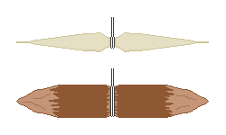

## 2. 绳与钩
&nbsp;&nbsp;&nbsp;渔网、鱼笼的绑扎、延绳钓等，渔具的几乎所有形态都从绳子开始。没有绳子，钓鱼就局限于徒手和鱼叉，所以在自然中做出绳子的能力，是整个捕鱼技术的瓶颈。

---
### 2-1. 纤维变成线的原理
&nbsp;&nbsp;&nbsp;植物茎中能用的是紧挨着树皮内侧的韧皮纤维。这是植物为了自己站立而造出的长纤维素束，所以单根虽细，但沿长度方向的拉力很强。但纤维短，末端光滑，直接接起来会滑脱。

- 搓捻靠摩擦解决这个问题。把两股各自朝同一方向搓捻，再把这两股朝反方向互相缠绕（反向加捻）。每股想要松开的力变成勒紧对方的力，绳子就能自己抓住自己。两个方向相同的话，绳子就直接散开。捻度增大纤维之间的法向压力，摩擦力也随之增大，纤维不会滑脱，而是分担受力。
- 捻度有最佳点。不足的话纤维会滑脱，过度的话纤维相对绳子的轴线变得倾斜，沿长度方向的力减小，绳子变僵硬，在绳结处断裂。
- 续入新纤维时，要错开，使两股的接头不出现在同一点。接头重叠的话，那个位置会成为整根绳子最弱的地方，而绳子总是在最弱的点断。

| 材料 | 采集部位 | 特点 |
| --- | --- | --- |
| 荨麻 | 茎的韧皮 | 细而坚韧，耐水性较好。秋天茎干枯之后最好 |
| 大麻 | 茎的韧皮 | 传统上最强的植物纤维之一。适合粗绳 |
| 葛藤 | 藤的外皮 | 可以得到很长的，适合当场做粗绳，但做细线显得粗糙 |
| 构树 | 枝皮 | 纤维长而强，纸和绳都能用 |
| 椴树、榆树 | 内皮 | 在水里泡几天，层就会分离，剥成条带状 |
| 椰子、棕榈 | 叶脉、果壳 | 在沿海和南方容易得到，耐海水 |
| 香蒲、莞草、灯芯草 | 整片叶子 | 撕细后搓捻，编鱼笼时够用 |

&nbsp;&nbsp;&nbsp;把树的内皮在水里泡几天，是为了让微生物分解粘住纤维的果胶（浸泡发酵）。泡太久，连纤维本身都会分解，一拉就啪地断掉。用指甲刮树皮，纤维能干净地分成一股一股，就够了。

---
### 2-2. 取自动物的绳子
&nbsp;&nbsp;&nbsp;动物性的绳子比植物性的强得多，但怕水。

- 筋：几乎是纯胶原纤维束，所以同样粗细下拉伸强度比植物纤维高几倍。湿着缠上去晾干，会收缩并紧紧勒住，非常适合固定箭头和杆。吸水会膨胀变软，所以不适合当鱼线。用于陷阱的绑扎处、钩的捆束、弓弦。
- 肠（肠子）：把内容物捋出、刮掉内侧黏膜后，搓捻晾干，耐水性强得多，而且近乎透明，可以当鱼线。
- 生皮条：把皮螺旋形剪开做成的条，粗而结实，但湿了会拉长，干了又会缩回去，钓鱼时不方便。

| 绳材料 | 大致相对强度 | 对水的抵抗 | 主要用途 |
| --- | :---: | :---: | --- |
| 筋 | 非常高 | 低 | 绑扎、弓弦、钩的捆束 |
| 肠 | 高 | 中等 | 鱼线、子线 |
| 大麻、荨麻 | 中等 | 中等 | 鱼线、渔网 |
| 树的内皮 | 中等 | 高 | 鱼笼、粗绳 |
| 葛藤、藤蔓 | 低 | 高 | 构筑物的绑扎、鱼梁 |
| 生皮条 | 高 | 低 | 水面以上的绑扎 |

&nbsp;&nbsp;&nbsp;按粗细分工。鱼直接咬的子线要细、不显眼，固定整个渔具的绳要粗、耐腐。想用一种绳子解决全部问题，总会在某一边失败。

---
### 2-3. 钩的形态
&nbsp;&nbsp;&nbsp;现代的弯钩以金属加工为前提。不能加工金属的话，就用咽钩（Gorge Hook）。

- 结构：两头尖的短棒，正中间系绳。
- 作用：顺着绳的方向藏在饵里，鱼吞下时，会以与绳平行的姿势通过喉咙。拉绳时，它以正中间系的绳为轴转动并横躺过来，两端卡在喉咙或胃壁上，拔不出来。
- 优点：受力方向与材料的长度方向一致，不易折断。弯钩的弯曲处会集中弯曲应力，用木头或骨头做的话会在那里折断，而咽钩只承受轴向压缩，同样的材料能承受大得多的力。
- 制作：把硬树枝或骨片削成2-5cm，两头削尖，在正中间刻一道浅槽系绳。几乎不需要工具和时间，所以可以在延绳钓上挂很多个。
- 缺点：要等鱼完全吞下之后再拉才能挂住。一咬钩就马上提竿的话会失败。

| 形态 | 材料 | 作用原理 | 优缺点 |
| --- | --- | --- | --- |
| 咽钩 | 木头、骨头、刺 | 吞下后横躺卡住 | 容易做且不易折断，但必须等到鱼吞下 |
| 刺钩 | 刺槐、山楂等的大刺 | 呈钩状扎进嘴里 | 适合就地使用，但弯曲部位较弱 |
| 骨钩 | 鸟骨、腿骨碎片 | 与弯钩相同 | 打磨修整耗时很长 |
| 组合钩 | 木柄 + 骨或刺尖 | 两种材料各取有利的方向 | 最结实，但绑扎一松就全部失去 |
| 贝壳 | 珍珠层厚的贝壳 | 反射光线，无需饵就能引诱 | 易折断，但没有饵时有用 |
| 铁丝、钉子 | 金属 | 弯折，甚至做出倒刺 | 最可靠，但灾难情况下数量有限 |

&nbsp;&nbsp;&nbsp;倒刺是在钩尖附近朝反方向做出的小突起，它防止的不是挂不上，而是脱落。刺入肉里时它与前进方向平行，阻力小，想要脱出时倒刺尖挂在肉上，阻力急剧增大。灾难情况下跑掉的鱼无法找回，所以倒刺的价值很大。倒刺做大了，第一次扎入所需的力也变大，根本挂不住，所以相对于钩的粗细要做得小。