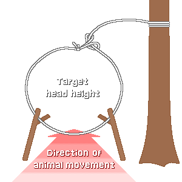
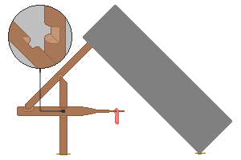

## 2. Классификация ловушек по принципу действия
&nbsp;&nbsp;&nbsp;Ловушки проще всего понять, если классифицировать их по тому, какую силу они накапливают и как высвобождают. Накапливаемых сил всего четыре — кинетическая энергия самого животного, сила тяжести, упругость дерева и рельеф, и любая ловушка использует одну из них или сочетание двух.

---
### 2-1. Классификация по источнику силы
| Категория | Источник силы | Типичные формы | Сложность изготовления |
| --- | --- | --- | :---: |
| Петля (силок) | Собственное движение животного вперёд | Петля на шею, петля на лапу | Очень просто |
| Пружинный силок | Упругая потенциальная энергия согнутого дерева | Пружинный силок | Средне |
| Давилка | Сила тяжести, тяжёлый камень или бревно | Четвёрка (figure-4), паюте | Трудно |
| Яма | Рельеф и сила тяжести | Ямы, ловушки-бочки | Очень большой объём труда |
| Ловушка-клетка | Необратимость конструкции | Ящичная ловушка, верша, ловушка на крабов | Средне |
| Сеть | Запутывание | Птичья сеть, накидная сеть | Требуется много нити |

---
### 2-2. Петли

&nbsp;&nbsp;&nbsp;Самая простая и самая распространённая ловушка. На конце нити делают петлю и предусматривают узел или фиксатор, чтобы петля могла уменьшаться только в одном направлении. Когда животное просовывает голову в петлю и продолжает двигаться вперёд, петля затягивается, а затянутая петля не увеличивается вновь, даже если животное отступит. Это односторонний преобразователь, превращающий кинетическую энергию движения животного вперёд в энергию затягивания.

- Важна конструкция, которая не откатывается назад. Петля, просто сделанная узлом, ослабевает, когда животное отступает, и оно вырывается, поэтому добавляют небольшое колечко или перекрут, играющие роль стопора.
- Проволока сохраняет изогнутую форму, поэтому эта проблема решается сама собой. Поэтому проволочные петли успешнее петель из растительного волокна.

| Элемент | Критерий | Причина |
| --- | --- | --- |
| Диаметр петли | Около 1,5 ширины головы целевого животного | Если мала, голова не пройдёт, если велика, пройдёт туловище |
| Высота петли | Для зайцев и кроликов 8-10 см над землёй | Соответствует высоте, на которой животное держит голову |
| Объект крепления | Живое дерево или глубоко вбитый кол | Если животное утащит, вернуть не удастся |
| Прочность нити | В несколько раз больше массы животного | Пойманное животное бьётся с силой, намного превышающей его вес |
| Опора петли | Держится на тонкой веточке или травинке | Если петля осела, она не сработает |

&nbsp;&nbsp;&nbsp;Выбор объекта крепления — частая причина неудач. Если привязать петлю к тонкой ветке, животное сломает ветку и утащит петлю целиком. Человек не получает ничего, а животное медленно умирает с нитью, обмотанной вокруг шеи. Закрепить петлю на толстом живом дереве или глубоко вбитом коле — минимальная ответственность того, кто ставит ловушку.

---
### 2-3. Пружинные силки и упругая энергия
&nbsp;&nbsp;&nbsp;Используется упругая потенциальная энергия, накопленная в согнутом молодом деревце или согнутой ветке. Дерево сгибают, как лук, фиксируют спусковым механизмом и присоединяют петлю. Когда животное попадает в петлю и задевает спусковой механизм, дерево выпрямляется и поднимает животное в воздух.

- Преимущество 1: животное не может упереться лапами в землю, поэтому не может, бьясь, порвать нить или вытащить фиксатор.
- Преимущество 2: поднятое животное трудно достать другим хищникам. Животное, попавшее в простую петлю, часто достаётся лисе или дикой кошке до прихода человека.
- Недостаток: если долго держать энергию в дереве, волокна подвергаются пластической деформации и теряют упругость. Пружинный силок, простоявший несколько дней, распрямляется с гораздо меньшей силой, чем вначале, и вероятность успеха падает. Замёрзшая зимой ветка почти полностью теряет упругость, а при оттаивании может даже сработать сама.

---
### 2-4. Давилки

&nbsp;&nbsp;&nbsp;Конструкция, в которой тяжёлый предмет косо подпирают, и он обрушивается, когда животное задевает подпорку. Суть в том, чтобы обрушивать большой вес очень малой силой, и для этого существует конструкция спускового механизма.

- Спусковой механизм в форме цифры 4: форма, где три палки — вертикальная, наклонная и приманочная — удерживают друг друга, и каждая точка контакта сцепляется только неглубокой выемкой. Большой вес, давящий сверху, меняет направление и делится, проходя через три палки, и на конце приманочной палки остаётся лишь очень малая горизонтальная сила. Когда животное задевает приманку и нарушает эту силу, контакты расцепляются, и всё сооружение мгновенно обрушивается. Как рычаг усиливает силу, так спусковой механизм усиливает чувствительность к силе.
- Способ паюте: наклонную и приманочную палки не сцепляют напрямую, а соединяют шнуром, чтобы приманочная палка выскакивала при гораздо более лёгком касании. Он чувствительнее механизма «четвёрка» и проще в изготовлении, но требует ещё одной детали.

| Показатель | Критерий | Причина |
| --- | --- | --- |
| Вес падающего предмета | Не менее чем в 5 раз больше массы целевого животного | Если не убить сразу, животное уйдёт или будет долго мучиться |
| Форма падающего предмета | Широкий плоский камень или бревно | Если круглый, он скатывается, промахивается и оставляет щель |
| Высота подпорки | Лишь настолько, чтобы целевое животное смогло зайти | Если высоко, животное пройдёт насквозь |
| Основание | Подложить плоский камень или бревно | На земляном основании животное, будучи придавлено, вроется и выживет |
| Обработка точек контакта | Неглубокие выемки, гладкие поверхности | Если выбрать глубоко, они плохо расцепляются и не сработают |

&nbsp;&nbsp;&nbsp;Соотношение весов в 5 раз и более — значение, от которого зависит, будет ли смерть мгновенной. Если вес недостаточен, животное лишь получит травму, уйдёт и медленно умрёт в другом месте. Это худший результат: человек не получает еды, а животное лишается жизни, поэтому экономить на весе невыгодно.

---
### 2-5. Ямы, птичьи ловушки, подводные ловушки
- Ловчая яма: принцип самый простой, но объём труда подавляющий. Калорий на рытьё ямы глубиной по пояс уходит больше, чем на изготовление нескольких десятков ловушек, и нужен способ замаскировать место раскопа. Рассматривайте её только тогда, когда подтверждена тропа, по которой обязательно ходят крупные животные, людей несколько и копать можно по частям в течение нескольких дней. Если поставить на дно заострённые колья, животное будет поймано наверняка, но для человека они так же смертельны.
- Птичьи ловушки: птицы не ходят по наземным тропам, а собираются у мест посадки и кормов. Если поставить сеть из тонкой нити между ветвями деревьев или у воды, летящие птицы не видят её, налетают и запутываются. Ячею делают такой, чтобы голова целевой птицы проходила. Если туго натянуть сеть, птица отскочит, поэтому её вешают слабо. Слабая сеть образует мешок и обхватывает птицу, когда та налетает.

| Ловушка | Цель | Принцип |
| --- | --- | --- |
| Птичья сеть | Мелкие птицы | Налетают на невидимую сеть и запутываются в свободной ячее |
| Ловушка с приманкой | Наземные птицы | Рассыпают зерно для приманки и обрушивают подпёртую корзину |
| Пучок петель на лапу | Околоводные птицы | Раскладывают много маленьких петель на мелководье, чтобы цеплялась лапа |
| Ловушка-бутылка | Грызуны | Падают в ёмкость со скользкими стенками и не могут выбраться |
| Ловушка на крабов, верша | Крабы, креветки, рыба | Зайдя через воронкообразный вход, кружат вдоль стенки и не выходят |
| Леска с приманкой | Крабы, раки | Приманку привязывают к нити, и они вытаскиваются, вцепившись и повиснув на ней |

&nbsp;&nbsp;&nbsp;Подводные ловушки имеют много преимуществ перед наземными. В воде запах человека рассеивается и разбавляется, поэтому вызывает меньше настороженности; пойманные особи находятся в воде, поэтому и летом портятся медленно; кроме того, в них попадают легко ловимые цели, такие как крабы и креветки. Когда условий для установки наземных ловушек нет, рассматривайте их в первую очередь.