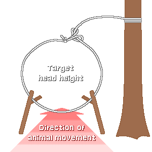
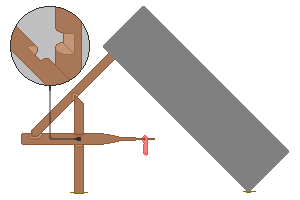

## 2. Classification of Traps by Principle
&nbsp;&nbsp;&nbsp;Traps are easiest to understand when classified by what force they store and how they release it. The forces stored are only four: the kinetic energy of the animal itself, gravity, the elasticity of wood, and terrain, and every trap is one of these or a combination of two.

---
### 2-1. Classification by Source of Force
| Category | Source of force | Representative forms | Difficulty of making |
| --- | --- | --- | :---: |
| Snare | The animal's own forward motion | Neck snare, foot snare | Very easy |
| Spring snare | Elastic potential energy of bent wood | Spring snare | Medium |
| Deadfall | Gravity, a heavy stone or log | Figure-4, Paiute | Hard |
| Pit | Terrain and gravity | Pits, barrel traps | Labor is very large |
| Cage trap | Irreversibility of the structure | Box trap, fish trap, crab trap | Medium |
| Net | Entanglement | Bird net, cast net | Needs a lot of line |

---
### 2-2. Snares

&nbsp;&nbsp;&nbsp;The simplest and most widely used trap. Make a loop at the end of a line and provide a knot or fitting so that the loop can get smaller only in one direction. When the animal puts its head through the loop and keeps advancing, the loop tightens, and a tightened loop does not enlarge again even if the animal backs up. It is a one-way conversion device that turns the animal's forward kinetic energy into tightening energy.

- A structure that does not go back is important. A loop simply made with a knot loosens when the animal backs up and lets it escape, so add a small ring or a twist that acts as a lock.
- Wire keeps its bent shape, so this problem is solved automatically. This is why wire snares have a higher success rate than plant-fiber snares.

| Element | Standard | Reason |
| --- | --- | --- |
| Loop diameter | About 1.5 times the head width of the target animal | If small the head does not go in, if large the body passes through |
| Loop height | For rabbits, 8-10 cm above the ground | Matches the height at which the animal holds its head |
| Anchor | A living tree or a deeply driven stake | If the animal drags it away, you cannot recover it |
| Line strength | Several times the animal's weight | A caught animal struggles with a force far greater than its weight |
| Loop support | Held up with a thin twig or grass stem | If the loop sags, it doesn't work |

&nbsp;&nbsp;&nbsp;Choosing the anchor is a common cause of failure. If you tie a snare to a thin branch, the animal breaks the branch and drags the snare away. The person gets nothing, and the animal slowly dies with a line wound around its neck. Anchoring to a thick living tree or a deeply driven stake is the minimum responsibility of the person setting the trap.

---
### 2-3. Spring Snares and Elastic Energy
&nbsp;&nbsp;&nbsp;This uses the elastic potential energy stored in a bent sapling or a bent branch. Bend the wood like a bow, fix it with a trigger, and connect a snare. When an animal is caught in the snare and trips the trigger, the wood straightens and lifts the animal into the air.

- Advantage 1: The animal cannot set its feet on the ground, so it cannot struggle to break the line or pull out the fixture.
- Advantage 2: An animal lifted up is hard for other predators to eat. An animal caught in a simple snare is commonly taken by a fox or a wildcat before the person arrives.
- Disadvantage: If energy is stored in the wood for a long time, the fibers undergo plastic deformation and lose elasticity. A spring snare left set for days straightens with far less force than at first, and the success rate falls. A branch frozen in winter loses nearly all its elasticity, and may even trigger by itself as it thaws.

---
### 2-4. Deadfalls

&nbsp;&nbsp;&nbsp;A structure in which a heavy object is propped at an angle and collapses when the animal touches the prop. The key is to make it possible to bring down a large weight with a very small force, and that is the reason the trigger structure exists.

- The figure-4 trigger: A form in which three sticks, a vertical stick, a diagonal stick, and a bait stick, hold each other, each contact meshing only by a shallow notch. The large weight pressing from above changes direction and is divided as it passes through the three sticks, leaving only a very small horizontal force at the end of the bait stick. When the animal touches the bait and disrupts that force, the contacts release and the whole thing collapses instantly. As a lever amplifies force, the trigger amplifies the sensitivity to force.
- The Paiute method: Instead of engaging the diagonal stick and the bait stick directly, they are connected with a cord so the bait stick comes out at a much lighter touch. It is more sensitive than the figure-4 trigger and easier to make, but needs one more part.

| Item | Standard | Reason |
| --- | --- | --- |
| Weight of the falling object | At least 5 times the target animal's weight | If it does not kill instantly, the animal gets away or suffers long |
| Shape of the falling object | A wide, flat stone or log | If round, it rolls and misses and leaves a gap |
| Height of the prop | Just enough for the target animal to get in | If high, the animal passes through |
| Floor | Lay a flat stone or log | On a dirt floor, the animal burrows while pressed and survives |
| Finishing of contacts | Shallow notches, smooth faces | If cut deep, it does not release easily and does not work |

&nbsp;&nbsp;&nbsp;A weight ratio of 5 times or more is the value that decides whether the kill is instant. If it is not heavy enough, the animal is only injured and gets away and slowly dies elsewhere. The person gets no food and the animal loses its life, the worst outcome, so saving on weight is no gain.

---
### 2-5. Pits, Bird Traps, and Underwater Traps
- Pit trap: The principle is the simplest but the labor is overwhelming. The calories of digging a waist-deep pit exceed those of making dozens of traps, and a way to hide the excavated spot is also needed. Consider it only when a passage that large animals must pass has been confirmed, there are several people, and the digging can be divided over several days. Setting sharpened stakes at the bottom catches animals for certain but is just as deadly to people.
- Bird traps: Birds do not follow ground passages but gather at landing points and food. If you stand a net woven of thin line between tree branches or at the water's edge, birds flying in do not see it, hit it, and get entangled. Make the mesh just big enough for the target bird's head to go through. If the net is stretched taut the bird bounces off, so hang it slack. A slack net forms a pocket and wraps the bird when it hits.

| Trap | Target | Principle |
| --- | --- | --- |
| Bird net | Small birds | Hit an invisible net and become entangled in the loose mesh |
| Bait trap | Ground-dwelling birds | Scatter grain to lure them and bring down a propped basket |
| Bundle of foot snares | Waterside birds | Lay many small snares in the shallows so a foot is caught |
| Bottle pit trap | Rodents | Fall into a container with slippery walls and cannot climb out |
| Crab trap, fish trap | Crabs, shrimp, fish | Once in through the funnel entrance, they circle along the wall and cannot get out |
| Baited line | Crabs, crayfish | Bait is tied to a line, and they are lifted out hanging on to it |

&nbsp;&nbsp;&nbsp;Underwater traps have many advantages over land traps. In water the human scent diffuses and dilutes, so it provokes less wariness; caught individuals are in the water, so they rot slowly even in summer; and easily caught targets such as crabs and shrimp come in as well. Consider them first when conditions do not allow land traps.