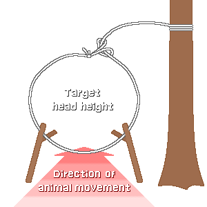
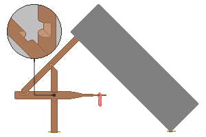

## 2. 罠の原理別の分類
&nbsp;&nbsp;&nbsp;罠は、どんな力をどう蓄えて放つかで分類すると理解しやすくなります。蓄える力は、動物自身の運動エネルギー、重力、木の弾性、地形の4つだけで、すべての罠は、このうちの1つか2つの組み合わせです。

---
### 2-1. 力の源で見る分類
| 分類 | 力の源 | 代表的な形 | 製作の難易度 |
| --- | --- | --- | :---: |
| くくり罠 | 動物自身の前進運動 | 首のくくり罠、足のくくり罠 | 非常に易しい |
| 跳ね上げ式のくくり罠 | 曲げた木の弾性位置エネルギー | スプリングスネア | 中程度 |
| 圧殺罠 | 重力、重い石や丸太 | 4の字(figure-4)、パイユート | 難しい |
| 落とし穴 | 地形と重力 | 穴、樽の罠 | 労働量が非常に大きい |
| 捕獲罠 | 構造の不可逆性 | 箱罠、筌、カニ罠 | 中程度 |
| 網 | 絡みつき | 鳥網、投網 | 糸がたくさん必要 |

---
### 2-2. くくり罠

&nbsp;&nbsp;&nbsp;最も単純で、広く使われている罠です。糸の先に輪をつくり、輪が一方向にだけ小さくなるよう、結び目や留め具を設けます。動物が輪に頭を入れて前進し続けると輪が締まり、締まった輪は、動物が後ずさりしても再び大きくなりません。動物の前進する運動エネルギーを締め付けるエネルギーに変える、一方向の変換装置です。

- 戻らない構造が重要です。ただ結び目でつくった輪は、動物が後ずさりするとゆるんで抜け出すので、締め止めの役目をする小さな輪やねじりを入れます。
- 針金は曲げた形を保つので、この問題が自動的に解決されます。針金のくくり罠の成功率が、植物繊維のくくり罠より高い理由です。

| 要素 | 基準 | 理由 |
| --- | --- | --- |
| 輪の直径 | 目標動物の頭の幅の1.5倍前後 | 小さいと頭が入らず、大きいと胴が通り抜ける |
| 輪の高さ | ウサギ類は地面から8-10cm | 動物が頭を上げる高さに合わせる |
| 固定する対象 | 生きている木や深く打ち込んだ杭 | 動物に引きずられると回収できない |
| 糸の強度 | 動物の体重の数倍 | 捕らえられた動物は体重よりはるかに大きな力で暴れる |
| 輪の支え | 細い枝や草の茎で立てておく | 輪が沈むと作動しない |

&nbsp;&nbsp;&nbsp;固定する対象の選択は、失敗のよくある原因です。くくり罠を細い枝に結ぶと、動物が枝を折って、罠ごと引きずっていきます。人は何も得られず、動物は首に糸を巻いたまま、ゆっくりと死にます。太くて生きている木や、深く打ち込んだ杭に固定することは、罠を仕掛ける人の最低限の責任です。

---
### 2-3. 跳ね上げ式のくくり罠と弾性エネルギー
&nbsp;&nbsp;&nbsp;しなった若木や、曲げた枝に蓄えた弾性位置エネルギーを利用します。木を弓のように曲げて引き金で固定し、くくり罠をつなぎます。動物がくくり罠にかかって引き金に触れると、木が伸びて、動物を宙に吊り上げます。

- 利点1: 動物が地面に足をつけられないので、暴れて糸を切ったり留め具を抜いたりすることができません。
- 利点2: 吊り上げられた動物は、ほかの捕食者が食べにくくなります。単純なくくり罠にかかった動物は、人が来る前にキツネや野良猫に奪われることがよくあります。
- 欠点: 木に長くエネルギーを蓄えておくと、繊維が塑性変形を起こして弾性を失います。数日仕掛けておいた跳ね上げ式のくくり罠は、最初よりはるかに弱い力で伸びて、成功率が下がります。冬に凍りついた枝は弾性がほとんどなくなり、解けるときにひとりでに作動することもあります。

---
### 2-4. 圧殺罠

&nbsp;&nbsp;&nbsp;重い物を斜めに支えておき、動物が支えに触れると崩れ落ちるようにした構造です。要点は、大きな重さを、ごく小さな力で崩せるようにすることで、これが引き金の構造が存在する理由です。

- 数字の4の形の引き金: 垂直の棒、斜めの棒、餌の棒の3本が互いをつかむ形で、各接点は浅い溝だけでかみ合います。上から押す大きな重さが、3本の棒を経て向きが変わり、分けられて、餌の棒の先にはごく小さな水平の力しか残りません。動物が餌に触れてその力を乱すと、接点がほどけて、全体が一瞬で崩れます。てこが力を増幅するように、引き金は力に対する敏感さを増幅します。
- パイユート方式: 斜めの棒と餌の棒を直接かみ合わせず、糸で連結して、餌の棒が、はるかに軽い接触でも外れるようにします。4の字の引き金より感度が高く、製作が易しいですが、部品がもう1つ必要です。

| 項目 | 基準 | 理由 |
| --- | --- | --- |
| 落下物の重さ | 目標動物の体重の5倍以上 | 即死させられないと、動物が逃げ出すか、長く苦しむ |
| 落下物の形 | 幅が広く平らな石や丸太 | 丸いと転がってそれ、隙間ができる |
| 支えの高さ | 目標動物がやっと入れる程度 | 高いと動物が通り抜けてしまう |
| 底面 | 平らな石や丸太を敷いておく | 土の地面だと、動物は押さえられたまま掘り進んで生き延びる |
| 接点の加工 | 浅い溝、滑らかな面 | 深く掘るとほどけにくく、作動しない |

&nbsp;&nbsp;&nbsp;重さの比の5倍以上は、即死かどうかが分かれる値です。十分に重くないと、動物は傷を負うだけで逃げ出し、別の場所でゆっくり死にます。人は食料を得られず、動物は命を失う、最悪の結果なので、重さを惜しむことは得になりません。

---
### 2-5. 落とし穴、鳥の罠、水中の罠
- 落とし穴: 原理は最も単純ですが、労働量が圧倒的です。腰の深さの穴を掘る熱量は、罠数十個をつくるより多く、掘った跡を隠す方法も必要です。大型動物が必ず通る通り道が確認され、人が複数いて、数日に分けて掘れる場合にだけ検討します。底に尖った杭を立てれば動物を確実に捕らえられますが、人にとっても同じく致命的です。
- 鳥の罠: 鳥は地上の通り道に沿って動かず、着地する地点と餌に集まります。細い糸で編んだ網を、木の枝の間や水辺に立てておくと、飛んできた鳥が見えずにぶつかって絡まります。網目は、目標とする鳥の頭が入る程度にします。網をぴんと張ると鳥がはね返されるので、ゆるく垂らします。ゆるい網は、鳥がぶつかったときに袋をつくって包み込みます。

| 罠 | 対象 | 原理 |
| --- | --- | --- |
| 鳥網 | 小型の鳥類 | 見えない網にぶつかり、ゆるい網目に絡まる |
| 餌の罠 | 地上性の鳥類 | 穀物をまいて誘い、支えておいたかごを崩す |
| 足のくくり罠の束 | 水辺の鳥類 | 小さなくくり罠をいくつも浅瀬に敷いて、足をかける |
| 瓶の落とし穴 | げっ歯類 | 滑りやすい壁の容器に落ちると上がってこられない |
| カニ罠、筌 | カニ、エビ、魚 | 漏斗の入口から入ると、壁に沿って回って出られない |
| 餌つきの釣り糸 | カニ、ザリガニ | 餌を糸に結んでおき、かみついてぶら下がったまま引き上げる |

&nbsp;&nbsp;&nbsp;水中の罠は、陸上の罠より有利な点が多くあります。水中では人のにおいが拡散・希釈されて警戒を引き起こしにくく、捕らえられた個体が水中にいるので夏でも腐敗が遅く、カニやエビのように捕らえやすい対象も一緒に入ってきます。陸上の罠を仕掛ける条件が整わないとき、最初に考えます。